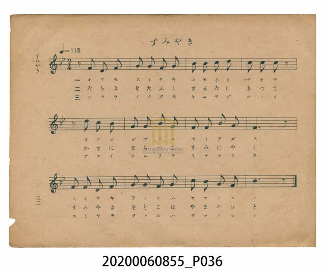
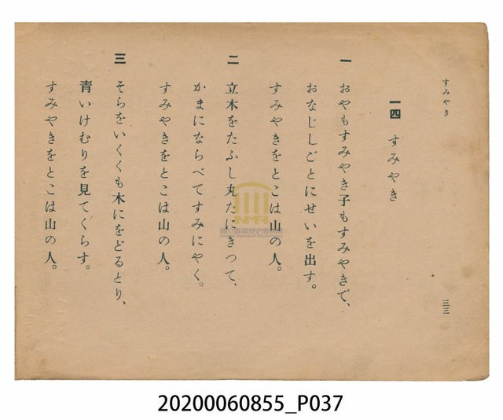

# すみやき（燒炭）

<audio controls src="sumiyaki.mp3"></audio>

- 日治時期公學校唱歌（第三學年・第十四課）
- 國立臺灣歷史博物館典藏

## 說明

【曲目說明】
・出處：臺灣總督府編《公學校唱歌》第三學年用，第十四課〈すみやき〉（燒炭），原書第 32–33 頁。
・調性與拍號：變ロ調（Bb 大調），2/4 拍，速度 != 112。
・背景與曲風：描寫深山裡的燒炭職人（すみやきをとこ）父子世代相傳、伐木截成圓木、排入炭窯燒炭，
伴著天上流雲、林間飛鳥與裊裊青煙度日的山林生活。旋律極具特色：第一、二行皆以「前半拍八分休止符」
弱起進入（`| 0 5_ 3_ 5_ |`、`| 0 3 2 1 |`），宛如山谷回音與揮斧伐木的呼吸律動；第三行副歌
「すみやきをとこは山の人」則轉為正拍強起，質樸而堅定。
・版本說明：本檔案為原書單聲部簡譜（數字譜）之忠實數位化版本。

・編曲說明（鋼琴伴奏版）：
1. 前奏 (Intro, 4 小節)：引用第三樂句正拍強起的「すみやきをとこは山の人」五聲音階主題，確立山林民謠風格。
2. 主歌伴奏 (Sumiyaki, 12 小節 × 3 段)：當右手 (PianoRH) 在第一、二行第 1 小節以後半拍弱起進入時，
左手 (PianoLH) 先一步在正拍敲響低音 `1_`，給予歌者清晰的拍點引導與穩健支撐。

## 跨冊／重複收錄參照

> 同曲（《公學校唱歌》與《新定兒童唱歌》第三學年共用教材）

- **[同曲]** 《新定兒童唱歌》尋常科第三學年用（2020.006.0847.0003）：[**〈炭やき（燒炭）〉**](../../../shintei_jido_shoka/grade_3_2020.006.0847.0003/3_04_sumiyaki/index.md)（`Bb` / `2/4` — [原始 TMD](../../../shintei_jido_shoka/grade_3_2020.006.0847.0003/3_04_sumiyaki/sumiyaki.tmd)）
- 總表：[跨冊重複與同名歌曲總索引](../../../duplicate_songs.md)

## 歌詞

```text
一　おやもすみやき子もすみやきで、
おなじしごとにせいを出す。
すみやきをとこは山の人。

二　立木をたふし丸たにきつて、
かまにならべてすみにやく。
すみやきをとこは山の人。

三　そらをいくくも木にをどるとり、
青いけむりを見てくらす。
すみやきをとこは山の人。
```

## ABC

```abc
X:1
T:すみやき（燒炭）
M:2/4
L:1/16
Q:1/4=112
K:Bb
V:V1 name="Piano" snm="Pia"
[V:V1]
z2 F2 D2 F2 | G2 G2 F2 G2 | B2 B2 c2 d2 | c2 c2 c2 z2 |
z2 d2 c2 B2 | G2 G2 B2 G2 | F2 F2 B2 G2 | F6 z2 |
F2 F2 D2 F2 | G2 G2 F2 G2 | c2 B2 G2 F2 | B6 z2 |
```

## TMD 檔案連結

- [主旋律 TMD 檔案](sumiyaki.tmd) [[在 TMD Studio 編輯](https://tmdlang.github.io/Tmd-TS/#tmd=s7IKdvYPcrWy4qpTUCpJTLdSSM7PyUlNLsnMz7PKzk9PzM7Ojy_OyM9OVIKrKMvPKc1NtUovSkxJjTdGiBfnlxYlp1oVJ2fk5-fEl6RWlCTl52cj5AuK8stS8xLzgGoKijLzSlJTwIoQClLLMlNSQdKpKZkl-UWZiTlIlqYWFYPcBLEkvqQoMa84uSizAORQhKqSjFSgy8rzi4DWamkpPG6c-bhx_-OmlseNve_3dDxvn_S8ae37PZ0KWlpcirYKhoZGXPa2Ck5JXDZG-iZ2IFOeTV_6bNPuZzObns2Z_7R1zdO1O54tWPh0ysZna3tABqxZ82RHJ1Dw6c4tj5t3A7lPexufzp79YtUmoKlgZzyd0_18dfeL9l3PGxc_W7v9af-mp72znneufLlkxdPWHS-m9ytxcelrKdhSC3ApKCg8bpjwbPam57PXvVi16tmMvscNE8Gizbuftu96MXPq-z2zIO55vmPv87mLn-6a83z7iscNXWj-e9zQjey_51NWvN_Tg-zFxw0dyAH6uKETOUyBip_2zX82ewdQi4Kx0aOGycbGCi8XND5uaIK65sWq_c8alr_oaH_W3fti5nyQs9Z1PW5eCxQHGuSUpPB0yXIwG2QWMEIUgOqArJcN85_uWqYAiS8k05p7ns1cDzJt9qaXi4BunfWsv__p-tXPtm98unHji8ULn89qgTjuReP2J7t2Aa1AcX3TpMeNKx43TgZa97xj29O1E57smPZk9-Lns3c8bdr8uKHxyZ4Jz-aseNax6lnHhKdzJgPZQMFnfZOeti4Fmvl81XqYz3tADlJQeLJny4uJ058uWflkR9ezrY0vZwPDq_HZvOkvp01-uXj2y81LgU59sbgLiF7OnfS8dSbQT8DEBnQk0LVAZc-nzH-2ZTfQe8-mdz_d1_1s6danrdufd-580QlMWrPAEdMActWunhcLe57Panuye-njhp6nnb1Pe7uA4fS0dfXTjrYneyY-W7vo-Zpljxt6Ia56umfji63bXzZsAjobGAIJNQoGCqbxCsbxILImAWgiWMhYwUjBEMiHxuO62U-XNYFCccP2p7PnvZy_GRTM_eueTVsOCRWQqyfueTphB9ClT7uBCWw2JOUAnfa0cz0wLUEsBzoQa5A_blwPNPxx4zpgtABd-rSz_cXezudNu56tXQzyyp7tQCcDnfFi86pnK3a8APpyQevTdbMQUf-8s-PZnDWQxA6K9zlrnq2a8mxhB9AISBJ8Om3di8ZNL5tXPN-w8MXaOUCPP5u64-na6WB255Od3U_3L3i6fhlQ8Mne3qc90yAGgiyAZieIMUCPvFg572nrimfT2oEh8GTHWhBj1bwXa9cD8xjQ1Kcbep-1dypk5iampxrpZRWkpivoKwQYGJsDbQEbBY60hseNXaAQaGpCDg1gikMTedy4HBgfYBcANTSuetw443Hj9MeNU8Chtvpx4-zHjUBTJgFzNUgbNDgIBzBYHdC1EJeDUlPHthfLgIEHTcLgzNHzdO1KUCbYOR9N_GXzXmC4gpL2hJ5nKxaDon770id757zYvPhp1-xnnZOfdYOiBqLl2Z5FQEOAJsCzIMQF8PDYBSxmGoAFJCg7gVw7_3HjVqAnn-zYAWYDPQkMhiWPG4EpGBoS3Y8b94ElVj1u6nzcuBMkB_EzUBDk7X5KQmJB75Md3cDsB83e4NwOjLRn67YCESTbA8Pg2dQtL_d2gTJ_x_SnwOQPzv8g_7VPAqoHZYimtcSHwY5OcJqYC_IPyJ1gPwBRE7DSAUc0SHDl4yagz4GB1AUNCWCpAVY68XFTA0i0adKLZUAVwMAA6gQGDCUJAlJ2PV-5C5jEXy5uednYB3Q1pBAD5XxwIfZi--YXu3qB4pDSDBQqwLoSiObMBuqFlGxPe9uBWRekBqmIIypggA6ivC6EAgUtfS6u4NLczMrE7EyrgMzEvHyHGoMahWpwqWRjoWUHZmCrhRUgBS2wHFPQMFF4uqH_-foGHUj-RsreZppYdAIthZoKNMAKFBFNq4CF1RIgXgTk1QD5O4Hs-RCxprVQsc1geZgcWAwq_7i5HVyKIhm8qwdscCPQkMaFQNwLNWQSVGwrEE-HiDXuA4p3Q8VXQ8V6gRhoeOMydIN3dEJcvBdo60og3gQ1GOSS9RAM9wXIZUCDgWoeN3dCXbwaiDuAeBWywah1jYJZPAgBmUCyBljbGALrHGMgywgMDRRqwLkDd7SAaz5qRUsXkN4B9dB2IN4C9UA3VGw3xPNgTzbAow8BsEQKKLCBgQ4PbKA1TZ1AGhiz4AAHic0E4v1gNcAMChXrx24sLEqAiQPkCqBrIK7YCOQvAAc1PJrAiaoNGk0rcbsWqaaHxoYhJDKAkQJECI4uEBKOEHB9T2mEYM0V4GAHRgc4d4DCB5ormucBcR8QT4KKdeCOEnhgAwMaNaesAOLJQLweKgaSB0XcOiCGhihQDc5IobqLYeGPPaOAogvCBWUaWMzUcnHp2inACjkQW5mLCwA)]
- [鋼琴伴奏 TMD 檔案](sumiyaki_piano.tmd) [[在 TMD Studio 編輯](https://tmdlang.github.io/Tmd-TS/#tmd=s7IKdvYPcrWy4tLSUnjcOPNx4_7HTS2PG3vf7-l43j7pedPax827X3bveT5hy5M9W54u7X_e2fF-T6eClhaXoq2CoaERl72tglMSl42RvokdV52C0rPpS59t2v1sZtOzOfOftq55unbHswULn07Z-GxtD8jINWue7OgECj7duQVoMJD7tLfx6ezZL1ZtApqqBDLg6Zzu56u7X7Tvet64-Nna7U_7Nz3tnfW8c-XLJSuetu54Mb1fiYtLX0vBllqAS0FB4XHDhGezNz2fve7FqlXPZvQ9bpgIFm3e_bR914uZU9_vmQVxz_Mde5_PXfx015zn21c8buhC89_jhm5k_z2fsuL9nh5kLz5u6EAO4scNnfBQBvoeqPhp3_xns3cAtSgYGz1qmGxsrPByQePjhiaoa16s2v-sYfmLjvZn3b0vZs4HOWtd1-PmtUBxoEFOSQpPlywHs0FmASNEAagOyHrZMP_prmUKkPhCMq2559nM9SDTZm96uQjo1lnP-vufrl_9bPvGpxs3Qpz1ZNeu5x3bnq6d8GTPhGdzgH5ufNq69Pmq9UDGszmzX0yc_nLupOetM0GGbG18CTRn8eyXm5cCbQMmg-ezWp6t2PF0_bKn3fOedk99PmX-sy27EdYDgxBoMSTAga7HTGNAB4GUKigY6ik87ewFiitoeOaVFOXrKJgoPN3Q_3x9gyZQzdM9QKNXQAL-2Yqmp_1Ln61dDPT40z3bX2zdDnTE44YelFBvmvS4ccXjxsmPG9cD_fm4cR3Qk48bep_smvKicdPL-Ztfzup7smP3y4XA9NrzfNEuYGIEKns2b_qzDRNfrFkADKlnC_ZAvaGgYKSnAFQMjHyIyxU0gktzMysTszN1FAyNoK5UODxdwVjh2bqtIOc-n7rtaf_mZ53dChoBmYl5-UEemgpP50Dc3wAM1ie7el4sBKUaBUOo9ie7lz7d1_O0twvsqY1AT71s2ASMBmAeA7oQ4gwgeLp9GcJUH5CprR1AI5-tXQo0HhIkz6YC_bf_yd4-oC8VEgzjE0A-3Lrsya4OoAdeNLQ-29H6bOYGULx1977cPQ8Ysk839AHj9vnKlU8blz6bsv7ZpAkgn0OzDCS1grSunPe0dcWzae1AtU92rAUxVs17sRaYSiYCY_bpht5n7Z0KmbmJ6alGelkFqekK-goBBsbmwDgGGwX2eMPjxi5QBDU1IUcWMOWhiTxuXA4MJbALgBoaVz1unPG4cfrjxingSF39uHH240agKZOAORekDZrcCMc_WB3QtRCXgyKqY9uLZcDEuR6eE0AZdO1KUGbYOR9N_GXz3udNu4D54emEnmcrFgOD8On2pU_2znmxefHTrtnPOic_654FtAOi5dmeRUBDgCYArX-xeCFQMcQF8PDYBSxKGoDpDpTjQK6d_7hxK9CTT3bsALOBngQGw5LHjcvgIdH9uHEfWGLV46bOx407QXIQPwMFQd7upyQkFvQ-2dENygHgEuBZx6pnHRNASWvdViB6OmcyUBwYBs-mbnm5t-tZ36SnHdNBKbppLbCgAPmvfRJQPVANqDIhOgx2dILTxFyQf0DuBPsBiJqAFQs4okGCKx83AX0ODKQuaEgAiyOw0omPmxpAok2TXiwDqgAGBlAnMGAoSRDAHA6M4OcrdwGT-MvFLS8b-0A5BVzsgcq_edNfTpv8YvvmF7t6geKQghAUKsD6EIjAheWLxV1A9LS3HVIwQcpOSGFJVMAAHUR5fQcFClr6FNajIOeglMuaVvCCWUEDWv1ogiMTWIKBi1B4loFVDEuetbeDvYgoe4FVxbOV859unPpyWjdlPgZ7EewyK2hR61BjUKNQDS4ybSy07MCMGgXTeBAyBpM1CmbxIARkAskaBSNgMQzh1gBZukBooFDDVYtirg8Ocw3jFaINY0F6QVSNggmQYRILEwbbG20KkQdScPUgDLWE4viB1E3AXIqomICxhKiZUKIJUi8ByzFIcwakd3r3033doHIPXLkApZ5t6gTWBi82rwLGIKiUA1ft8OqPCvEFcya-KMMWLAqQGhRYdypowFKhDqTSQapzzDSx6ARaCzUVaIAVqHRoWgVsoSwB4kXgiHzctBPIng8Ra1oLFdsMlofJgcWg8o-b28FVMpLBu3rABjcCDWlcCMS9UEMmQcW2AvF0iFjjPqB4N1R8NVSsF4iBhjcuQzd4RyfExXuBtq4E4k1Qg0EuWQ_BcF-AXAY0GKjmcXMn1MWrgbgDiFchG1wDTIA4s4QhEBoBGzSgzAGCoLSKP1rATRpqRUsXkN4B9dB2IN4C9UA3VGw3xPNgTzbAow8BsEQKKLCBgQ4PbKA1TZ1AGhiz4AAHic0E4v1gNcBaAyrWj91YWJQAEwfIFUDXQFyxEchfAA5qeDSBE1UbNJpW4nYtKEKMwYURLDbAxRKs7EJwYCUUgXzSSYUIwZorwMEOjA5w7gCFDzRXNM8D4j4gngQV68AdJfDABgY0ak5ZAcSTgXg9VAwkD4q4dUAMDVGgGpyRQnUXk1l3oJZx2KsPYss4PBFFuAaCMoCOjDbLRa2SSM7V5DgESlHoELTUTFGIEK6Tde0UwHW_ApABi0h8bGUuLgA)]

## 分析

```text
================================================================================
📊 TMD Song Profile: [ すみやき（燒炭） ]
================================================================================
⏱  Duration:       0:12 (12.9s), 12 measures total
🎼 Key & Tempo:    首調基準 B,, != 112.0 BPM, <2/4>
   - 分析範圍：      由實際發聲的音符與和弦推測調性；播放脈絡另行呈現
🎤 人聲音域:    D4 (MIDI 62) – D5 (MIDI 74) [跨度: 12 個半音 / 1.0 個八度, 難度: easy]
   - 最低音:  D4 in [Sumiyaki #1 @ m.1, 0:00]
   - 最高音: D5 in [Sumiyaki #1 @ m.3, 0:02]
   - 適合: soprano, mezzo-soprano, contralto, tenor, baritone, bass
🏛  結構:      Sumiyaki (12.9s)
⚡ 編曲密度:        Peak 1 軌道同時演奏
🗝  調性診斷：       F 調性不明確（純淨自然大調，未偵測到可信轉調）
   - 風格氣質:    純淨自然大調（陽光明朗、易唱易記，無明顯調外色彩）
   - 轉調歷程:    全曲維持單一推測調性（未偵測到可信轉調）
   - 核心骨幹音:  F, G, A#, C, D
   - 調性數值:    F 調性不明確 [相關度: 0.75, 穩定度: Ambiguous, 自然音純度: 100.0%]
   - 候選調性 (K-S): F 大調 (0.75), A# 大調 (0.75), G 小調 (0.64)
   - 五度圈歷程:   -1
   - 各段落調性細節:
     • [Sumiyaki #1]: F 調性不明確 (r: 0.75, 自然音純度: 100.0%)

  [ 五度圈游移軌跡 ]
               C  
        [F ]*          G  
      Bb               D  
      Eb               A  
         Ab           E  
            Db       B  
               F# 
     (* = active key center)

  [ 十二半音累積音高分佈 ]
     C  : ███████████               14.0%
     C# :                            0.0%
     D  : ███████                    9.3%
     D# :                            0.0%
     E  :                            0.0%
     F  : ████████████████████████  30.2%
     F# :                            0.0%
     G  : ████████████████████      25.6%
     G# :                            0.0%
     A  :                            0.0%
     A# : █████████████████         20.9%
     B  :                            0.0%
--------------------------------------------------------------------------------
Assignment 軌道音域：
  - Piano         : D4 – D5 (12 個半音 / 1.0 個八度, 39 個音符)
================================================================================
```


## 原書掃描頁






