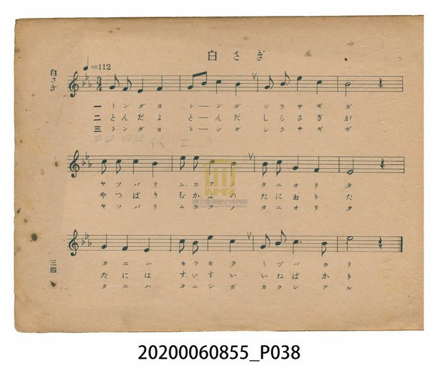
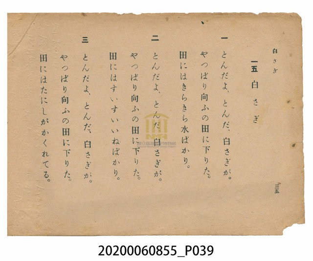

# 白さぎ（白鷺鷥）

> Re:Shōka 使用 AI 協助辨識與重建樂譜，可能會有錯誤。歡迎回報。

- **NEUTRINO 歌聲合成版**：<br><audio controls src="shirasagi_neutrino.mp3"></audio>
- **鋼琴伴奏版**：<br><audio controls src="shirasagi.mp3"></audio>


- 岡田與志松 作詞（懸賞募集入選原題〈飛んだ白さぎ〉）
- 日治時期公學校唱歌（第三學年・第十五課）
- 國立臺灣歷史博物館典藏

## 說明


- 出處：臺灣總督府編《公學校唱歌》第三學年用，第十五課〈白さぎ〉（白鷺鷥），原書第 34–35 頁。

- 調性與拍號：變ホ調（Eb 大調），3/4 拍，速度 != 112。

- 背景與曲風：三年級全冊壓軸曲目，亦是唯一一首全曲採用 3/4 拍（三拍子）的歌曲。歌詞描寫臺灣農村

最常見的「白鷺鷥（白さぎ）」展翅飛起，最終還是降落在對面的水田裡；三段歌詞依季節變化描繪水田景致：
第一段插秧前「田裡波光粼粼盡是春水（田にはきらきら水ばかり）」，第二段秧苗長高「田裡盡是修長翠綠的稻苗
（田にはすいすいいねばかり）」，第三段「田裡躲藏著田螺（田にはたにしがかくれてる）」。
優美的三拍子旋律猶如白鷺鷥御風滑翔的曼妙姿態。
- 版本說明：本檔案為原書單聲部簡譜（數字譜）之忠實數位化版本。


### 編曲說明（鋼琴伴奏版）：

1. 前奏 (Intro, 4 小節)：引用第三樂句「田にはきらきら水ばかり」之圓舞曲旋律，描繪白鷺鷥展翅滑翔的輕盈姿態。
2. 主歌伴奏 (Shirasagi, 12 小節 × 3 段)：右手 (PianoRH) 演奏三拍子主旋律；
左手 (PianoLH) 採用典型圓舞曲伴奏音型（`1_ - [1] - [1] -`），營造水波盪漾與振翅飛翔的優雅韻律。


## 歌詞

```text
一　とんだよ、とんだ、白さぎが。
やつぱり向ふの田に下りた。
田にはきらきら水ばかり。

二　とんだよ、とんだ、白さぎが。
やつぱり向ふの田に下りた。
田にはすいすいいねばかり。

三　とんだよ、とんだ、白さぎが。
やつぱり向ふの田に下りた。
田にはたにしがかくれてる。
```

## ABC

```abc
X:1
T:白さぎ（白鷺鷥）
M:3/4
L:1/16
Q:1/4=112
K:Eb
V:V1 name="Piano" snm="Pia"
[V:V1]
G2 F2 E4 F4 | G2 B2 c4 B4 | G2 B2 e4 c4 | B8 z4 |
w: 1.~ト ン ダ ヨ | ト _ ン ダ | シ ラ サ ギ | ガ
w: 2.~と ん だ よ | と _ ん だ | し ら さ ぎ | が
w: 3.~ト ン ダ ヨ | ト _ ン ダ | シ ラ サ ギ | ガ
c2 c2 c4 B4 | e2 e2 c4 c4 | B2 c2 G4 F4 | E8 z4 |
w: 1.~ヤ ツ パ リ | ム カ フ ノ | タ ニ オ リ | タ
w: 2.~や つ ぱ り | む か ふ の | た に お り | た
w: 3.~ヤ ツ パ リ | ム カ フ ノ | タ ニ オ リ | タ
G4 F4 E4 | c2 B2 e4 c4 | G2 B2 c6 B2 | e8 z4 |
w: 1.~タ ニ ハ | キ ラ キ ラ | ミ ヅ バ カ | リ
w: 2.~た に は | す い す い | い ね ば か | り
w: 3.~タ ニ ハ | タ ニ シ ガ | カ ク レ テ | ル
```

## TMD 檔案連結

- [主旋律 TMD 檔案](shirasagi.tmd) [[在 TMD Studio 編輯](https://tmdlang.github.io/Tmd-TS/#tmd=s7IKdvYPcrWy4qpTUCpJTLdSSM7PyUlNLsnMz7PKzk9PzM7Ojy_OyM9OVIKrKMvPKc1NtUovSkxJjTdGiBfnlxYlp1oVJ2fk5-fEl6RWlCTl52cj5AuK8stS8xLzgGoKijLzSlJTwIoQClLLMlNSQdKpKZkl-UWZiTlIlqYWFYPcBLEkvqQoMa84uSizAORQhKqSjFSgyxLzMnNBerW0FJ7P3Pu4cerjxr73ezqA7Jfbd73cvvT9nk4FLS0uRVsFQ0MjLntbBdckLhtjfRM7kDlPNy18PmXDi472p_unP5u7T-HJ3jkvVs4Dan_WvuPF5nlPu-e_nN32tHXpy8YdT_vmv1zY87ih4-Xi2Y-bJj9uXAC37nFDJ9AWsMOeTV_6bNPuZzObns2Z_7R1zdO1O54tWPh0ysZna3tAjlqz5smOTqDg051bHjfvBnKf9jY-2TXlxapNMAOezul-vrr7Rfuu542Ln63d_rR_09PeWc87V75csuJp644X0_uVuLj0tRRsqQW4FBQUHjdMeDZ70_PZ616sWvVsBtA7E8Gizbuftu96MXPq-z2zIO55vmPv87mLn-6a83z7iscNXWj-e9zQjey_51NWvN_Tg-xFYNihBhlKJAEVA4P42ewdQC0KxiaPGiYbmyq8XND4uKEJ6poXq_Y_a1gOjKxn3b0vZs4HOWtd1-Pm2UBxoFmuSQpPlywHs0FmAWNYAagOyHrZMP_prmUKkASAZFpzz7OZ60Gmzd70chHQrbNATge6e8usp60rnrZ1PV08-cXuHZCAARrzZNeyZzPWP52y_smOBiB6uWwaUBlQ9lkfMAmtUIDb1wE0Bsh4unYC0CHPZ7UAQwaoCmgvkAFMW8_6-5-uXw0Jzxf7Nj2bCw5rBYVncxqe7tjxYlk3UMvjhh6kkEEEGtDAxw29TzdOfb6_FZgKX2zdDnQXUOPzrU0vm1qArns5s_fFhL1P56x4uqH35dxFINs3ACNiw4vFC9_vmQ1y2LqtEGc82Tf36drFz9c3AIPwac80oKue71wFUQwKlfYtwPCAOAwcpw0gjf2Tni9f_rSzF-Q8sJnPNi962tr5fNMeEJq9EOiAZzOWAg0BuXnKhseNqx83rn_c2Pu4qRNCAqUeNwLFux83dUH8AkkhT3b1AM0HGv6ie_rLqdtfrp4BtwJi7JP964Diz_cveL5tAdBTz1fsBqqEOA_VrpmPG1tgJBCtxW4dOBzgVrzYtQmYrV5MnA7iztuFauB8MGP648YekDmN_Y-bgIxlj5u6IQZCk5OCwtOWVc_39QHdBo_9Z9O7n-7rft6z7emyJnhsPt23EJjWnu2e-Hz_FFDszN7zdNnMp8v3P2vtRqTM550dz-asgeRFYDQA2c9WTXm2sON50y5IDnk6bd2Lxk0vm1c837Dwxdo5oOJq6o6na6eD2Z1PdnY_3b_g6fplQMEne3uBsQsxEGQBNLdDjIGkBFAqntYOzAdPdqwFMVbNe7F2PbAIAJoKTEXP2jsVgOVreqqRXlZBarqCvkKAgbEl0BawUcCE8bih4XHjCkiB-Lip43FDI4Lb0IjI78AAhHqwCRgxSx43bgTGytMJEx83bn3cuA4S4k92gKIKFOgQpQQTEVQd0KkQZwNDC5IvnuxrezobGEGNcO6TXW2g2IdFBCg_zpvzvGUbwYwDUgljP9m17tnMbUD0dM4GYLi9bN4LSvNABzU0wYNkF9CjdAkSnGmd3qECzJTPNu0EIpRQ6doLzMfwzIocQjuATqBLCOHMvPQOoWdrF6OVMk8nLoIGCdAdlNfiUKCgpc_FFZyRWZRYnJieaRWQmZiX71BjUFMNLqRsLLTswAxs7QdoOf9iYY-ChonC0w39wLpBB5L1kXK-hSYWnUBLQabWKBgrGCkYKugCSV0wz1TBDMgyhfMM44BMkFANWBAEDUA8sHYfwxpg4dcBxJuBuAEo_rh5BVgtSBTE2wwmQTJAsabtQPZKIL0VJNq0Diq6BtNcI6B44wqg3GQgvQCsGmQeRBTEmwwiwTIgselAkU4gPRUs2gcV7cE015j67sUfO7t6KIodMzCExQcwLoAIxIdFiBkwjmBxB4pFbNGzBIhbgHgi2GuroN5dAPTIaiANDrJmaJA17Qeyu4E0SBVcLVAUawQ1AU1tBJreuBEcPF1Q1Q1AEaAZjeBAa4QGWuN8IAba1whSBVcLFMUeRdR2M4Es1ElhFoJEASgCQFGGkmlgOQoUh-AYxBpJYOeCvAEi-6FeWAtNfWvBoiuhgQAMyOZWIJ4ANgcUICBRkLex5SFQAIMCHkSuhwb6TCAGRd1MsGgLVBQkArSxcQPEXGAUgtwAiigsEYTVvbCI2A52FyiXgESBEda0HigDyTWPm9vA7gW5CGFuLReXrp0CvBAE2wMUUOYCAA)]
- [鋼琴伴奏 TMD 檔案](shirasagi_piano.tmd) [[在 TMD Studio 編輯](https://tmdlang.github.io/Tmd-TS/#tmd=s7IKdvYPcrWy4tLSUng-c-_jxqmPG_ve7-kAsl9u3_Vy-9LHzbtfdu95PmHLkz1bni7tf97Z8X5Pp4KWFpeirYKhoRGXva2CaxKXjbG-iR1XnYLSs-lLn23a_Wxm07M585-2rnm6dsezBQufTtn4bG0PyNQ1a57s6AQKPt25BWgwkPu0t_HJrikvVm0CmqoEMuDpnO7nq7tftO963rj42drtT_s3Pe2d9bxz5cslK5627ngxvV-Ji0tfS8GWWoBLQUHhccOEZ7M3PZ-97sWqVc9m9D1umAgWbd79tH3Xi5lT3--ZBXHP8x17n89d_HTXnOfbVzxu6ELz3-OGbmT_PZ-y4v2eHmQvPm4ABSskiB83dCKHMtD3QMVP--Y_m70DqEXB2ORRw2RjU4WXCxofNzRBXfNi1f5nDctfdLQ_6-59MXM-yFnruh43zwaKA81yTVJ4umQ5mA0yCxghCkB1QNbLhvlPdy1TgMQXkmnNPc9mrgeZNnvTy0VAt8561t__dP1qaNBvAHpgw8tpk-FOfL5_JRC92Lr95eLZjxsaX87sfTFh77Npe55tXvS0tfP5pj1ABNH1fFbL05ZVz_f1AcMC6ISnaycAQwdoC8JuYPgB-ZDQBjodM4EBXQNSqqBgqKfwtLMXKK6g4ZlXUpSvo2Ci8HRD__P1DZpANU_3TAUGMyTUn61oetq_9HFDD9AFjxtXP25c_7ix93FTJ4QEuuxxI1C8-3FT1-OG3ic7u5_OmfyiYx7QGc-mdz_d1w0MKKD_n-9cBffw041Tn-9vfbZ74vP9U4BeegG0a3bH0-X7n7V2Q32ioGCkp_Bkx26g9yCOV9AIzsgsSixOTM_UUTA0grpU4fB0BWOFZ-u2gp3cv_lZZ7eCRkBmYl5-kIemwrM9U4A64UEFMg7qoNkQO4Dg6fZlCE0-IE19C4EeB2aIp_MQHoG44eX8zUBBYKgmGMYr6CpEG8bCyARIynjePv9lwwJggABj7vnsVc_27AMlgp71QM8CoxbiWWD8vZzd-nL-bqBDQJ6F5hJIAgV698XKeU9bVzyb1g7U-mTHWhBj1bwXa9cDsw7Q5qcbep-1dypk5iampxrpZRWkpivoKwQYGFsCHQA26smOhscNDY8bVzxumvy4ccHjpg5gikJwGxoR-aQRmK8gyaap5XHjkseNG4Ex-HTCxMeNWx83roPE9ZMd4GhtnA9VSkQKAKsDOhXibGC8AL0OTNtP9rU9nd0JSt4w7pNdbaAwgxeHDU3P5s153rLtZVPLsxnrIbng6ZwVQC-_nLsIGHKQLPBi8UKQShj7ya51z2ZuA6KnczYAw-1l816gXpCDGprgQbIL6FG6BMnMx41AbRASiNYOWKg837bg2aadQIQSKl17X66eAdTyfMXuF93TkUNoB9AJdAmh-WDGdJAxwIBp7H_cBGQse9wEy_d0C6Fnaxe_2LUJWOm9mDgdJDJv19OJi6BBAnQH5bUfFCho6VNYq4Kcg1JQa1rBS2oFDWhlpAlShbWUhVQukMADhiKkrEWrYhCVC6zAAxZOT7unUhYSYK-DXWwFLZIdagxqqsFFr42Flh2YUQMsv3UVjIDYEIhrFMwUTBUM44BMMzDXGMgFsXSBdA1EAgQNQJJctSjG-2A3Hr2oBgqZgIVMwEJgskbBFCxkChYCkyga4dZRHJGQKg1YYSHVZ8D4RFRoKBEKqdGeN-2CNIOQKrAeSL0FkgLXJ8-2Nj6bBUrs8NoOre6iQlTCHYwnOrEFkAK4FdHwYmGPggYs4epAqjCkGsxCE4tOoLWwRGIETiCghIJIFaZwHlKSAQki0ghIu49hDbBp1AHEm4G4ASj-uHkFWC1IFMTbDCZBMkCxpu1A9kogvRUk2rQOKroG01wjoHjjCqDcZCC9AKwaZB5EFMSbDCLBMiCx6UCRTiA9FSzaBxXtwTTXmPruxR87u3ooih0zMITFBzAugAjEh0WIGTyTA2VxRM8SIG4B4olgr62CencB0COrgTQ4yJqhQda0H8juBtIgVXC1QFGsEdQENLURaHrjRnDwdEFVNwBFgGY0ggOtERpojfOBGGhfI0gVXC1QFHsUUdvNBLJQJ4VZiNxyFh5JYOeCvAEi-6FeWAtNfWvBoiuhgQAMyOZWIJ4ANgcUICBRkLex5SFQAIMCHkSuhwb6TCAGRd1MsGgLVBQkArSxcQPEXGAUgtwAiigsEYTVvbCI2A52FyiXgESBEda0HigDyTWPm9vA7gW5CKW-QSsDsdY5xJaBeGMLS7UFEYJUW1AhM7CQWS6OqoyMrI_XUcgVJ-66FNnpuOpSklI6qQFFfv2ua6cAblGAzQZy4NEd7WMYi0XQCJugMVxQmQsA)]

## 分析

```text
================================================================================
📊 TMD Song Profile: [ 白さぎ（白鷺鷥） ]
================================================================================
⏱  Duration:       0:19 (19.3s), 12 measures total
🎼 Key & Tempo:    首調基準 E,, != 112.0 BPM, <3/4>
   - 分析範圍：      由實際發聲的音符與和弦推測調性；播放脈絡另行呈現
🎤 人聲音域:    D#4 (MIDI 63) – D#5 (MIDI 75) [跨度: 12 個半音 / 1.0 個八度, 難度: easy]
   - 最低音:  D#4 in [Shirasagi #1 @ m.1, 0:00]
   - 最高音: D#5 in [Shirasagi #1 @ m.3, 0:03]
   - 適合: soprano, mezzo-soprano, contralto, tenor, baritone, bass
🏛  結構:      Shirasagi (19.3s)
⚡ 編曲密度:        Peak 1 軌道同時演奏
🗝  調性診斷：       C 小調（純淨自然小調，未偵測到可信轉調）
   - 風格氣質:    純淨自然小調（陰鬱抒情、旋律集中，無明顯調外色彩）
   - 轉調歷程:    全曲維持單一推測調性（未偵測到可信轉調）
   - 核心骨幹音:  C, D#, A#, G, F
   - 調性數值:    C 小調 [相關度: 0.81, 穩定度: Moderate, 自然音純度: 100.0%]
   - 候選調性 (K-S): C 小調 (0.81), D# 大調 (0.78), A# 大調 (0.59)
   - 五度圈歷程:   +0
   - 各段落調性細節:
     • [Shirasagi #1]: C 小調 (r: 0.81, 自然音純度: 100.0%)

  [ 五度圈游移軌跡 ]
              [C ]*
         F            G  
      Bb               D  
      Eb               A  
         Ab           E  
            Db       B  
               F# 
     (* = active key center)

  [ 十二半音累積音高分佈 ]
     C  : ████████████████████████  28.8%
     C# :                            0.0%
     D  :                            0.0%
     D# : ███████████████████████   27.3%
     E  :                            0.0%
     F  : █████████                 10.6%
     F# :                            0.0%
     G  : ██████████                12.1%
     G# :                            0.0%
     A  :                            0.0%
     A# : ██████████████████        21.2%
     B  :                            0.0%
--------------------------------------------------------------------------------
Assignment 軌道音域：
  - Piano         : D#4 – D#5 (12 個半音 / 1.0 個八度, 38 個音符)
================================================================================
```


## 原書掃描頁






