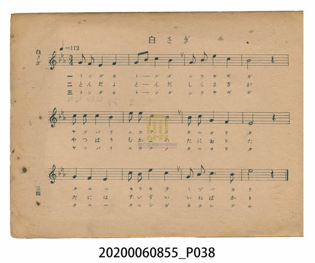
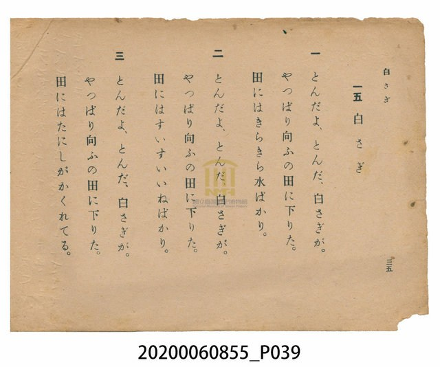

# 白さぎ（白鷺鷥）

> Re:Shōka 使用 AI 協助辨識與重建樂譜，可能會有錯誤。歡迎回報。

- **鋼琴伴奏版**：<br><audio controls src="shirasagi.mp3"></audio>
- **NEUTRINO 歌聲合成版**：<br><audio controls src="shirasagi_neutrino.mp3"></audio>

- 岡田與志松 作詞（懸賞募集入選原題〈飛んだ白さぎ〉）
- 日治時期公學校唱歌（第三學年・第十五課）
- 國立臺灣歷史博物館典藏

## 說明


- 出處：臺灣總督府編《公學校唱歌》第三學年用，第十五課〈白さぎ〉（白鷺鷥），原書第 34–35 頁。
- 調性與拍號：變ホ調（Eb 大調），3/4 拍，速度 != 112。
- 背景與曲風：三年級全冊壓軸曲目，亦是唯一一首全曲採用 3/4 拍（三拍子）的歌曲。歌詞描寫臺灣農村
最常見的「白鷺鷥（白さぎ）」展翅飛起，最終還是降落在對面的水田裡；三段歌詞依季節變化描繪水田景致：
第一段插秧前「田裡波光粼粼盡是春水（田にはきらきら水ばかり）」，第二段秧苗長高「田裡盡是修長翠綠的稻苗
（田にはすいすいいねばかり）」，第三段「田裡躲藏著田螺（田にはたにしがかくれてる）」。
優美的三拍子旋律猶如白鷺鷥御風滑翔的曼妙姿態。
- 版本說明：本檔案為原書單聲部簡譜（數字譜）之忠實數位化版本。

### 編曲說明（鋼琴伴奏版）：

1. 前奏 (Intro, 4 小節)：引用第三樂句「田にはきらきら水ばかり」之圓舞曲旋律，描繪白鷺鷥展翅滑翔的輕盈姿態。
2. 主歌伴奏 (Shirasagi, 12 小節 × 3 段)：右手 (PianoRH) 演奏三拍子主旋律；
左手 (PianoLH) 採用典型圓舞曲伴奏音型（`1_ - [1] - [1] -`），營造水波盪漾與振翅飛翔的優雅韻律。


## 歌詞

```text
一　とんだよ、とんだ、白さぎが。
やつぱり向ふの田に下りた。
田にはきらきら水ばかり。

二　とんだよ、とんだ、白さぎが。
やつぱり向ふの田に下りた。
田にはすいすいいねばかり。

三　とんだよ、とんだ、白さぎが。
やつぱり向ふの田に下りた。
田にはたにしがかくれてる。
```

## ABC

<div class="abc-score" data-abc-src="shirasagi.abc" aria-label="五線譜載入中"></div>

[下載 ABC 原始檔](shirasagi.abc)

## TMD 檔案連結

- [主旋律 TMD 檔案](shirasagi.tmd) [[在 TMD Studio 編輯](https://tmdlang.github.io/Tmd-TS/#tmd=s7IKdvYPcrWy4qpTUCpJTLdSSM7PyUlNLsnMz7PKzk9PzM7Ojy_OyM9OVIKrKMvPKc1NtUovSkxJjTdGiBfnlxYlp1oVJ2fk5-fEl6RWlCTl52cj5AuK8stS8xLzgGoKijLzSlJTwIoQClLLMlNSQdKpKZkl-UWZiTlIlqYWFYPcBLEkvqQoMa84uSizAORQhKqSjFSgyxLzMnOR9QKNSs_MsypJzCxPzIvPT0vLTEYxG1U-OR_otOKSeENLYyTP5ReVZOQDvVyQUWmVkVkMcl5yYk58dmIeUshAHVeQmJ5qFWBgbKHEpaWl8Hzm3seNUx839r3f0wFkv9y-6-X2pe_3dCpoaXEp2ioYGhpx2dsquCZx2Rjrm9iBzHq6aeHzKRtedLQ_3T_92dx9Ck_2znmxch5Q-7P2HS82z3vaPf_l7LanrUtfNu542jf_5cKexw0dLxfPftw0-XHjArh1jxs6gbaAHfds-tJnm3Y_m9n0bM78p61rnq7d8WzBwqdTNj5b2wNy1Jo1T3Z0AgWf7tzyuHk3kPu0t_HJrikvVm2CGfB0Tvfz1d0v2nc9b1z8bO32p_2bnvbOet658uWSFU9bd7yY3q_ExaWvpWBLLcCloKDwuGHCs9mbns9e92LVqmczgN6ZCBZt3v20fdeLmVPf75kFcc_zHXufz138dNec59tXPG7oQvPf44ZuZP89n7Li_Z4eZC8Cww41yFAiCagYGMTPZu8AalEwNnnUMNnYVOHlgsbHDU1Q17xYtf9Zw3JgZD3r7n0xcz7IWeu6HjfPBooDzXJNUni6ZDmYDTILGMMKQHVA1suG-U93LVOAJAAk05p7ns1cDzJt9qaXi4BunQVyOtDdW2Y9bV3xtK3r6eLJL3bvgAQM0Jgnu5Y9m7H-6ZT1T3Y0ANHLZdOAyoCyz_qASWiFAty-DqAxQMbTtROADnk-qwUYMkBVQHuBDGDaetbf_3T9akh4vti36dlccFgrKDyb0_B0x44Xy7qBWh439CCFDCLQgAY-buh9unHq8_2twFT4Yut2oLuAGp9vbXrZ1AJ03cuZvS8m7H06Z8XTDb0v5y4C2b4BGBEbXixe-H7PbJDD1m2FOOPJvrlP1y5-vr4BGIRPe6YBXfV85yqIYlCotG8BhgfEYeA4bQBp7J_0fPnyp529IOeBzXy2edHT1s7nm_aA0OyFQAc8m7EUaAjIzVM2PG5c_bhx_ePG3sdNnRASKPW4ESje_bipC-IXSAp5sqsHaD7Q8Bfd019O3f5y9Qy4FRBjn-xfBxR_vn_B820LgJ56vmI3UCXEeah2zXzc2AIjgWgtduvA4QC34sWuTcBs9WLidBB33i5UA-eDGdMfN_aAzGnsf9wEZCx73NQNMRCanBQUnraser6vD-g2eOw_m979dF_3855tT5c1wWPz6b6FwLT2bPfE5_ungGJn9p6ny2Y-Xb7_WWs3ImU-7-x4NmcNJC8CowHIfrZqyrOFHc-bdkFyyNNp6140bnrZvOL5hoUv1s4BFVdTdzxdOx3M7nyys_vp_gVP1y8DCj7Z2wuMXYiBIAuguR1iDCQlgFLxtHZgPniyYy2IsWrei7XrgUUA0FRgKnrW3qkALOLTU430sgpS0xX0FYClrSXQFrBRwITxuKHhceMKSIH4uKnjcUMjgtvQiMjvwACEerAJGDFLHjduBMbK0wkTHzdufdy4DhLiT3aAogoU6BClBBMRVB3QqRBnA0MLki-e7Gt7OhsYQY1w7pNdbaDYh0UEKD_Om_O8ZRvBjANSCWM_2bXu2cxtQPR0zgZguL1s3gtK80AHNTTBg2QX0KN0CRKcaZ3eoQLMlM827QQilFDp2gvMx_DMihxCO4BOoEsI4cy89A6hZ2sXo5UyTycuggYJ0B2U1-JQoKClz8UVnJFZlFicmJ5pFZCZmJfvUGNQUw0upGwstOzADGztB2g5_2Jhj4KGicLTDf3AukEHkvWRcr6FJhadQEtBptYoGCsYKRgq6AJJXTDPVMEMyDKF8wzjgEyQUA1YEAQNQDywdh_DGmDh1wHEm4G4ASj-uHkFWC1IFMTbDCZBMkCxpu1A9kogvRUk2rQOKroG01wjoHjjCqDcZCC9AKwaZB5EFMSbDCLBMiCx6UCRTiA9FSzaBxXtwTTXmPruxR87u3ooih0zMITFBzAugAjEh0WIGTCOYHEHikVs0bMEiFuAeCLYa6ug3l0A9MhqIA0OsmZokDXtB7K7gTRIFVwtUBRrBDUBTW0Emt64ERw8XVDVDUARoBmN4EBrhAZa43wgBtrXCFIFVwsUxR5F1HYzgSzUSWEWgkQBKAJAUYaSaWA5ChSH4BjEGklg54K8ASL7oV5YC019a8GiK6GBAAzI5lYgngA2BxQgIFGQt7HlIVAAgwIeRK6HBvpMIAZF3UywaAtUFCQCtLFxA8RcYBSC3ACKKCwRhNW9sIjYDnYXKJeARIER1rQeKAPJNY-b28DuBbkIYW4tF5eunQK8EATbAxRQ5gIA)]
- [鋼琴伴奏 TMD 檔案](shirasagi_piano.tmd) [[在 TMD Studio 編輯](https://tmdlang.github.io/Tmd-TS/#tmd=s7IKdvYPcrWy4qpTUCpJTLdSSM7PyUlNLsnMz7PKzk9PzM7Ojy_OyM9OVIKrKMvPKc1NtTJGiBTnlxYlp-JSX1CUX5aal5gHVFGSmFmemBefDhQoyssvik9PzUstSsxBqE0ty0xJBaksKMrMTSyqjE_JTwZalleCZH1qUTHIdQWZiXn58YlFRYl56amoSvKLSjLy04sSCzIqrTIyi0vyizKTE3PisxPzkJxVkgHUZZWaUpqcCPItum_iCxLTU60CDIwtlLi0tBSez9z7uHHq48a-93s6gOyX23e93L70cfPul917nk_Y8mTPlqdL-593drzf06mgpcWlaKtgaGjEZW-r4JrEZWOsb2IHMv3Z9KXPNu1-NrPp2Zz5T1vXPF2749mChU-nbHy2tgdk6po1T3Z0AgWf7twCNBjIfdrb-GTXlBerNgFNBTvv6Zzu56u7X7Tvet64-Nna7U_7Nz3tnfW8c-XLJSuetu54Mb1fiYtLX0vBllqAS0FB4XHDhGezNz2fve7FqlXPZvQ9bpgIFm3e_bR914uZU9_vmQVxz_Mde5_PXfx015zn21c8buhC89_jhm5k_z2fsuL9nh5kLz5uAAUrJIgfN3QihzLQ90DFT_vmP5u9A6hFwdjkUcNkY1OFlwsaHzc0QV3zYtX-Zw3LX3S0P-vufTFzPshZ67oeN88GigPNck1SeLpkOZgNMgsYIQpAdUDWy4b5T3ctU4DEF5JpzT3PZq4HmTZ708tFQLfOetbf_3T9amjQbwB6YMPLaZPhTny-fyUQvdi6_eXi2Y8bGl_O7H0xYe-zaXuebV70tLXz-aY9QATR9XxWy9OWVc_39QHDAuiEp2snAEMHaAvCbmD4AfmQ0AY6HTOBAV0DUqqgYKin8LSzFyiuoOGZV1KUr6NgovB0Q__z9Q2aQDVP90wFBjMk1J-taHrav_RxQw_QBY8bVz9uXP-4sfdxUyeEBLrscSNQvPtxU9fjht4nO7ufzpn8omMe0BnPpnc_3dcNDCig_5_vXAX38NONU5_vb322e-Lz_VOAXnoBtGt2x9Pl-5-1dkN9oqBgpKfwZMduoPcgjlfQCM7ILEosTkzP1FEwNIK6VOHwdAVjhWfrtoKd3L_5WWe3gkYAKGsHeWgqPNszBagTHlQg46AOmg2xAwiebl-G0OQD0tS3EOhxYIZ4Og_hEYgbXs7fDBQEhmqCYbyCrkK0YSyMTICkjOft8182LAAGCDDmns9e9WzPPlAi6FkP9CwwaiGeBcbfy9mtL-fvBjoE5FloLoEkUKB3X6yc97R1xbNp7UCtT3asBTFWzXuxdj0w6wBtfrqh91l7pwKwdEtPNdLLKkhNV9BXABYzlkAHgI16sqPhcUPD48YVj5smP25c8LipA5iiENyGRkQ-aQTmK0iyaWp53LjkceNGYAw-nTDxcePWx43rIHH9ZAc4WhvnQ5USkQLA6oBOhTgbGC9ArwPT9pN9bU9nd4KSN4z7ZFcbKMzgxWFD07N5c563bHvZ1PJsxnpILng6ZwXQyy_nLgKGHCQLvFi8EKQSxn6ya92zmduA6OmcDcBwe9m8F6gX5KCGJniQ7AJ6lC5BMvNxI1AbhASitQMWKs-3LXi2aScQoYRK196Xq2cAtTxfsftF93TkENoBdAJdQmg-mDEdZAwwYBr7HzcBGcseN8HyPd1C6NnaxS92bQJWei8mTgeJzNv1dOIiaJAA3UF57QcFClr6FNaqIOegFNSaVvCSWkEDWhlpglRhLWUhlQsk8IChCClr0aoYROUCK_CAhdPT7qmUhQTY62AXW0GLZIcag5pqcNFrY6FlB2bUAMtvXQUjIDYE4hoFMwVTBcM4INMMzDUGckEsXSBdA5EAQQOQJFctivE-yMabwI0HFtWgIhqEaxRMgBwTIAeIaxRMgRxTIAeI4coMIMZSHGGQqgtYMSHVW8B4Q1RcKBEHqbmeN-2CNHeQKqoeSP0EkgLXG8-2Nj6bBUrU8FoNrY6iQpTBHYwn2rAFkAK4tdDwYmGPggYsgepAqiqkmspCE4tOoLWwxGAETgigBIGIfVM4DylpgAQRaQGk3cewBtgE6gDizUDcABR_3LwCrBYkCuJtBpMgGaBY03YgeyWQ3goSbVoHFV2Daa4RULxxBVBuMpBeAFYNMg8iCuJNBpFgGZDYdKBIJ5CeChbtg4r2YJprTH334o-dXT0UxY4ZGMLiAxgXQATiwyLEDJ6ZgbI4omcJELcA8USw11ZBvbsA6JHVQBocZM3QIGvaD2R3A2mQKrhaoCjWCGoCmtoINL1xIzh4uqCqG4AiQDMawYHWCA20xvlADLSvEaQKrhYoij2KqO1mAlmok8IsRG55Co8ksHNB3gCR_VAvrIWmvrVg0ZXQQAAGZNMuID0BbA4oQECiIG9jy0OgAAYFPIhcDw30mUAMirqZYNEWqChIBGhj4waIucAoBLkBFFFYIgire2ERsR3sLlAuAYkCI6xpPVAGkmseN7eB3QtyEUq9glYGYq1biC0D8cYWSvUE4oCqJzDHDMgxy0WrrED1E0lZHK_lsOoQs26EOQu9biQp5RLvcWLrZV07BXCNDzYDyIFHU7SPYSwWQSNsgsZwQWUuAA)]

## 分析

```text
================================================================================
📊 TMD Song Profile: [ 白さぎ（白鷺鷥） ]
================================================================================
⏱  Duration:       0:19 (19.3s), 12 measures total
🎼 Key & Tempo:    首調基準 E,, != 112.0 BPM, <3/4>
   - 分析範圍：      由實際發聲的音符與和弦推測調性；播放脈絡另行呈現
🎤 人聲音域:    D#4 (MIDI 63) – D#5 (MIDI 75) [跨度: 12 個半音 / 1.0 個八度, 難度: easy]
   - 最低音:  D#4 in [Shirasagi #1 @ m.1, 0:00]
   - 最高音: D#5 in [Shirasagi #1 @ m.3, 0:03]
   - 適合: soprano, mezzo-soprano, contralto, tenor, baritone, bass
🏛  結構:      Shirasagi (19.3s)
⚡ 編曲密度:        Peak 1 軌道同時演奏
🗝  調性診斷：       C 小調（純淨自然小調，未偵測到可信轉調）
   - 風格氣質:    純淨自然小調（陰鬱抒情、旋律集中，無明顯調外色彩）
   - 轉調歷程:    全曲維持單一推測調性（未偵測到可信轉調）
   - 核心骨幹音:  C, D#, A#, G, F
   - 調性數值:    C 小調 [相關度: 0.81, 穩定度: Moderate, 自然音純度: 100.0%]
   - 候選調性 (K-S): C 小調 (0.81), D# 大調 (0.78), A# 大調 (0.59)
   - 五度圈歷程:   +0
   - 各段落調性細節:
     • [Shirasagi #1]: C 小調 (r: 0.81, 自然音純度: 100.0%)

  [ 五度圈游移軌跡 ]
              [C ]*
         F            G  
      Bb               D  
      Eb               A  
         Ab           E  
            Db       B  
               F# 
     (* = active key center)

  [ 十二半音累積音高分佈 ]
     C  : ████████████████████████  28.8%
     C# :                            0.0%
     D  :                            0.0%
     D# : ███████████████████████   27.3%
     E  :                            0.0%
     F  : █████████                 10.6%
     F# :                            0.0%
     G  : ██████████                12.1%
     G# :                            0.0%
     A  :                            0.0%
     A# : ██████████████████        21.2%
     B  :                            0.0%
--------------------------------------------------------------------------------
Assignment 軌道音域：
  - Piano         : D#4 – D#5 (12 個半音 / 1.0 個八度, 38 個音符)
================================================================================
```


## 原書掃描頁






