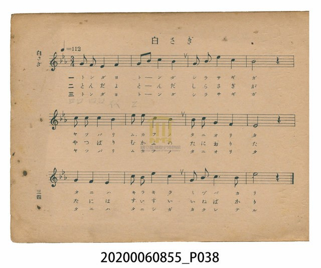
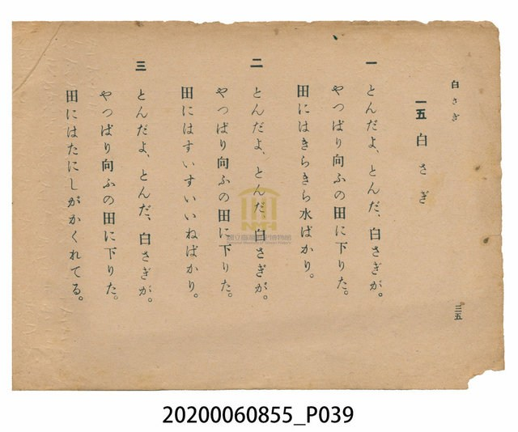

# 白さぎ（白鷺鷥）

<audio controls src="shirasagi.mp3"></audio>

- 日治時期公學校唱歌（第三學年・第十五課）
- 國立臺灣歷史博物館典藏

- note

【曲目說明】
・出處：臺灣總督府編《公學校唱歌》第三學年用，第十五課〈白さぎ〉（白鷺鷥），原書第 34–35 頁。
・調性與拍號：變ホ調（Eb 大調），3/4 拍，速度 != 112。
・背景與曲風：三年級全冊壓軸曲目，亦是唯一一首全曲採用 3/4 拍（三拍子）的歌曲。歌詞描寫臺灣農村
最常見的「白鷺鷥（白さぎ）」展翅飛起，最終還是降落在對面的水田裡；三段歌詞依季節變化描繪水田景致：
第一段插秧前「田裡波光粼粼盡是春水（田にはきらきら水ばかり）」，第二段秧苗長高「田裡盡是修長翠綠的稻苗
（田にはすいすいいねばかり）」，第三段「田裡躲藏著田螺（田にはたにしがかくれてる）」。
優美的三拍子旋律猶如白鷺鷥御風滑翔的曼妙姿態。
・版本說明：本檔案為原書單聲部簡譜（數字譜）之忠實數位化版本。

・編曲說明（鋼琴伴奏版）：
1. 前奏 (Intro, 4 小節)：引用第三樂句「田にはきらきら水ばかり」之圓舞曲旋律，描繪白鷺鷥展翅滑翔的輕盈姿態。
2. 主歌伴奏 (Shirasagi, 12 小節 × 3 段)：右手 (PianoRH) 演奏三拍子主旋律；
左手 (PianoLH) 採用典型圓舞曲伴奏音型（`1_ - [1] - [1] -`），營造水波盪漾與振翅飛翔的優雅韻律。

## 歌詞

```text
一　とんだよ、とんだ、白さぎが。
やつぱり向ふの田に下りた。
田にはきらきら水ばかり。

二　とんだよ、とんだ、白さぎが。
やつぱり向ふの田に下りた。
田にはすいすいいねばかり。

三　とんだよ、とんだ、白さぎが。
やつぱり向ふの田に下りた。
田にはたにしがかくれてる。
```

## 原書掃描頁





## 調性分析

```text
================================================================================
📊 TMD Song Profile: [ 白さぎ（白鷺鷥） ]
================================================================================
⏱  Duration:       0:19 (19.3s), 12 measures total
🎼 Key & Tempo:    首調基準 E,, != 112.0 BPM, <3/4>
   - 分析範圍：      由實際發聲的音符與和弦推測調性；播放脈絡另行呈現
🎤 人聲音域:    D#4 (MIDI 63) – D#5 (MIDI 75) [跨度: 12 個半音 / 1.0 個八度, 難度: easy]
   - 最低音:  D#4 in [Shirasagi #1 @ m.1, 0:00]
   - 最高音: D#5 in [Shirasagi #1 @ m.3, 0:03]
   - 適合: soprano, mezzo-soprano, contralto, tenor, baritone, bass
🏛  結構:      Shirasagi (19.3s)
⚡ 編曲密度:        Peak 1 軌道同時演奏
🗝  調性診斷：       C 小調（純淨自然小調，未偵測到可信轉調）
   - 風格氣質:    純淨自然小調（陰鬱抒情、旋律集中，無明顯調外色彩）
   - 轉調歷程:    全曲維持單一推測調性（未偵測到可信轉調）
   - 核心骨幹音:  C, D#, A#, G, F
   - 調性數值:    C 小調 [相關度: 0.81, 穩定度: Moderate, 自然音純度: 100.0%]
   - 候選調性 (K-S): C 小調 (0.81), D# 大調 (0.78), A# 大調 (0.59)
   - 五度圈歷程:   +0
   - 各段落調性細節:
     • [Shirasagi #1]: C 小調 (r: 0.81, 自然音純度: 100.0%)

  [ 五度圈游移軌跡 ]
              [C ]*
         F            G  
      Bb               D  
      Eb               A  
         Ab           E  
            Db       B  
               F# 
     (* = active key center)

  [ 十二半音累積音高分佈 ]
     C  : ████████████████████████  28.8%
     C# :                            0.0%
     D  :                            0.0%
     D# : ███████████████████████   27.3%
     E  :                            0.0%
     F  : █████████                 10.6%
     F# :                            0.0%
     G  : ██████████                12.1%
     G# :                            0.0%
     A  :                            0.0%
     A# : ██████████████████        21.2%
     B  :                            0.0%
--------------------------------------------------------------------------------
Assignment 軌道音域：
  - Piano         : D#4 – D#5 (12 個半音 / 1.0 個八度, 38 個音符)
================================================================================
```

## ABC

```abc
X:1
T:白さぎ（白鷺鷥）
C:TMD (Chen, Chih-Han / aguai)
M:3/4
L:1/16
Q:1/4=112
K:Eb

V:V1 name="Piano" snm="Pia"

[V:V1]
g2 f2 e4 f4 | g2 b2 c4 b4 | g2 b2 e4 c4 | b8 z4 |
c2 c2 c4 b4 | e2 e2 c4 c4 | b2 c2 g4 f4 | e8 z4 |
g4 f4 e4 | c2 b2 e4 c4 | g2 b2 c6 b2 | e8 z4 |
```

- [主旋律 TMD 檔案](shirasagi.tmd)
- [鋼琴伴奏 TMD 檔案](shirasagi_piano.tmd)
