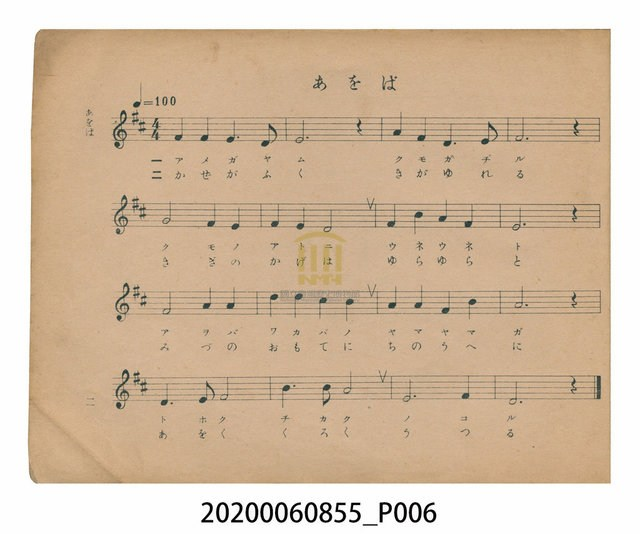
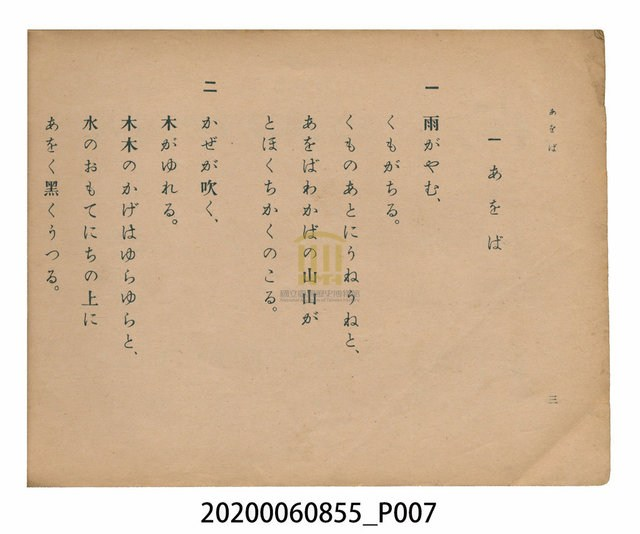

# あをば（青葉）

> Re:Shōka 使用 AI 協助辨識與重建樂譜，可能會有錯誤。歡迎回報。

- **鋼琴伴奏版**：<br><audio controls src="awoba.mp3"></audio>
- **NEUTRINO 歌聲合成版**：<br><audio controls src="awoba_neutrino.mp3"></audio>

- 日治時期公學校唱歌（第三學年・第一課）
- 國立臺灣歷史博物館典藏

## 說明


- 出處：臺灣總督府編《公學校唱歌》第三學年用，第一課〈あをば〉（青葉），原書第 2–3 頁。
- 調性與拍號：ニ調（D 大調），4/4 拍，速度 != 100。
- 背景與曲風：描寫春雨初歇、雲霧散去後，層層疊疊的新綠山巒（あをばわかばの山山）
遠近綿延，以及微風吹拂樹影搖曳、倒映於水面與大地上的清新自然景致。旋律以五聲性級進
與優美的四度、六度跳進交織，充滿田園牧歌般的開闊感。
- 版本說明：本檔案為原書單聲部簡譜（數字譜）之忠實數位化版本。

### 編曲說明（鋼琴伴奏版）：

1. 前奏 (Intro, 4 小節)：擷取主旋律五聲音階核心動機，以明亮柔和的線條引出雨過天青的意境。
2. 主歌伴奏 (Awoba, 16 小節 × 2 段)：右手 (PianoRH) 演奏原曲歌唱旋律；左手 (PianoLH)
以低音根音搭配 I、IV、V、vi 和弦之四拍律動，支撐流暢優美的山林氣息。


## 歌詞

```text
一　雨がやむ、くもがちる。
くものあとにうねうねと、
あをばわかばの山山が
とほくちかくのこる。

二　かぜが吹く、木がゆれる。
木木のかげはゆらゆらと、
水のおもてにちの上に
あをく黒くうつる。
```

## ABC

<div class="abc-score" data-abc-src="awoba.abc" aria-label="五線譜載入中"></div>

[下載 ABC 原始檔](awoba.abc)

## TMD 檔案連結

- [主旋律 TMD 檔案](awoba.tmd) [[在 TMD Studio 編輯](https://tmdlang.github.io/Tmd-TS/#tmd=s7IKdvYPcrWy4qpTUCpJTLdSSM7PyUlNLsnMz7PKzk9PzM7Ojy_OyM9OVIKrKMvPKc1NtUovSkxJjTdGiBfnlxYlp1oVJ2fk5-fEl6RWlCTl52cj5AuK8stS8xLzgGoKijLzSlJTwIoQClLLMlNSQdKpKZkl-UWZiTlIlqYWFYPcBLEkvqQoMa84uSizAORQhCqgpvTMPKvc_LykUqCrkSVKMvKBLi7IqLTKyCwGmZ6cmBOfnZiH5LGSjFSgv_ISS0qLUtG9FV-QmJ5qFWBgYKbEpaWl8Lix6XHTpMeNG97v6Xg5d9KLiZ3v93QqaGlxKdoqGBoYcNnbKrhw2Zjom9iBzHk2femzTbufzWx6Nmf-09Y1T9fueLZg4dMpG5-t7QHqf75mzZMdnUDBpzu3PG7eDeY2vFi1CWgi2BVP53Q_X939on3X88bFz9Zuf9q_6WnvrOedK18uWfG0dceL6f1KXFz6Wgq21AJcCgoKjxsmPJu96fnsdS9WrXo2o-9xw0SwaPPup-27Xsyc-n7PLIh7nu_Y-3zu4qe75jzfvuJxQxea5x43dCN77vmUFe_39MD997ihAx6MjxuAAYgISaCyp33zn83eAVSsYPSoYbKxwssFjY8bmqCueLFq_7OG5S862p91976YOR_onMfN3UBBoBkuCk-XLAczQaYAY0ABqAbIetkw_-muZQqQ-EEyqbnn2cz1IJNmb3q5COi-Wc_6-5-uX_1sxtKXs1c87Zj7bG3744bGl0DZOcufTV38tG_3033AWOt5unEJED2f1gVCs1qeTdvwfNuCpxs3Pt0-CegKhMea-h83doMYjetAshs3Ah0GsltB4WXjghf7Jz7ftv_p7m1AA5_sXvq0v-vpvnVAZzydsPNZd9OzFTuf7t34bMK0Z7M3A93wtGHSsxkLnk3b82zDlpdzFwHdDPTp0zkbnuwAO2BHK9ANL9pXPW_ZBvJR-xagJ59N7366rxto8pNdU140bgKG2fMts142bII4AGRCy6rn-_qA2p_Ong0MHpAtrWuBjBfbNwOVPdm15PnOKSDPtrY-273_-ZQNT-dMet65HBi1LzrWAHW9nNb9cnrXs5b5iAB93tnxbM4aSLIBheacNc9WTXm2sON50y5IlD6dtg7olJfNK55vWPhi7RxgYD2buuPp2ulgdueTnd1P9y94un4ZUPDJ3t6nPdMgBoIsgCZMiDEgN6yc97R1xbNp7UCPPNmxFsRYNe_F2vXA1Ao09emG3mftnQqZucCMa6SXVZCarqCvAMzA5qAIABkFTIWPGxqAsfy4sedxU8vjJiC38XFj_-OmJpBI48LHTd0wf0FF14HitRGoYfXjxrbHjWthJDDtN0LU4Yx2oJEQFUDdu0HmAc0HqQAygKZORtgFdDrEG8DQAyXBxjlPdrWBEvDsTcD0B2QD1T2dswI5RYICDZIoV68EpkJQagYmhYmdL5a1vZjcDYyn5_uAiRWY8oC5YDEwwb3Yuv3Jnn5g0nk-dSbIKHBCfLpk5ctZs4GGw8NnFzADN4AdOQfoemCaBLm2ofHZHEiItT1uApIwZwNFwRJAzwA1AMNgPVhFJ5SEBxEw8YIVdYEDdBk4KIEhsQ6YioFs5EDsf7kbRILDeAmO8IFlFaDXgLkFllVAOQfoGFCy3rvx6doJIHEgmtkMREBfgwIK6FpwLgJai5yRQObMWPC8dTmwnAOWRs_3gwNz-8aXTc2gPDZrOtBAaBABnUJ5WQsFClr6XFyO5flJiVYBmYl5-Q41BjXV4ExqY6JlB2bUKBgDoYaRgi4QGmqqaujqagIFIXwDIMsUJG0I5hrBpY1h0mAzfAxrFB43LQJm04UKGo-b1oAlHzcvAal83LwAbtTjpvVA_iJkNY0QNatRzTMCijV2A_EcoNrGHojaxq1gtY39CPMae4G4B2ReG0RNUw9YTVM33DyoJ01AzlcwBDsdROuCWWZg3yH5Fsk768HuA3mqD2wkiNUBxCCjQfxlQDbQeigN8kQHFk_0gl3eB8TrwA4GeWoSEINMB5nSBsSdcBqkYgW600FhbQqENQqGcSBkDnQ2KFpAToewsMUFyPGbgHgC2GnAcG9aDeZBvdO8BIjnwWmQHkiUoDp_P9j5S-HO7wKqawLSQE83rgaLLATLATMTEO8AiyDiEuoBtNQD8g9Q0AwsaAYVBHkCFg-gGIFoQfaUBiyAHzfP1oTGD1i0ERr1qxGiIE9CBDfjSF7AZNUEVTIJqA-cqMCikNT1uKkXIQryHCQFLkFLXLVcXLp2CuAMBjYZyFHmAgA)]
- [鋼琴伴奏 TMD 檔案](awoba_piano.tmd) [[在 TMD Studio 編輯](https://tmdlang.github.io/Tmd-TS/#tmd=s7IKdvYPcrWy4qpTUCpJTLdSSM7PyUlNLsnMz7PKzk9PzM7Ojy_OyM9OVIKrKMvPKc1NtTJGiBTnlxYlp-JSX1CUX5aal5gHVFGSmFmemBefDhQoyssvik9PzUstSsxBqE0ty0xJBaksKMrMTSyqjE_JTwZalleCZH1qUTHIdQWZiXn58YlFRYl56amoSvKLSjLy04sSCzIqrTIyi0vyizKTE3PisxPzkJxVkgHUZZWXWFJalIrulfiCxPRUqwADAzMlLi0thceNTY-bJj1u3PB-T8fLuZNeTOx83Lz7Zfee5xO2PNmz5enS_uedHe_3dCpoaXEp2ioYGhhw2dsquHDZmOib2IFMfjZ96bNNu5_NbHo2Z_7T1jVP1-54tmDh0ykbn63tAZr4fM2aJzs6gYJPd24BmgvmNrxYtQloIthdT-d0P1_d_aJ91_PGxc_Wbn_av-lp76znnStfLlnxtHXHi-n9Slxc-loKttQCXAoKCo8bJjybven57HUvVq16NqPvccNEsGjz7qftu17MnPp-zyyIe57v2Pt87uKnu-Y8377icUMXmuceN3Qje-75lBXv9_TA_fe4oQMesI8bOuFhC_Q3UNnTvvnPZu8AKlYwetQw2Vjh5YLGxw1NUFe8WLX_WcPyFx3tz7p7X8ycD3TO4-ZuoCDQDBeFp0uWg5kgU4AxoABUA2S9bJj_dNcyBUj8IJnU3PNs5nqQSbM3vVwEdN-sZ_39T9evfjl7xdN9PU-XrHw2c8vjhsaXszc9m7r46caNwMAAGvZsz2og-2Vj78v2PoijgSY8Xb0SyHjZsPj5tv0vtm5_sqcfqPLJ7qVP-7ue7lsHNPzphJ1Pu6c-W7Hz6d6NQDNBLlBQeNow6dmMBU_nrHi2YcvLuYtA5szZ8GRH1_NZLc92tD6btgHkvI0LES4GhjTQrZB4AYUZRjIE-gFitKGewtPOXqC4goZnXklRvo6CicLTDf3P1zdogvw5GZiUpj3ZsfvZ9O6n-7qf7JryonHTy_mbX87qe7Zgx9P9zSC3rgSGLcgPQLue7Fr3bP6Up5N6gC57vn3Ws0Vzn-6ZCkwOwJB62dgHDClgQIAc3dL_dFEz1LkKCkZ6CiAr1vZAXKig4Vien5Soo2BoBnWKwuHpCkYKz9ZtBbnpaf_mZ53dChoBoLwd5KGp8GzPFKAucFrYBDQElKzArn2_Z_bT7csQan08NCH2AQHQuU_29gF98mzBThA5Ye3L1l4FT2CIe4YBCRAuy1QAeuTpnmVPdnY_nT0bmEKAZgL9C4raKeufTZrwbGvjs1mLnraser6vD-gpUMTPm_5sw-JnjetBXoNmEUgaBbrrxcp5T1tXPJvWDoy-JzvWghir5r1YC1Q7ERhFTzf0PmvvVAAWaOmpRnpZBanpCvoKwMLFHBhZYKOA-eFxQwMwIB839jxuanncBOQ2Pm7sf9zUBBJpXPi4qRuWAKCi60BZpxGoYfXjxrbHjWthJDAXghMWImc19T9u7AYxGtcBvQFEQCMhKoC6d4PMA5oPUgFkAE2djLAL6HSIN4AxA8oPjXOe7GoDZSVwZgCygeqACRfIfTlnOSh79O0Ghec-YKHWA8wMz7ctAOWraRtA2WNZ24vJ3aCUs28J0Ang_IjIJ8AU_3zqTJBRjQte7J8ISkuzZgMNh4fPLmBR0gB25Byg64H5COTahsZncyAh1va4CUjCnA0UBUsAPQPUAAyD9WAVnVASHkTADAdW1AUO0GXgoASGxDpg5gOykQOx_-VuEAkO4yU4wgecvZ91A93cA8zhzyZMezZ7M1AdiD1nBSgJ7d34dO0EkDgQzWwGIqCvQQEFy_lAa0GZf8lySP4HmTNjwfPW5aAsBsxZ-8GBuX3jy6ZmUC6bNR1ciICDCOgUykt9KFDQ0qewNgE5B6XY0bSClzsKGtACGZxbgSXt852rkMsPYMzAi0pgWMKLVkgIPdu86GlrJ8j34HIIUtJQ5nuwd8GutIKWOQ41BjXV4LLExkTLDsyoUTBWMFUwjFMwAzJNgRwjBV0gS8MQSOkqGGmqaujqaoLV1ICldBUMFGq4alEM9sFusGG8QrRhrIIphELhm4L4ZkCGWW6sgjFMAVQGhKGWUBxZkPIZWAJDC2dgfCFKZ5QIgxTPz5t2Qap3eN0BSsbg0hgo9axr0rPm1qcdbS-WLwal50k9wGoFUvhTIarADiQQVcYKGpBYMITGDFKsgKMPLeJAemCRBjLDx7BG4XHTImBdu1BB43HTGrDk4-YlIJWPmxfAjXrctB7IX4SsphGiZjWqeUZAscZuIJ4DVNvYA1HbuBWstrEfYV5jLxD3gMxrg6hp6gGraeqGmwf1pAnI-QqGYKeDaFByNAYmT5DvkNMgwjvrwe4DeaoPbCSI1QHEIKNB_GVANtB6KA3yRAcWT_SCXd4HxOvADgZ5ahIQg0wHmdIGxJ1wGqRiBbrTQWFtCs4qwAwFRObQXAVyOoSFLS5Ajt8ExBPATgOGe9NqMA_qneYlQDwPToP0QKIE1fn7wc5fCnd-F1BdE5AGerpxNVhkIVgOWNAD8Q6wCCIuoR7AyPbgssAMLGgGFQR5AhYPoBiBaEH2lAYsgB83z9aExg9YtBEa9asRoiBPQgQ340hewGTVBFUyCagPnKjAopDU9bipFyEK8hwkBS5BS1zAwgQpf2EtsbAVNgrQFv1CYNKFNzCxKAPmX-yFHrRMM4IVengKRRAfEhE4XbKrh3iXmACNNIkFWwCkMG2GFb9QcQynEnDKjk7yAwXqNJgL4AoQAiS5BdjKpdgt6KEAr6WgEiAMTUe6dgrgyg9sIJADTlfRPoaxaAJGcAFlLgA)]

## 分析

```text
================================================================================
📊 TMD Song Profile: [ あをば（青葉） ]
================================================================================
⏱  Duration:       0:38 (38.4s), 16 measures total
🎼 Key & Tempo:    首調基準 D, != 100.0 BPM, <4/4>
   - 分析範圍：      由實際發聲的音符與和弦推測調性；播放脈絡另行呈現
🎤 人聲音域:    D4 (MIDI 62) – D5 (MIDI 74) [跨度: 12 個半音 / 1.0 個八度, 難度: easy]
   - 最低音:  D4 in [Awoba #1 @ m.1, 0:02]
   - 最高音: D5 in [Awoba #1 @ m.10, 0:21]
   - 適合: soprano, mezzo-soprano, contralto, tenor, baritone, bass
🏛  結構:      Awoba (38.4s)
⚡ 編曲密度:        Peak 1 軌道同時演奏
🗝  調性診斷：       D 大調（純淨自然大調，未偵測到可信轉調）
   - 風格氣質:    純淨自然大調（陽光明朗、易唱易記，無明顯調外色彩）
   - 轉調歷程:    全曲維持單一推測調性（未偵測到可信轉調）
   - 核心骨幹音:  F#, E, D, A, B
   - 調性數值:    D 大調 [相關度: 0.76, 穩定度: Moderate, 自然音純度: 100.0%]
   - 候選調性 (K-S): D 大調 (0.76), A 大調 (0.72), F# 小調 (0.67)
   - 五度圈歷程:   +2
   - 各段落調性細節:
     • [Awoba #1]: D 大調 (r: 0.76, 自然音純度: 100.0%)

  [ 五度圈游移軌跡 ]
               C  
         F            G  
      Bb              [D ]*
      Eb               A  
         Ab           E  
            Db       B  
               F# 
     (* = active key center)

  [ 十二半音累積音高分佈 ]
     C  :                            0.0%
     C# : ██                         1.7%
     D  : ██████████████████        19.5%
     D# :                            0.0%
     E  : ██████████████████████    22.9%
     F  :                            0.0%
     F# : ████████████████████████  25.4%
     G  : ███                        3.4%
     G# :                            0.0%
     A  : ██████████████████        18.6%
     A# :                            0.0%
     B  : ████████                   8.5%
--------------------------------------------------------------------------------
Assignment 軌道音域：
  - Piano         : D4 – D5 (12 個半音 / 1.0 個八度, 42 個音符)
================================================================================
```


## 原書掃描頁






