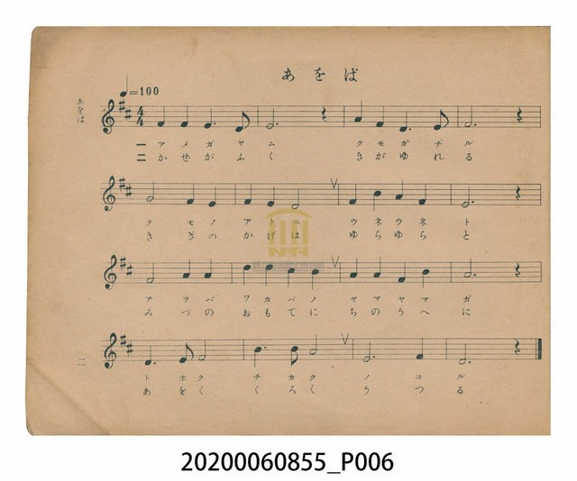
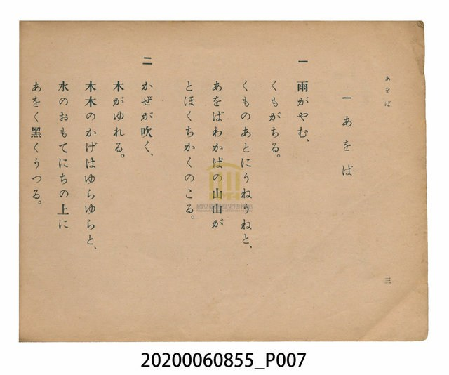

# あをば（青葉）

<audio controls src="awoba.mp3"></audio>

- 日治時期公學校唱歌（第三學年・第一課）
- 國立臺灣歷史博物館典藏

## 說明

【曲目說明】
・出處：臺灣總督府編《公學校唱歌》第三學年用，第一課〈あをば〉（青葉），原書第 2–3 頁。
・調性與拍號：ニ調（D 大調），4/4 拍，速度 != 100。
・背景與曲風：描寫春雨初歇、雲霧散去後，層層疊疊的新綠山巒（あをばわかばの山山）
遠近綿延，以及微風吹拂樹影搖曳、倒映於水面與大地上的清新自然景致。旋律以五聲性級進
與優美的四度、六度跳進交織，充滿田園牧歌般的開闊感。
・版本說明：本檔案為原書單聲部簡譜（數字譜）之忠實數位化版本。

・編曲說明（鋼琴伴奏版）：
1. 前奏 (Intro, 4 小節)：擷取主旋律五聲音階核心動機，以明亮柔和的線條引出雨過天青的意境。
2. 主歌伴奏 (Awoba, 16 小節 × 2 段)：右手 (PianoRH) 演奏原曲歌唱旋律；左手 (PianoLH)
以低音根音搭配 I、IV、V、vi 和弦之四拍律動，支撐流暢優美的山林氣息。

## 歌詞

```text
一　雨がやむ、くもがちる。
くものあとにうねうねと、
あをばわかばの山山が
とほくちかくのこる。

二　かぜが吹く、木がゆれる。
木木のかげはゆらゆらと、
水のおもてにちの上に
あをく黒くうつる。
```

## ABC

```abc
X:1
T:あをば（青葉）
C:TMD (Chen, Chih-Han / aguai)
M:4/4
L:1/16
Q:1/4=100
K:D
V:V1 name="Piano" snm="Pia"
[V:V1]
F4 F4 E6 D2 | E12 z4 | A4 F4 D6 E2 | F12 z4 |
G8 E4 D4 | F4 E4 D8 | F4 B4 A4 F4 | E12 z4 |
F8 A4 A4 | d4 d4 c4 B4 | A4 A4 F4 B4 | A12 z4 |
D6 E2 F8 | B6 B2 A8 | E12 F4 | D12 z4 |
```

## TMD 檔案連結

- [主旋律 TMD 檔案](awoba.tmd)
- [鋼琴伴奏 TMD 檔案](awoba_piano.tmd)

## 分析

```text
================================================================================
📊 TMD Song Profile: [ あをば（青葉） ]
================================================================================
⏱  Duration:       0:38 (38.4s), 16 measures total
🎼 Key & Tempo:    首調基準 D, != 100.0 BPM, <4/4>
   - 分析範圍：      由實際發聲的音符與和弦推測調性；播放脈絡另行呈現
🎤 人聲音域:    D4 (MIDI 62) – D5 (MIDI 74) [跨度: 12 個半音 / 1.0 個八度, 難度: easy]
   - 最低音:  D4 in [Awoba #1 @ m.1, 0:02]
   - 最高音: D5 in [Awoba #1 @ m.10, 0:21]
   - 適合: soprano, mezzo-soprano, contralto, tenor, baritone, bass
🏛  結構:      Awoba (38.4s)
⚡ 編曲密度:        Peak 1 軌道同時演奏
🗝  調性診斷：       D 大調（純淨自然大調，未偵測到可信轉調）
   - 風格氣質:    純淨自然大調（陽光明朗、易唱易記，無明顯調外色彩）
   - 轉調歷程:    全曲維持單一推測調性（未偵測到可信轉調）
   - 核心骨幹音:  F#, E, D, A, B
   - 調性數值:    D 大調 [相關度: 0.76, 穩定度: Moderate, 自然音純度: 100.0%]
   - 候選調性 (K-S): D 大調 (0.76), A 大調 (0.72), F# 小調 (0.67)
   - 五度圈歷程:   +2
   - 各段落調性細節:
     • [Awoba #1]: D 大調 (r: 0.76, 自然音純度: 100.0%)

  [ 五度圈游移軌跡 ]
               C  
         F            G  
      Bb              [D ]*
      Eb               A  
         Ab           E  
            Db       B  
               F# 
     (* = active key center)

  [ 十二半音累積音高分佈 ]
     C  :                            0.0%
     C# : ██                         1.7%
     D  : ██████████████████        19.5%
     D# :                            0.0%
     E  : ██████████████████████    22.9%
     F  :                            0.0%
     F# : ████████████████████████  25.4%
     G  : ███                        3.4%
     G# :                            0.0%
     A  : ██████████████████        18.6%
     A# :                            0.0%
     B  : ████████                   8.5%
--------------------------------------------------------------------------------
Assignment 軌道音域：
  - Piano         : D4 – D5 (12 個半音 / 1.0 個八度, 42 個音符)
================================================================================
```


## 原書掃描頁






