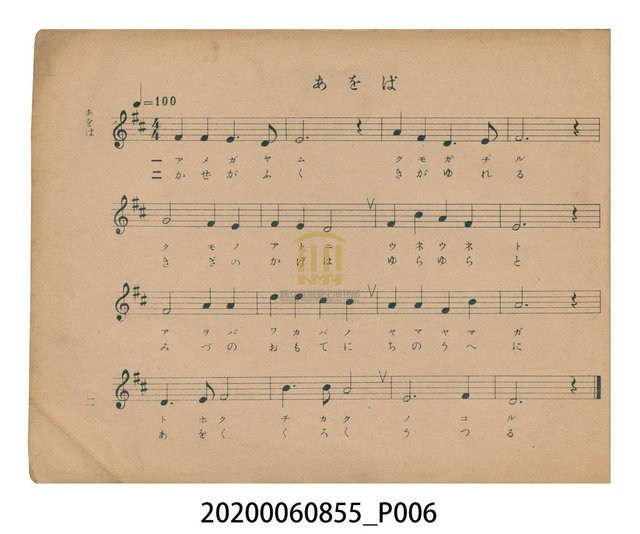
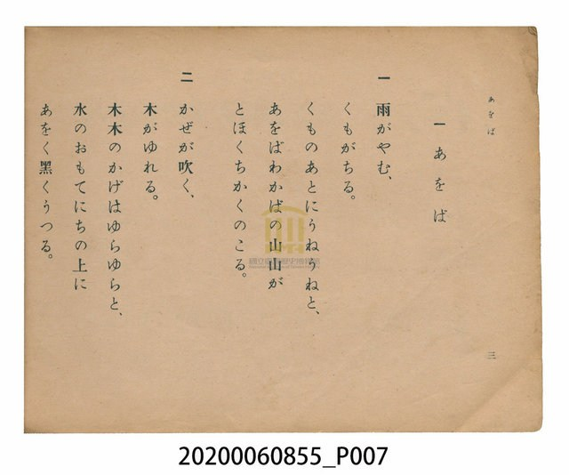

# あをば（青葉）

> Re:Shōka 使用 AI 協助辨識與重建樂譜，可能會有錯誤。歡迎回報。

- **鋼琴伴奏版**：<br><audio controls src="awoba.mp3"></audio>
- **NEUTRINO 歌聲合成版**：<br><audio controls src="awoba_neutrino.mp3"></audio>

- 日治時期公學校唱歌（第三學年・第一課）
- 國立臺灣歷史博物館典藏

## 說明


- 出處：臺灣總督府編《公學校唱歌》第三學年用，第一課〈あをば〉（青葉），原書第 2–3 頁。
- 調性與拍號：ニ調（D 大調），4/4 拍，速度 != 100。
- 背景與曲風：描寫春雨初歇、雲霧散去後，層層疊疊的新綠山巒（あをばわかばの山山）
遠近綿延，以及微風吹拂樹影搖曳、倒映於水面與大地上的清新自然景致。旋律以五聲性級進
與優美的四度、六度跳進交織，充滿田園牧歌般的開闊感。
- 版本說明：本檔案為原書單聲部簡譜（數字譜）之忠實數位化版本。

### 編曲說明（鋼琴伴奏版）：

1. 前奏 (Intro, 4 小節)：擷取主旋律五聲音階核心動機，以明亮柔和的線條引出雨過天青的意境。
2. 主歌伴奏 (Awoba, 16 小節 × 2 段)：右手 (PianoRH) 演奏原曲歌唱旋律；左手 (PianoLH)
以低音根音搭配 I、IV、V、vi 和弦之四拍律動，支撐流暢優美的山林氣息。


## 歌詞

```text
一　雨がやむ、くもがちる。
くものあとにうねうねと、
あをばわかばの山山が
とほくちかくのこる。

二　かぜが吹く、木がゆれる。
木木のかげはゆらゆらと、
水のおもてにちの上に
あをく黒くうつる。
```

## ABC

```abc
X:1
T:あをば（青葉）
M:4/4
L:1/16
Q:1/4=100
K:D
V:V1 name="Piano" snm="Pia"
[V:V1]
F4 F4 E6 D2 | E12 z4 | A4 F4 D6 E2 | F12 z4 |
w: 1.~ア メ ガ ヤ | ム | ク モ ガ チ | ル
w: 2.~か ぜ が ふ | く | き が ゆ れ | る
G8 E4 D4 | F4 E4 D8 | F4 B4 A4 F4 | E12 z4 |
w: 1.~ク モ ノ | ア ト ニ | ウ ネ ウ ネ | ト
w: 2.~き ぎ の | か げ は | ゆ ら ゆ ら | と
F8 A4 A4 | d4 d4 c4 B4 | A4 A4 F4 B4 | A12 z4 |
w: 1.~ア ヲ バ | ワ カ バ ノ | ヤ マ ヤ マ | ガ
w: 2.~み づ の | お も て に | ち の う へ | に
D6 E2 F8 | B6 B2 A8 | E12 F4 | D12 z4 |
w: 1.~ト ホ ク | チ カ ク | ノ コ | ル
w: 2.~あ を く | く ろ く | う つ | る
```

## TMD 檔案連結

- [主旋律 TMD 檔案](awoba.tmd) [[在 TMD Studio 編輯](https://tmdlang.github.io/Tmd-TS/#tmd=s7IKdvYPcrWy4qpTUCpJTLdSSM7PyUlNLsnMz7PKzk9PzM7Ojy_OyM9OVIKrKMvPKc1NtUovSkxJjTdGiBfnlxYlp1oVJ2fk5-fEl6RWlCTl52cj5AuK8stS8xLzgGoKijLzSlJTwIoQClLLMlNSQdKpKZkl-UWZiTlIlqYWFYPcBLEkvqQoMa84uSizAORQhCqgpvTMPKvc_LykUqCrlbi0tBQeNzY9bpr0uHHD-z0dL-dOejGx8_2eTgUtLS5FWwVDAwMue1sFFy4bE30TO5Axz6YvfbZp97OZTc_mzH_auubp2h3PFix8OmXjs7U9QP3P16x5sqMTKPh055bHzbvB3IYXqzYBTQQ74umc7ueru1-073reuPjZ2u1P-zc97Z31vHPlyyUrnrbueDG9X4mLS19LwZZagEtBQeFxw4Rnszc9n73uxapVz2b0PW6YCBZt3v20fdeLmVPf75kFcc_zHXufz138dNec59tXPG7oQvPc44ZuZM89n7Li_Z4euP8eN3TAg_FxAzAAESEJVPa0b_6z2TuAihWMHjVMNlZ4uaDxcUMT1BUvVu1_1rD8RUf7s-7eFzPnA53zuLkbKAg0w0Xh6ZLlYCbIFGAMKADVAFkvG-Y_3bVMARI_SCY19zybuR5k0uxNLxcB3TfrWX__0_Wrn81Y-nL2iqcdc5-tbX_c0PgSKDtn-bOpi5_27X66DxhrPU83LgGi59O6QGhWy7NpG55vW_B048an2ycBXYHwWFP_48ZuEKNxHUh240agw0B2Kyi8bFzwYv_E59v2P929DWjgk91Ln_Z3Pd23DuiMpxN2PutuerZi59O9G59NmPZs9magG542THo2Y8GzaXuebdjycu4ioJuBPn06Z8OTHWAH7GgFuuFF-6rnLdtAPmrfAvTks-ndT_d1A01-smvKi8ZNwDB7vmXWy4ZNEAeATGhZ9XxfH1D709mzgcEDsqV1LZDxYvtmoLInu5Y83zkF5NnW1me79z-fsuHpnEnPO5cDo_ZFxxqgrpfTul9O73rWMh8RoM87O57NWQNJNqDQnLPm2aopzxZ2PG_aBYnSp9PWAZ3ysnnF8w0LX6ydAwysZ1N3PF07HczufLKz--n-BU_XLwMKPtnb-7RnGsRAkAXQhAkxBuSGlfOetq54Nq0d6JEnO9aCGKvmvVi7HphagaY-3dD7rL1TITM3MT3VSC-rIDVdQV8hwMDAHBQBIKOAqfBxQwMwlh839jxuanncBOQ2Pm7sf9zUBBJpXPi4qRvmL6joOlC8NgI1rH7c2Pa4cS2MBKb9Rog6nNEONBKiAqh7N8g8oPkgFUAG0NTJCLuATod4Axh6oCTYOOfJrjZQAp69CZj-gGyguqdzViCnSFCgQRLl6pXAVAhKzcCkMLHzxbK2F5O7gfH0fB8wsQJTHjAXLAYmuBdbtz_Z0w9MOs-nzgQZBU6IT5esfDlrNtBwePjsAmbgBrAj5wBdD0yTINc2ND6bAwmxtsdNQBLmbKAoWALoGaAGYBisB6vohJLwIAImXrCiLnCALgMHJTAk1gFTMZCNHIj9L3eDSHAYL8ERPrCsAvQaMLfAsgoo5wAdA0rWezc-XTsBJA5EM5uBCOhrUEABXQvORUBrkTMSyJwZC563LgeWc8DS6Pl-cGBu3_iyqRmUx2ZNBxoIDSKgUygva6FAQUufi8uxPD8p0SogMzEv36HGoKYanEltTLTswIwaBWMg1DBS0AVCQ01VDV1dTaAghG8AZJmCpA3BXCO4tDFMGmyGj2GNwuOmRcBsulBB43HTGrDk4-YlIJWPmxfAjXrctB7IX4SsphGiZjWqeUZAscZuIJ4DVNvYA1HbuBWstrEfYV5jLxD3gMxrg6hp6gGraeqGmwf1pAnI-QqGYKeDaF0wywzsOyTfInlnPdh9IE_1gY0EsTqAGGQ0iL8MyAZaD6VBnujA4olesMv7gHgd2MEgT00CYpDpIFPagLgTToNUrEB3OiisTYGwRsEwDoTMgc4GRQvI6RAWtrgAOX4TEE8AOw0Y7k2rwTyod5qXAPE8OA3SA4kSVOfvBzt_Kdz5XUB1TUAa6OnG1WCRhWA5YGYC4h1gEURcQj2AlnpA_gEKmoEFzaCCIE_A4gEUIxAtyJ7SgAXw4-bZmtD4AYs2QqN-NUIU5EmI4GYcyQuYrJqgSiYB9YETFVgUkroeN_UiREGeg6TAJWiJq5aLS9dOAZzBwCYDOcpcAA)]
- [鋼琴伴奏 TMD 檔案](awoba_piano.tmd) [[在 TMD Studio 編輯](https://tmdlang.github.io/Tmd-TS/#tmd=s7IKdvYPcrWy4tLSUnjc2PS4adLjxg3v93S8nDvpxcTOx827X3bveT5hy5M9W54u7X_e2fF-T6eClhaXoq2CoYEBl72tgguXjYm-iR1XnYLSs-lLn23a_Wxm07M585-2rnm6dsezBQufTtn4bG0P0MTna9Y82dEJFHy6cwvQXDC34cWqTUATlUC6n87pfr66-0X7rueNi5-t3f60f9PT3lnPO1e-XLLiaeuOF9P7lbi49LUUbKkFuBQUFB43THg2e9Pz2eterFr1bEbf44aJYNHm3U_bd72YOfX9nlkQ9zzfsff53MVPd815vn3F44YuNM89buhG9tzzKSve7-mB--9xQwc8YB83dMLDFuhvoLKnffOfzd4BVKxg9KhhsrHCywWNjxuaoK54sWr_s4blLzran3X3vpg5H-icx83dQEGgGS4KT5csBzNBpgBjQAGoBsh62TD_6a5lCpD4QTKpuefZzPUgk2ZverkI6L5Zz_r7n65f_XL2iqf7ep4uWfls5pbHDY0vZ296NnXx040bgYEBNOzZntVA9svG3pftfRBHA014unolkPGyYfHzbftfbN3-ZE8_UOWT3Uuf9nc93bcOaPjTCTufdk99tmLn070bgWaCXKCg8LRh0rMZC57OWfFsw5aXcxeBzJmz4cmOruezWp7taH02bQPIeRsXIlwMDGmgWyHxAgozjGQI9APEaEM9haedvUBxBQ3PvJKifB0FE4WnG_qfr2_QBPlzMjApTXuyY_ez6d1P93U_2TXlReOml_M3v5zV92zBjqf7m0FuXQkMW5AfgHY92bXu2fwpTyf1AF32fPusZ4vmPt0zFZgcgCH1srEPGFLAgAA5uqX_6aJmqHMVFIz0FEBWrO2BuFBBw7E8PylRR8HQDOoUhcPTFYwUnq3bCnLT0_7Nzzq7FTQCMhPz8oM8NBWe7ZkC1AVOC5uAhoCSFdi17_fMfrp9GUKtj4cmxD4gADr3yd4-oE-eLdgJIiesfdnaq-AJDHHPMCABwmWZCkCPPN2z7MnO7qezZwNTCNBMoH9BUTtl_bNJE55tbXw2a9HTllXP9_UBPQWK-HnTn21Y_KxxPchr0CwCSaNAd71YOe9p64pn09qB0fdkx1oQY9W8F2uBaicCo-jpht5n7Z0KmbmJ6alGelkFqekK-goBBgbmwMgCGwXMD48bGoAB-bix53FTy-MmILfxcWP_46YmkEjjwsdN3bAEABVdB8o6jUANqx83tj1uXAsjgbkQnLAQOaup_3FjN4jRuA7oDSACGglRAdS9G2Qe0HyQCiADaOpkhF1Ap0O8AYwZUH5onPNkVxsoK4EzA5ANVAdMuEDuyznLQdmjbzcoPPcBC7UeYGZ4vm0BKF9N2wDKHsvaXkzuBqWcfUuATgDnR0Q-Aab451NngoxqXPBi_0RQWpo1G2g4PHx2AYuSBrAj5wBdD8xHINc2ND6bAwmxtsdNQBLmbKAoWALoGaAGYBisB6vohJLwIAJmOLCiLnCALgMHJTAk1gEzH5CNHIj9L3eDSHAYL8ERPuDs_awb6OYeYA5_NmHas9mbgepA7DkrQElo78anayeAxIFoZjMQAX0NCihYzgdaC8r8S5ZD8j_InBkLnrcuB2UxYM7aDw7M7RtfNjWDctms6eBCBBxEQKdQXupDgYKWPoW1Ccg5KMWOphW83FHQgBbI4NwKLGmf71yFXH4AYwZeVALDEl60QkLo2eZFT1s7Qb4Hl0OQkoYy34O9C3alFbTMcagxqKkGlyU2Jlp2YEaNgrGCqYJhnIIZkGkK5Bgp6AJZGoZASlfBSFNVQ1dXE6ymBiylq2CgUMNVi2KwD3aDDeMVog1jFUwhFArfFMQ3AzLMcmMVjGEKoDIgDLWE4siClM_AEhhaOAPjC1E6o0QYpHh-3rQLUr3D6w5QMgaXxkCpZ12TnjW3Pu1oe7F8MSg9T-oBViuQwp8KUQV2IIGoMlbQgMSCITRmkGIFHH1oEQfSA4s0kBk-hjUKj5sWAevahQoaj5vWgCUfNy8BqXzcvABu1OOm9UD-ImQ1jRA1q1HNMwKKNXYD8Ryg2sYeiNrGrWC1jf0I8xp7gbgHZF4bRE1TD1hNUzfcPKgnTUDOVzAEOx1Eg5KjMTB5gnyHnAYR3lkPdh_IU31gI0GsDiAGGQ3iLwOygdZDaZAnOrB4ohfs8j4gXgd2MMhTk4AYZDrIlDYg7oTTIBUr0J0OCmtTcFYBZiggMofmKpDTISxscQFy_CYgngB2GjDcm1aDeVDvNC8B4nlwGqQHEiWozt8Pdv5SuPO7gOqagDTQ042rwSILwXLAgh6Id4BFEHEJ9QBGtgeXBWZgQTOoIMgTsHgAxQhEC7KnNGAB_Lh5tiY0fsCijdCoX40QBXkSIrgZR_ICJqsmqJJJQH3gRAUWhaSux029CFGQ5yApcAla4gIWJkj5C2uJha2wUYC26BcCky68gYlFGTD_Yi_0oGWaEazQw1MogviQiMDpkl09xLvEBGikSSzYAiCFaTOs-IWKYziVgFN2dJIfKFCnwVwAV4AQIMktwFYuxW5BDwV4LQWVAGFoOtK1UwBXfmADgRxwuor2MYxFEzCCCyhzAQA)]

## 分析

```text
================================================================================
📊 TMD Song Profile: [ あをば（青葉） ]
================================================================================
⏱  Duration:       0:38 (38.4s), 16 measures total
🎼 Key & Tempo:    首調基準 D, != 100.0 BPM, <4/4>
   - 分析範圍：      由實際發聲的音符與和弦推測調性；播放脈絡另行呈現
🎤 人聲音域:    D4 (MIDI 62) – D5 (MIDI 74) [跨度: 12 個半音 / 1.0 個八度, 難度: easy]
   - 最低音:  D4 in [Awoba #1 @ m.1, 0:02]
   - 最高音: D5 in [Awoba #1 @ m.10, 0:21]
   - 適合: soprano, mezzo-soprano, contralto, tenor, baritone, bass
🏛  結構:      Awoba (38.4s)
⚡ 編曲密度:        Peak 1 軌道同時演奏
🗝  調性診斷：       D 大調（純淨自然大調，未偵測到可信轉調）
   - 風格氣質:    純淨自然大調（陽光明朗、易唱易記，無明顯調外色彩）
   - 轉調歷程:    全曲維持單一推測調性（未偵測到可信轉調）
   - 核心骨幹音:  F#, E, D, A, B
   - 調性數值:    D 大調 [相關度: 0.76, 穩定度: Moderate, 自然音純度: 100.0%]
   - 候選調性 (K-S): D 大調 (0.76), A 大調 (0.72), F# 小調 (0.67)
   - 五度圈歷程:   +2
   - 各段落調性細節:
     • [Awoba #1]: D 大調 (r: 0.76, 自然音純度: 100.0%)

  [ 五度圈游移軌跡 ]
               C  
         F            G  
      Bb              [D ]*
      Eb               A  
         Ab           E  
            Db       B  
               F# 
     (* = active key center)

  [ 十二半音累積音高分佈 ]
     C  :                            0.0%
     C# : ██                         1.7%
     D  : ██████████████████        19.5%
     D# :                            0.0%
     E  : ██████████████████████    22.9%
     F  :                            0.0%
     F# : ████████████████████████  25.4%
     G  : ███                        3.4%
     G# :                            0.0%
     A  : ██████████████████        18.6%
     A# :                            0.0%
     B  : ████████                   8.5%
--------------------------------------------------------------------------------
Assignment 軌道音域：
  - Piano         : D4 – D5 (12 個半音 / 1.0 個八度, 42 個音符)
================================================================================
```


## 原書掃描頁






