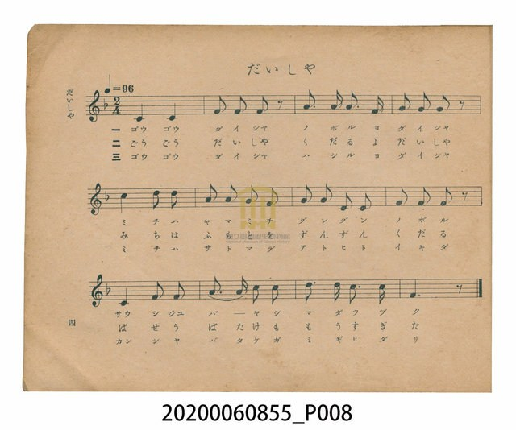
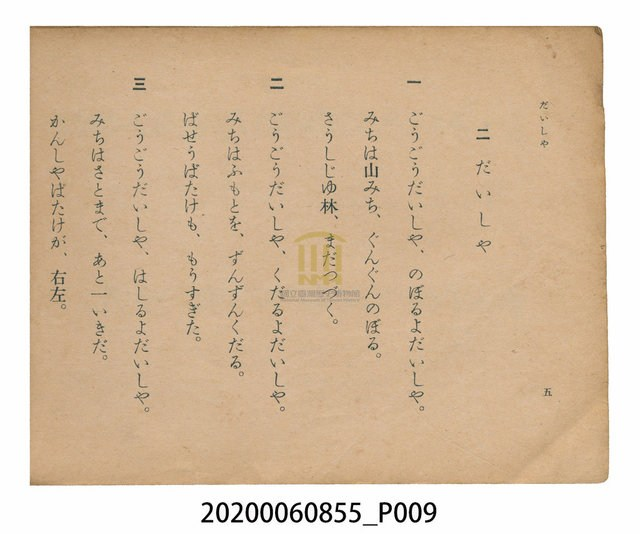

# だいしゃ（台車）

> Re:Shoka 使用 AI 協助辨識與重建樂譜，可能會有錯誤。歡迎回報。

<audio controls src="daisha.mp3"></audio>

- 日治時期公學校唱歌（第三學年・第二課）
- 國立臺灣歷史博物館典藏

## 說明

【曲目說明】
・出處：臺灣總督府編《公學校唱歌》第三學年用，第二課〈だいしゃ〉（台車），原書第 4–5 頁。
・調性與拍號：ヘ調（F 大調），2/4 拍，速度 != 96。
・背景與曲風：最具臺灣地方色彩的公學校唱歌之一。「台車」（輕便車）是日治時期臺灣山區與
鄉鎮間重要的窄軌手押台車交通工具。歌詞生動描繪台車「轟隆轟隆（ごうごう）」爬上山路、
衝下山麓、駛向村里，沿途經過臺灣特有的「相思樹林（さうしじゆ林）」、「芭蕉園（ばせうばたけ）」
與「甘蔗田（かんしやばたけ）」，節奏明快活潑。
・版本說明：本檔案為原書單聲部簡譜（數字譜）之忠實數位化版本。

・編曲說明（鋼琴伴奏版）：
1. 前奏 (Intro, 4 小節)：以分解大三和弦上行與輕快切分節奏，模擬台車啟動出發的活力。
2. 主歌伴奏 (Daisha, 12 小節 × 3 段)：右手 (PianoRH) 演奏附點與三連音交織的主旋律；
左手 (PianoLH) 採用二拍子輕快步伐伴奏（低音單音 + 首調和弦 [1]、[4]、[5]），呈現台車在軌道上行進的律動。

## 歌詞

```text
https://collections.culture.tw/ShowGalImage?SYSUID=11&IMG=KX52KKMMMC0AMAKW5H0IMEMDMJ0GMAMIMJ0WMAMGMZ0AMDM1KL58KHM5MJ0AMHKEK25HKKKHMRMYMJKPKNKB51KJMFK6M2MBKHMX5SM7MRMCMD5R0OK8MYM2MGMFM45VKQKY0CM2MB0V045SMSK7M20BM6MG0WMW0EMDM10IM4MQ0RMG&TEXT=K7KG575Y&FROM=5YKK57

一　ごうごうだいしや、のぼるよだいしや。
みちは山みち、ぐんぐんのぼる。
さうしじゆ林、まだつづく。

二　ごうごうだいしや、くだるよだいしや。
みちはふもとを、ずんずんくだる。
ばせうばたけも、もうすぎた。

三　ごうごうだいしや、はしるよだいしや。
みちはさとまで、あと一いきだ。
かんしやばたけが、右左。
```

## ABC

```abc
X:1
T:だいしゃ（台車）
M:2/4
L:1/16
Q:1/4=96
K:F
V:V1 name="Piano" snm="Pia"
[V:V1]
C4 C4 | F2 F2 F2 z2 | A3 A A3 F | G2 G2 G2 z2 |
c4 d2 d2 | A2 A2 G2 F2 | G2 G2 C2 C2 | F2 F2 F2 z2 |
C4 F2 F2 | d3 d c2 c2 | d3 d c3 c | F6 z2 |
C4 C4 | F2 F2 F2 z2 | A3 A A3 F | G2 G2 G2 z2 |
c4 d2 d2 | A2 A2 G2 F2 | G2 G2 C2 C2 | F2 F2 F2 z2 |
C4 F2 F2 | d3 d c2 c2 | d3 d c3 c | F6 z2 |
C4 C4 | F2 F2 F2 z2 | A3 A A3 F | G2 G2 G2 z2 |
c4 d2 d2 | A2 A2 G2 F2 | G2 G2 C2 C2 | F2 F2 F2 z2 |
C4 F2 F2 | d3 d c2 c2 | d3 d c3 c | F6 z2 |
```

## TMD 檔案連結

- [主旋律 TMD 檔案](daisha.tmd) [[在 TMD Studio 編輯](https://tmdlang.github.io/Tmd-TS/#tmd=s7IKdvYPcrWy4qpTUCpJTLdSSM7PyUlNLsnMz7PKzk9PzM7Ojy_OyM9OVIKrKMvPKc1NtUovSkxJjTdGiBfnlxYlp1oVJ2fk5-fEl6RWlCTl52cj5AuK8stS8xLzgGoKijLzSlJTwIoQClLLMlNSQdKpKZkl-UWZiTlIlqYWFYPcBLEkvqQoMa84uSizAORQhKqSjFSgy8CSBflFQKO1tBQeNy543NjyuHH646bm93s6nvZveLG76_2eTgUtLS5FWwVLMy57WwU3LhsjfRM7kEHPpi99tmn3s5lNz-bMf9q65unaHc8WLHw6ZeOztT1A7c_XrHmyoxMo-HTnlsfNu0HcXT0vVm0CGgh2xtM53c9Xd79o3_W8cfGztduf9m962jvreefKl0tWPG3d8WJ6vxIXl76WQkZJSUGxlb4-IrSL9ZJLc0pKi1L1Ssr1gzPyy90TczxzE9NT7YMjg0M9XWwNDdU8fd1tvSNMjby9fX19nQ0cfR29w009DDx9XX1dfL0M3H0dfT2BdDiQdveNAsq7-Bp6-5haeHv4mgLFHX09vF29jUw9vL2BIkG-kb5e3gHeft5OpobeXr5u3ma-Rr5OQJkI02Bfc6C8s6-LaZCBv7cFUKUR0EQ3XxPTMO9A70gDZ5BKgzADE6DKYG9zXyMDJ18zX3egzeEGILcYAt1k4htoEOTrrhbiGhFi623u7W5qbhqp5hbk72trGuntbWquoKUPDgtbagEuBQWFxw0Tns3e9Hz2uherVj2b0fe4YSJYtHn30_ZdL2ZOfb9nFiRunu_Y-3zu4qe75jzfvuJxQxdaRD9u6EaO6OdTVrzf0wOP68cNHciJ6nFDJ3K6Aqp82jf_2ewdQPUKJo8aJpsqvFzQ-LihCeqQF6v2P2tY_qKj_Vl374uZ84Euetw8AygINMNN4emS5WAmyBRgglQAqgGyXjbMf7prmQI4tSIZ1NzzbOZ6kEGzN71cBHThrGdzGp62bod48OmcDc-m7XzRuenp3pXPZ7WgefDJzu4nOxqAZj1u6IG4_HED0KaOF3umPtm3H-KRZzPWI-cFqLEbNz7tbQBaCnKEgsLLls6XfeteTpv8sr33xbJGoEXPV7W82N3zrLP7WdceiMlPdi152TDr6falQLcBbQTa_mLlvOdT5j_tnvqsv__5zlUwB_S82Dv_5aw2CAl0zOPGKY8b2yAk0D1AFz7vAEZKF9ANL7avf9zQCHHDi4Vzn-zoBgq-3DUZKPhy-eynEyY-mzvxZTsww_Y827T_ZcOU59smv2zsg0Z9585nczqBTgXa-Hz2jmcNc5-t2Pls3nSwjVPBNk5_3DjjcVMbWBBkL9BYkPO61r6Y2vl0ziSwyg2PG2eDFQMZ8x83ToSohDqpox1k-JQZL6ZMfz5lA1h99-OmyeAEA0w2KFpASWt9w9Ol_cD0-nT_6mdbdj_bOxERzc87O57NWQNJzuA4XvNs1ZRnCzueN-2CpLOn09a9aNz0snnF8w0LX6ydA7Ts2dQdT9dOB7M7gTH9dP-Cp-uXAQWf7O192jMNYiDIAmiGgRgDiZenrSueTWsHuv_JjrUgxqp5L9YCgxro1I6nG3qftXcqZIIKJSO9rILUdAV9hQADA0ugLWCjwCmqATnWkLIJMLQbHzeue9y453ETMCiQcxBQCuLZxv2PGxc-blwPjEsoG6RnAjjgICRMP0wDenSBNewDm73kcePSx439UKWgtA32C6gEACcwIALlC2i27QEmradzFz6d3QlLjU0vGycDkxkwF0DSG1AN0IMvmhY-2Tvn2YbFT_c1AJMiUBdQJWoq6nnZ1AJSuX398237n-7e9mIi0FlN8EDaBSxd8AdSP0iEYCA9btz6uKnpceOKx02TwNpmgUMIQsKMgOlBT6wgnUA9IP1AwZmPG_tA4kQGFSi3oQYVMJMBfQkKp9bNkGADBcPi2cDkDCyHwEHVDcymQJXwPPRk5_yn2zcB8-WzvgWgrLlr9dN9PU92tSEH1Q5g9sAfVMBQALIJBxUwnawAJ4zlYG2gYAOlVpCGXpBOmAYsmfRxIzDCGp_2b366fRmxIfR06ZSXyzY_nbAckZhmLwIWSS_6up72r3rauRJUUgO9u6Phaf9iYGIC6n2xfS5QDSQA4AXH0zkrIMEJtBvkgtaVz6Y3Pt049eU0UNSCwgnoGsorTigAV8guiZnFGYlWAZmJefkONQY1CtXgIs3GRMsOzMBWYSuAK8uGFwt7FDRMFJ5u6AeWZ5pYlAHNhxoBVG2l8Lhpy-OmZTCqBljYNTxuWgLkb3_cvBjM7wOWf4-b5wBZq8GsFRiqkIzc1QM0EpxMYBRQMThVAClQRQ3m94MMalwA1N8NYjV1YKhCdmUnMa4EG9m0nbAraxRM40GoRkHDUAEEDTRVNXR1NUECxgq6ugrGIL4mlGMI4QDljBRAEK4YnDlwRwSwjUJqRDTPB-JGsOP7wY5fAmbPA8kAJUBCTRseN28GexTEQIobkPLVQBIjJvYD8UJwaK8Hh_FWsO4mIAtUZIGFwIUVSAWIgRQ5IPu6Uc0ERwW6O5vAZjZ3AEXnPW5uBwstggqBwOPmSVAeSGbJ46a1YG4DwmhglChomCmYwcPaGB4JRqgxABUFxyBcHC0aCcTMjk7SswiwkAclPmAyAgbejsfNS8EBPgHIfdQwBRZTwMQHEgWGAdh3j5tbwKxWsLdBoY8RORvAxd1scHi3gcMBVOCBeMAgBhZ6kKgCaW-CqgFVEyBWH1jtfCyx0wRM_sCUAUnykMCFuPRxEzAtNG0Es9aARYGpCsheB48gUIw8bl6FEi_x4OCFB7WZri40ljRMFUwRwgq6CkgSwHyDkDMEcRGRU8vFpWunACngFHCwlLm4AA)]
- [鋼琴伴奏 TMD 檔案](daisha_piano.tmd) [[在 TMD Studio 編輯](https://tmdlang.github.io/Tmd-TS/#tmd=s7IKdvYPcrWy4tLSUnjcuOBxY8vjxumPm5rf7-l42r_hxe6ux827X3bveT5hy5M9W54u7X_e2fF-T6eClhaXoq2CpRmXva2CG5eNkb6JHVedgtKz6Uufbdr9bGbTsznzn7auebp2x7MFC59O2fhsbQ_QwOdr1jzZ0QkUfLpzC9BYEHdXz4tVm4AGKoF0P53T_Xx194v2Xc8bFz9bu_1p_6anvbOed658uWTF09YdL6b3K3Fx6Wsp2FILcCkoKDxumPBs9qbns9e9WLXq2Yy-xw0TwaLNu5-273oxc-r7PbMg7nm-Y-_zuYuf7przfPuKxw1daJ573NCN7LnnU1a839MD99_jhg7koH3c0AkPXaDXgSqf9s1_NnsHUL2CyaOGyaYKLxc0Pm5ogjrkxar9zxqWv-hof9bd-2LmfKCLHjfPAAoCzXBTeLpkOZgJMgUYCQpANUDWy4b5T3ctUwDHEJJBzT3PZq4HGTR708tFQBfOetbf_3T9auRIg3q2c-ezOZ3PZ7W82DP1yb79L3b3vGyc_LihB5oiGnqfr9z_bNHaZ9P2PJ-941nD3Gcrdj6bN_1xQ-OLrrUvpnY-nTMJaMvzKTNeTJn-fMqGl9MmA90EcoSCwpMdXU_nLgSqfLKjG8J4unTK0wkTn82d-GLCXoiNT_evBrlzI1AW5nRgoAMdDYkioL8xEyTQMxALDPUUnnb2AsUVNDzzSorydRRMFJ5u6H--vkETqObJ7qVPO9peLF8MDDdQbE3qebpnGdBNLxb2AF0MsftpRztQDVAD0BCgu5-tWPhs8hqIz59Onf-0eyowZTyfuQfo1mdbdj_tmg11pYKCkR7Qe7uBqQHiMAUNl8TM4oxEHQVDI6gTFA5PVzBWeLZuK8gtT_s3P-vsVtAIyEzMyw_y0FR4tmcKUNvLmS0vd88DugbovpcNi1_O3_xk15LnO6cA7QOZPr376b7u93tmQ6wEgqfblyGM8QEZ07cQmP6AKQ-YFp6unQAN0LVLn-yZAHEYMACf7O0DGvx02jogqaCt8HLZNGAqgoSGQrRhLDBaok3ApGksNIVO7Hjevw8aCnNWQFIEJOBeNmwCug3oKmDQgMICmqsgaRoYGi9WznvauuLZtHawn4CJpv3Fqnkv1q4HZjVQNtjQ-6y9UyEzNzE91UgvqyA1XUFfIcDAwBJoL9ioJzsaHjc0PG6c8rixDUbC81IL0I2PG9c9btzzuKn7cRNyNgNKQVJP4_7HjQsfN65_unEjlA3SM-Fx02QYCdMP0zAVbMn0x40zHje1QRL248Z9YLOXPG5c-rixH6oU6H6IX0DFxN75L2e1AREoMKB5u-d5xxpgKn86uxOWc5qAwfZi-_pnM0DOATKAaoAefNG08MneOc82LH66rwEYqEBdQJXIWQuUp5uA8d8A1PJ82_6nu7e9mAh0VhM8kHYBiyD8gdQPEiEYSI8btz5uanrcuOJx0ySwtlngEIKQMCNgejY8bpwNtgrImP-4cSJIJ1APSD9QcObjxj6QOJFBBSkQkIPq2ab9QF-Cwql1MyTYQMGweDYoj87ZAA6q7hcL5wJVwoudJzvnP92-6fm2yc_6Frxs7Huxa_XTfT1PdrUhB9WOTkJBBQwFIJtwUAHTyQpwwlgO1gYKNlBqBWnoBemEaQCaBAw9sBnwoGoERlgjsAgAZl9iQwhYUr5ctvnphOWIxDR7Eajg7Ot62r_qaefKZ3MaQN7d0fC0fzEwMYFK0-1zgWogAQAvj4H5FxKcQLtBLmhd-Wx649ONU19OA0UtKJyArqG8doUCBS19CmttkHNQynRNK3ihrqABrfU0wXG7eym0uNuy-9neifDAg5RSwPLp2cr5EI9S5kWwn8BOsYKW3g41BjUK1eBC2cZEyw7MAHoaUsaDCnuw-4EF-MuFPSDdIPkaBQ1DBWNNVQ1dTQUNUwXDOAgTKGymYAYXhioAihrDFRspGMJFjRSMFEzjFQxAAiARrloUp_ngdBq43gClNXCIweosPDUDsEnxbOoOUP2gowCsHoCEaawmwjOG8SApIMMEyDABMeAiQPcB1ULcRnFSgNSxwEoUVsECkwOihkVJD5Dgf960C9JKQ6o_eyDeB0pBPdzfBfTki8ZNkHCgQvKAuI1A-sDUCm5GNgATrIIGvOGCRRk01IFGAFVbKTxu2vK4aRmMqgE2mRoeNy0B8rc_bl4M5vcBW1GPm-cAWavBrBUYqpCM3NUDNBJcNsIooGJwUQikQE1YML8fZFDjAqD-bhCrqQNDFbIrO4lxJdjIpu2EXQlOU0AEzkMgCE__oHyiqwvPKmAOam4xQsos-CMC2HonNSKa5wNxI9jx_WDHLwGz54FkgBIgoaYNj5s3gz0KYiDFDUj5aiCJERP7gXghOLTXg8N4K1h3E5AFqqfBQuAaGqQCxECKHJB93ahmgqMC3Z1NYDObO4Ci8x43t4OFFkGFQOBx8yQoDySz5HHTWjC3AWE0MEqQSi585RWsbAPFIFwcLRoJxMyOTtKzCLBlA0p8wGQEDLwdj5uXggN8ApD7qGEKLKaAiQ8kCgwDsO8eN7eAWa1gb4NCHyNyNoDr-Nng8G4DhwOolgfxgEEMrOkhUQXS3gRVA2obgVh9YLXzscROEzD5A1MGJMlDAhfi0sdNwLTQtBHMWgMWBaYqIHsdPIJAMfK4eRVKvMSDgxdRvejqIuoXU6RaR1cBSQKYbxByhiAuSh2DXL7hrGRwRB7R5RtSHYLJgNcq1MrE-KouuAjVEiZajQlngG0DcQ0gAa1rpwCuzxWADEig42Ipc3EBAA)]

## 分析

```text
================================================================================
📊 TMD Song Profile: [ だいしゃ（台車） ]
================================================================================
⏱  Duration:       0:45 (45.0s), 36 measures total
🎼 Key & Tempo:    首調基準 F, != 96.0 BPM, <2/4>
   - 分析範圍：      由實際發聲的音符與和弦推測調性；播放脈絡另行呈現
🎤 人聲音域:    C4 (MIDI 60) – D5 (MIDI 74) [跨度: 14 個半音 / 1.2 個八度, 難度: moderate]
   - 最低音:  C4 in [Daisha #1 @ m.1, 0:00]
   - 最高音: D5 in [Daisha #1 @ m.5, 0:05]
   - 適合: soprano, mezzo-soprano, contralto, tenor, baritone, bass
🏛  結構:      Daisha (15.0s) -> Daisha (15.0s) -> Daisha (15.0s)
⚡ 編曲密度:        Peak 1 軌道同時演奏
🗝  調性診斷：       F 大調（純淨自然大調，未偵測到可信轉調）
   - 風格氣質:    純淨自然大調（陽光明朗、易唱易記，無明顯調外色彩）
   - 轉調歷程:    全曲維持單一推測調性（未偵測到可信轉調）
   - 核心骨幹音:  C, F, D, G, A
   - 調性數值:    F 大調 [相關度: 0.88, 穩定度: Moderate, 自然音純度: 100.0%]
   - 候選調性 (K-S): F 大調 (0.88), C 大調 (0.79), A 小調 (0.55)
   - 五度圈歷程:   -1 -> -1 -> -1
   - 各段落調性細節:
     • [Daisha #1]: F 大調 (r: 0.88, 自然音純度: 100.0%)
     • [Daisha #2]: F 大調 (r: 0.88, 自然音純度: 100.0%)
     • [Daisha #3]: F 大調 (r: 0.88, 自然音純度: 100.0%)

  [ 五度圈游移軌跡 ]
               C  
        [F ]*          G  
      Bb               D  
      Eb               A  
         Ab           E  
            Db       B  
               F# 
     (* = active key center)

  [ 十二半音累積音高分佈 ]
     C  : ████████████████████████  31.8%
     C# :                            0.0%
     D  : ██████████                13.6%
     D# :                            0.0%
     E  :                            0.0%
     F  : █████████████████████     28.4%
     F# :                            0.0%
     G  : ██████████                13.6%
     G# :                            0.0%
     A  : █████████                 12.5%
     A# :                            0.0%
     B  :                            0.0%
--------------------------------------------------------------------------------
Assignment 軌道音域：
  - Piano         : C4 – D5 (14 個半音 / 1.2 個八度, 114 個音符)
================================================================================
```


## 原書掃描頁






