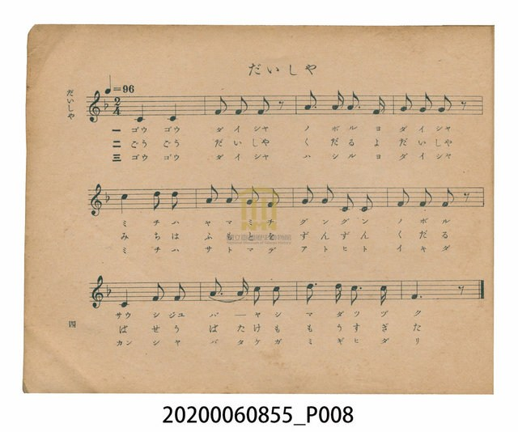
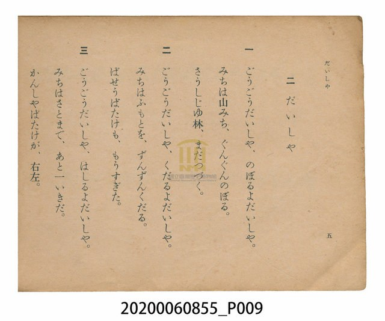

# だいしゃ（台車）

> Re:Shōka 使用 AI 協助辨識與重建樂譜，可能會有錯誤。歡迎回報。

- **鋼琴伴奏版**：<br><audio controls src="daisha.mp3"></audio>
- **NEUTRINO 歌聲合成版**：<br><audio controls src="daisha_neutrino.mp3"></audio>

- 山本奈良男 作詞（懸賞募集入選原題〈臺車〉）
- 日治時期公學校唱歌（第三學年・第二課）
- 國立臺灣歷史博物館典藏

## 說明


- 出處：臺灣總督府編《公學校唱歌》第三學年用，第二課〈だいしゃ〉（台車），原書第 4–5 頁。
- 調性與拍號：ヘ調（F 大調），2/4 拍，速度 != 96。
- 背景與曲風：最具臺灣地方色彩的公學校唱歌之一。「台車」（輕便車）是日治時期臺灣山區與
鄉鎮間重要的窄軌手押台車交通工具。歌詞生動描繪台車「轟隆轟隆（ごうごう）」爬上山路、
衝下山麓、駛向村里，沿途經過臺灣特有的「相思樹林（さうしじゆ林）」、「芭蕉園（ばせうばたけ）」
與「甘蔗田（かんしやばたけ）」，節奏明快活潑。
- 版本說明：本檔案為原書單聲部簡譜（數字譜）之忠實數位化版本。

### 編曲說明（鋼琴伴奏版）：

1. 前奏 (Intro, 4 小節)：以分解大三和弦上行與輕快切分節奏，模擬台車啟動出發的活力。
2. 主歌伴奏 (Daisha, 12 小節 × 3 段)：右手 (PianoRH) 演奏附點與三連音交織的主旋律；
左手 (PianoLH) 採用二拍子輕快步伐伴奏（低音單音 + 首調和弦 [1]、[4]、[5]），呈現台車在軌道上行進的律動。


## 歌詞

```text
一　ごうごうだいしや、のぼるよだいしや。
みちは山みち、ぐんぐんのぼる。
さうしじゆ林、まだつづく。

二　ごうごうだいしや、くだるよだいしや。
みちはふもとを、ずんずんくだる。
ばせうばたけも、もうすぎた。

三　ごうごうだいしや、はしるよだいしや。
みちはさとまで、あと一いきだ。
かんしやばたけが、右左。
```

## ABC

<div class="abc-score" data-abc-src="daisha.abc" aria-label="五線譜載入中"></div>

[下載 ABC 原始檔](daisha.abc)

## TMD 檔案連結

- [主旋律 TMD 檔案](daisha.tmd) [[在 TMD Studio 編輯](https://tmdlang.github.io/Tmd-TS/#tmd=s7IKdvYPcrWy4qpTUCpJTLdSSM7PyUlNLsnMz7PKzk9PzM7Ojy_OyM9OVIKrKMvPKc1NtUovSkxJjTdGiBfnlxYlp1oVJ2fk5-fEl6RWlCTl52cj5AuK8stS8xLzgGoKijLzSlJTwIoQClLLMlNSQdKpKZkl-UWZiTlIlqYWFYPcBLEkvqQoMa84uSizAORQhKr8opKMfKDDCjIqrTIyi0GGJCfmxGcn5iG5vyQjFeh8sAkFQA3IujPTM_OsShIzyxPz4vPT0jKTUdyAKp-cD_RCcUm8oaUxRiDEFySmp1oFGBhYKHFpaSk8blzwuLHlceP0x03N7_d0PO3f8GJ31_s9nQpaWlyKtgqWZlz2tgpuXDZG-iZ2IJOebtz4bM6ap0s7XnSufz5lu8KTvXNerJwH1PmsfceLzfOeds9_ObvtaevSl407nvbNf7mw53FDx4v2XUBDHzd0As0FO-fZ9KXPNu1-NrPp2Zz5T1vXPF2749mChU-nbHy2tgdo0vM1a57s6AQKPt255XHzbhB3V8-LVZtgup_O6X6-uhto6PPGxc_Wbn_av-lp76znnStfLlnxtHXHi-n9Slxc-loKttQCXAoKCo8bJjybven57HUvVq16NqPvccNEsGjz7qdAv82c-n7PLIh7nu_Y-3zu4qe75jzfvuJxQxea5x43dCN77vmUFe_39MD9Bwwp5NgAhxciQoAqgQH6bPYOoHoFk0cNk00VXi5ofNzQBHXIi1X7nzUsf9HR_qy798XM-UAXPW6eARQEmuGm8HTJcjATZAowJhWAaoCslw3zn-5apgCOZiSDmnuezVwPMmj2ppeLgC6c9WxOw9PW7RAPPp2z4dm0nS86Nz3du_L5rBY0Dz7Z2f1kRwPQrMcNPRCXP24A2tTxYs_UJ_v2QzzybMZ65PiHGrtx49PeBqClIEcoKLxs6XzZt-7ltMkv23tfLGsEWvR8VcuL3T3POrufde2BmPxk15KXDbOebl8KdBvQRqDtwIT4fMr8p91Tn_X3P9-5CuaAnhd757-c1QYhgY553DjlcWMbhAS6B-jC5x3ASOkCuuHF9vWPGxohbnixcO6THd1AwZe7JgMFXy6f_XTCxGdzJ75sBybSnmeb9r9smPJ82-SXjX3QqO_c-WxOJ9CpQBufz97xrGHusxU7n82bDrZxKtjG6Y8bZzxuagMLguwFGgtyXtfaF1M7n86ZBFa54XHjbLBiIGP-48aJEJVQJ3W0gwyfMuPFlOnPp2wAq-9-3DQZnGCAyQZFCyhprW94urQfmF6f7l_9bMvuZ3snIqL5eWcHMCNDkjM4jtc8WzXl2cKO5027IOns6bR1Lxo3vWxe8XzDwhdr54Cy-NQdT9dOB7M7gTH9dP-Cp-uXAQWf7O192jMNYiDIAmiGgRgDiZenrSueTWsHuv_JjrUgxqp5L9YCgxro1I6nG3qftXcqZOYCyyUjvayC1HQFfQVg-WQJtAVsFDhFNSDHGlI2AYZ24-PGdY8b9zxuAgYFcg4CSkE827j_cePCx43rgXEJZYP0TAAHHISE6YdpQI8usIZ9YLOXPG5c-rixH6oUlLbBfgGVAOAEBkSgfAHNtj3ApPV07sKnszthqbHpZeNkYDID5gJIegOqAXrwRdNCYEn6bMPip_sagEkRqAuoEjUV9bxsagGp3L7--bb9T3dvezER6KwmeCDtApYu-AOpHyRCMJAeN2593NT0uHHF46ZJYG2zwCEEIWFGwPSgJ1aQTqAekH6g4MzHjX0gcSKDCpTbUIMKmMmAvgSFU-tmSLCBgmHxbGByBpZD4KDqBmZToEp4Hnqyc_7T7ZuA-fJZ3wJQ1ty1-um-nie72pCDagcwe-APKmAoANmEgwqYTlaAE8ZysDZQsIFSK0hDL0gnTAOWTPq4ERhhjU_7Nz_dvozYEHq6dMrLZZufTliOSEyzFwGLpBd9XU_7Vz3tXAkqqYHe3dHwtH8xMDEB9b7YPheoBhIA8ILj6ZwVkOAE2g1yQevKZ9Mbn26c-nIaKGpB4QR0DeUVJxQoaOlzcbkkZhZnJFoFZCbm5TvUGNRUg0s0GxMtOzADW32tAK4rG14s7FHQMFF4uqEfWJxpYlEGNB5kRI2CaTwI1ShoGCqAoIGmqoauriZIwFhBFwiNQQKaMJ4hhAeUNVIAQbhysGk-hjUKj5u2PG5aBqOACh83NwB5S4B4--PmJUAdEME-sHmPm-cAzX7cvBrKWwGVxdACMd8IaD448cEokOLGBUBeCxCDkgrM_MZ-iImNC0DmN3VDeE0dUFkMLRDzjYl3P9T8pu1Euh9_jAHbMsTHmIKGmYIZPCKM4VFkhBo9UFFwBMPF0WIZEW3N80HubgQy-qF-ALq_eR7Yd_OBrEaIaNMGIHszOEyhLGhsAmMSiFejR9Z-UGgvBDLWQ0N-KzBUmkD6G1cAWZOgorOA7MlgUSgLGofgmALGHmoUYbi1CWhqMzBugaLzgKx2qOgiuOgkCAssCoqXtUB-AzERs6OTpKwECl94WJuBEwU0pjRMFUxxyoB4CFlDMB9b1gLWMstAXtgOZO943LwMGvoTwBpARoFjDZQmweLzoKkS6GwgrwXKa4WGw3qoNSjxtQEU7rOBjDZoHGyA5qP54NiZCIk9sP4mqAxQJVBmJpTXB9U3H810cNZaDUwxUPc3L0Fx_OOm_eBEtRHIWgOVgRjxuGkdNArhngHLrkJYUMvFpWunACktFYAsZS4A)]
- [鋼琴伴奏 TMD 檔案](daisha_piano.tmd) [[在 TMD Studio 編輯](https://tmdlang.github.io/Tmd-TS/#tmd=s7IKdvYPcrWy4qpTUCpJTLdSSM7PyUlNLsnMz7PKzk9PzM7Ojy_OyM9OVIKrKMvPKc1NtTJGiBTnlxYlp-JSX1CUX5aal5gHVFGSmFmemBefDhQoyssvik9PzUstSsxBqE0ty0xJBaksKMrMTSyqjE_JTwZalleCZH1qUTHIdQWZiXn58YlFRYl56amoSvKLSjLy04sSCzIqrTIyi0vyizKTE3PisxPzkJxVkgHUZZWaUpqcCPItum_iCxLTU60CDAwslLi0tBQeNy543NjyuHH646bm93s6nvZveLG763Hz7pfde55P2PJkz5anS_ufd3a839OpoKXFpWirYGnGZW-r4MZlY6RvYgcy-9n0pc827X42s-nZnPlPW9c8Xbvj2YKFT6dsfLa2B2jg8zVrnuzoBAo-3bkFaCyIu6vnxapNQAPBLns6p_v56u4X7bueNy5-tnb70_5NT3tnPe9c-XLJiqetO15M71fi4tLXUrClFuBSUFB43DDh2exNz2eve7Fq1bMZfY8bJoJFm3c_bd_1YubU93tmQdzzfMfe53MXP9015_n2FY8butA897ihG9lzz6eseL-nB-6_xw0dyEH7uKETHrpArwNVPu2b_2z2DqB6BZNHDZNNFV4uaHzc0AR1yItV-581LH_R0f6su_fFzPlAFz1ungEUBJrhpvB0yXIwE2QKMBIUgGqArJcN85_uWqYAjiEkg5p7ns1cDzJo9qaXi4AunPWsv__p-tXIkQb1bOfOZ3M6n89qebFn6pN9-1_s7nnZOPlxQw80RTT0Pl-5_9mitc-m7Xk-e8ezhrnPVux8Nm_644bGF11rX0ztfDpnEtCW51NmvJgy_fmUDS-nTQa6CeQIBYUnO7qezl0IVPlkRzeE8XTplKcTJj6bO_HFhL0QG5_uXw1y50agLMzpwEAHOhoSRUB_YyZIoGcgFhjqKTzt7AWKK2h45pUU5esomCg83dD_fH2DJlDNk91Ln3a0vVi-GBhuoNia1PN0zzKgm14s7AG6GGL30452oBqgBqAhQHc_W7Hw2eQ1EJ8_nTr_afdUYMp4PnMP0K3Ptux-2jUb6koFBSM9oPd2A1MDxGEKGi6JmcUZiToKhkZQJygcnq5grPBs3VaQW572b37W2a2gEQDK40EemgrP9kwBans5s-Xl7nlA1wDd97Jh8cv5m5_sWvJ85xSgfSDTp3c_3df9fs9siJVA8HT7MoQxPiBj-hYC0x8w5QHTwtO1E6ABunbpkz0TIA4DBuCTvX1Ag59OWwckFbQVXi6bBkxFkNBQiDaMBUZLtAmYNI2FptCJHc_790FDYc4KSIqABNzLhk1AtwFdBQwaUFhAcxUkTQND48XKeU9bVzyb1g72EzDRtL9YNe_F2vXArAbKBht6n7V3KgALwvRUI72sgtR0BX0FYIlkCbQXbNSTHQ2PGxoeN0553NgGI-F5qQXoxseN6x437nnc1P24CTmbAaUgqadx_-PGhY8b1z_duBHKBumZ8LhpMoyE6YdpmAq2ZPrjxhmPm9ogCftx4z6w2UseNy593NgPVQp0P8QvoGJi7_yXs9qACBQY0Lzd87xjDTCVP53dCcs5TcBge7F9_bMZIOcAGUA1QA--aFr4ZO-cZxsWP93XAAxUoC6gSuSsBcrTTcD4bwBqeb5t_9Pd215MBDqrCR5Iu4BFEP5A6geJEAykx41bHzc1PW5c8bhpEljbLHAIQUiYETA9Gx43zgZbBWTMf9w4EaQTqAekHyg483FjH0icyKCCFAjIQfVs036gL0Hh1LoZEmygYFg8G5RH52wAB1X3i4VzgSrhxc6TnfOfbt_0fNvkZ30LXjb2vdi1-um-nie72pCDakcnoaAChgKQTTiogOlkBThhLAdrAwUbKLWCNPSCdMI0AE0Chh7YDHhQNQIjrBFYBACzL7EhBCwpXy7b_HTCckRimr0IVHD2dT3tX_W0c-WzOQ0g7-5oeNq_GJiYQKXp9rlANZAAgJfHwPwLCU6g3SAXtK58Nr3x6capL6eBohYUTkDXUF67QoGClj6FtTbIOShluqYVvFBX0IDWeprguN29FFrcbdn9bO9EeOBBSilg-fRs5XyIRynzIthPYKdYQUtvhxqDmmpwmWxjomUHZgD9DCniQWU92PnA8vvlwh6QZpB8jYKGoYKxpqqGrqaChqmCYRyECRQ2UzCDC0MVAEWN4YqNFAzhokYKRgqm8QoGIAGQCFctist8cLkMXGuAUho4vGA1Fp56AdigeDZ1B6h20FEAVg5AwjRWE-EXw3iQFJBhAmSYgBhwEaDzgGohTqM4IUBqWGAVCqtegYkBUb-ipAZI6D9v2gVpoyHVnj0Q7wOloB7u7wJ68kXjJkg4UCFxQNyGP3Vg6gS3IRuAqVVBA95qwaIMHujAkAUicEICQXgiACUWXSCEJRgIDzXRGCGlGZBpPoY1Co-btjxuWgajgAofNzcAeUuAePvj5iVAHRDBPrB5j5vnAM1-3LwaylsBlcXQAjHfCGg-uLyFUSDFjQuAvBYgBpWOMPMb-yEmNi4Amd_UDeE1dUBlMbRAzDcm3v1Q85u2E-l-_DEGbOMTH2NIuRtfnoblf1AEw8XRYhkRbc3zQe5uBDL6oX4Aur95Hth384GsRoho0wYgezM4TKEsaGwCYxKIV6NH1n5QaC8EMtZDQ34rMFSaQPobVwBZk6Cis4DsyWBRKAsah-CYAsYeahRhuLUJaGozMG6BovOArHao6CK46CQICywKipe1QH4DMRGzo5OkrAQKX6QyGJQoEOWwKU4ZEA8hawjmY8tawIbVMpAXtgPZOx43L4OG_gSwBpBR4FgDpUmw-DxoqgQ6G8hrgfJaoeGwHmoNSnxtAIX7bCCjDRoHG6D5aD44diZCYg-svwkqA1QJlJkJ5fVB9c1HMx2ctVYDUwzU_c1LUBz_uGk_OFFtBLLWQGUgRjxuWgeNQrhnwLKrEBYAKwXkwhJXhYUjhkkoLOH1ESYDXkNRL6PjrgbhIlRMvSi1L5wBtg3ENYCEs66dArhpANYE5EDCPdrHMBZdxAhDxBguoswFAA)]

## 分析

```text
================================================================================
📊 TMD Song Profile: [ だいしゃ（台車） ]
================================================================================
⏱  Duration:       0:15 (15.0s), 12 measures total
🎼 Key & Tempo:    首調基準 F, != 96.0 BPM, <2/4>
   - 分析範圍：      由實際發聲的音符與和弦推測調性；播放脈絡另行呈現
🎤 人聲音域:    C4 (MIDI 60) – D5 (MIDI 74) [跨度: 14 個半音 / 1.2 個八度, 難度: moderate]
   - 最低音:  C4 in [Daisha #1 @ m.1, 0:00]
   - 最高音: D5 in [Daisha #1 @ m.5, 0:05]
   - 適合: soprano, mezzo-soprano, contralto, tenor, baritone, bass
🏛  結構:      Daisha (15.0s)
⚡ 編曲密度:        Peak 1 軌道同時演奏
🗝  調性診斷：       F 大調（純淨自然大調，未偵測到可信轉調）
   - 風格氣質:    純淨自然大調（陽光明朗、易唱易記，無明顯調外色彩）
   - 轉調歷程:    全曲維持單一推測調性（未偵測到可信轉調）
   - 核心骨幹音:  C, F, D, G, A
   - 調性數值:    F 大調 [相關度: 0.88, 穩定度: Moderate, 自然音純度: 100.0%]
   - 候選調性 (K-S): F 大調 (0.88), C 大調 (0.79), A 小調 (0.55)
   - 五度圈歷程:   -1
   - 各段落調性細節:
     • [Daisha #1]: F 大調 (r: 0.88, 自然音純度: 100.0%)

  [ 五度圈游移軌跡 ]
               C  
        [F ]*          G  
      Bb               D  
      Eb               A  
         Ab           E  
            Db       B  
               F# 
     (* = active key center)

  [ 十二半音累積音高分佈 ]
     C  : ████████████████████████  31.8%
     C# :                            0.0%
     D  : ██████████                13.6%
     D# :                            0.0%
     E  :                            0.0%
     F  : █████████████████████     28.4%
     F# :                            0.0%
     G  : ██████████                13.6%
     G# :                            0.0%
     A  : █████████                 12.5%
     A# :                            0.0%
     B  :                            0.0%
--------------------------------------------------------------------------------
Assignment 軌道音域：
  - Piano         : C4 – D5 (14 個半音 / 1.2 個八度, 38 個音符)
================================================================================
```


## 原書掃描頁






