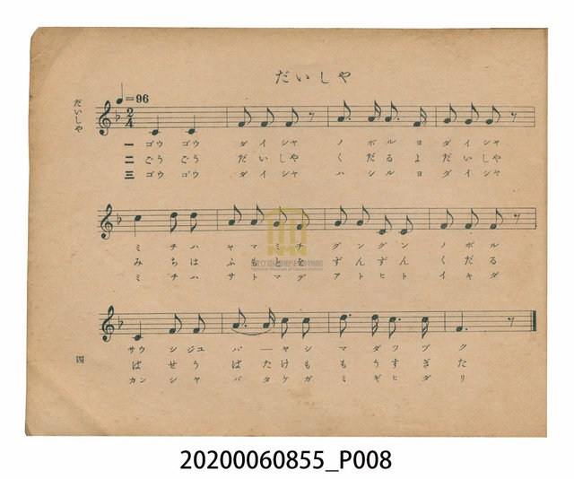
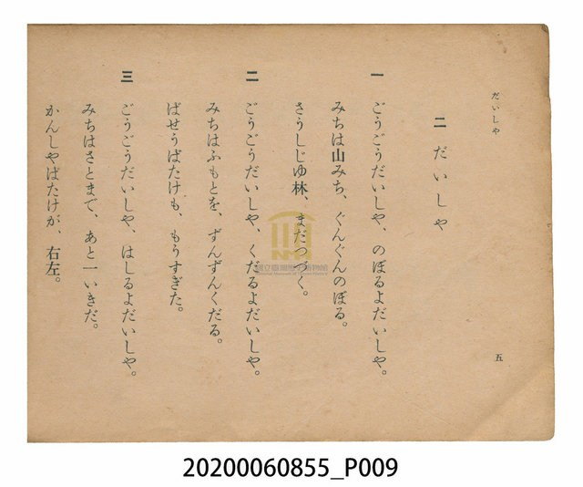

# だいしゃ（台車）

> Re:Shōka 使用 AI 協助辨識與重建樂譜，可能會有錯誤。歡迎回報。

- **NEUTRINO 歌聲合成版**：<br><audio controls src="daisha_neutrino.mp3"></audio>
- **鋼琴伴奏版**：<br><audio controls src="daisha.mp3"></audio>


- 山本奈良男 作詞（懸賞募集入選原題〈臺車〉）
- 日治時期公學校唱歌（第三學年・第二課）
- 國立臺灣歷史博物館典藏

## 說明


- 出處：臺灣總督府編《公學校唱歌》第三學年用，第二課〈だいしゃ〉（台車），原書第 4–5 頁。
- 調性與拍號：ヘ調（F 大調），2/4 拍，速度 != 96。
- 背景與曲風：最具臺灣地方色彩的公學校唱歌之一。「台車」（輕便車）是日治時期臺灣山區與
鄉鎮間重要的窄軌手押台車交通工具。歌詞生動描繪台車「轟隆轟隆（ごうごう）」爬上山路、
衝下山麓、駛向村里，沿途經過臺灣特有的「相思樹林（さうしじゆ林）」、「芭蕉園（ばせうばたけ）」
與「甘蔗田（かんしやばたけ）」，節奏明快活潑。
- 版本說明：本檔案為原書單聲部簡譜（數字譜）之忠實數位化版本。

### 編曲說明（鋼琴伴奏版）：

1. 前奏 (Intro, 4 小節)：以分解大三和弦上行與輕快切分節奏，模擬台車啟動出發的活力。
2. 主歌伴奏 (Daisha, 12 小節 × 3 段)：右手 (PianoRH) 演奏附點與三連音交織的主旋律；
左手 (PianoLH) 採用二拍子輕快步伐伴奏（低音單音 + 首調和弦 [1]、[4]、[5]），呈現台車在軌道上行進的律動。


## 歌詞

```text
一　ごうごうだいしや、のぼるよだいしや。
みちは山みち、ぐんぐんのぼる。
さうしじゆ林、まだつづく。

二　ごうごうだいしや、くだるよだいしや。
みちはふもとを、ずんずんくだる。
ばせうばたけも、もうすぎた。

三　ごうごうだいしや、はしるよだいしや。
みちはさとまで、あと一いきだ。
かんしやばたけが、右左。
```

## ABC

```abc
X:1
T:だいしゃ（台車）
M:2/4
L:1/16
Q:1/4=96
K:F
V:V1 name="Piano" snm="Pia"
[V:V1]
C4 C4 | F2 F2 F2 z2 | A3 A A3 F | G2 G2 G2 z2 |
w: 1.~ゴウ ゴウ | ダ イ シヤ | ノ ボ ル ヨ | ダ イ シヤ
w: 2.~ごう ごう | だ い しや | く だ る よ | だ い しや
w: 3.~ゴウ ゴウ | ダ イ シヤ | ハ シ ル ヨ | ダ イ シヤ
c4 d2 d2 | A2 A2 G2 F2 | G2 G2 C2 C2 | F2 F2 F2 z2 |
w: 1.~ミ チ ハ | ヤ マ ミ チ | グ ン グ ン | ノ ボ ル
w: 2.~み ち は | ふ も と を | ず ん ず ん | く だ る
w: 3.~ミ チ ハ | サ ト マ デ | ア ト ヒ ト | イ キ ダ
C4 F2 F2 | d3 d c2 c2 | d3 d c3 c | F6 z2 |
w: 1.~サウ シ ジユ | バ _ ヤ シ | マ ダ ツ ヅ | ク
w: 2.~ば せ う | ば た け も | も う す ぎ | た
w: 3.~カン シ ヤ | バ タ ケ ガ | ミ ギ ヒ ダ | リ
```

## TMD 檔案連結

- [主旋律 TMD 檔案](daisha.tmd) [[在 TMD Studio 編輯](https://tmdlang.github.io/Tmd-TS/#tmd=s7IKdvYPcrWy4qpTUCpJTLdSSM7PyUlNLsnMz7PKzk9PzM7Ojy_OyM9OVIKrKMvPKc1NtUovSkxJjTdGiBfnlxYlp1oVJ2fk5-fEl6RWlCTl52cj5AuK8stS8xLzgGoKijLzSlJTwIoQClLLMlNSQdKpKZkl-UWZiTlIlqYWFYPcBLEkvqQoMa84uSizAORQhKr8opKMfKDDCjIqrTIyi0GGJCfmxGcn5iG5vyQjFeh8sAkFQA1KXFpaCo8bFzxubHncOP1xU_P7PR1P-ze82N31fk-ngpYWl6KtgqUZl72tghuXjZG-iR3IoKcbNz6bs-bp0o4XneufT9mu8GTvnBcr5wF1Pmvf8WLzvKfd81_ObnvauvRl446nffNfLux53NDxon0X0NDHDZ1Ac8GueTZ96bNNu5_NbHo2Z_7T1jVP1-54tmDh0ykbn63tAZr0fM2aJzs6gYJPd2553LwbxN3V82LVJpjup3O6n6_uBhr6vHHxs7Xbn_Zveto763nnypdLVjxt3fFier8SF5e-loIttQCXgoLC44YJz2Zvej573YtVq57N6HvcMBEs2rz7KdBvM6e-3zML4p7nO_Y-n7v46a45z7eveNzQhea5xw3dyJ57PmXF-z09cP8BQwo5NsDhhYgQoEpggD6bvQOoXsHkUcNkU4WXCxofNzRBHfJi1f5nDctfdLQ_6-59MXM-0EWPm2cABYFmuCk8XbIczASZAoxJBaAaIOtlw_ynu5YpgKMZyaDmnmcz14MMmr3p5SKgC2c9m9PwtHU7xINP52x4Nm3ni85NT_eufD6rBc2DT3Z2P9nRADTrcUMPxOWPG4A2dbzYM_XJvv0QjzybsR45_qHGbtz4tLcBaCnIEQoKL1s6X_atezlt8sv23hfLGoEWPV_V8mJ3z7PO7mddeyAmP9m15GXDrKfblwLdBrQRaDswIT6fMv9p99Rn_f3Pd66COaDnxd75L2e1QUigYx43Tnnc2AYhge4BuvB5BzBSuoBueLF9_eOGRogbXiyc-2RHN1Dw5a7JQMGXy2c_nTDx2dyJL9uBibTn2ab9LxumPN82-WVjHzTqO3c-m9MJdCrQxuezdzxrmPtsxc5n86aDbZwKtnH648YZj5vawIIge4HGgpzXtfbF1M6ncyaBVW543DgbrBjImP-4cSJEJdRJHe0gw6fMeDFl-vMpG8Dqux83TQYnGGCyQdECSlrrG54u7Qem16f7Vz_bsvvZ3omIaH7e2QHMyJDkDI7jNc9WTXm2sON50y5IOns6bd2Lxk0vm1c837Dwxdo5oCw-dcfTtdPB7E5gTD_dv-Dp-mVAwSd7e5_2TIMYCLIAmmEgxkDi5WnrimfT2oHuf7JjLYixat6LtcCgBjq14-mG3mftnQqZuYnpqUZ6WQWp6Qr6CgEGBpZAW8BGgVNUA3KsIWUTYGg3Pm5c97hxz-MmYFAg5yCgFMSzjfsfNy583LgeGJdQNkjPBHDAQUiYfpgG9OgCa9gHNnvJ48aljxv7oUpBaRvsF1AJAE5gQATKF9Bs2wNMWk_nLnw6uxOWGpteNk4GJjNgLoCkN6AaoAdfNC0ElqTPNix-uq8BmBSBuoAqUVNRz8umFpDK7eufb9v_dPe2FxOBzmqCB9IuYOmCP5D6QSIEA-lx49bHTU2PG1c8bpoE1jYLHEIQEmYETA96YgXpBOoB6QcKznzc2AcSJzKoQLkNNaiAmQzoS1A4tW6GBBsoGBbPBiZnYDkEDqpuYDYFqoTnoSc75z_dvgmYL5_1LQBlzV2rn-7rebKrDTmodgCzB_6gAoYCkE04qIDpZAU4YSwHawMFGyi1gjT0gnTCNGDJpI8bgRHW-LR_89Pty4gNoadLp7xctvnphOWIxDR7EbBIetHX9bR_1dPOlaCSGujdHQ1P-xcDExNQ74vtc4FqIAEALziezlkBCU6g3SAXtK58Nr3x6capL6eBohYUTkDXUF5xQoGClj4Xl0tiZnFGolVAZmJevkONQU01uESzMdGyAzOw1dcK4Lqy4cXCHgUNE4WnG_qBxZkmFmVA40FG1CiYxoNQjYKGoQIIGmiqaujqaoIEjBV0gdAYJKAJ4xlCeEBZIwUQhCsHm-ZjWKPwuGnL46ZlMAqo8HFzA5C3BIi3P25eAtQBEewDm_e4eQ7Q7MfNq6G8FVBZDC0Q842A5oMTH4wCKW5cAOS1ADEoqcDMb-yHmNi4AGR-UzeE19QBlcXQAjHfmHj3Q81v2k6k-_HHGLAtQ3yMKWiYKZjBI8IYHkVGqNEDFQVHMFwcLZYR0dY8H-TuRiCjH-oHoPub54F9Nx_IaoSINm0AsjeDwxTKgsYmMCaBeDV6ZO0HhfZCIGM9NOS3AkOlCaS_cQWQNQkqOgvIngwWhbKgcQiOKWDsoUYRhlubgKY2A-MWKDoPyGqHii6Ci06CsMCioHhZC-Q3EBMxOzpJykqg8IWHtRk4UUBjSsNUwRSnDIiHkDUE87FlLWAtswzkhe1A9o7HzcugoT8BrAFkFDjWQGkSLD4PmiqBzgbyWqC8Vmg4rIdagxJfG0DhPhvIaIPGwQZoPpoPjp2JkNgD62-CygBVAmVmQnl9UH3z0UwHZ63VwBQDdX_zEhTHP27aD05UG4GsNVAZiBGPm9ZBoxDuGbDsKoQFtVxcunYKkNJSAchS5gIA)]
- [鋼琴伴奏 TMD 檔案](daisha_piano.tmd) [[在 TMD Studio 編輯](https://tmdlang.github.io/Tmd-TS/#tmd=s7IKdvYPcrWy4tLSUnjcuOBxY8vjxumPm5rf7-l42r_hxe6ux827X3bveT5hy5M9W54u7X_e2fF-T6eClhaXoq2CpRmXva2CG5eNkb6JHVedgtKz6Uufbdr9bGbTsznzn7auebp2x7MFC59O2fhsbQ_QwOdr1jzZ0QkUfLpzC9BYEHdXz4tVm4AGKoF0P53T_Xx194v2Xc8bFz9bu_1p_6anvbOed658uWTF09YdL6b3K3Fx6Wsp2FILcCkoKDxumPBs9qbns9e9WLXq2Yy-xw0TwaLNu5-273oxc-r7PbMg7nm-Y-_zuYuf7przfPuKxw1daJ573NCN7LnnU1a839MD99_jhg7koH3c0AkPXaDXgSqf9s1_NnsHUL2CyaOGyaYKLxc0Pm5ogjrkxar9zxqWv-hof9bd-2LmfKCLHjfPAAoCzXBTeLpkOZgJMgUYCQpANUDWy4b5T3ctUwDHEJJBzT3PZq4HGTR708tFQBfOetbf_3T9auRIg3q2c-ezOZ3PZ7W82DP1yb79L3b3vGyc_LihB5oiGnqfr9z_bNHaZ9P2PJ-941nD3Gcrdj6bN_1xQ-OLrrUvpnY-nTMJaMvzKTNeTJn-fMqGl9MmA90EcoSCwpMdXU_nLgSqfLKjG8J4unTK0wkTn82d-GLCXoiNT_evBrlzI1AW5nRgoAMdDYkioL8xEyTQMxALDPUUnnb2AsUVNDzzSorydRRMFJ5u6H--vkETqObJ7qVPO9peLF8MDDdQbE3qebpnGdBNLxb2AF0MsftpRztQDVAD0BCgu5-tWPhs8hqIz59Onf-0eyowZTyfuQfo1mdbdj_tmg11pYKCkR7Qe7uBqQHiMAUNl8TM4oxEHQVDI6gTFA5PVzBWeLZuK8gtT_s3P-vsVtAIyEzMyw_y0FR4tmcKUNvLmS0vd88DugbovpcNi1_O3_xk15LnO6cA7QOZPr376b7u93tmQ6wEgqfblyGM8QEZ07cQmP6AKQ-YFp6unQAN0LVLn-yZAHEYMACf7O0DGvx02jogqaCt8HLZNGAqgoSGQrRhLDBaok3ApGksNIVO7Hjevw8aCnNWQFIEJOBeNmwCug3oKmDQgMICmqsgaRoYGi9WznvauuLZtHawn4CJpv3Fqnkv1q4HZjVQNtjQ-6y9UyEzNzE91UgvqyA1XUFfIcDAwBJoL9ioJzsaHjc0PG6c8rixDUbC81IL0I2PG9c9btzzuKn7cRNyNgNKQVJP4_7HjQsfN65_unEjlA3SM-Fx02QYCdMP0zAVbMn0x40zHje1QRL248Z9YLOXPG5c-rixH6oU6H6IX0DFxN75L2e1AREoMKB5u-d5xxpgKn86uxOWc5qAwfZi-_pnM0DOATKAaoAefNG08MneOc82LH66rwEYqEBdQJXIWQuUp5uA8d8A1PJ82_6nu7e9mAh0VhM8kHYBiyD8gdQPEiEYSI8btz5uanrcuOJx0ySwtlngEIKQMCNgejY8bpwNtgrImP-4cSJIJ1APSD9QcObjxj6QOJFBBSkQkIPq2ab9QF-Cwql1MyTYQMGweDYoj87ZAA6q7hcL5wJVwoudJzvnP92-6fm2yc_6Frxs7Huxa_XTfT1PdrUhB9WOTkJBBQwFIJtwUAHTyQpwwlgO1gYKNlBqBWnoBemEaQCaBAw9sBnwoGoERlgjsAgAZl9iQwhYUr5ctvnphOWIxDR7Eajg7Ot62r_qaefKZ3MaQN7d0fC0fzEwMYFK0-1zgWogAQAvj4H5FxKcQLtBLmhd-Wx649ONU19OA0UtKJyArqG8doUCBS19CmttkHNQynRNK3ihrqABrfU0wXG7eym0uNuy-9neifDAg5RSwPLp2cr5EI9S5kWwn8BOsYKW3g41BjXV4DLZxkTLDswA-hlSxIPKerDzgeX3y4U9IM0g-RoFDUMFY01VDV1NBQ1TBcM4CBMobKZgBheGKgCKGsMVGykYwkWNFIwUTOMVDEACIBGuWhSX-eByGbjWAKU0cHjBaiw89QKwQfFs6g5Q7aCjAKwcgIRprCbCL4bxICkgwwTIMAEx4CJA5wHVQpxGcUKA1LDAKhRWvQITA6J-RUkNkNB_3rQL0kZDqj17IN4HSkE93N8F9OSLxk2QcKBC4oC4DX_qwNQJbkM2AFOrgga81YJFGTzQgSELROCEBILwRABKLLpACEswEB5qojFCSjMg03wMaxQeN2153LQMRgEVPm5uAPKWAPH2x81LgDoggn1g8x43zwGa_bh5NZS3AiqLoQVivhHQfHB5C6NAihsXAHktQAwqHWHmN_ZDTGxcADK_qRvCa-qAymJogZhvTLz7oeY3bSfS_fhjDNjGJz7GkHI3vjwNy_-gCIaLo8UyItqa54Pc3Qhk9EP9AHR_8zyw7-YDWY0Q0aYNQPZmcJhCWdDYBMYkEK9Gj6z9oNBeCGSsh4b8VmCoNIH0N64AsiZBRWcB2ZPBolAWNA7BMQWMPdQownBrE9DUZmDcAkXnAVntUNFFcNFJEBZYFBQva4H8BmIiZkcnSVkJFL5IZTAoUSDKYVOcMiAeQtYQzMeWtYANq2UgL2wHsnc8bl4GDf0JYA0go8CxBkqTYPF50FQJdDaQ1wLltULDYT3UGpT42gAK99lARhs0DjZA89F8cOxMhMQeWH8TVAaoEigzE8rrg-qbj2Y6OGutBqYYqPubl6A4_nHTfnCi2ghkrYHKQIx43LQOGoVwz4BlVyEsAFYKyIUlrgoLRwyTUFjC6yNMBryGol5Gx10NwkWomHpRal84A2wbiGsACWddOwVw0wCsCciBhHu0j2EsuogRhogxXESZCwA)]

## 分析

```text
================================================================================
📊 TMD Song Profile: [ だいしゃ（台車） ]
================================================================================
⏱  Duration:       0:15 (15.0s), 12 measures total
🎼 Key & Tempo:    首調基準 F, != 96.0 BPM, <2/4>
   - 分析範圍：      由實際發聲的音符與和弦推測調性；播放脈絡另行呈現
🎤 人聲音域:    C4 (MIDI 60) – D5 (MIDI 74) [跨度: 14 個半音 / 1.2 個八度, 難度: moderate]
   - 最低音:  C4 in [Daisha #1 @ m.1, 0:00]
   - 最高音: D5 in [Daisha #1 @ m.5, 0:05]
   - 適合: soprano, mezzo-soprano, contralto, tenor, baritone, bass
🏛  結構:      Daisha (15.0s)
⚡ 編曲密度:        Peak 1 軌道同時演奏
🗝  調性診斷：       F 大調（純淨自然大調，未偵測到可信轉調）
   - 風格氣質:    純淨自然大調（陽光明朗、易唱易記，無明顯調外色彩）
   - 轉調歷程:    全曲維持單一推測調性（未偵測到可信轉調）
   - 核心骨幹音:  C, F, D, G, A
   - 調性數值:    F 大調 [相關度: 0.88, 穩定度: Moderate, 自然音純度: 100.0%]
   - 候選調性 (K-S): F 大調 (0.88), C 大調 (0.79), A 小調 (0.55)
   - 五度圈歷程:   -1
   - 各段落調性細節:
     • [Daisha #1]: F 大調 (r: 0.88, 自然音純度: 100.0%)

  [ 五度圈游移軌跡 ]
               C  
        [F ]*          G  
      Bb               D  
      Eb               A  
         Ab           E  
            Db       B  
               F# 
     (* = active key center)

  [ 十二半音累積音高分佈 ]
     C  : ████████████████████████  31.8%
     C# :                            0.0%
     D  : ██████████                13.6%
     D# :                            0.0%
     E  :                            0.0%
     F  : █████████████████████     28.4%
     F# :                            0.0%
     G  : ██████████                13.6%
     G# :                            0.0%
     A  : █████████                 12.5%
     A# :                            0.0%
     B  :                            0.0%
--------------------------------------------------------------------------------
Assignment 軌道音域：
  - Piano         : C4 – D5 (14 個半音 / 1.2 個八度, 38 個音符)
================================================================================
```


## 原書掃描頁






