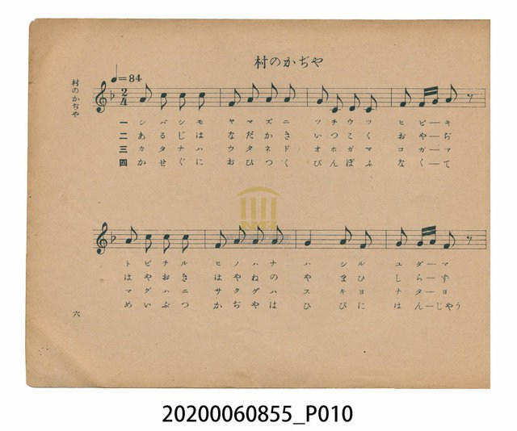
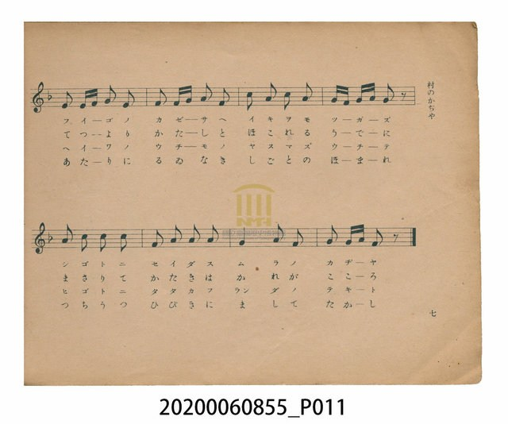
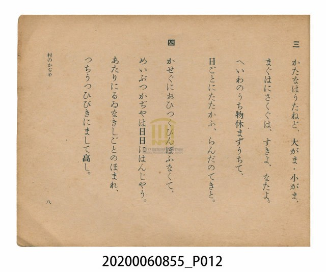
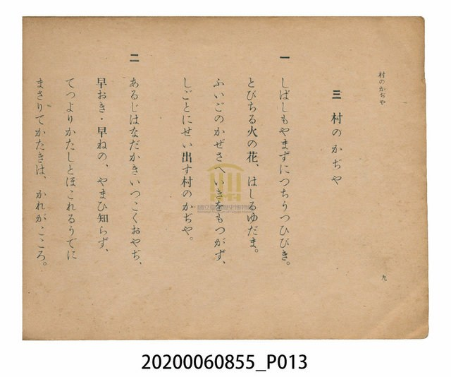

# 村のかぢや（村之鍛冶屋）

> Re:Shōka 使用 AI 協助辨識與重建樂譜，可能會有錯誤。歡迎[回報](https://github.com/TMDLang/reshoka/issues)。

- **鋼琴伴奏版**：<br><audio controls src="muranokajiya.mp3"></audio>
- **NEUTRINO 歌聲合成版**：<br><audio controls src="muranokajiya_neutrino.mp3"></audio>

- 日治時期公學校唱歌（第三學年・第三課／原曲：1912年『尋常小学唱歌』）
- 國立臺灣歷史博物館典藏

## 說明


- 出處：臺灣總督府編《公學校唱歌》第三學年用，第三課〈村のかぢや〉（村之鍛冶屋），原書第 6–9 頁。
原曲出自 1912 年（大正元年）日本文部省《尋常小學唱歌》第四學年（作詞：中村秋香，作曲：田村虎藏）。
- 調性與拍號：ヘ調（F 大調），2/4 拍，速度 != 84。
- 背景與曲風：描寫村莊裡勤奮不懈的鐵匠老爹（鍛冶屋），拉動風箱、揮鎚打鐵、火星四濺，
鍛造農具（大鐮、小鐮、馬鍬、鋤頭、柴刀），歌頌勞動者的堅毅精神。開頭同音反覆動機
「3 5 5 5 | 1 3 3 3」生動模仿鐵鎚敲擊鐵砧的清脆聲響。
- 版本說明：本檔案為原書單聲部簡譜（數字譜）之忠實數位化版本。

### 編曲說明（鋼琴伴奏版）：

1. 前奏 (Intro, 4 小節)：以「3 5 5 5 | 1 3 3 3」鐵鎚敲擊動機揭開序幕，確立鏗鏘有力的節奏。
2. 主歌伴奏 (Muranokajiya, 16 小節 × 4 段)：右手 (PianoRH) 演奏充滿附點與十六分音符彈性的主旋律；
左手 (PianoLH) 採用八分音符規律交替之低音與和弦（`1_ [1] 5_ [1]`），宛如鐵砧上不曾停歇的打鐵聲響。


## 歌詞

```text
一　しばしもやまずにつちうつひびき。
とびちる火の花、はしるゆだま。
ふいごのかぜさへいきをもつかず、
しごとにせい出す村のかぢや。

二　あるじはなだかきいつこくおやぢ、
早おき・早ねの、やまひ知らず、
てつよりかたしとほこれるうでに
まさりてかたきは、かれがこころ。

三　かたなはうたねど、大がま・小がま、
まぐはにさくぐは、すきよ、なたよ。
へいわのうち物休まずうちて、
日ごとにたたかふ、らんだのてきと。

四　かせぐにおひつくびんぽふなくて、
めいぶつかぢやは日日にはんじやう。
あたりにるゐなきしごとのほまれ、
つちうつひびきにまして高し。
```

## ABC

<div class="abc-score" data-abc-src="muranokajiya.abc" aria-label="五線譜載入中"></div>

[下載 ABC 原始檔](muranokajiya.abc)

## TMD 檔案連結

- [主旋律 TMD 檔案](muranokajiya.tmd) [[在 TMD Studio 編輯](https://tmdlang.github.io/Tmd-TS/#tmd=s7IKdvYPcrWy4qpTUCpJTLdSSM7PyUlNLsnMz7PKzk9PzM7Ojy_OyM9OVIKrKMvPKc1NtUovSkxJjTdGiBfnlxYlp1oVJ2fk5-fEl6RWlCTl52cj5AuK8stS8xLzgGoKijLzSlJTwIoQClLLMlNSQdKpKZkl-UWZiTlIlqYWFYPcBLEkvqQoMa84uSizAORQhCqgpvTMPKvc_LykUqCrMSVSM7MysTgtv6gkIx_ooYKMSquMzGKQ5cmJOfHZiXlI_i7JSAV6Oz85ubQgEdVaqKMKEtNTrQIMDA2UuLS0FJ7Nnfi4cd3jxu7HjYseN7W839MBFHmys_tl7-ynbduebux-v6dTQUuLS9FWwcKEy95WwY3LxkjfxA5k6rPpS59t2v1sZtOzOfOftq55unbHswULn07Z-GxtD9Cc52vWPNnRCRR8unPL4-bdEO6LVZve7-l_2jf_2WwgY5ahpaERSLqh7-mG7qc7djzd0P907TKIEY8b-oF2g53_dE7389XdL9p3PW9c_Gzt9qf9m572znreufLlkhVPW3e8mN6vxMWlr6VgSy3ApaCg8LhhAtCNz2eve7Fq1bMZfY8bJoJFm3c_bd_1YuZUoOMh7nm-Y-_zuYuf7przfPuKxw1daOHwuKEbORyeT1nxfk8PPCgeN4BCGzn8Hzd0Yo0CoC5woO0A6lUwe9Qw2VLh5YLGxw1NIEcpKEACFOSy9lUKoEBVAFoGNOjpkuXP1i5-2toM5naCImzOmmfT2l82r3g-B6i9CynYdyC7-Ons2RAXAw15snfOi5XzgB5-smMt0GXPl3e_XDYT6CCgOCQWn0_ZABR_MbMPGBNAW6CuAgbVi1X7nzUsf9HR_qy798XM-UClj5tnAAWBhropAN0GZoL8BkxRCkA1QNbLhvlPdy1TACc3JIOae57NXA8yaPaml4uAYTjrWX__0_WrQdb2db1YvPBp95KnS9c92dH7rL3j-ayWlxO2Pu1Z8KKh8XnHTqBlaCH5rLvzafdUoDnP12183ND4rH_dy75ZzzonA3UBuc8bVz-bMR8YAM_27wIqhgQw0ISXDQte7Nv0tHU7JFxfTlgHVAwMOQjj5bI1L3vXgBjdS14uWAsydv6Wpx0NUBvX9rxc0PO0ex7Q3hcNrUAXPl3Q-mx96_NN-54vnQf058tp3UBdTyf0vJy_-Wl_74tlbUCVz1bOh9j-uKHHWMEUDGsUDBWMQfBxQ-_zKfNBqlYsfLJ7P9DtIE9M3fRscheQ_XzBcqAlz3a0vmhpe9G46eX8_YjAfN7ZAUwFkGQNCklgilg15dnCjudNuyBp7Om0dSA9wDSyYeGLtXNACXLqjqdrp4PZncCU-XT_gqfrlwEFn-ztfdozDWIgyAJoxoEYA_Q0MN08bV0BTHDAqAOlHiBj1bwXa9cDcxMoFDcAo6tTITMXWCIZ62UVpKYrqEF4JhCevgKwnDICpnYgZQy0Gmz-kx0NjxsaHjdOf9y4AUQ2NYHyTeO-x42zHjeufty45HHjwseNbWDGpseNmx839sL83rgCzF_4uKkbGMvAfPeiC5QAHjeuBxvU_bgJqG0ByCyYhq2PG4FmT4Fl0TmPG6c-btwBFux93DQJZDnIHqDULKBBED1AhwE1AK0C2jAbqBSYLR83zsTI6GAbgKEACRFQNupsf9qx-8nO-cBk_LRxzrO17aAonLoJGK-QKARlj8WgZAkUB7of4vinS6e82L8DkuafbdjyvH8BKDk1LIYk76cTdgKtB8kuWvGyee-TfW0gw_u7nk6b8awRaGnPi82Ln3bNfrp9KTA3g6wDZqjFCyF54WX3KqBR8GDfBSwagMEODG2gF2aAw2wVOLSA3F5wiAADYvLjxv7HjV3gGFkEDZFn01eChICKmneD2WtBAQEMdmi0bXo-f-njpk7kIFwGMqyp43ETUBvQ-PngQAWG6G6QDU09YCcAo2o5MIwhGoDGTAWrBuqEaAA6CZjMgHELjNWex41ABHQbUDMsMSCH_JMdu5_s2vVsxvqXjQte7J_4ctnmpxN6gaHxomH_89lbXi6Y-HT2Llhh0gP0wout24Hk87kLn-6bBwxPYD58Pr31_Z7Zz9ZPebJ72sumxU_3TH2yeykoQzUBC_nGp91zXzb2vezeA8qZwEDuBNZlTc9mb4EWArOA1W4P0HagXlDJsL_56f7pyCG_A1ikAkMe4i9gmANDHuh5IBsYkCtBxi8BBgTQg_tAtdMGYPiD2bCwBAbNBLAeYHIEJl6gNJgLCpqZ4FTcAWYDzZ0PZkNTPjiRNwFVA9Ms0LaFwOr2yR5gEobkM5AIKLBhMbwUKc0DHQZEQNeCSlNQxDYBQx6YToAGAWMHGC_AehIjCl7Onva8ZRuoAAemvYYFwJLzaReoPniytw1S9kKKXKA4vNSFsIEF74uGmSDGtO6ni_ZBCuHnXY2gygJaAs-GZ6inczYATQNa8XRSz9Odm0FRDC3Se56t7wd6A6Srfduz5g3AUu7Z1K3AOuVZxwakuABWC7C4AGZtYEAC_QtMdcByBpj4gYG1GezZveCCAxiiQBFYGD1uAgYyMMFvgxUY4FKgcT2oTgYFH9Cg9WDNM8DibfCIAJYwwIgBWrIaXEIB7QQaDAxFeDEDDFdgvtgHSuawOMdWBoJsAEYeUNuyl6uB-ReUxNBj4cWm5c9XrXuxfy8wxJ7s6ALVqsA6C1Y4APMIqB0CzBpTFsGLCIj7X3R0vJzVBgzqlzNbgDnoectCoOIXzXuBRQ00wU-fC9QILMfAQT0FmEcgJoCKJkj51tTyYlkjsJR7smsd0H3AnAgNdqATKW_RQYGClj4Xl28psFkO7CtkZVYmWgVkAtkONQY11eCq1sZCyw7MwNacVAA33BpeLOxR0DBRACbC5-sbdCAVFlJ9ZaCJRSfQXpCpNcCaG60eB7KMFEzjFcziQSRIWMNQwUhTVUNXEyhpoFAD1uhjWANMQduB1fcEKL0IqPZx8xIgngcU2QWku8EiLUDcCBRZBmaDRCYpaDxunqwANO9x01qYeUZAmcYmoEg3kJ4BxOtBahtXAfECIAaJ9oJFgOY1Am1pnAzE_WCRLqB5TS1g8xqBroCYZwxy32og3g-0sQuIwWpBrgCL9AJxJ1gEaEPzbCC9BuxykMhmkHlrwOaBRCDmmYBsArkCqLYR6OfG1VC7gQka6iKIazYDTQC5bS-otob6QQMkCXbfMqB5-ONzVw8N4lMXSBuBWRpGCsaQyDREjczmDiAGOhwUWc1gzwEj6nFzHzjoQEEIEgH6AhrdEBXLQFHZgBZU4KhcD1QHiipQAEEiDiayFojXgQMaGGeg-gAchCAV00EB3wkJqFnIEQlOUhugLgEnq6atQAwyESIKEtkJdhvQ9OYVYLeBk8V-iNuAIohobAL6EJyMtoEjDhaxi6DugyS8TWC3ASMTGtHrQaZBEi2sRCQYlcA-FZaoNEKKS0O8cWker6ABxObxsNwH5KBnSEOgiCk41kExDYxdQ4gMIp6N0OJ5KsgnSyDZbws4hiFZBSi6ByIKDNvmGWBRYLIGhygwiYMzODC2wRkNnkGAGR051kHpARikYBlgemoCpxpg6AJF50PCbjoQg-OncTckEzf1gDM9yGxgkILNblwOUQsMeaQ0MAPh7mZgzEPdDU6BjRBRYAxCREHFEDA9wIoikNlAhWCzYWpBsYfI2E0IFwLdDI1zoKuA-iZA3AIqiCDpGOSDKWBfQNIxUOduqLv3QUzoIZQygLU2ZSmD7FwOyrvgWAfldkhOAsYDKJ6B2RgUZqDQWwBK-80rUdJGcxMk3ID5BSm-QXl3KjTMgEUbNCfNB4cVLCd1g_MlMJYbgeECjnNgSEGLf2CIIsUwsLxBcxuwqAZjYEEOTLcgNSsfN28GOw_oXGhkt4GiaS3EeR0o0QoqlRcCcRs8o4PKalCmBjkPkrGBcQaNVIgH5oOcB3QzJLHWcNVycenaKSDX0WALgGLKXAA)]
- [鋼琴伴奏 TMD 檔案](muranokajiya_piano.tmd) [[在 TMD Studio 編輯](https://tmdlang.github.io/Tmd-TS/#tmd=s7IKdvYPcrWy4qpTUCpJTLdSSM7PyUlNLsnMz7PKzk9PzM7Ojy_OyM9OVIKrKMvPKc1NtTJGiBTnlxYlp-JSX1CUX5aal5gHVFGSmFmemBefDhQoyssvik9PzUstSsxBqE0ty0xJBaksKMrMTSyqjE_JTwZalleCZH1qUTHIdQWZiXn58YlFRYl56amoSvKLSjLy04sSCzIqrTIyi0vyizKTE3PisxPzkJxVkgHUZZWfnFxakAjyLrp34gsS01OtAgwMDZS4tLQUns2d-Lhx3ePG7seNix43tbzf0wEUebKz-2Xv7Kdt255u7H7cvPtl957nE7Y82bPl6dL-550d7_d0KmhpcSnaKliYcNnbKrhx2Rjpm9iB7Hk2femzTbufzWx6Nmf-09Y1T9fueLZg4dMpG5-t7QGa_HzNmic7OoGCT3duARoL4b5Yten9nv6nffOfzQYyZhlaGhqBpBv6nm7ofrpjx9MN_U_XLoMY8bihH2g32ENP53Q_X939on3X88bFz9Zuf9q_6WnvrOedK18uWfG0dceL6f1KXFz6Wgq21AJcCgoKjxsmAN34fPa6F6tWPZvR97hhIli0effT9l0vZk4FOh7inuc79j6fu_jprjnPt6943NCFFg6PG7qRw-H5lBXv9_TAg-JxAyj8kWPkcUMnZqQAgwGoCxxoO4B6FcweNUy2VHi5oPFxQxPIUQoKkAAFuax9lQIoUBWAloGiZ86aZ9PaXzaveD4HqLgLKZB3ILvv6ezZEPcB7X6yd86LlfOA3nuyYy3QHc-Xd79cNhNoPVAcEmfPp2wAir-Y2QcMd6DLoG4ABsyLVfufNSx_0dH-rLv3xcz5QKWPm2cABYGGuik8XbIczAT5BJh-FIBqgKyXDfOf7lqmAE5cSAY19zybuR5k0OxNLxcBQ2zWs_7-p-tXv2zpBNr8csLWpz0LXnaver61CeTFzslAkReNm57s6H2-deqzaXteNGx-3ND4vHH1i66NLxfPfrZ_F5ALDMyXDQueTmh5uqf_xb5NT1u3P5_V8rR7ydOl60B2bVyIsB4YkUCLIdEOdDtmfgA6CBLshnoKTzt7geIKGp55JUX5OgomCsDQfb6-QRMUgLuXPm7oMVYwBcMaBUMFYxB83NALdPDLvlnPpm56NrnraffUZyvnP-tf-3Ja99Nd_U93ApNWz_NFu4AJ_mX_9Jf9M57N6XzaNRvoWqCxQKvgcW6kp_Bkx25gHEKcpqDhWwosRYCFVlZmZaKOgqEZ1CkKh6cDnfVs3VaQm572b37W2a2gEQAqd4I8NBWe7ZkC1Py0tfXZ7v0vZ7a83D0PGO5Pexuftq592tH2cv7m52uWPd3bAYxYoAtA9k3vfroPmCJnQxwBSnvblyGM9AEZ2bcQmM6ftq6GG_BiWT9Q05NdS57N3g9M2E_29gHFQfZM6nm6ZxkwjBMM4xWiDWMVTMFUAjTBr5v9dFkTMKyeL1j-ZEcXMH6fzd73tHHOs7XtQLfA4_3l_P2gMIHmWUguAYYKMBE_bV0BTP1Ae0BJGchYNe_F2vXAjAy08OmG3mftnQrA4jk91VgvqyA1XUENwjOB8PQVgIWmETCjASljoHvA5j_Z0fC4oeFx4_THjRtAZFMTKMs27nvcOOtx4-rHjUseNy583NgGZmx63Lj5cWMvLFk1rgDzFz5u6gamTGCWByZOYLJ83LgebFD34yagtgUgs2Aatj5uBJo9BVY6zHncOPVx4w6wYO_jpkkgy0H2AKVmAQ2C6AE6DKgBaBXQhtlApcAS4XHjTIwyBmwDMBQgIQLK053tTzt2P9k5HxjIiBCeugmYSiEhDMqr4KwESofgnAW08-nSKS_27wCKACPi2YYtz_sXAI1-2bAYmGefr9v4dMJOoPUg2UUrXjbvfbKvDWR4f9fTaTOeNQIt7XmxeTEwYT_dvhRYtICsAxYqixdCohWYu4FGwYN9F7CcAgY7MLSBXpgBDrNV4NACcnvBIQIMiMmPG_sfN3aBY2QRNESeTV8JEgIqagamXCB7LSgggMEOjbZNz-cvfdzUiRyEy0CGNXU8bgJqAxo_HxyowBDdDbKhqQfsBGBULQeGMUQD0JipYNVAnRANQCcBkxkwboGx2vO4EYiAbgNqhiUG5JAHZqknu3Y9m7H-ZeOCF_snvly2-emEXmBovGjY_3z2lpcLJj6dvesFsDTr2AkMMaAXXmzdDiSfz134dN88UIk3Zf7z6a3A7Phs_ZQnu6e9bFr8dM9UYMHzvGnX0yZg_dL4tHvuy8Y-YBkGykegXAOsRpuezd7ydEHrs_WtQBGQsTPWA_WCysP9zU_3T0cO-R3A8h0Y8hB_AcMcGPJAzwPZwIBcCTJ-CTAggB7cB6oYNwDDH8yGhSUwaCaA9QCTIzDxAqXBXFDQzASn4g4wG2jufDAbmvLBibwJqBqYZoG2LQTW9E_2AJMwJJ-BRECBDYvhpUhpHugwIAK6dis4kjsfNwFDHphOgAYBYwcYL8AqGiMKXs6e9rxlG6h4AaY9YB3R0fC0C1Q5PdnbBq01lix_OWEdUBzk4Q39cPbLZWteNMwEMYBF96J9L3vXgOqdrkZQzTV_C1ANMF7gGerpnA1A04BWgAq9nZtBUQyuhkDhv74f6A2QrvZtz5o3AEvIZ1O3giqmjg1IcQGspGFxAczawIAE-heY6oDlDDDxAwNrM9ize8EFBzBEgSKwMHrcBAxkYILfBiswwKVA43pQ7QkKPqBB68GaZ4DF2-ARASxhgBEDtGQ1uIQC2gk0GBiK8GIGGK7AfLEPlMxhcY6tDATZAIw8oLZlL1cD8y8oiaHHwotNy5-vWvdi_15giAFLe1DV3D0PXjgA8wioRgBmjSmL4EUExP0vOjpezmoDBjWw-gLmoOctC4GKXzTvBRY10AQ_fS5QI7AcAwf1FGAegZgAKpog5VtTy4tljcBS7smudUD3AXMiNNiBTqS8MQkFClr6FDZSwYkAubmhaQVvbyhoQBtVmuBsu3spWtsBGmZ9s4AV79N53cjNDcp8CfYW2DVW0DaFQ41BTTW4dWBjoWUHZtQA2z1orSAgy0hBF0gbgVkaRgrGmqoauppAeQOFGq5aFEN9sBuK0mjAwgcxTCF8IAWXB2GoHRTHB6QFBmxcoTa_gDGDaH-hRA2kAQYqnsHtb6QWVQ-kIfVsxcJnk9dAWj2QdhMw7oDtRFCHoGHTi4U9wLYppMVHhYhDdjOe-MMWTArgXkwD0EEKGrBUqANpQiG1oAw0segE2owvVQDjyyweRIKENQwVjCAJwxgcaSCNPoY1wDJtO7CtPgFKLwKqfdy8BIjnAUV2AelusEgLEDcCRZaB2SCRSQoaj5snKwDNe9y0FmaeEVCmsQko0g2kZwDxepDaxlVAvACIQaK9YBGgeY1AWxonA3E_WKQLaF5TC9g8oE6oecYg960G4v1AG7uAGKwW5AqwSC8Qd4JFgDY0zwbSa8AuB4lsBpm3BmweSARingnIJpArgGobgX5uXA21G1jEQl0Ecc1moAkgt-0FtR-hftAASYLdtwxoHv743NVDg_jEncvhkdncAcRAh4MiqxnsOWBEPW7uAwcdKAhBIkBfQKMbomIZKCob0IIKHJXrgepAUQUKIEjEwUTWAvE6cEAD4wzUQgEHIUjFdFDAd0ICahZyRIKT1AaoS8DJqmkrEINMhIiCRHaC3QY0vXkF2G3gZLEf4jagCCIam4A-BCejbeCIg0UsMNGB3QdJeJvAbgNGJjSi14NMgyRaUB3dDqxfCUYlcIABS1QaIcWlId64NI9X0ABi83hY7gNy0DOkIaiQBcc6KKaBsWsIkUHEsxFaPE8F-WQJJPttAccwJKsARfdARIFh2wzMSEAWMFmDQxSYxMEZHBjb4IwGzyDAjI4c66D0AAxSsAwwPTWBUw0wdIGi8yFhNx2IwfHTuBuSiZt6wJkeZDYwSMFmNy6HqAWGPFIamIFwdzMw5qHuBqfARojoIpgoqBgCpgdYUQQyG6gQbDZMLSj2EBm7CeFCoJuhcQ50FVAUWrCACiJIOgb5YArYF5B0DFSzG-rufRATegilDGA7krKUQXYuB-VdcKyDcjskJwHjARTPwGwMCjNQ6C0Apf3mlahpYwck3ID5BSm-QXl3KjTMgEUbNCfNB4cVLCd1g_MlMJYbgeECjnNgSEGLf2CIIsUwsLxBcxuwqAZjYEEOTLcgNSsfN28GOw_oXGhkt4GctxbivA6UaAWVyguBuA2e0UFlNShTg5wHydjAOINGKsQD80HOA7oZkljBTRTMKhpra4jYKhpvzFLYoCKpbqGqQ6AMoDLC7kArGPG6A4eHCbkLhAk6BD0f0iJAkJq6unYK4BY12EAgBzldRfsYxmIXN8IhboxD3AQurswFAA)]

## 分析

```text
================================================================================
📊 TMD Song Profile: [ 村のかぢや（村之鍛冶屋） ]
================================================================================
⏱  Duration:       0:22 (22.9s), 16 measures total
🎼 Key & Tempo:    首調基準 F, != 84.0 BPM, <2/4>
   - 分析範圍：      由實際發聲的音符與和弦推測調性；播放脈絡另行呈現
🎤 人聲音域:    C4 (MIDI 60) – C5 (MIDI 72) [跨度: 12 個半音 / 1.0 個八度, 難度: easy]
   - 最低音:  C4 in [Muranokajiya #1 @ m.3, 0:03]
   - 最高音: C5 in [Muranokajiya #1 @ m.1, 0:00]
   - 適合: soprano, mezzo-soprano, contralto, tenor, baritone, bass
🏛  結構:      Muranokajiya (22.9s)
⚡ 編曲密度:        Peak 1 軌道同時演奏
🗝  調性診斷：       A 小調（純淨自然小調，未偵測到可信轉調）
   - 風格氣質:    純淨自然小調（陰鬱抒情、旋律集中，無明顯調外色彩）
   - 轉調歷程:    全曲維持單一推測調性（未偵測到可信轉調）
   - 核心骨幹音:  A, C, G, F, E
   - 調性數值:    A 小調 [相關度: 0.81, 穩定度: Moderate, 自然音純度: 100.0%]
   - 候選調性 (K-S): A 小調 (0.81), C 大調 (0.69), F 大調 (0.64)
   - 五度圈歷程:   +3
   - 各段落調性細節:
     • [Muranokajiya #1]: A 小調 (r: 0.81, 自然音純度: 100.0%)

  [ 五度圈游移軌跡 ]
               C  
         F            G  
      Bb               D  
      Eb              [A ]*
         Ab           E  
            Db       B  
               F# 
     (* = active key center)

  [ 十二半音累積音高分佈 ]
     C  : ███████████████           21.7%
     C# :                            0.0%
     D  : █                          1.7%
     D# :                            0.0%
     E  : ████                       5.0%
     F  : ███████████               15.8%
     F# :                            0.0%
     G  : ███████████████           21.7%
     G# :                            0.0%
     A  : ████████████████████████  34.2%
     A# :                            0.0%
     B  :                            0.0%
--------------------------------------------------------------------------------
Assignment 軌道音域：
  - Piano         : C4 – C5 (12 個半音 / 1.0 個八度, 65 個音符)
================================================================================
```


## 原書掃描頁










