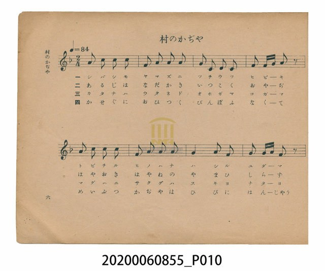
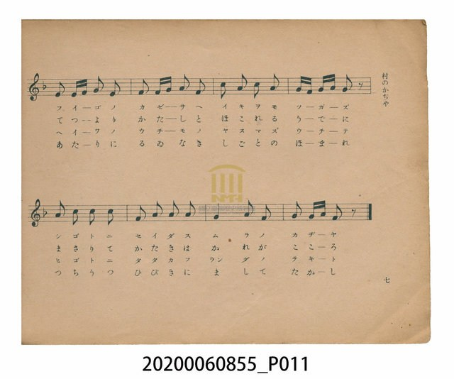
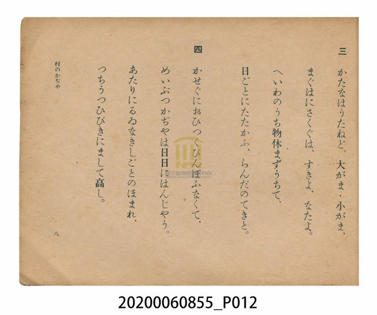
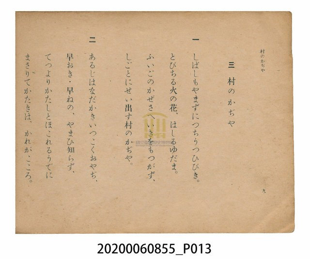

# 村のかぢや（村之鍛冶屋）

> Re:Shōka 使用 AI 協助辨識與重建樂譜，可能會有錯誤。歡迎回報。

- **NEUTRINO 歌聲合成版**：<br><audio controls src="muranokajiya_neutrino.mp3"></audio>
- **鋼琴伴奏版**：<br><audio controls src="muranokajiya.mp3"></audio>


- 日治時期公學校唱歌（第三學年・第三課／原曲：1912年『尋常小学唱歌』）
- 國立臺灣歷史博物館典藏

## 說明


- 出處：臺灣總督府編《公學校唱歌》第三學年用，第三課〈村のかぢや〉（村之鍛冶屋），原書第 6–9 頁。
原曲出自 1912 年（大正元年）日本文部省《尋常小學唱歌》第四學年（作詞：中村秋香，作曲：田村虎藏）。
- 調性與拍號：ヘ調（F 大調），2/4 拍，速度 != 84。
- 背景與曲風：描寫村莊裡勤奮不懈的鐵匠老爹（鍛冶屋），拉動風箱、揮鎚打鐵、火星四濺，
鍛造農具（大鐮、小鐮、馬鍬、鋤頭、柴刀），歌頌勞動者的堅毅精神。開頭同音反覆動機
「3 5 5 5 | 1 3 3 3」生動模仿鐵鎚敲擊鐵砧的清脆聲響。
- 版本說明：本檔案為原書單聲部簡譜（數字譜）之忠實數位化版本。

### 編曲說明（鋼琴伴奏版）：

1. 前奏 (Intro, 4 小節)：以「3 5 5 5 | 1 3 3 3」鐵鎚敲擊動機揭開序幕，確立鏗鏘有力的節奏。
2. 主歌伴奏 (Muranokajiya, 16 小節 × 4 段)：右手 (PianoRH) 演奏充滿附點與十六分音符彈性的主旋律；
左手 (PianoLH) 採用八分音符規律交替之低音與和弦（`1_ [1] 5_ [1]`），宛如鐵砧上不曾停歇的打鐵聲響。


## 歌詞

```text
一　しばしもやまずにつちうつひびき。
とびちる火の花、はしるゆだま。
ふいごのかぜさへいきをもつかず、
しごとにせい出す村のかぢや。

二　あるじはなだかきいつこくおやぢ、
早おき・早ねの、やまひ知らず、
てつよりかたしとほこれるうでに
まさりてかたきは、かれがこころ。

三　かたなはうたねど、大がま・小がま、
まぐはにさくぐは、すきよ、なたよ。
へいわのうち物休まずうちて、
日ごとにたたかふ、らんだのてきと。

四　かせぐにおひつくびんぽふなくて、
めいぶつかぢやは日日にはんじやう。
あたりにるゐなきしごとのほまれ、
つちうつひびきにまして高し。
```

## ABC

```abc
X:1
T:村のかぢや（村之鍛冶屋）
M:2/4
L:1/16
Q:1/4=84
K:F
V:V1 name="Piano" snm="Pia"
[V:V1]
A2 c2 c2 c2 | F2 A2 A2 A2 | G2 C2 D2 C2 | F2 F G A2 z2 |
w: 1.~シ バ シ モ | ヤ マ ズ ニ | ツ チ ウ ツ | ヒ ビ _ キ
w: 2.~あ る じ は | な だ か き | い つ こ く | お や _ ぢ
w: 3.~カ タ ナ ハ | ウ タ ネ ド | オ ホ ガ マ | コ ガ _ マ
w: 4.~か せ ぐ に | お ひ つ く | び ん ぽ ふ | な く _ て
A2 c2 c2 c2 | F2 A2 A2 A2 | G4 A2 G2 | G2 G A F2 z2 |
w: 1.~ト ビ チ ル | ヒ ノ ハ ナ | ハ シ ル | ユ ダ _ マ
w: 2.~は や お き | は や ね の | や ま ひ | し ら _ ず
w: 3.~マ グ ハ ニ | サ ク グ ハ | ス キ ヨ | ナ タ _ ヨ
w: 4.~め い ぶ つ | か ぢ や は | ひ び に | は ん _ じやう
E2 E E A2 E2 | F2 F G A2 F2 | c2 A2 c2 A2 | G F G A G2 z2 |
w: 1.~フ イ _ ゴ ノ | カ ゼ _ サ ヘ | イ キ ヲ モ | ツ _ ガ _ ズ
w: 2.~て つ _ よ り | か た _ し と | ほ こ れ る | う _ で _ に
w: 3.~ヘ イ _ ワ ノ | ウ チ _ モ ノ | ヤ ス マ ズ | ウ _ チ _ テ
w: 4.~あ た _ り に | る ゐ _ な き | し ご と の | ほ _ ま _ れ
A2 c2 c2 c2 | F2 A2 A2 A2 | G4 A2 G2 | G2 G A F2 z2 |
w: 1.~シ ゴ ト ニ | セ イ ダ ス | ム ラ ノ | カ ヂ _ ヤ
w: 2.~ま さ り て | か た き は | か れ が | こ こ _ ろ
w: 3.~ヒ ゴ ト ニ | タ タ カ フ | ラン ダ ノ | テ キ _ ト
w: 4.~つ ち う つ | ひ び き に | ま し て | た か _ し
```

## TMD 檔案連結

- [主旋律 TMD 檔案](muranokajiya.tmd) [[在 TMD Studio 編輯](https://tmdlang.github.io/Tmd-TS/#tmd=s7IKdvYPcrWy4qpTUCpJTLdSSM7PyUlNLsnMz7PKzk9PzM7Ojy_OyM9OVIKrKMvPKc1NtUovSkxJjTdGiBfnlxYlp1oVJ2fk5-fEl6RWlCTl52cj5AuK8stS8xLzgGoKijLzSlJTwIoQClLLMlNSQdKpKZkl-UWZiTlIlqYWFYPcBLEkvqQoMa84uSizAORQhCqgpvTMPKvc_LykUqCrMSVSM7MykZympaXwbO7Ex43rHjd2P25c9Lip5f2eDqDIk53dL3tnP23b9nRj9_s9nQpaWlyKtgoWJlz2tgpuXDZG-iZ2IKOfTV_6bNPuZzObns2Z_7R1zdO1O54tWPh0ysZna3uA5jxfs-bJjk6g4NOdWx4374ZwX6za9H5P_9O--c9mAxmzDC0NjUDSDX1PN3Q_3bHj6Yb-p2uXQYx43NAPtBvsh6dzup-v7n7Rvut54-Jna7c_7d_0tHfW886VL5eseNq648X0fiUuLn0tBVtqAS4FBYXHDROAbnw-e92LVauezeh73DARLNq8-2n7rhczpwIdD3HP8x17n89d_HTXnOfbVzxu6EILh8cN3cjh8HzKivd7euBB8bgBFNrI4f-4oRNrFAB1gQNtB1CvgtmjhsmWCi8XND5uaAI5SkEBEqAgl7WvUgAFqgLQMqBBT5csf7Z28dPWZjC3ExRhc9Y8m9b-snnF8zlA7V1Iwb4D2cVPZ8-GuBhoyJO9c16snAf08JMda4Eue768--WymUAHAcUhsfh8ygag-IuZfcCYANoCdRUwqF6s2v-sYfmLjvZn3b0vZs4HKn3cPAMoCDTUTQHoNjAT5DdgilIAqgGyXjbMf7prmQI4uSEZ1NzzbOZ6kEGzN71cBAzDWc_6-5-uXw2ytq_rxeKFT7uXPF267smO3mftHc9ntbycsPVpz4IXDY3PO3YCLUMLyWfdnU-7pwLNeb5u4-OGxmf96172zXrWORmoC8h93rj62Yz5wAB4tn8XUDEkgIEmvGxY8GLfpqet2yHh-nLCOqBiYMhBGC-XrXnZuwbE6F7ycsFakLHztzztaIDauLbn5YKep93zgPa-aGgFuvDpgtZn61ufb9r3fOk8oD9fTusG6no6oefl_M1P-3tfLGsDqny2cj7E9scNPcYKpmBYo2CoYAyCjxt6n0-ZD1K1YuGT3fuBbgd5YuqmZ5O7gOznC5YDLXm2o_VFS9uLxk0v5-9HBObzzg5gKoAka1BIAlPEqinPFnY8b9oFSWNPp60D6QGmkQ0LX6ydA0qQU3c8XTsdzO4Epsyn-xc8Xb8MKPhkb-_TnmkQA0EWQDMOxBigp4Hp5mnrCmCCA0YdKPUAGavmvVi7HpibQKG4ARhdnQqZuYnpqcZ6WQWp6QpqEJ4JhKevEGBgaARM7UDKGGg12PwnOxoeNzQ8bpz-uHEDiGxqAuWbxn2PG2c9blz9uHHJ48aFjxvbwIxNjxs3P27shfm9cQWYv_BxUzcwloH57kUXKAE8blwPNqj7cRNQ2wKQWTANWx83As2eAsuicx43Tn3cuAMs2Pu4aRLIcpA9QKlZQIMgeoAOA2oAWgW0YTZQKTBbPm6ciZHRwTYAQwESIqBs1Nn-tGP3k53zgcn4aeOcZ2vbQVE4dRMwXiFRCMoei0HJEigOdD_E8U-XTnmxfwckzT_bsOV5_wJQcmpYDEneTyfsBFoPkl204mXz3if72kCG93c9nTbjWSPQ0p4Xmxc_7Zr9dPtSYG4GWQfMUIsXQvLCy-5VQKPgwb4LWDQAgx0Y2kAvzACH2SpwaAG5veAQAQbE5MeN_Y8bu8AxsggaIs-mrwQJARU17waz14ICAhjs0Gjb9Hz-0sdNnchBuAxkWFPH4yagNqDx88GBCgzR3SAbmnrATgBG1XJgGEM0AI2ZClYN1AnRAHQSMJkB4xYYqz2PG4EI6DagZlhiQA75Jzt2P9m169mM9S8bF7zYP_Hlss1PJ_QCQ-NFw_7ns7e8XDDx6exdsMKkB-iFF1u3A8nncxc-3TcPGJ7AfPh8euv7PbOfrZ_yZPe0l02Ln-6Z-mT3UlCGagIW8o1Pu-e-bOx72b0HlDOBgdwJrMuans3eAi0EZgGr3R6g7UC9oJJhf_PT_dORQ34HsEgFhjzEX8AwB4Y80PNANjAgV4KMXwIMCKAH94Fqpw3A8AezYWEJDJoJYD3A5AhMvEBpMBcUNDPBqbgDzAaaOx_MhqZ8cCJvAqoGplmgbQuB1e2TPcAkDMlnIBFQYMNieClSmgc6DIiArgWVpqCIbQKGPDCdAA0Cxg4wXoD1JEYUvJw97XnLNlABDkx7DQuAJefTLlB98GRvG6TshRS5QHF4qQthAwveFw0zQYxp3U8X7YMUws-7GkGVBbQEng3PUE_nbACaBrTi6aSepzs3g6IYWqT3PFvfD_QGSFf7tmfNG4Cl3LOpW4F1yrOODUhxAawWYHEBzNrAgAT6F5jqgOUMMPEDA2sz2LN7wQUHMESBIrAwetwEDGRggt8GKzDApUDjelCdDAo-oEHrwZpngMXb4BEBLGGAEQO0ZDW4hALaCTQYGIrwYgYYrsB8sQ-UzGFxjq0MBNkAjDygtmUvVwPzLyiJocfCi03Ln69a92L_XmCIPdnRBapVgXUWrHAA5hFQOwSYNaYsghcREPe_6Oh4OasNGNQvZ7YAc9DzloVAxS-a9wKLGmiCnz4XqBFYjoGDegowj0BMABVNkPKtqeXFskZgKfdk1zqg-4A5ERrsQCdS3qKDAgUtfS4u31Jg6xnYpM_KrEy0CsgEsh1qDGqqwVWtjYWWHZiBrTmpAG64NbxY2KOgYaIATITP1zfoQCospPrKQBOLTqC9IFNrgDU3Wj0OZBkpmMYrmMWDSJCwhqGCkaaqhq4mUNJAoQas0cewBpiCtgOr7wlQehFQ7ePmJUA8DyiyC0h3g0VagLgRKLIMzAaJTFLQeNw8WQFo3uOmtTDzjIAyjU1AkW4gPQOI14PUNq4C4gVADBLtBYsAzWsE2tI4GYj7wSJdQPOaWsDmNQJdATHPGOS-1UC8H2hjFxCD1YJcARbpBeJOsAjQhubZQHoN2OUgkc0g89aAzQOJQMwzAdkEcgVQbSPQz42roXYDEzTURRDXbAaaAHLbXlBtDfWDBkgS7L5lQPPwx-euHhrEpy6QNgKzNIwUjCGRaYgamc0dQAx0OCiymsGeA0bU4-Y-cNCBghAkAvQFNLohKpaBorIBLajAUbkeqA4UVaAAgkQcTGQtEK8DBzQwzkD1ATgIQSqmgwK-ExJQs5AjEpykNkBdAk5WTVuBGGQiRBQkshPsNqDpzSvAbgMni_0QtwFFENHYBPQhOBltA0ccLGIXQd0HSXibwG4DRiY0oteDTIMkWliJSDAqgX0qLFFphBSXhnjj0jxeQQOIzeNhuQ_IQc-QhkARU3Csg2IaGLuGEBlEPBuhxfNUkE-WQLLfFnAMQ7IKUHQPRBQYts0zwKLAZA0OUWASB2dwYGyDMxo8gwAzOnKsg9IDMEjBMsD01ARONcDQBYrOh4TddCAGx0_jbkgmbuoBZ3qQ2cAgBZvduByiFhjySGlgBsLdzcCYh7obnAIbIaLAGISIgoohYHqAFUUgs4EKwWbD1IJiD5GxmxAuBLoZGudAVwH1TYC4BVQQQdIxyAdTwL6ApGOgzt1Qd--DmNBDKGUAa23KUgbZuRyUd8GxDsrtkJwEjAdQPAOzMSjMQKG3AJT2m1eipI3mJki4AfMLUnyD8u5UaJgBizZoTpoPDitYTuoG50tgLDcCwwUc58CQghb_wBBFimFgeYPmNmBRDcbAghyYbkFqVj5u3gx2HtC50MhuA0XTWojzOlCiFVQqLwTiNnhGB5XVoEwNch4kYwPjDBqpEA_MBzkP6GZIYq3hquXi0rVTQK6jwRYAxZS5AA)]
- [鋼琴伴奏 TMD 檔案](muranokajiya_piano.tmd) [[在 TMD Studio 編輯](https://tmdlang.github.io/Tmd-TS/#tmd=s7IKdvYPcrWy4tLSUng2d-LjxnWPG7sfNy563NTyfk8HUOTJzu6XvbOftm17urH7cfPul917nk_Y8mTPlqdL-593drzf06mgpcWlaKtgYcJlb6vgxmVjpG9ix1WnoPRs-tJnm3Y_m9n0bM78p61rnq7d8WzBwqdTNj5b2wM0-fmaNU92dAIFn-7cAjQWwn2xatP7Pf1P--Y_mw1kzDK0NDQCSTf0Pd3Q_XTHjqcb-p-uXQYx4nFDP9BuJZBFT-d0P1_d_aJ91_PGxc_Wbn_av-lp76znnStfLlnxtHXHi-n9Slxc-loKttQCXAoKCo8bJgDd-Hz2uherVj2b0fe4YSJYtHn30_ZdL2ZOBToe4p7nO_Y-n7v46a45z7eveNzQhRYOjxu6kcPh-ZQV7_f0wIPicQMo_JFj5HFDJ2akAIMBqAscaDuAehXMHjVMtlR4uaDxcUMTyFEKCpAABbmsfZUCKFAVgJaBomfOmmfT2l82r3g-B6i4CymQdyC77-ns2RD3Ae1-snfOi5XzgN57smMt0B3Pl3e_XDYTaD1QHBJnz6dsAIq_mNkHDHegy6BuAAbMi1X7nzUsf9HR_qy798XM-UClj5tnAAWBhropPF2yHMwE-QSYfhSAaoCslw3zn-5apgBOXEgGNfc8m7keZNDsTS8XAUNs1rP-_qfrV79s6QTa_HLC1qc9C152r3q-tQnkxc7JQJEXjZue7Oh9vnXqs2l7XjRsftzQ-Lxx9YuujS8Xz362fxeQCwzMlw0Lnk5oebqn_8W-TU9btz-f1fK0e8nTpetAdm1ciLAeGJFAiyHRDnQ7Zn4AOggS7IZ6Ck87e4HiChqeeSVF-ToKJgrA0H2-vkETFIC7lz5u6DFWMAXDGgVDBWMQfNzQC3Twy75Zz6Zueja562n31Gcr5z_rX_tyWvfTXf1PdwKTVs_zRbuACf5l__SX_TOezel82jUb6FqgsUCr4HFupKfwZMduYBxCnKag4VtalJiXn52YlVmZqKNgaAZ1isLh6UBnPVu3FeSmp_2bn3V2K2gEZAKVBnloKjzbMwWo-Wlr67Pd-1_ObHm5ex4w3J_2Nj5tXfu0o-3l_M3P1yx7urcDGLFAF4Dsm979dB8wRc6GOAKU9rYvQxjpAzKybyEwnT9tXQ034MWyfqCmJ7uWPJu9H5iwn-ztA4qD7JnU83TPMmAYJxjGK0QbxiqYgqkEaIJfN_vpsiZgWD1fsPzJji5g_D6bve9p45xna9uBboHH-8v5-0FhAs2zkFwCDBVgIn7augKY-oH2gJIykLFq3ou164EZGWjh0w29z9o7FTJzE9NTjfWyClLTFdQgPBMIT18hwMDQCJjRgJQx0D1g85_saHjc0PC4cfrjxg0gsqkJlGUb9z1unPW4cfXjxiWPGxc-bmwDMzY9btz8uLEXlqwaV4D5Cx83dQNTJjDLAxMnMFk-blwPNqj7cRNQ2wKQWTANWx83As2eAisd5jxunPq4cQdYsPdx0ySQ5SB7gFKzgAZB9AAdBtQAtApow2ygUmCJ8LhxJkYZA7YBGAqQEAHl6c72px27n-ycDwxkRAhP3QRMpZAQBuVVcFYCpUNwzgLa-XTplBf7dwBFgBHxbMOW5_0LgEa_bFgMzLPP1218OmEn0HqQ7KIVL5v3PtnXBjK8v-vptBnPGoGW9rzYvBiYsJ9uXwosWkDWAQuVxQsh0QrM3UCj4MG-C1hOAYMdGNpAL8wAh9kqcGgBub3gEAEGxOTHjf2PG7vAMbIIGiLPpq8ECQEVNQNTLpC9FhQQwGCHRtum5_OXPm7qRA7CZSDDmjoeNwG1AY2fDw5UYIjuBtnQ1AN2AjCqlgPDGKIBaMxUsGqgTogGoJOAyQwYt8BY7XncCERAtwE1wxIDcsgDs9STXbuezVj_snHBi_0TXy7b_HRCLzA0XjTsfz57y8sFE5_O3vUCWJp17ASGGNALL7ZuB5LP5y58um8eqMSbMv_59FZgdny2fsqT3dNeNi1-umcqsOB53rTraROwfml82j33ZWMfsAwD5SNQrgFWo03PZm95uqD12fpWoAjI2BnrgXpB5eH-5qf7pyOH_A5g-Q4MeYi_gGEODHmg54FsYECuBBm_BBgQQA_uA1WMG4DhD2bDwhIYNBPAeoDJEZh4gdJgLihoZoJTcQeYDTR3PpgNTfngRN4EVA1Ms0DbFgJr-id7gEkYks9AIqDAhsXwUqQ0D3QYEAFduxUcyZ2Pm4AhD0wnQIOAsQOMF2AVjREFL2dPe96yDVS8ANMesI7oaHjaBaqcnuxtg9YaS5a_nLAOKA7y8IZ-OPvlsjUvGmaCGMCie9G-l71rQPVOVyOo5pq_BagGGC_wDPV0zgagaUArQIXezs2gKAZXQ6DwX98P9AZIV_u2Z80bgCXks6lbQRVTxwakuABW0rC4AGZtYEAC_QtMdcByBpj4gYG1GezZveCCAxiiQBFYGD1uAgYyMMFvgxUY4FKgcT2o9gQFH9Cg9WDNM8DibfCIAJYwwIgBWrIaXEIB7QQaDAxFeDEDDFdgvtgHSuawOMdWBoJsAEYeUNuyl6uB-ReUxNBj4cWm5c9XrXuxfy8wxIClPahq7p4HLxyAeQRUIwCzxpRF8CIC4v4XHR0vZ7UBgxpYfQFz0POWhUDFL5r3AosaaIKfPheoEViOgYN6CjCPQEwAFU2Q8q2p5cWyRmAp92TXOqD7gDkRGuxAJ1LemIQCBS19Chup4ESA3NzQtIK3NxQ0oI0qTXC23b0Ure0ADbO-WcCK9-m8buTmBmW-BHsL7BoraJvCocagphrcOrCx0LIDM2qA7R60VhCQZaSgC6SNwCwNIwVjTVUNXU2gvIFCDVctiqE-2A1FaTRg4YMYphA-kILLgzDUDorjA9ICAzauUJtfwJhBtL9QogbSAAMVz-D2N1KLqgfSkHq2YuGzyWsgrR5IuwkYd8B2IqhD0LDpxcIeYNsU0uKjQsQhuxlP_GELJgVwL6YB6CAFDVgq1IE0oZBaUAaaWHQCbcaXKoDxZRYPIkHCGoYKRpCEYQyONJBGH8MaYJm2HdhWnwClFwHVPm5eAsTzgCK7gHQ3WKQFiBuBIsvAbJDIJAWNx82TFYDmPW5aCzPPCCjT2AQU6QbSM4B4PUht4yogXgDEINFesAjQvEagLY2TgbgfLNIFNK-pBWxeI9AVEPOMQe5bDcT7gTZ2ATFYLcgVYJFeIO4EiwBtaJ4NpNeAXQ4S2Qwybw3YPJAIxDwTkE0gVwDVNgL93LgaajewiIW6COKazUATQG7bC2o_Qv2gAZIEu28Z0Dz88bmrhwbxiTuXwyOzuQOIgQ4HRVYz2HPAiHrc3AcOOlAQgkSAvoBGN0TFMlBUNqAFFTgq1wPVgaIKFECQiIOJrAXideCABsYZqIUCDkKQiumggO-EBNQs5IgEJ6kNUJeAk1XTViAGmQgRBYnsBLsNaHrzCrDbwMliP8RtQBFENDYBfQhORtvAEQeL2EVQ90ES3iaw24CRCY3o9SDTIIkWVkcTjErgAAOWqDRCiktDvHFpHq-gAcTm8bDcB-SgZ0hDUCELjnVQTANj1xAig4hnI7R4ngryyRJI9tsCjmFIVgGK7oGIAsO2eQZYFJiswSEKTOLgDA6MbXBGg2cQYEZHjnVQegAGKVgGmJ6awKkGGLpA0fmQsJsOxOD4adwNycRNPeBMDzIbGKRgsxuXQ9QCQx4pDcxAuLsZGPNQd4NTYCNEFBiDEFFQMQRMD7CiCGQ2UCHYbJhaUOwhMnYTwoVAN0PjHOgqoL4JELeACiJIOgb5YArYF5B0DNS5G-rufRATegilDGA7krKUQXYuB-VdcKyDcjskJwHjARTPwGwMCjNQ6C0Apf3mlShpo7kJEm7A_IIU36C8OxUaZsCiDZqT5oPDCpaTusH5EhjLjcBwAcc5MKSgxT8wRJFiGFjeoLkNWFSDMbAgB6ZbkJqVj5s3g50HdC40sttA0bQW4rwOlGgFlcoLgbgNntFBZTUoU4OcB8nYwDiDRirEA_NBzgO6GZJYwU0UzCoaa2uI2Coab8xS2KAiqW6hqkOgDKAywu5AKxjxugOHhwm5C4QJOgQ9H9IiQJCaurp2CuAWNdhAIAc5XUX7GMZiFzfCIW6MQ9wELq7MBQA)]

## 分析

```text
================================================================================
📊 TMD Song Profile: [ 村のかぢや（村之鍛冶屋） ]
================================================================================
⏱  Duration:       0:22 (22.9s), 16 measures total
🎼 Key & Tempo:    首調基準 F, != 84.0 BPM, <2/4>
   - 分析範圍：      由實際發聲的音符與和弦推測調性；播放脈絡另行呈現
🎤 人聲音域:    C4 (MIDI 60) – C5 (MIDI 72) [跨度: 12 個半音 / 1.0 個八度, 難度: easy]
   - 最低音:  C4 in [Muranokajiya #1 @ m.3, 0:03]
   - 最高音: C5 in [Muranokajiya #1 @ m.1, 0:00]
   - 適合: soprano, mezzo-soprano, contralto, tenor, baritone, bass
🏛  結構:      Muranokajiya (22.9s)
⚡ 編曲密度:        Peak 1 軌道同時演奏
🗝  調性診斷：       A 小調（純淨自然小調，未偵測到可信轉調）
   - 風格氣質:    純淨自然小調（陰鬱抒情、旋律集中，無明顯調外色彩）
   - 轉調歷程:    全曲維持單一推測調性（未偵測到可信轉調）
   - 核心骨幹音:  A, C, G, F, E
   - 調性數值:    A 小調 [相關度: 0.81, 穩定度: Moderate, 自然音純度: 100.0%]
   - 候選調性 (K-S): A 小調 (0.81), C 大調 (0.69), F 大調 (0.64)
   - 五度圈歷程:   +3
   - 各段落調性細節:
     • [Muranokajiya #1]: A 小調 (r: 0.81, 自然音純度: 100.0%)

  [ 五度圈游移軌跡 ]
               C  
         F            G  
      Bb               D  
      Eb              [A ]*
         Ab           E  
            Db       B  
               F# 
     (* = active key center)

  [ 十二半音累積音高分佈 ]
     C  : ███████████████           21.7%
     C# :                            0.0%
     D  : █                          1.7%
     D# :                            0.0%
     E  : ████                       5.0%
     F  : ███████████               15.8%
     F# :                            0.0%
     G  : ███████████████           21.7%
     G# :                            0.0%
     A  : ████████████████████████  34.2%
     A# :                            0.0%
     B  :                            0.0%
--------------------------------------------------------------------------------
Assignment 軌道音域：
  - Piano         : C4 – C5 (12 個半音 / 1.0 個八度, 65 個音符)
================================================================================
```


## 原書掃描頁










