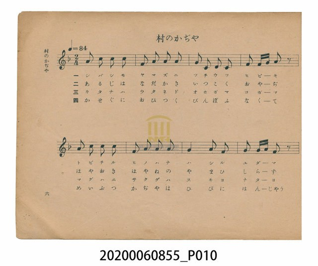
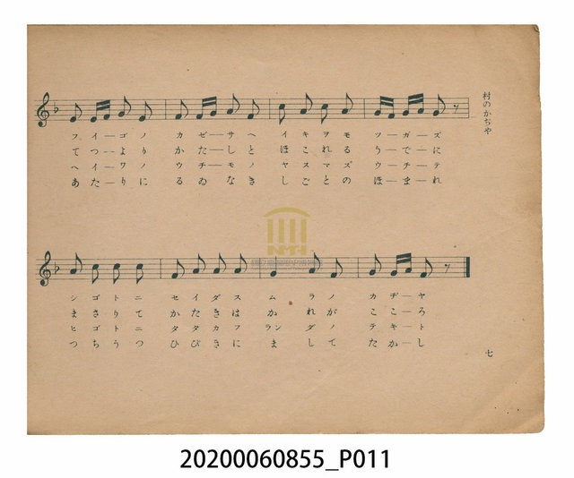
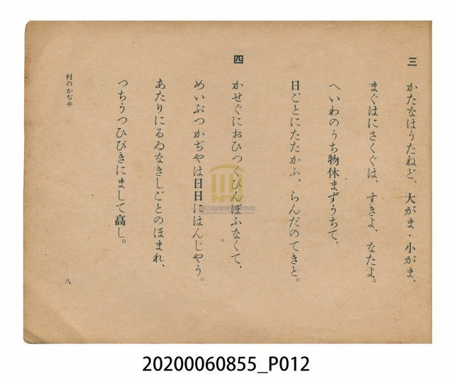
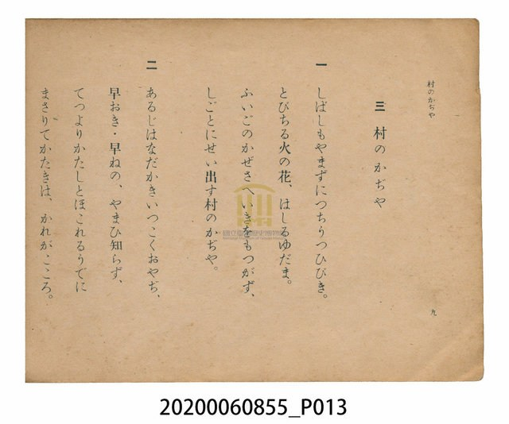

# 村のかぢや（村之鍛冶屋）

<audio controls src="muranokajiya.mp3"></audio>

- 日治時期公學校唱歌（第三學年・第三課／原曲：1912年『尋常小学唱歌』）
- 國立臺灣歷史博物館典藏

## 說明

【曲目說明】
・出處：臺灣總督府編《公學校唱歌》第三學年用，第三課〈村のかぢや〉（村之鍛冶屋），原書第 6–9 頁。
原曲出自 1912 年（大正元年）日本文部省《尋常小學唱歌》第四學年（作詞：中村秋香，作曲：田村虎藏）。
・調性與拍號：ヘ調（F 大調），2/4 拍，速度 != 84。
・背景與曲風：描寫村莊裡勤奮不懈的鐵匠老爹（鍛冶屋），拉動風箱、揮鎚打鐵、火星四濺，
鍛造農具（大鐮、小鐮、馬鍬、鋤頭、柴刀），歌頌勞動者的堅毅精神。開頭同音反覆動機
「3 5 5 5 | 1 3 3 3」生動模仿鐵鎚敲擊鐵砧的清脆聲響。
・版本說明：本檔案為原書單聲部簡譜（數字譜）之忠實數位化版本。

・編曲說明（鋼琴伴奏版）：
1. 前奏 (Intro, 4 小節)：以「3 5 5 5 | 1 3 3 3」鐵鎚敲擊動機揭開序幕，確立鏗鏘有力的節奏。
2. 主歌伴奏 (Muranokajiya, 16 小節 × 4 段)：右手 (PianoRH) 演奏充滿附點與十六分音符彈性的主旋律；
左手 (PianoLH) 採用八分音符規律交替之低音與和弦（`1_ [1] 5_ [1]`），宛如鐵砧上不曾停歇的打鐵聲響。

## 歌詞

```text
一　しばしもやまずにつちうつひびき。
とびちる火の花、はしるゆだま。
ふいごのかぜさへいきをもつかず、
しごとにせい出す村のかぢや。

二　あるじはなだかきいつこくおやぢ、
早おき・早ねの、やまひ知らず、
てつよりかたしとほこれるうでに
まさりてかたきは、かれがこころ。

三　かたなはうたねど、大がま・小がま、
まぐはにさくぐは、すきよ、なたよ。
へいわのうち物休まずうちて、
日ごとにたたかふ、らんだのてきと。

四　かせぐにおひつくびんぽふなくて、
めいぶつかぢやは日日にはんじやう。
あたりにるゐなきしごとのほまれ、
つちうつひびきにまして高し。
```

## 原書掃描頁









## 分析

```text
================================================================================
📊 TMD Song Profile: [ 村のかぢや（村之鍛冶屋） ]
================================================================================
⏱  Duration:       0:22 (22.9s), 16 measures total
🎼 Key & Tempo:    首調基準 F, != 84.0 BPM, <2/4>
   - 分析範圍：      由實際發聲的音符與和弦推測調性；播放脈絡另行呈現
🎤 人聲音域:    C4 (MIDI 60) – C5 (MIDI 72) [跨度: 12 個半音 / 1.0 個八度, 難度: easy]
   - 最低音:  C4 in [Muranokajiya #1 @ m.3, 0:03]
   - 最高音: C5 in [Muranokajiya #1 @ m.1, 0:00]
   - 適合: soprano, mezzo-soprano, contralto, tenor, baritone, bass
🏛  結構:      Muranokajiya (22.9s)
⚡ 編曲密度:        Peak 1 軌道同時演奏
🗝  調性診斷：       A 小調（純淨自然小調，未偵測到可信轉調）
   - 風格氣質:    純淨自然小調（陰鬱抒情、旋律集中，無明顯調外色彩）
   - 轉調歷程:    全曲維持單一推測調性（未偵測到可信轉調）
   - 核心骨幹音:  A, C, G, F, E
   - 調性數值:    A 小調 [相關度: 0.81, 穩定度: Moderate, 自然音純度: 100.0%]
   - 候選調性 (K-S): A 小調 (0.81), C 大調 (0.69), F 大調 (0.64)
   - 五度圈歷程:   +3
   - 各段落調性細節:
     • [Muranokajiya #1]: A 小調 (r: 0.81, 自然音純度: 100.0%)

  [ 五度圈游移軌跡 ]
               C  
         F            G  
      Bb               D  
      Eb              [A ]*
         Ab           E  
            Db       B  
               F# 
     (* = active key center)

  [ 十二半音累積音高分佈 ]
     C  : ███████████████           21.7%
     C# :                            0.0%
     D  : █                          1.7%
     D# :                            0.0%
     E  : ████                       5.0%
     F  : ███████████               15.8%
     F# :                            0.0%
     G  : ███████████████           21.7%
     G# :                            0.0%
     A  : ████████████████████████  34.2%
     A# :                            0.0%
     B  :                            0.0%
--------------------------------------------------------------------------------
Assignment 軌道音域：
  - Piano         : C4 – C5 (12 個半音 / 1.0 個八度, 65 個音符)
================================================================================
```

## ABC

```abc
X:1
T:村のかぢや（村之鍛冶屋）
C:TMD (Chen, Chih-Han / aguai)
M:2/4
L:1/16
Q:1/4=84
K:F

V:V1 name="Piano" snm="Pia"

[V:V1]
a2 c2 c2 c2 | f2 a2 a2 a2 | g2 c2 d2 c2 | f2 f g a2 z2 |
a2 c2 c2 c2 | f2 a2 a2 a2 | g4 a2 g2 | g2 g a f2 z2 |
e2 e e a2 e2 | f2 f g a2 f2 | c2 a2 c2 a2 | g f g a g2 z2 |
a2 c2 c2 c2 | f2 a2 a2 a2 | g4 a2 g2 | g2 g a f2 z2 |
```

- [主旋律 TMD 檔案](muranokajiya.tmd)
- [鋼琴伴奏 TMD 檔案](muranokajiya_piano.tmd)
