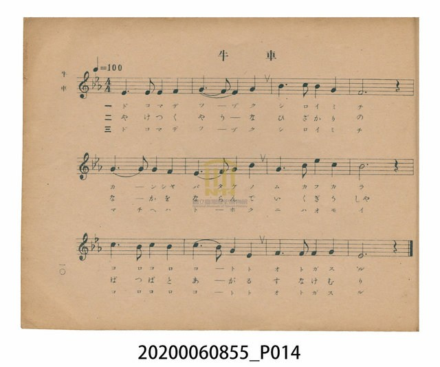
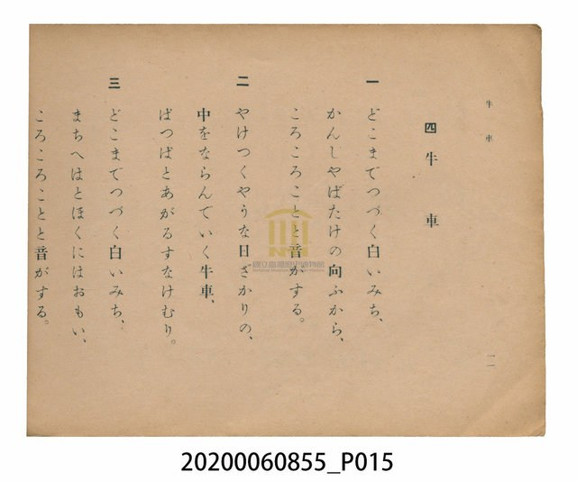

# 牛車

> Re:Shōka 使用 AI 協助辨識與重建樂譜，可能會有錯誤。歡迎回報。

- **鋼琴伴奏版**：<br><audio controls src="gyusha.mp3"></audio>
- **NEUTRINO 歌聲合成版**：<br><audio controls src="gyusha_neutrino.mp3"></audio>

- 岡田與志松 作詞（懸賞募集入選）
- 日治時期公學校唱歌（第三學年・第四課）
- 國立臺灣歷史博物館典藏

## 說明


- 出處：臺灣總督府編《公學校唱歌》第三學年用，第四課〈牛車〉，原書第 10–11 頁。
- 調性與拍號：ホ調（E 大調），4/4 拍，速度 != 100。
- 背景與曲風：描寫臺灣農村炎熱正午下，滿載重物的牛車成隊沿著漫長白色鄉道（白いみち）與
甘蔗田（かんしやばたけ）緩緩前行，車輪發出「ころころこと」聲響、揚起陣陣沙塵的南國風情。
旋律採用純樸的大調五聲音階搭配全曲貫穿的附點節奏，呈現牛車一步一印、穩定前行的律動。
- 版本說明：本檔案為原書單聲部簡譜（數字譜）之忠實數位化版本。

### 編曲說明（鋼琴伴奏版）：

1. 前奏 (Intro, 4 小節)：引用第三樂句「ころころことと音がする」之附點動機，勾勒遠方傳來的牛車輪聲。
2. 主歌伴奏 (Gyusha, 12 小節 × 3 段)：右手 (PianoRH) 演奏附點五聲音階主旋律；
左手 (PianoLH) 以穩健的四分音符低音與和弦交替（`1_ [1] 5_ [1]`），表現牛車負重前行的踏實步伐。


## 歌詞

```text
一　どこまでつづく白いみち、
かんしやばたけの向ふから、
ころころことと音がする。

二　やけつくやうな日ざかりの、
中をならんでいく牛車、
ぽつぽとあがるすなけむり。

三　どこまでつづく白いみち、
まちへはとほくにはおもい、
ころころことと音がする。
```

## ABC

<div class="abc-score" data-abc-src="gyusha.abc" aria-label="五線譜載入中"></div>

[下載 ABC 原始檔](gyusha.abc)

## TMD 檔案連結

- [主旋律 TMD 檔案](gyusha.tmd) [[在 TMD Studio 編輯](https://tmdlang.github.io/Tmd-TS/#tmd=s7IKdvYPcrWy4qpTUCpJTLdSSM7PyUlNLsnMz7PKzk9PzM7Ojy_OyM9OVIKrKMvPKc1NtUovSkxJjTdGiBfnlxYlp1oVJ2fk5-fEl6RWlCTl52cj5AuK8stS8xLzgGoKijLzSlJTwIoQClLLMlNSQdKpKZkl-UWZiTlIlqYWFYPcBLEkvqQoMa84uSizAORQhKqSjFSgy8CSBflFSEYDTUvPzLMqScwsT8yLz09Ly0xGMR5VPjkf6LriknhDS2Mk_wENzMgH-rogo9IqI7MY5MLkxJz47MQ8pMCBuq8gMT3VKsDA0ESJS0tL4Xnn7Be7uxS0tLgUbRUMDQy47G0VXLlsTPRN7EAan25a-HzKhhcd7U_3T382d5_Ck71zXqyc935Px7P2HS82z3vaPf_l7LanrUtfNu54v6cTbNez6Uufbdr9bGbTsznzn7auebp2x7MFC59O2fhsbQ9Q3_M1a57s6AQKPt255XHzbiD36ezZL1Ztgul-Oqf7-eruF-27njcufrZ2-9P-TU97Zz3vXPlyyYqnrTteTO9X4uLS11KwpRbgUlBQeNww4dnsTc9nr3uxatWzGX2PGyaCRZt3P23f9WLm1Pd7ZkHc83zH3udzFz_dNef59hWPG7rQPPe4oRvZc8-nrHi_pwfuv8cNHZCgftzQCRR_2jf_2ewdQFlgmD9qmGxoqPByQePjhiaoxS9W7X_WsBwY7M-6e1_MnA90weNmoCn7gQHoqvB0yXIwE2QOMJ4UgGqArJcN85_uWqYAiUUkk5p7ns1cDzJp9qaXi4BOmvWsv__p-tUQH73Yt-nZ3InPm_qetwG9sPhpb8eTHd1Aw57t3v9iT-fL9l5gyD-f1QJx-bOOCS9ndT3btP_FxOnP9qx-OXX785l7X3RuetnS-bJxMihuZ-593NjyuHH_48aFQOcBLQU5QkHh-ZQZL6ZMB6YjoJrHjd2PmyY_bpz-uAmocsPjxvmPGycCFT_fvhKInnb2vlgITCY9QOte7Fn1fOYeYBQ8buh53Dj5cVMvgmwEhn_vi8ZNL-fvf9zQ-Kx_1out21_OXAxEzzbNfLpwK9DNT3unA9MS0MvPmluhwaGg8Gx699N93c_6gIl6xfMtU56t2AFSCQ7PJ7umgA3c_HJW37MJa1-29j5tXQEMtBebVj9fuR-o7OXMlpe75z1f3_B0aT8oBid2PO_fBwmZJzsanq1dCiSf9m4Auuf5ypVP182C-AVk_r7up91TEVHyvLPj2Zw1kLQGio85a56tmvJsYcfzpl2QZPF02jqQU5pXPN-w8MXaOaDcNnXH07XTwezOJzu7n-5f8HT9MqDgk729T3umQQwEWQBNzRBjgGkSmFdBvpjWDoyLJzvWghir5r1Yux6YxIGmPt3Q-6y9UyEzF1giGOllFaSmK-grAEsGU6AtYKOAPnrc0PC4cSU4zPc9blz-uHHJ48aljxv7keMa6GWwxdii9nHjuqcTgORWsGwnXClGfDauAIb940ZgVM983NQNDS2gIyEOBobTkx29z-cvfb5t_9Pd2552bHiydyowb4ISJyQRNk5-sR2orOfpvnnw9AYK_P5lQF-8XLAWJNW0-cm-tie72oAp6mn_ypez2iAkMC0BVUKSHDDggXbDA2AXMFs3gP0D9APQ6_1gdtvjxlXAYu5x4zSwr7qAnoR6DBjIj5smAaVBfgUFBjDEgBr6YXkf6ntg2AENA5JAfzeBPA30MdDfQG1Ae5qAFgKVYgTA0zkrnu7d_nTv_hfLGp-3TwImeaBvXnSsAYVBcweo2EXKwU92LHvWNwmeBiH2A7Pvkz2gwuLpzOkgNGcDJOsAgwQ59yAHwA5glJGQAoAqFj5u3PG4cT3Yb7tBIda4GsztetwE9GoL7VPAi-1zX85e9GLh9Jd96142AbNfx8vGmS8bFwBtBufVLlBkb1oBLNqe7JwPlH22CVTSwdMHUYkD6DLK6x4oUNDS5-Jyrywtzki0CshMzMt3qDGoqQYXWDYmWnZgRo2ChqGCLhAaaqpq6OpqKhgqGIEEjcGCRnBBY5CgKVjQDCpoChY0AosZKNSAjfMxBCp73NwJFnzctFkTWC7NA-J2kPbHzS1gcaDex82tQOn1YNGm7RDVzWuB4k1LgIz5QPHHzY2oJhuB1UJMAKZmoNpGoNrGfogZMPE2TTC1CizauAkqOg2kuhtoehfI5MZ1qCYb08LNsNCFBKQxNMyMIaELCXJY6BormCFUmsKCPA4sCgly1OBtWo1w0mag9dsfNy-GuHUC1A_7Qa7aCJTug4gvgIqvBmmZCmKAXbsSSwgDgw5mODjEJkFCEiIKLHxAJk8Gyi2HiMPCvR-kvg8UAeAQBhbVzdgCeR402BpBDpkBxJDoa-5A-Gg2PJCbu6GqQYY3rQIyFoEMBwY3eiCboQSdGTDUMASNgYkYKAhJrrCQNwInYUhsoIXxZuQIBoZy81pIxEPEwS7tAGOwKDR4mjtAqtcA8U5wAEMiCi2A90KDbAkoyPYC8QpIUDYhAr4HaEI3RHQmVPUqkPhEoHgDOAy6sIQutd1cC24RZ5SUFBRb6euXJOcm6SWX5pSUFqXqlZTrV2XoAsmUVGD_Icc-My8ltcI5PyXV1tff2dnfx8fVOcTT3y9YLTPF1hDYbjQwtDAwNbQAl0i6dgqQQgnsdCBPmQsA)]
- [鋼琴伴奏 TMD 檔案](gyusha_piano.tmd) [[在 TMD Studio 編輯](https://tmdlang.github.io/Tmd-TS/#tmd=s7IKdvYPcrWy4qpTUCpJTLdSSM7PyUlNLsnMz7PKzk9PzM7Ojy_OyM9OVIKrKMvPKc1NtTJGiBTnlxYlp-JSX1CUX5aal5gHVFGSmFmemBefDhQoyssvik9PzUstSsxBqE0ty0xJBaksKMrMTSyqjE_JTwZalleCZH1qUTHIdQWZiXn58YlFRYl56amoSvKLSjLy04sSCzIqrTIyi0vyizKTE3PisxPzkJxVkgHUZZWaUpqcCPItum_iCxLTU60CDAxNlLi0tBSed85-sbvr_Z6Ol917nk_Y8mTPlqdL-593drzf06mgpcWlaKtgaGDAZW-r4MplY6JvYgcy7dn0pc827X42s-nZnPlPW9c8Xbvj2YKFT6dsfLa2B2jQ8zVrnuzoBAo-3bnlcfNuIPfp7NkvVm0Cmgh2y9M53c9Xd79o3_W8cfGztduf9m962jvreefKl0tWPG3d8WJ6vxIXl76Wgi21AJeCgsLjhgnPZm96Pnvdi1Wrns3oe9wwESzavPtp-64XM6e-3zML4p7nO_Y-n7v46a45z7eveNzQhea5xw3dyJ57PmXF-z09cP89buiABObjhk6g-NO--c9m7wDKAgPwUcNkQ0OFlwsaHzc0QS1-sWr_s4blLzran3X3vpg5H-iCx81AU_YDA9BV4emS5WAmyBxgoCsA1QBZLxvmP921TAESJUgmNfc8m7keZNLsTS8XAZ0061l__9P1qyE-erFv07O5E583d4Aibe3ip70dT3Z0g5wNduqzTftfTJz-fMqMF1OA5IbnU6c8n9XyfObeF52bXjZOfrF9_fPtK4HoaWfvi4VA7zcCtbzYs-r5zD3AcANZDwrZnseNkx839SLIRmDQ9b5o3PRy_v4nO5Y965_1Yuv2Z5tmPl24FWj4y5bOp3Pmgxy8cSHCD8DgBroeEjlY0yLQVxD7DPUUgK4BiitoeOaVFOXrKJgoPN3Q_3x9gyZQzdM9U4GxAomkZyuanvYvxe6-xhUv529-3AiUmvm4qRvo3Cc7u1_ObHm5e97T7qnPVgKjo-dp976n3ZNeNi54Nm3n06bNT_a1gYIGHGrAIAB6D-p6BQUjPYUnO3YD0wfEwQoa7pWlxRmJOgqGRlCnKRyermCs8GzdVrAb-zc_6-xW0AgA5fMgD02FZ3umALVBrH-yawo45Da_nNUHMnR699N9wOiaDbEJCJ5uX4bQ7QPU_WT30ucrVz5tXAp0HjAhPu1oA-p-vmbZk719QAYwWTyd1PN0z7Inu5Y8mw1KXQmG8QrRhrEKpmAqAZLIXixc8bx_H9R3mxa8bO-FRDnQzBc7gIlp2bO1S5_smQDyMjQ7QZI30NMvVs572rri2bR2oFVPdqwFMVbNe7F2PTCPAW17uqH3WXunArDMS0810ssqSE1X0FcAFj6mQHvBRj3Z0fC4oeFx40pwzOx73Lj8ceOSx41LHzf2A9Ph48aWx437HzcCk0oj2OLG7sdNQHXTHzcBJTY8bpz_uHHi48Z1TycAya1g2U64UoKxDo4_oCMhDgZGzZMdvc_nL32-bf_T3duedmx4sncqsHBAyxGgpLFvHiLLAEO9fxnQFy8XrAVJgVPKk11twHT3tH_ly1ltEBKYxEBhiZR24AGwC5ixGsD-AfoB6PV-MLvtceMqYJZ93DgN7KsuoCehHgMG8uOmSUBpkF9BgQEMMaAGYEaBFD5Q3wPDDmgYkAT6uwnkaaCPgf4GagPa0wS0EKgUIwCezlnxdO_2p3v3v1jW-Lx9EjDjAn3zomMNKAwwihBQ5u6bBE8oEPtfzup6sgdUWj2dOR2E5myAFADAIHk5czEQQUoC5ADYAYwyElIAUMXCx407HjeuB_ttNyjEGleDuV2Pm4BebaF9Cnixfe7L2YteLJz-sm_dy6aWp_s6XjbOBJYVkCLyyY4uUGRvWgGs1Z7snA-UfbapE5in4OmDqMQBdBnllR8UKGjpU1ipgpyDUvBqWsFLXgUNaCWlCY5PYIEEKUjAHsJVQQCrFWCh8mw3sJSd-mzaHmC98HLaZGAwA8MYlKfAxfDTjVNfTuumLCTAXge72Apa4jrUGNRUgwtUGxMtOzCjRkHDTEEXCE01VTV0dTUVzBRMMQWNFQxBgkZgQSOooBFQuAYoARIzUKjhqkWxzQe7bSbAwtckVgFaFGPyQYWzKaSMBlJA4yESIAy1g-LIhFRZwDoJVl8BIxRRYaHEKKTGet60C9IMQqqXeiDVETDKgSkcWA1BqglIPQhshTzfuQqaFBYCWy-bqBCREKfij0lIXBhC48cQGENAQWOUSDMER5qGKVjQDCpoChaExC4olEHG-RgClT1u7gQLPm7arAlsrcwD4naQ9sfNLWBxoN7HTbuAeD1YtGk7RHXzWpD4EiBjPlD8cXMjqslGYLUQE4BlMlBtI1BtYz_EDJh4myaYWgUWbdwEFZ0GUt0NNL0LZHLjOlSTjWnhZljoQgLSGJ4lwKELCXJY6BoDsw9cJSzzGMaBRSFBjhq8TavhTmreDLR---PmxRC3ToD6YT_IVRuB0n0Q8QVQ8dUgLVNBDLBrV2IJYWDQwQwHh9gkSEhCRIFVKMjkyUC55RBxWLj3g9T3gSIAHMLABkcztkCeBw22RpBDZgAxJPqaOxA-mg0P5OZuqGqQ4U2rgIxFIMOBwY0eyNQqjJDCeDNyBANDuXktJOIh4mCXdoAxWBQaPM0dINVrgHgnOIAhEYUWwHuhQbYEFGR7gXgFJCibEAHfAzShGyI6E6p6FUh8IlC8ARwGXVhCl9puBhabyOUH1rIZW7mqAO5QNAALMWC5COttYFEGLKAg8YfSxMbNNwNSZrlI5b0RtLyHpAOcTtkFbK-T6xSYndAaB64AzifNKTs6iXcK5ZWerp0CuG4FGwjkQGIz2scwFl3ECEPEGC6izAUA)]

## 分析

```text
================================================================================
📊 TMD Song Profile: [ 牛車 ]
================================================================================
⏱  Duration:       0:28 (28.8s), 12 measures total
🎼 Key & Tempo:    首調基準 E, != 100.0 BPM, <4/4>
   - 分析範圍：      由實際發聲的音符與和弦推測調性；播放脈絡另行呈現
🎤 人聲音域:    E4 (MIDI 64) – E5 (MIDI 76) [跨度: 12 個半音 / 1.0 個八度, 難度: easy]
   - 最低音:  E4 in [Gyusha #1 @ m.1, 0:00]
   - 最高音: E5 in [Gyusha #1 @ m.7, 0:15]
   - 適合: soprano, mezzo-soprano, contralto, tenor, baritone, bass
🏛  結構:      Gyusha (28.8s)
⚡ 編曲密度:        Peak 1 軌道同時演奏
🗝  調性診斷：       E 大調（純淨自然大調，未偵測到可信轉調）
   - 風格氣質:    純淨自然大調（陽光明朗、易唱易記，無明顯調外色彩）
   - 轉調歷程:    全曲維持單一推測調性（未偵測到可信轉調）
   - 核心骨幹音:  G#, E, F#, B, C#
   - 調性數值:    E 大調 [相關度: 0.79, 穩定度: Moderate, 自然音純度: 100.0%]
   - 候選調性 (K-S): E 大調 (0.79), B 大調 (0.67), C# 小調 (0.66)
   - 五度圈歷程:   +4
   - 各段落調性細節:
     • [Gyusha #1]: E 大調 (r: 0.79, 自然音純度: 100.0%)

  [ 五度圈游移軌跡 ]
               C  
         F            G  
      Bb               D  
      Eb               A  
         Ab          [E ]*
            Db       B  
               F# 
     (* = active key center)

  [ 十二半音累積音高分佈 ]
     C  :                            0.0%
     C# : ██████████████            14.4%
     D  :                            0.0%
     D# :                            0.0%
     E  : ███████████████████████   23.3%
     F  :                            0.0%
     F# : ████████████████████      20.0%
     G  :                            0.0%
     G# : ████████████████████████  24.4%
     A  :                            0.0%
     A# :                            0.0%
     B  : █████████████████         17.8%
--------------------------------------------------------------------------------
Assignment 軌道音域：
  - Piano         : E4 – E5 (12 個半音 / 1.0 個八度, 39 個音符)
================================================================================
```


## 原書掃描頁






