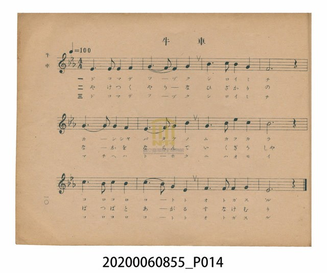
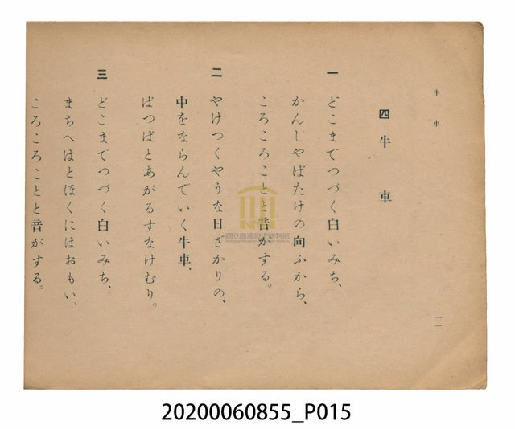

# 牛車

<audio controls src="gyusha.mp3"></audio>

- 日治時期公學校唱歌（第三學年・第四課）
- 國立臺灣歷史博物館典藏

## 說明

【曲目說明】
・出處：臺灣總督府編《公學校唱歌》第三學年用，第四課〈牛車〉，原書第 10–11 頁。
・調性與拍號：ホ調（E 大調），4/4 拍，速度 != 100。
・背景與曲風：描寫臺灣農村炎熱正午下，滿載重物的牛車成隊沿著漫長白色鄉道（白いみち）與
甘蔗田（かんしやばたけ）緩緩前行，車輪發出「ころころこと」聲響、揚起陣陣沙塵的南國風情。
旋律採用純樸的大調五聲音階搭配全曲貫穿的附點節奏，呈現牛車一步一印、穩定前行的律動。
・版本說明：本檔案為原書單聲部簡譜（數字譜）之忠實數位化版本。

・編曲說明（鋼琴伴奏版）：
1. 前奏 (Intro, 4 小節)：引用第三樂句「ころころことと音がする」之附點動機，勾勒遠方傳來的牛車輪聲。
2. 主歌伴奏 (Gyusha, 12 小節 × 3 段)：右手 (PianoRH) 演奏附點五聲音階主旋律；
左手 (PianoLH) 以穩健的四分音符低音與和弦交替（`1_ [1] 5_ [1]`），表現牛車負重前行的踏實步伐。

## 歌詞

```text
一　どこまでつづく白いみち、
かんしやばたけの向ふから、
ころころことと音がする。

二　やけつくやうな日ざかりの、
中をならんでいく牛車、
ぽつぽとあがるすなけむり。

三　どこまでつづく白いみち、
まちへはとほくにはおもい、
ころころことと音がする。
```

## ABC

```abc
X:1
T:牛車
M:4/4
L:1/16
Q:1/4=100
K:E
V:V1 name="Piano" snm="Pia"
[V:V1]
E6 E2 E4 F4 | G3 F5 E4 G4 | B3 c5 B4 G4 | F12 z4 |
G6 G2 G4 F4 | E6 F2 G4 c4 | G3 B5 e4 c4 | B12 z4 |
c6 B2 c4 B4 | c6 B2 G4 E4 | F6 F2 F4 G4 | E12 z4 |
```

## TMD 檔案連結

- [主旋律 TMD 檔案](gyusha.tmd) [[在 TMD Studio 編輯](https://tmdlang.github.io/Tmd-TS/#tmd=s7IKdvYPcrWy4tLSUnjeOfvF7i4FLS0uRVsFQwMDLntbBVcuGxN9EzuuOgWlZ9OXPtu0-9nMpmdz5j9tXfN07Y5nCxY-nbLx2dqe93s6nq9Z82RHJ1Dw6c4tj5t3A7lPZ89-sWrT-z2dSiDdT-d0P1_d_aJ91_PGxc_Wbn_av-lp76znnStfLlnxtHXHi-n9Slxc-loKttQCXAoKCo8bJjybven57HUvVq16NqPvccNEsGjz7qftu17MnPp-zyyIe57v2Pt87uKnu-Y8377icUMXmuceN3Qje-75lBXv9_TA_fe4oQMSbo8bOoHiT_vmP5u9AygLDMBHDZMNDRVeLmh83NAEtfjFqv3PGpa_6Gh_1t37YuZ8oAseNwNN2Q8MQFeFp0uWg5kgc4CBrgBUA2S9bJj_dNcyBUiUIJnU3PNs5nqQSbM3vVwEdNKsZ_39T9evhvjoxb5Nz-ZOfN7U97wN6IXFT3s7nuzoBhr2bPf-F3s6X7b3AkP--awWiMufdUx4Oavr2ab9LyZOf7Zn9cup25_P3Puic9PLls6XjZNBcTtz7-PGlseN-x83LgQ6D2gpyBEKCs-nzHgxZfrzKRuAah43dj9umvy4cfrjJqDKDY8b5z9unAhU_Hz7SiB62tn7YiEwmfQArXuxZ9XzmXuAUfC4oedx4-THTb0IshEY_r0vGje9nL__cUPjs_5ZL7ZufzlzMRA92zTz6cKtQDc_7Z0OTEtALz9rboUGh4LCs-ndT_d1P-tbCIyd51umPFuxA6QSHJ5Pdk0BG7j55ay-ZxPWvmztfdq6AhhoLzatfr5yP1DZy5ktL3fPe76-4enSflAMTux43r8PEjJPdjQ8W7sUSD7t3QB0z_OVK5-umwXxC8j8fd1Pu6ciouR5Z8ezOWsgaQ0UH3PWPFs15dnCjudNuyDJ4um0dSCnNK94vmHhi7VzgKH2bOqOp2ung9mdT3Z2P92_4On6ZUDBJ3t7n_ZMgxgIsgCamiHGANPki5XzQL6Y1g6Miyc71oIYq-a9WLsemMSBpj7d0PusvVMhMzcxPdVIL6sgNV1BXyHAwNAUaAvYKKCPHjc0PG5cCQ7zfY8blz9uXPK4cenjxn7kuAZ6GWwxtqh93Lju6QQguRUs2wlXihGfjSuAYf-4ERjVMx83dUNDC-hIiIOB4fRkR-_z-Uufb9v_dPe2px0bnuydCsyboMQJSYSNk19sByrrebpvHjy9gQK_fxnQFy8XrAVJNW1-sq_tya42YIp62r_y5aw2CAlMS0CVkCQHDHig3fAA2AXM1g1g_wD9APR6P5jd9rhxFbCYe9w4DeyrLqAnoR4DBvLjpklAaZBfQYEBDDGghn5Y3of6Hhh2QMOAJNDfTSBPA30M9DdQG9CeJqCFQKUYAfB0zoqne7c_3bv_xbLG5-2TgEke6JsXHWtAYdDcASp2kXLwkx3LnvVNgqdBiP3A7PtkD6iweDpzOgjN2QDJOsAgQc49yAGwAxhlJKQAoIqFjxt3PG5cD_bbblCINa4Gc7seNwG92kL7FPBi-9yXsxe9WDj9Zd-6l03A7NfxsnHmy8YFQJvBebULFNmbVgCLtic75wNln20ClXTw9EFU4gC6jPK6BwoUtPS5uILz89KtAjIT8_IdagxqFKrB5ZWNiYKWHZgFrPKAydgKWHx0Kjxu2gyk5wFxu0INkGwB4j1A3AqUWQ8SadoO5K0F0kuA9HywmkZw8acAsgpm3K4eoHFNQM2NE4EYqLSxH6wZJNIGMbJxFUikcRMQTwNlb6BsF1hkHaZxOzqp5roaBQ1DBV0gNNRU1dDV1VQwVDACCRqDBY1AgpoKGkA2hGWoYAySNQXLmqHLmoJljRR0dRUMFGrAiRoRmk2roa4Durlp--PmJWDnTABy9gPxRiC7DyyyAKp0KpgGiazEEaDAIIMEHSiwJoE9AxZrAoXMZCB7OVgEFMj9QNwHDmyQCKjUxB6moLBsBOIZQNwPMbG5A-ru2bBQbQbaB5R93ASyfxE4nJdghCokAI2hoWoMCVVIUINDFSxohlBpihHUcWBpYFBjDU1QzINiFkKD3ABigdwJcm8HWATkPiCvaQ0Q7wS7fDWuoNwLTZcgegU4kJqggdsD1NwNFpkJCV5QGm5qAFvQhSNtUsd1wLAxQ4QNMEjMgKGBIWgMTJRAQWCqQwpaI3BKBAY3JOxqwQ3ZjJKSgmIrff2S5NwkveTSnJLSolS9knL9qgxdIJmSWpKYmWOfmZeSWuGcn5Jq6-vv7Ozv4-PqHOLp7xeslpliawhs7hkYWhiYGlqACxJdOwVQWQKilbm4AA)]
- [鋼琴伴奏 TMD 檔案](gyusha_piano.tmd) [[在 TMD Studio 編輯](https://tmdlang.github.io/Tmd-TS/#tmd=s7IKdvYPcrWy4tLSUnjeOfvF7q73ezpedu95PmHLkz1bni7tf97Z8X5Pp4KWFpeirYKhgQGXva2CK5eNib6JHVedgtKz6Uufbdr9bGbTsznzn7auebp2x7MFC59O2fhsbQ_QoOdr1jzZ0QkUfLpzy-Pm3UDu09mzX6zaBDRRCaT76Zzu56u7X7Tvet64-Nna7U_7Nz3tnfW8c-XLJSuetu54Mb1fiYtLX0vBllqAS0FB4XHDhGezNz2fve7FqlXPZvQ9bpgIFm3e_bR914uZU9_vmQVxz_Mde5_PXfx015zn21c8buhC89zjhm5kzz2fsuL9nh64_x43dEAC83FDJ1D8ad_8Z7N3AGWBAfioYbKhocLLBY2PG5qgFr9Ytf9Zw_IXHe3PuntfzJwPdMHjZqAp-4EB6KrwdMlyMBNkDjDQFYBqgKyXDfOf7lqmAIkSJJOae57NXA8yafaml4uATpr1rL__6frVEB-92Lfp2dyJz5s7QJG2dvHT3o4nO7pBzgY79dmm_S8mTn8-ZcaLKUByw_OpU57Pank-c--Lzk0vGye_2L7--faVQPS0s_fFQqD3G4FaXuxZ9XzmHmC4gawHhWzP48bJj5t6EWQjMOh6XzRuejl__5Mdy571z3qxdfuzTTOfLtwKNPxlS-fTOfNBDt64EOEHYHADXQ-JHKxpEegriH2GegpA1wDFFTQ880qK8nUUTBSebuh_vr5BE6jm6Z6pwFiBRNKzFU1P-5did1_jipfzNz9uBErNfNzUDXTuk53dL2e2vNw972n31GcrgdHR87R739PuSS8bFzybtvNp0-Yn-9pAQQMONWAQAL0Hdb2CgpGewpMdu4HpA-JgBQ33ytLijEQdBUMjqNMUDk9XMFZ4tm4r2I39m591ditoBGQm5uUHeWgqPNszBagNYv2TXVPAIbf55aw-kKHTu5_uA0bXbIhNQPB0-zKEbh-g7ie7lz5fufJp41Kg84AJ8WlHG1D38zXLnuztAzKAyeLppJ6ne5Y92bXk2WxQ6kowjFeINoxVMAVTCZBE9mLhiuf9-6C-27TgZXsvJMqBZr7YAUxMy56tXfpkzwSQl6HZCZK8gZ5-sXLe09YVz6a1A616smMtiLFq3ou164F5DGjb0w29z9o7FTJzE9NTjfSyClLTFfQVAgwMTYH2go16sqPhcUPD48aV4JjZ97hx-ePGJY8blz5u7Aemw8eNLY8b9z9uBCaVRrDFjd2Pm4Dqpj9uAkpseNw4_3HjxMeN655OAJJbwbKdcKUEYx0cf0BHQhwMjJonO3qfz1_6fNv-p7u3Pe3Y8GTvVGDhgJYjQElj3zxElgGGev8yoC9eLlgLkgKnlCe72oDp7mn_ypez2iAkMImBwhIp7cADYBcwYzWA_QP0A9Dr_WB22-PGVcAs-7hxGthXXUBPQj0GDOTHTZOA0iC_ggIDGGJADcCMAil8oL4Hhh3QMCAJ9HcTyNNAHwP9DdQGtKcJaCFQKUYAPJ2z4une7U_37n-xrPF5-yRgxgX65kXHGlAYYBQhoMzdNwmeUCD2v5zV9WQPqLR6OnM6CM3ZACkAgEHycuZiIIKUBMgBsAMYZSSkAKCKhY8bdzxuXA_2225QiDWuBnO7HjcBvdpC-xTwYvvcl7MXvVg4_WXfupdNLU_3dbxsnAksKyBF5JMdXaDI3rQCWKs92TkfKPtsUycwT8HTB1GJA-gyyis_KFDQ0qewUgU5B6Xg1bSCl7wKGtBKShMcn8ACCVKQgD2Eq4IAVivAQuXZbmApO_XZtD3AeuHltMnAYAaGMShPgYvhpxunvpzWTVlIgL0OdrEVtMR1qDGoUagGl6g2Jlp2YEaNgoaZgi4QmmqqaujqaiqYKZhiChorGIIEjcCCRlBBI6BwDVBCV1fBQKGGqxbFNh8ctpkAS1-TWAVoWYzJB5XOppBCGkgBjYdIgDDUEopjE1JnASslWIUFjFFEjYUSpZAq63nTLkg7CKli6oHUR8A4ByZxYD0EqScgFSGwGfJ85ypoWlgIbL5sokJMQpyKLyqxBYwCuEnQAHQF0GOw9gIWZUAboEYAVVsBWyadCo-bNgPpeUDcDoyHx80tQLwHiFuBMutBIk3bgby1QHoJkJ4PVtMIrayRjNvVAzSuCai5cSIQA5U29oM1g0TaIEY2rgKJNG4C4mmgmg4o2wUWWYdp3I5OqrkOmKCBiRcIDaEJ2hCYpIGCxohUrqmgAWRDWIbg5K5hCpY1Q5c1BcsCMwgkM-CPkF3AdgeJEdK0GupBoLebtj9uXgL20QQgZz8QbwSy-8AiC6BKp4JpkMhKHHECDHVI6IPCexI4PMBiTaDAnQxkLweLgOKpH4j7wPEFEgG1QbBHCyg6GoF4BhD3Q0xs7oC6ezYsYpqB9gFlHzeB7F8EjqolGBEDiQNjePEDjhhIbMGKH2NgUQVXCS6oUGIrDiwNjC1iImRHJ-kRAkp_oPQFoUHeALFAXgV5uQMsAvIikNe0Boh3gj2_Glds7IXmDhC9AhzOTdD46QFq7gaLzITEECgnNTWALejCkUOo4zqqVg7IBRj22oEKBRi8woC08nHzzYCUWS5SjWMErXGolnUxrYbZCa3z4ArgfNKcQnyipUa1q2unAK7eFYAMSFTiYilzcQEA)]

## 分析

```text
================================================================================
📊 TMD Song Profile: [ 牛車 ]
================================================================================
⏱  Duration:       0:28 (28.8s), 12 measures total
🎼 Key & Tempo:    首調基準 E, != 100.0 BPM, <4/4>
   - 分析範圍：      由實際發聲的音符與和弦推測調性；播放脈絡另行呈現
🎤 人聲音域:    E4 (MIDI 64) – E5 (MIDI 76) [跨度: 12 個半音 / 1.0 個八度, 難度: easy]
   - 最低音:  E4 in [Song #1 @ m.1, 0:00]
   - 最高音: E5 in [Song #1 @ m.7, 0:15]
   - 適合: soprano, mezzo-soprano, contralto, tenor, baritone, bass
🏛  結構:      Song (28.8s)
⚡ 編曲密度:        Peak 1 軌道同時演奏
🗝  調性診斷：       E 大調（純淨自然大調，未偵測到可信轉調）
   - 風格氣質:    純淨自然大調（陽光明朗、易唱易記，無明顯調外色彩）
   - 轉調歷程:    全曲維持單一推測調性（未偵測到可信轉調）
   - 核心骨幹音:  E, F#, G#, B, C#
   - 調性數值:    E 大調 [相關度: 0.78, 穩定度: Moderate, 自然音純度: 100.0%]
   - 候選調性 (K-S): E 大調 (0.78), B 大調 (0.70), C# 小調 (0.67)
   - 五度圈歷程:   +4
   - 各段落調性細節:
     • [Song #1]: E 大調 (r: 0.78, 自然音純度: 100.0%)

  [ 五度圈游移軌跡 ]
               C  
         F            G  
      Bb               D  
      Eb               A  
         Ab          [E ]*
            Db       B  
               F# 
     (* = active key center)

  [ 十二半音累積音高分佈 ]
     C  :                            0.0%
     C# : █████████████████         16.1%
     D  :                            0.0%
     D# :                            0.0%
     E  : ████████████████████████  23.3%
     F  :                            0.0%
     F# : ██████████████████████    21.7%
     G  :                            0.0%
     G# : ██████████████████████    21.1%
     A  :                            0.0%
     A# :                            0.0%
     B  : ██████████████████        17.8%
--------------------------------------------------------------------------------
Assignment 軌道音域：
  - Piano         : E4 – E5 (12 個半音 / 1.0 個八度, 39 個音符)
================================================================================
```


## 原書掃描頁






