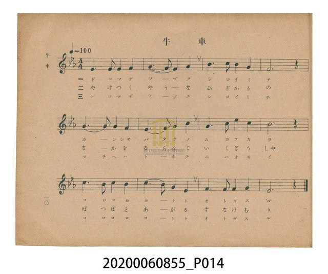
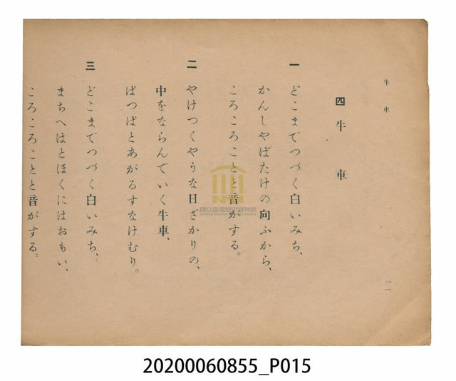

# 牛車

> Re:Shōka 使用 AI 協助辨識與重建樂譜，可能會有錯誤。歡迎回報。

- **NEUTRINO 歌聲合成版**：<br><audio controls src="gyusha_neutrino.mp3"></audio>
- **鋼琴伴奏版**：<br><audio controls src="gyusha.mp3"></audio>


- 岡田與志松 作詞（懸賞募集入選）
- 日治時期公學校唱歌（第三學年・第四課）
- 國立臺灣歷史博物館典藏

## 說明


- 出處：臺灣總督府編《公學校唱歌》第三學年用，第四課〈牛車〉，原書第 10–11 頁。

- 調性與拍號：ホ調（E 大調），4/4 拍，速度 != 100。

- 背景與曲風：描寫臺灣農村炎熱正午下，滿載重物的牛車成隊沿著漫長白色鄉道（白いみち）與

甘蔗田（かんしやばたけ）緩緩前行，車輪發出「ころころこと」聲響、揚起陣陣沙塵的南國風情。
旋律採用純樸的大調五聲音階搭配全曲貫穿的附點節奏，呈現牛車一步一印、穩定前行的律動。
- 版本說明：本檔案為原書單聲部簡譜（數字譜）之忠實數位化版本。


### 編曲說明（鋼琴伴奏版）：

1. 前奏 (Intro, 4 小節)：引用第三樂句「ころころことと音がする」之附點動機，勾勒遠方傳來的牛車輪聲。
2. 主歌伴奏 (Gyusha, 12 小節 × 3 段)：右手 (PianoRH) 演奏附點五聲音階主旋律；
左手 (PianoLH) 以穩健的四分音符低音與和弦交替（`1_ [1] 5_ [1]`），表現牛車負重前行的踏實步伐。


## 歌詞

```text
一　どこまでつづく白いみち、
かんしやばたけの向ふから、
ころころことと音がする。

二　やけつくやうな日ざかりの、
中をならんでいく牛車、
ぽつぽとあがるすなけむり。

三　どこまでつづく白いみち、
まちへはとほくにはおもい、
ころころことと音がする。
```

## ABC

```abc
X:1
T:牛車
M:4/4
L:1/16
Q:1/4=100
K:E
V:V1 name="Piano" snm="Pia"
[V:V1]
E6 E2 E4 F4 | G6 F2 E4 G4 | B6 c2 B4 G4 | F12 z4 |
w: 1.~ド コ マ デ | ツ _ ヅ ク | シ ロ イ ミ | チ
w: 2.~や け つ く | や う _ な | ひ ざ か り | の
w: 3.~ド コ マ デ | ツ _ ヅ ク | シ ロ イ ミ | チ
G6 G2 G4 F4 | E6 F2 G4 c4 | G6 B2 e4 c4 | B12 z4 |
w: 1.~カ _ ン シャ | バ タ ケ ノ | ム カ フ カ | ラ
w: 2.~な _ か を | な ら ん で | い く ぎ う | しゃ
w: 3.~マ チ ヘ ハ | ト _ ホ ク | ニ ハ オ モ | イ
c6 B2 c4 B4 | c6 B2 G4 E4 | F6 F2 F4 G4 | E12 z4 |
w: 1.~コ ロ コ ロ | コ _ ト ト | オ ト ガ ス | ル
w: 2.~ぽ つ ぽ と | あ _ が る | す な け む | り
w: 3.~コ ロ コ ロ | コ _ ト ト | オ ト ガ ス | ル
```

## TMD 檔案連結

- [主旋律 TMD 檔案](gyusha.tmd) [[在 TMD Studio 編輯](https://tmdlang.github.io/Tmd-TS/#tmd=s7IKdvYPcrWy4qpTUCpJTLdSSM7PyUlNLsnMz7PKzk9PzM7Ojy_OyM9OVIKrKMvPKc1NtUovSkxJjTdGiBfnlxYlp1oVJ2fk5-fEl6RWlCTl52cj5AuK8stS8xLzgGoKijLzSlJTwIoQClLLMlNSQdKpKZkl-UWZiTlIlqYWFYPcBLEkvqQoMa84uSizAORQhKqSjFSgy8CSBflFQKO1tBSed85-sbtLQUuLS9FWwdDAgMveVsGVy8ZE38QOpO_ppoXPp2x40dH-dP_0Z3P3KTzZO-fFynnv93Q8a9_xYvO8p93zX85ue9q69GXjjvd7OsFWPZu-9Nmm3c9mNj2bM_9p65qna3c8W7Dw6ZSNz9b2APU9X7PmyY5OoODTnVseN-8Gcp_Onv1i1SaY7qdzup-v7n7Rvut54-Jna7c_7d_0tHfW886VL5eseNq648X0fiUuLn0tBVtqAS4FBYXHDROezd70fPa6F6tWPZvR97hhIli0effT9l0vZk59v2cWxD3Pd-x9Pnfx011znm9f8bihC81zjxu6kT33fMqK93t64P573NABCerHDZ1A8ad985_N3gGUBYb5o4bJhoYKLxc0Pm5oglr8YtX-Zw3LgcH-rLv3xcz5QBc8bgaash8YgK4KT5csBzNB5gDjSQGoBsh62TD_6a5lCpBYRDKpuefZzPUgk2ZverkI6KRZz_r7n65fDfHRi32bns2d-Lyp73kb0AuLn_Z2PNnRDTTs2e79L_Z0vmzvBYb881ktEJc_65jwclbXs037X0yc_mzP6pdTtz-fufdF56aXLZ0vGyeD4nbm3seNLY8b9z9uXAh0HtBSkCMUFJ5PmfFiynRgOgKqedzY_bhp8uPG6Y-bgCo3PG6c_7hxIlDx8-0rgehpZ--LhcBk0gO07sWeVc9n7gFGweOGnseNkx839SLIRmD4975o3PRy_v7HDY3P-me92Lr95czFQPRs08ynC7cC3fy0dzowLQG9_Ky5FRocCgrPpnc_3df9rA-YqFc83zLl2YodIJXg8HyyawrYwM0vZ_U9m7D2ZWvv09YVwEB7sWn185X7gcpezmx5uXve8_UNT5f2g2JwYsfz_n2QkHmyo-HZ2qVA8mnvBqB7nq9c-XTdLIhfQObv637aPRURJc87O57NWQNJa6D4mLPm2aopzxZ2PG_aBUkWT6etAzmlecXzDQtfrJ0Dym1TdzxdOx3M7nyys_vp_gVP1y8DCj7Z2_u0ZxrEQJAF0NQMMQaYJoF5FeSLae3AuHiyYy2IsWrei7XrgUkcaOrTDb3P2jsVMnMT01ON9LIKUtMV9BUCDAxNgbaAjQL66HFDw-PGleAw3_e4cfnjxiWPG5c-buxHjmugl8EWY4vax43rnk4AklvBsp1wpRjx2bgCGPaPG4FRPfNxUzc0tICOhDgYGE5PdvQ-n7_0-bb9T3dve9qx4cneqcC8CUqckETYOPnFdqCynqf75sHTGyjw-5cBffFywVqQVNPmJ_vanuxqA6aop_0rX85qg5DAtARUCUlywIAH2g0PgF3AbN0A9g_QD0Cv94PZbY8bVwGLuceN08C-6gJ6EuoxYCA_bpoElAb5FRQYwBADauiH5X2o74FhBzQMSAL93QTyNNDHQH8DtQHtaQJaCFSKEQBP56x4unf70737XyxrfN4-CZjkgb550bEGFAbNHaBiFykHP9mx7FnfJHgahNgPzL5P9oAKi6czp4PQnA2QrAMMEuTcgxwAO4BRRkIKAKpY-Lhxx-PG9WC_7QaFWONqMLfrcRPQqy20TwEvts99OXvRi4XTX_ate9kEzH4dLxtnvmxcALQZnFe7QJG9aQWwaHuycz5Q9tkmUEkHTx9EJQ6gyyive6BAQUufi8u9srQ4I9EqIDMxL9-hxqCmGlxg2Zho2YEZNQoahgq6QGioqaqhq6upYKhgBBI0BgsawQWNQYKmYEEzqKApWNAILGagUAM2zscQqOxxcydY8HHTZk1guTQPiNtB2h83t4DFgXofN7cCpdeDRZu2Q1Q3rwWKNy0BMuYDxR83N6KabARWCzEBmJqBahuBahv7IWbAxNs0wdQqsGjjJqjoNJDqbqDpXSCTG9ehmmxMCzfDQhcSkMbQMDOGhC4kyGGha6xghlBpCgvyOLAoJMhRg7dpNcJJm4HWb3_cvBji1glQP-wHuWojULoPIr4AKr4apGUqiAF27UosIQwMOpjh4BCbBAlJiCiw8AGZPBkotxwiDgv3fpD6PlAEgEMYWFQ3YwvkedBgawQ5ZAYQQ6KvuQPho9nwQG7uhqoGGd60CshYBDIcGNzogWyGEnRmwFDDEDQGJmKgICS5wkLeCJyEIbGBFsabkSMYGMrNayERDxEHu7QDjMGi0OBp7gCpXgPEO8EBDIkotADeCw2yJaAg2wvEKyBB2YQI-B6gCd0Q0ZlQ1atA4hOB4g3gMOjCErrUdnMtuEWcUVJSUGylr1-SnJukl1yaU1JalKpXUq5flaELJFNSSxIzc-wz81JSK5zzU1Jtff2dnf19fFydQzz9_YLVMlNsDYHtRgNDCwNTQwtwiaRrpwAplMBOB_KUuQA)]
- [鋼琴伴奏 TMD 檔案](gyusha_piano.tmd) [[在 TMD Studio 編輯](https://tmdlang.github.io/Tmd-TS/#tmd=s7IKdvYPcrWy4tLSUnjeOfvF7q73ezpedu95PmHLkz1bni7tf97Z8X5Pp4KWFpeirYKhgQGXva2CK5eNib6JHVedgtKz6Uufbdr9bGbTsznzn7auebp2x7MFC59O2fhsbQ_QoOdr1jzZ0QkUfLpzy-Pm3UDu09mzX6zaBDRRCaT76Zzu56u7X7Tvet64-Nna7U_7Nz3tnfW8c-XLJSuetu54Mb1fiYtLX0vBllqAS0FB4XHDhGezNz2fve7FqlXPZvQ9bpgIFm3e_bR914uZU9_vmQVxz_Mde5_PXfx015zn21c8buhC89zjhm5kzz2fsuL9nh64_x43dEAC83FDJ1D8ad_8Z7N3AGWBAfioYbKhocLLBY2PG5qgFr9Ytf9Zw_IXHe3PuntfzJwPdMHjZqAp-4EB6KrwdMlyMBNkDjDQFYBqgKyXDfOf7lqmAIkSJJOae57NXA8yafaml4uATpr1rL__6frVEB-92Lfp2dyJz5s7QJG2dvHT3o4nO7pBzgY79dmm_S8mTn8-ZcaLKUByw_OpU57Pank-c--Lzk0vGye_2L7--faVQPS0s_fFQqD3G4FaXuxZ9XzmHmC4gawHhWzP48bJj5t6EWQjMOh6XzRuejl__5Mdy571z3qxdfuzTTOfLtwKNPxlS-fTOfNBDt64EOEHYHADXQ-JHKxpEegriH2GegpA1wDFFTQ880qK8nUUTBSebuh_vr5BE6jm6Z6pwFiBRNKzFU1P-5did1_jipfzNz9uBErNfNzUDXTuk53dL2e2vNw972n31GcrgdHR87R739PuSS8bFzybtvNp0-Yn-9pAQQMONWAQAL0Hdb2CgpGewpMdu4HpA-JgBQ33ytLijEQdBUMjqNMUDk9XMFZ4tm4r2I39m591ditoBGQm5uUHeWgqPNszBagNYv2TXVPAIbf55aw-kKHTu5_uA0bXbIhNQPB0-zKEbh-g7ie7lz5fufJp41Kg84AJ8WlHG1D38zXLnuztAzKAyeLppJ6ne5Y92bXk2WxQ6kowjFeINoxVMAVTCZBE9mLhiuf9-6C-27TgZXsvJMqBZr7YAUxMy56tXfpkzwSQl6HZCZK8gZ5-sXLe09YVz6a1A616smMtiLFq3ou164F5DGjb0w29z9o7FTJzE9NTjfSyClLTFfQVAgwMTYH2go16sqPhcUPD48aV4JjZ97hx-ePGJY8blz5u7Aemw8eNLY8b9z9uBCaVRrDFjd2Pm4Dqpj9uAkpseNw4_3HjxMeN655OAJJbwbKdcKUEYx0cf0BHQhwMjJonO3qfz1_6fNv-p7u3Pe3Y8GTvVGDhgJYjQElj3zxElgGGev8yoC9eLlgLkgKnlCe72oDp7mn_ypez2iAkMImBwhIp7cADYBcwYzWA_QP0A9Dr_WB22-PGVcAs-7hxGthXXUBPQj0GDOTHTZOA0iC_ggIDGGJADcCMAil8oL4Hhh3QMCAJ9HcTyNNAHwP9DdQGtKcJaCFQKUYAPJ2z4une7U_37n-xrPF5-yRgxgX65kXHGlAYYBQhoMzdNwmeUCD2v5zV9WQPqLR6OnM6CM3ZACkAgEHycuZiIIKUBMgBsAMYZSSkAKCKhY8bdzxuXA_2225QiDWuBnO7HjcBvdpC-xTwYvvcl7MXvVg4_WXfupdNLU_3dbxsnAksKyBF5JMdXaDI3rQCWKs92TkfKPtsUycwT8HTB1GJA-gyyis_KFDQ0qewUgU5B6Xg1bSCl7wKGtBKShMcn8ACCVKQgD2Eq4IAVivAQuXZbmApO_XZtD3AeuHltMnAYAaGMShPgYvhpxunvpzWTVlIgL0OdrEVtMR1qDGoqQYXqDYmWnZgRo2ChpmCLhCaaqpq6OpqKpgpmGIKGisYggSNwIJGUEEjoHANUAIkZqBQw1WLYpsPdttMgIWvSawCtCjG5IMKZ1NIGQ2kgMZDJEAYagfFkQmpsoB1Eqy-AkYoosJCiVFIjfW8aRekGYRUL_VAqiNglANTOLAaglQTkHoQ2Ap5vnMVNCksBLZeNlEhIiFOxR-TkLgwhMaPITCGgILGKJFmCI40DVOwoBlU0BQsCIldUCiDjPMxBCp73NwJFnzctFkT2FqZB8TtIO2Pm1vA4kC9j5tbgdLrwaJN2yGqm9cCxZuWABnzgeKPmxtRTTYCq4WYACyTgWobgWob-yFmwMTbNMHUKrBo4yao6DSQ6m6g6V0gkxvXoZpsTAs3w0IXEpDG8CwBDl1IkMNC1xiYfeAqYZnHMA4sCgly1OBtWo1w0mag9dsfNy-GuHUC1A_7Qa7aCJTug4gvgIqvBmmZCmKAXbsSSwgDgw5mODjEJkFCEiIKrEJBJk8Gyi2HiMPCvR-kvg8UAeAQBjY4mrEF8jxosDWCHDIDiCHR19yB8NFseCA3d0NVgwxvWgVkLAIZDgxu9ECmVmGEFMabkSMYGMrNayERDxEHu7QDjMGi0OBp7gCpXgPEO8EBDIkotADeCw2yJaAg2wvEKyBB2YQI-B6gCd0Q0ZlQ1atA4hOB4g3gMOjCErrUdjOw2EQuP7CWzdjKVQVwh6IBWIgBy0VYbwOLMmABBYk_lCY2br4ZkDLLRSrvjaDlPSQd4HTKLmB7nVynwOyE1jhwBXA-aU7Z0Um8Uyiv9HTtFMB1K9hAIAcSm9E-hrHoIkYYIsZwEWUuAA)]

## 分析

```text
================================================================================
📊 TMD Song Profile: [ 牛車 ]
================================================================================
⏱  Duration:       0:28 (28.8s), 12 measures total
🎼 Key & Tempo:    首調基準 E, != 100.0 BPM, <4/4>
   - 分析範圍：      由實際發聲的音符與和弦推測調性；播放脈絡另行呈現
🎤 人聲音域:    E4 (MIDI 64) – E5 (MIDI 76) [跨度: 12 個半音 / 1.0 個八度, 難度: easy]
   - 最低音:  E4 in [Gyusha #1 @ m.1, 0:00]
   - 最高音: E5 in [Gyusha #1 @ m.7, 0:15]
   - 適合: soprano, mezzo-soprano, contralto, tenor, baritone, bass
🏛  結構:      Gyusha (28.8s)
⚡ 編曲密度:        Peak 1 軌道同時演奏
🗝  調性診斷：       E 大調（純淨自然大調，未偵測到可信轉調）
   - 風格氣質:    純淨自然大調（陽光明朗、易唱易記，無明顯調外色彩）
   - 轉調歷程:    全曲維持單一推測調性（未偵測到可信轉調）
   - 核心骨幹音:  G#, E, F#, B, C#
   - 調性數值:    E 大調 [相關度: 0.79, 穩定度: Moderate, 自然音純度: 100.0%]
   - 候選調性 (K-S): E 大調 (0.79), B 大調 (0.67), C# 小調 (0.66)
   - 五度圈歷程:   +4
   - 各段落調性細節:
     • [Gyusha #1]: E 大調 (r: 0.79, 自然音純度: 100.0%)

  [ 五度圈游移軌跡 ]
               C  
         F            G  
      Bb               D  
      Eb               A  
         Ab          [E ]*
            Db       B  
               F# 
     (* = active key center)

  [ 十二半音累積音高分佈 ]
     C  :                            0.0%
     C# : ██████████████            14.4%
     D  :                            0.0%
     D# :                            0.0%
     E  : ███████████████████████   23.3%
     F  :                            0.0%
     F# : ████████████████████      20.0%
     G  :                            0.0%
     G# : ████████████████████████  24.4%
     A  :                            0.0%
     A# :                            0.0%
     B  : █████████████████         17.8%
--------------------------------------------------------------------------------
Assignment 軌道音域：
  - Piano         : E4 – E5 (12 個半音 / 1.0 個八度, 39 個音符)
================================================================================
```


## 原書掃描頁






