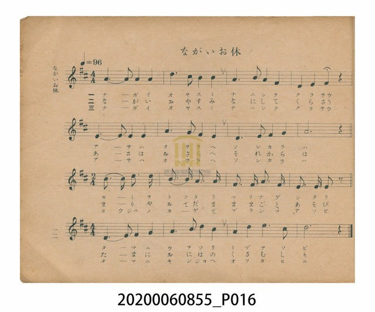
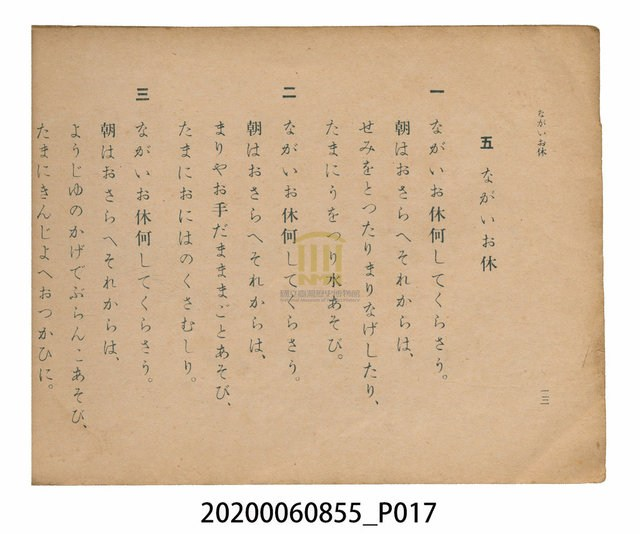

# ながいお休（長假）

> Re:Shōka 使用 AI 協助辨識與重建樂譜，可能會有錯誤。歡迎回報。

- **鋼琴伴奏版**：<br><audio controls src="nagaioyasumi.mp3"></audio>
- **NEUTRINO 歌聲合成版**：<br><audio controls src="nagaioyasumi_neutrino.mp3"></audio>

- 日治時期公學校唱歌（第三學年・第五課）
- 國立臺灣歷史博物館典藏

## 說明


- 出處：臺灣總督府編《公學校唱歌》第三學年用，第五課〈ながいお休〉（長假／暑假），原書第 12–13 頁。
- 調性與拍號：ニ調（D 大調），4/4 拍，速度 != 96。
- 背景與曲風：描寫公學校學童迎接漫長暑假（ながいお休）的歡欣心情：早晨先溫習功課（おさらへ），
接著去捕蟬、拍球、釣魚戲水、玩沙包與扮家家酒，或在臺灣常見的「榕樹（ようじゆ）」樹蔭下盪鞦韆、
幫家裡拔草與跑腿。第三樂句（Song2）以密集的附點八分音符表現孩童嬉戲的雀躍感。
- 版本說明：本檔案為原書單聲部簡譜（數字譜）之忠實數位化版本。

### 編曲說明（鋼琴伴奏版）：

1. 前奏 (Intro, 4 小節)：引用結尾樂句（Song3）明亮上行的旋律線，帶出假期的喜悅期待。
2. 主歌伴奏 (Song1 + Song2 + Song3, 共 14 小節 × 3 段)：依原譜節奏細分拆為三段連接，
右手 (PianoRH) 演奏主旋律，左手 (PianoLH) 以輕快明朗的四拍和聲伴奏襯托孩童嬉戲的活力。


## 歌詞

```text
一　ながいお休何してくらさう。
朝はおさらへそれからは、
せみをとつたりまりなげしたり、
たまにうをつり水あそび。

二　ながいお休何してくらさう。
朝はおさらへそれからは、
まりやおてだまままごとあそび、
たまにおにはのくさむしり。

三　ながいお休何してくらさう。
朝はおさらへそれからは、
ようじゆのかげでぶらんこあそび、
たまにきんじよへおつかひに。
```

## ABC

<div class="abc-score" data-abc-src="nagaioyasumi.abc" aria-label="五線譜載入中"></div>

[下載 ABC 原始檔](nagaioyasumi.abc)

## TMD 檔案連結

- [主旋律 TMD 檔案](nagaioyasumi.tmd) [[在 TMD Studio 編輯](https://tmdlang.github.io/Tmd-TS/#tmd=s7IKdvYPcrWy4qpTUCpJTLdSSM7PyUlNLsnMz7PKzk9PzM7Ojy_OyM9OVIKrKMvPKc1NtUovSkxJjTdGiBfnlxYlp1oVJ2fk5-fEl6RWlCTl52cj5AuK8stS8xLzgGoKijLzSlJTwIoQClLLMlNSQdKpKZkl-UWZiTlIlqYWFYPcBLEkvqQoMa84uSizAORQhCqgpvTMPKuSxMzyxLz4_LS0zGQUU_KLSjLygQ4vyKi0ysgsBlmSnJgTn52Yh-S_koxUoPcg3kD3XXxBYnqqVYCBoZkSl5aWwuPGVY8bex43tjxu7HqyZ-L7PR0vp25_2tj-fk-ngpYWl6KtgqUZl72tgguXjYm-iR3IsGfTlz7btPvZzKZnc-Y_bV3zdO2OZwsWPp2y8dnaHqD252vWPNnRCRR8unPL4-bdIO6uKS9WbQIaCHbK0zndz1d3v2jf9bxx8bO125_2b3raO-t558qXS1Y8bd3xYnq_EheXvpaCLbUAl4KCwuOGCc9mb3o-e92LVauezeh73DARLNq8-2n7rhczp77fMwvinuc79j6fu_jprjnPt6943NCF5rnHDd3Inns-ZcX7PT1w_z1u6EALy8cNnUjB2f9s1kRIuAJ1Pe2b_2z2DqBeBUOjRw2TDY0VXi5ofNzQBHXWi1X7nzUsf9HR_qy798XM-UD3PW7uBgoCjXNReLpkOZgJMgcYJQpANUDWy4b5T3ctUwDHF5JBzT3PZq4HGTR708tFQPfOetbf_3T9aoTP1u54vnrpi_19z_qWPtuzGuhYmDPRfQO08PmslmdrFz5bs_jp_uZnza0g06avfDYTGG8dz3atfr5_0tOu-eCYBurtetw49XFT5-PGHRCXghykoAC05cXE6U_7dj_rnfpi_prHDY1A1z-f0AxkvGxf_HLtrGcdm55t2ALkPu9b-WzTzKc9rSDHd657um4bEL1snQQ06lnHtKdzVkBi7OmOHS-WdQMd9rih59myqc9W7ATZ3gR0QNvjxhmPm9qAtj9u6AWKv5iy9smO7uezV72ct-zl_DagFRAnPd25Gmjyi8ULn3VPedHbCbTuxfaJL1r3AwMREtvPVjQ97V8KNDY4Py_dCGjek91Ln65vezm7DWjty5ktL3fPe9q6-mlH28v5m5-vWfZi4Yrn_fuerl0JDNenazqBHgIpm93wYlfvs5b5iKh53tnxbM4aSIIEheScNc9WTXm2sON50y5I6ng6bd2Lxk0vm1c837Dwxdo5QAc8m7rj6drpYHbnk53dT_cveLp-GVDwyd7epz3TIAaCLIAmeYgxwIT7YiXQhSueTWsHeu7JjrUgxqp5L9auB-YDoKlPN_Q-a-9UyMwFlgtGelkFqekK-grA8sEcaAvYqCc7Gh43NKAlhyd7pz5unP64cdnjxn5wPAO5wEAF--7ZnLmPG9cjp4HHjXMfNwE1d4O5QIvBgf-4cfbjxv2PmyY9blzxuHHJ48b5j5uAevaBSaBtQHGgDWBBmIb5IOnG1SC7QNqWAOVA6aWxCWRD42aoA4C-gvgQFLDgVA2MA2CqBhZYL5Y1Pm2c9WR3w8tde57sawPmmZeNfU8nLnq_Zz4wMT_ZAcz0aIm5B5jYXjYtBgX4PmAB1wNMupDU-7R1EiShgtJqdzcwGYMUN2573rEPmMIh6RmhAJSqm-BBugtYmtAmSMGh1wQyEmzSAnCAQdAUcDjDgwo9SIEagCTQknUgB4DsAbpwOjj06RCqwHJg1jpIUQDP-6DyATXvQ4L3yc75QO1Pd619OXMRJOdCMi9yCO8A8mgSwkiFCziousEJdfnjxm0gdU2THzcCEc5A7gWrAGoGmgK0AWgbMN0DjdgEkqVDOAO5kHISrTxECduODcBy7cX-iS9bNrxs7wGVkPtnQkrFF5u2P5u78cVSUPEICmqgcymvoqFAQUufiwtUyBpaBWQm5uU71BjUVIMLaRsTLTswo0ZBw1RBFwxNNVU1dHU1FUyBEChsGAcWNYeKmgEhXLEZXKkxUNBQwQhI6yrUgE30MQQqe9zcBTUVqOpx0xogXgLS_rhpFVj0cfMSkPhOIGM-WByqHlgrg8S3AxltQPHHTeuBrJVAeisQL4PZYATS0QgxCWJDYw8Qt4BNaoSa1NQCEp8JxPsh4lCbG1eDxKcDMdA8INkPVNoJpKcCMdBOiA3GtPQDLOANocYbQUPTEAjhQWwCFTQGBi5cLUylsYIJUBCi0AAl3JsWIbsZaGNzP4qbm7YCxUGuaZ4BEd8LdfMakPrVYDmgm4G6UMyGhHgTcoiDwms9Sog3TgWZAQrLHRDxuVA7e0Dqu8FyoBBfj2o2OKyp7-5aSNI3wkj6Foikbw61FJbIYYleV8EwDiZkBhWBpXmM_IIS_LsR3gAmiPlQ3uPmTWB-B5wPTJxA1fvh_FVwcyBBvQ_ZnCZYQgQnaniAg4J8GZi_AM7fBzcHkoRXwHWCVTbteNy8FG5pH1hoNYpVm-Cy7SCjYCEFyt8gaIweCnABWGo2hKdm1JTZPA_Zs0i5C2gn2ObtcP5-UFyvQk99sCABexLInwLnrwDzYakTmO5A6W0zWgprnga3fyXY_s1w-zaD7YelQGDaAtk_GTkVGeMrQLHlTbSCEpiuQMWnKYihYYRasgILUIgAWk6GJg6QW-aBChVIul8G9QMwzICpCBxOoHQ_H4hbEb4A-wEkPhnVZEhIQpMlKJT2gQpE1FwMLh-BZVbjOlj5CMzrQJMboPLTwSZD0yRaLsbu5rVQNwPDGZwCl0OzMSh3gzwBT4SPmydBnN0NNxwYAbp2CuBKDGwRlGOEzDGGcZS5AA)]
- [鋼琴伴奏 TMD 檔案](nagaioyasumi_piano.tmd) [[在 TMD Studio 編輯](https://tmdlang.github.io/Tmd-TS/#tmd=s7IKdvYPcrWy4qpTUCpJTLdSSM7PyUlNLsnMz7PKzk9PzM7Ojy_OyM9OVIKrKMvPKc1NtTJGiBTnlxYlp-JSX1CUX5aal5gHVFGSmFmemBefDhQoyssvik9PzUstSsxBqE0ty0xJBaksKMrMTSyqjE_JTwZalleCZH1qUTHIdQWZiXn58YlFRYl56amoSvKLSjLy04sSCzIqrTIyi0vyizKTE3PisxPzkJxVkgHUZVWcnJGfj-QAiFfiCxLTU60CDAzNlLi0tBQeN6563NjzuLHlcWPXkz0T3-_peDl1-9PG9sfNu19273k-YcuTPVueLu1_3tnxfk-ngpYWl6KtgqUZl72tgguXjYm-iR3I-GfTlz7btPvZzKZnc-Y_bV3zdO2OZwsWPp2y8dnaHqCBz9esebKjEyj4dOcWoLEg7q4pL1ZtAhoIdtzTOd3PV3e_aN_1vHHxs7Xbn_Zveto763nnypdLVjxt3fFier8SF5e-loIttQCXgoLC44YJz2Zvej573YtVq57N6HvcMBEs2rz7afuuFzOnvt8zC-Ke5zv2Pp-7-OmuOc-3r3jc0IXmuccN3cieez5lxfs9PXD_PW7oQAvdxw2d8AB-v6f_2ayJYAZQsOdp3_xns3cA9SoYGj1qmGxorPByQePjhiaos16s2v-sYfmLjvZn3b0vZs4Huu9xczdQEGici8LTJcvBTJA5wChRAKoBsl42zH-6a5kCOL6QDGrueTZzPcig2ZteLgK6d9az_v6n61cjfLZ2x_PVS5_OWQFxHTBGX06b_GzmihfrGp7tWv18_6Sn-4CR2vOsd-qL-WseNzS-bF_8cu2sZx2bnm3YAuQ-71v5bNPMpz2tQDbIkGVTn63Y-WRH9_PZq17OW_ZyfhvQ6qc7Vz_dP_Ppum1Pu2c-n9XyrKXz6f7Vz6fMf7ZlN8KhwAAHOhESPaBAw0iMQKeDlCooGOopPO3sBYoraHjmlRTl6yiYKDzd0P98fYMmUM3TPVOB8fJ864SnG_Y9W9H0tH8p0LTg_Lx0Y6AZQLOf7Fr3ZEfXi4U9IJdM7366r_v59lmgCNmxDZgWICEAlHo6bc6zplZQ-t4H9BrYkQoKRnoKT3bsBiYEiLsUNEDmGipoK4BoIyhtrKPwtHWjgiHMUQqHpysYKzxbtxXkuif75gJj_sXaOUAJkM-2bHja0fasu-150y5gsgIqetmw-Fkf0Mk9EBuB4Gn_5med3QoaAaBCIshDU-HZnilArSCHgJ0Pcvv2ZQglPkAlT3YvfbFnKjCUgR5-Nmc6yD-zZwOTydNJPS8aN0Fc_2Lp-medM56uXQmK_jWdwBgFhciW3U-7ZoM8DM01kHQK9PKLlfOetq54Nq0dGKFPdqwFMVbNe7F2PTArAQP46YbeZ-2dCsCCLj3VSC-rIDVdQV8BWOiYAwMdbNSTHQ2PGxrQ8seTvVMfN05_3LjscWP_46bOx41Abhs0tJ_Nmfu4cT1QHUgUJLfjcePcx01Azd1gLtDiRrAbG2c_btz_uGnS48YVjxuXPG6c_7gJqGcfmATaBhQH2gAWhGmYD5JuXA2yC6RtCVAOlJgbm0A2NG6GOgDoK4gPQXlmz2pgLgYFIzh9vFjW-LRx1pPdDS937Xmyrw2Y7V429j2duOj9nvnPpq8EJq-nrR3QzNM1H1zy9QDzxsumxU92AmMMmp0gOepp6yRILgJlpO7u5xOaQYobtz3v2Pe0bzcksyEUgLJcEzxIdwELJNoEKTj0mkBGgk1aAA4wCJoCDmd4UKEHKVADkARasg7kAJA9QBdOB4c-HUK1u_f5rHXAMEQrmJ51rgOVPuu2vWydBA_eJzvnA7U_3bX25cxFLxYvfNY9BYhe9HYih_AOII8mIdwErCraHjfOeNwEJIFB1Q1OqMsfN24DqWua_LgRiHAGci9YBVAz0BSgDUDbgOkeaMQmkCwdwhle0L-Ysha5rEcJ244NL2e2vNg_8WXLhpftPZA64MX2iS9a97_YtP3Z3I0vlu6HBjXQuZTX8lCgoKVPYesB5ByU-kXTCl7BKGhA61tNcPLYvfTpkn5gYwhSwwNL3Jdr2qC126wWYLH6YttiSBn9dOPUl9O6KfMo2GdgB1lBqwKHGoOaanA9YWOiZQdm1ChoGCroAqGRpqqGrq4msOYxAQmaggXNoIKGcQpmQFFTEEPDKA4sZw6VqwEJggQMFGq4alFs9MFuo2G8QrRhrIIphKpRMAEyTGJhFNAaIMMUIg-k4OpBGGoHxfEFbpU1AKtPaJUMjDILrFFGvjXg4Acbjj_4ISGtq2AKDU9TIATFCmoom4EjAC1aTIGxBQweBSMgrQsMGZCJPoZAZY-bu6CmAlU9bloDxEtA2h83rQKLPm5eAhLfCWTMB4tD1QPbjCDx7UBGG1D8cdN6IGslkN4KxMtgNhiBdDRCTILY0NgDxC1gkxqhJjW1gMRnAvF-iDjU5sbVIPHpQAw0D0j2A5V2AumpQAy0E2KDMS39gJruESnfEAjhQWwCzw5GuPIIRCEoRSLCvWkRspuBNjb3o7i5aStQHOSa5hkQ8b1QN68BqV8NlgO6GagLxWxIiDchhzgovNajhHjjVJAZoLDcARGfC7WzB6S-GywHCvH1qGaDw5r67gbmUqTET2ZJgC6PxoeaYgbkmuXGKhhDaZwlCHoJA8LULFF29cBLFCNgiWKEXqLoKNhYaNkpQBrx1CpejLAUL0BbYKncHBqxsIIEVrDoAottmJAZVARWrmCUSShJfDciqQAz3Xwo73HzJjC_A84HFgBA1fvh_FVwcyDJeR-yOU2wzA4uOOCJGpSsl4H5C-D8fXBzIMXECrhOsMqmHY-bl8It7QMLrUaxahNcth1kFCykQGUoCBqjhwJcAFZiGMJLDNTc3zwP2bNIJRjQTrDN2-H8_aD8tAo9h8OCBOxJIH8KnL8CzIeVAMC8DcrTm9FycfM0uP0rwfZvhtu3GWw_LJcD8y_I_snIORWajnDkVGiOAeUg5JxI9ToZ1KWF5CBjnM0o8q2BZxpj-jWJkHIONC-Agn4eqJ6CFKXLoFEGTCLATANOFqCidD4wlnYhIg0cZSDxyagmQxIONBeCEsU-UB2LWjGAq1xgNdi4DlblAqsPoMkNUPnpYJOhWRCtYsDu5rVQNwOTFTjDLYfWDKAKA-QJeJ573DwJ4uxuuOHQ9AaNApq1EXXtFMBNUbCBQA64Nor2MYxFFjBCFzBGFwBqMULXgioA1IIqANRijK4FVQCoBSGgzAUA)]

## 分析

```text
================================================================================
📊 TMD Song Profile: [ ながいお休（長假） ]
================================================================================
⏱  Duration:       0:35 (35.0s), 14 measures total
🎼 Key & Tempo:    首調基準 D, != 96.0 BPM, <4/4>
   - 分析範圍：      由實際發聲的音符與和弦推測調性；播放脈絡另行呈現
🎤 人聲音域:    D4 (MIDI 62) – E5 (MIDI 76) [跨度: 14 個半音 / 1.2 個八度, 難度: moderate]
   - 最低音:  D4 in [Song1 #1 @ m.4, 0:07]
   - 最高音: E5 in [Song3 #1 @ m.13, 0:31]
   - 適合: soprano, mezzo-soprano, contralto, tenor, baritone, bass
🏛  結構:      Song1 (20.0s) -> Song2 (5.0s) -> Song3 (10.0s)
⚡ 編曲密度:        Peak 1 軌道同時演奏
🗝  調性診斷：       D 大調（純淨自然大調，未偵測到可信轉調）
   - 風格氣質:    純淨自然大調（陽光明朗、易唱易記，無明顯調外色彩）
   - 轉調歷程:    全曲維持單一推測調性（未偵測到可信轉調）
   - 核心骨幹音:  D, A, F#, B, E
   - 調性數值:    D 大調 [相關度: 0.95, 穩定度: High, 自然音純度: 100.0%]
   - 候選調性 (K-S): D 大調 (0.95), A 大調 (0.73), F# 小調 (0.58)
   - 五度圈歷程:   +2 -> +2 -> +2
   - 各段落調性細節:
     • [Song1 #1]: D 大調 (r: 0.89, 自然音純度: 100.0%)
     • [Song2 #1]: D 大調 (r: 0.87, 自然音純度: 100.0%)
     • [Song3 #1]: D 大調 (r: 0.90, 自然音純度: 100.0%)

  [ 五度圈游移軌跡 ]
               C  
         F            G  
      Bb              [D ]*
      Eb               A  
         Ab           E  
            Db       B  
               F# 
     (* = active key center)

  [ 十二半音累積音高分佈 ]
     C  :                            0.0%
     C# : ███                        3.7%
     D  : ████████████████████████  31.0%
     D# :                            0.0%
     E  : ███████                    9.2%
     F  :                            0.0%
     F# : ██████████                13.5%
     G  : ████                       4.7%
     G# :                            0.0%
     A  : ██████████████████████    28.6%
     A# :                            0.0%
     B  : ███████                    9.3%
--------------------------------------------------------------------------------
Assignment 軌道音域：
  - Piano         : D4 – E5 (14 個半音 / 1.2 個八度, 56 個音符)
================================================================================
```


## 原書掃描頁






