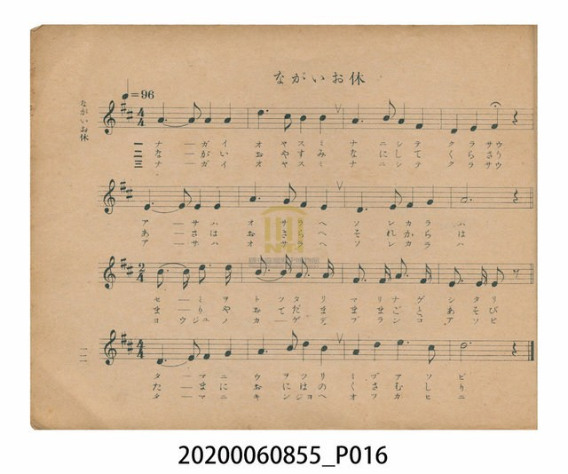
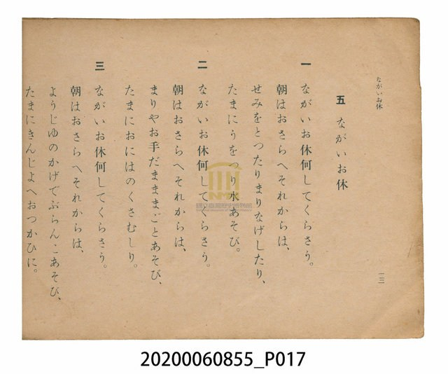

# ながいお休（長假）

> Re:Shōka 使用 AI 協助辨識與重建樂譜，可能會有錯誤。歡迎回報。

- **NEUTRINO 歌聲合成版**：<br><audio controls src="nagaioyasumi_neutrino.mp3"></audio>
- **鋼琴伴奏版**：<br><audio controls src="nagaioyasumi.mp3"></audio>


- 日治時期公學校唱歌（第三學年・第五課）
- 國立臺灣歷史博物館典藏

## 說明


- 出處：臺灣總督府編《公學校唱歌》第三學年用，第五課〈ながいお休〉（長假／暑假），原書第 12–13 頁。
- 調性與拍號：ニ調（D 大調），4/4 拍，速度 != 96。
- 背景與曲風：描寫公學校學童迎接漫長暑假（ながいお休）的歡欣心情：早晨先溫習功課（おさらへ），
接著去捕蟬、拍球、釣魚戲水、玩沙包與扮家家酒，或在臺灣常見的「榕樹（ようじゆ）」樹蔭下盪鞦韆、
幫家裡拔草與跑腿。第三樂句（Song2）以密集的附點八分音符表現孩童嬉戲的雀躍感。
- 版本說明：本檔案為原書單聲部簡譜（數字譜）之忠實數位化版本。

### 編曲說明（鋼琴伴奏版）：

1. 前奏 (Intro, 4 小節)：引用結尾樂句（Song3）明亮上行的旋律線，帶出假期的喜悅期待。
2. 主歌伴奏 (Song1 + Song2 + Song3, 共 14 小節 × 3 段)：依原譜節奏細分拆為三段連接，
右手 (PianoRH) 演奏主旋律，左手 (PianoLH) 以輕快明朗的四拍和聲伴奏襯托孩童嬉戲的活力。


## 跨冊／重複收錄參照

> 同曲（《公學校唱歌》與《新定兒童唱歌》第三學年共用教材）

- **[同曲]** 《新定兒童唱歌》尋常科第三學年用（2020.006.0847.0003）：[**〈長いお休〉**](../../../shintei_jido_shoka/grade_3_2020.006.0847.0003/1_09_nagai_oyasumi/index.md)（`D` / `4/4` — [原始 TMD](../../../shintei_jido_shoka/grade_3_2020.006.0847.0003/1_09_nagai_oyasumi/nagai_oyasumi.tmd)）
- 總表：[跨冊重複與同名歌曲總索引](../../../duplicate_songs.md)

## 歌詞

```text
一　ながいお休何してくらさう。
朝はおさらへそれからは、
せみをとつたりまりなげしたり、
たまにうをつり水あそび。

二　ながいお休何してくらさう。
朝はおさらへそれからは、
まりやおてだまままごとあそび、
たまにおにはのくさむしり。

三　ながいお休何してくらさう。
朝はおさらへそれからは、
ようじゆのかげでぶらんこあそび、
たまにきんじよへおつかひに。
```

## ABC

```abc
X:1
T:ながいお休（長假）
M:4/4
L:1/16
Q:1/4=96
K:D
V:V1 name="Piano" snm="Pia"
[V:V1]
A32/5 A8/5 A4 A4 | d6 c2 B4 B4 | A6 B2 A4 F4 | D4 E4 F8 |
w: 1.~ナ _ ガ イ | オ ヤ ス ミ | ナ ニ シ テ | ク ラ サ
w: 2.~な _ が い | お や す み | な に し て | く ら さ
w: 3.~ナ _ ガ イ | オ ヤ ス ミ | ナ ニ シ テ | ク ラ サ
D32/5 E8/5 D4 D4 | A6 G2 F4 E4 | D6 E2 F4 G4 | A12 z4 |
w: 1.~ア _ サ ハ | オ サ ラ ヘ | ソ レ カ ラ | ハ
w: 2.~あ _ さ は | お さ ら へ | そ れ か ら | は
w: 3.~ア _ サ ハ | オ サ ラ ヘ | ソ レ カ ラ | ハ
c16/5 c4/5 d16/5 d4/5 B16/5 B4/5 A16/5 A4/5 | F16/5 F4/5 A16/5 F4/5 D16/5 D4/5 D2 z2 | D6 E2 F4 G4 | A6 B2 d4 B4 |
w: 1.~セ _ ミ ヲ ト ツ タ リ | マ リ ナ ゲ シ タ リ | タ _ マ ニ | ウ ヲ ツ リ
w: 2.~ま _ り や お て だ ま | ま ま ご と あ そ び | た _ ま に | お に は の
w: 3.~ヨ ウ ジュ ノ カ _ ゲ デ | ブ ラ ン コ ア ソ ビ | タ _ マ ニ | キ ン ジョ ヘ
A4 d4 e6 c2 | d12 z4 |
w: 1.~ミ ヅ ア ソ | ビ
w: 2.~く さ む し | り
w: 3.~オ ツ カ ヒ | ニ
```

## TMD 檔案連結

- [主旋律 TMD 檔案](nagaioyasumi.tmd) [[在 TMD Studio 編輯](https://tmdlang.github.io/Tmd-TS/#tmd=s7IKdvYPcrWy4qpTUCpJTLdSSM7PyUlNLsnMz7PKzk9PzM7Ojy_OyM9OVIKrKMvPKc1NtUovSkxJjTdGiBfnlxYlp1oVJ2fk5-fEl6RWlCTl52cj5AuK8stS8xLzgGoKijLzSlJTwIoQClLLMlNSQdKpKZkl-UWZiTlIlqYWFYPcBLEkvqQoMa84uSizAORQJS4tLYXHjaseN_Y8bmx53Nj1ZM_E93s6Xk7d_rSx_f2eTgUtLS5FWwVLMy57WwUXLhsTfRM7kMHPpi99tmn3s5lNz-bMf9q65unaHc8WLHw6ZeOztT1A7c_XrHmyoxMo-HTnlsfNu0HcXVNerNoENBDsrKdzup-v7n7Rvut54-Jna7c_7d_0tHfW886VL5eseNq648X0fiUuLn0tBVtqAS4FBYXHDROezd70fPa6F6tWPZvR97hhIli0effT9l0vZk59v2cWxD3Pd-x9Pnfx011znm9f8bihC81zjxu6kT33fMqK93t64P573NCBFpaPGzqRgrP_2ayJkHAF6nraN__Z7B1AvQqGRo8aJhsaK7xc0Pi4oQnqrBer9j9rWP6io_1Zd--LmfOB7nvc3A0UBBrnovB0yXIwE2QOMEoUgGqArJcN85_uWqYAji8kg5p7ns1cDzJo9qaXi4DunfWsv__p-tUIn63d8Xz10hf7-571LX22ZzXQsTBnovsGaOHzWS3P1i58tmbx0_3Nz5pbQaZNX_lsJjDeOp7tWv18_6SnXfPBMQ3U2_W4cerjps7HjTsgLgU5SEEBaMuLidOf9u1-1jv1xfw1jxsaga5_PqEZyHjZvvjl2lnPOjY927AFyH3et_LZpplPe1pBju9c93TdNiB62ToJaNSzjmlP56yAxNjTHTteLOsGOuxxQ8-zZVOfrdgJsr0J6IC2x40zHje1AW1_3NALFH8xZe2THd3PZ696OW_Zy_ltQCsgTnq6czXQ5BeLFz7rnvKitxNo3YvtE1-07gcGIiS2n61oetq_FGhscH5euhHQvCe7lz5d3_ZydhvQ2pczW17unve0dfXTjraX8zc_X7PsxcIVz_v3PV27EhiuT9d0Aj0EUja74cWu3mct8xFR87yz49mcNZAECQrJOWuerZrybGHH86ZdkNTxdNq6F42bXjaveL5h4Yu1c4AOeDZ1x9O108Hszic7u5_uX_B0_TKg4JO9vU97pkEMBFkATfIQY4AJ98VKoAtXPJvWDvTckx1rQYxV816sXQ_MB0BTn27ofdbeqZCZm5ieaqSXVZCarqCvEGBgaA60BWzUkx0Njxsa0JLDk71THzdOf9y47HFjPziegVxgoIJ992zO3MeN65HTwOPGuY-bgJq7wVygxeDAf9w4-3Hj_sdNkx43rnjcuORx4_zHTUA9-8Ak0DagONAGsCBMw3yQdONqkF0gbUuAcqD00tgEsqFxM9QBQF9BfAgKWHCqBsYBMFUDC6wXyxqfNs56srvh5a49T_a1AfPMy8a-pxMXvd8zH5iYn-wAZnq0xNwDTGwvmxaDAnwfsIDrASZdSOp92joJklBBabW7G5iMQYobtz3v2AdM4ZD0jFAAStVN8CDdBSxNaBOk4NBrAhkJNmkBOMAgaAo4nOFBhR6kQA1AEmjJOpADQPYAXTgdHPp0CFVgOTBrHaQogOd9UPmAmvchwftk53yg9qe71r6cuQiScyGZFzmEdwB5NAlhpMIFHFTd4IS6_HHjNpC6psmPG4EIZyD3glUANQNNAdoAtA2Y7oFGbALJ0iGcgVxIOYlWHqKEbccGYLn2Yv_Ely0bXrb3gErI_TMhpeKLTdufzd34YimoeAQFNdC5lFfRUKCgpc_FBSpkDa0CMhPz8h1qDGqqwYW0jYmWHZhRo6BhqqALhqaaqhq6upoKpkAIFDaMA4uaQ0XNgBCu2Ayu1BgoaKhgBKR1FWrAJvoYApU9bu6CmgpU9bhpDRAvAWl_3LQKLPq4eQlIfCeQMR8sDlUPrJVB4tuBjDag-OOm9UDWSiC9FYiXwWwwAulohJgEsaGxB4hbwCY1Qk1qagGJzwTi_RBxqM2Nq0Hi04EYaB6Q7Acq7QTSU4EYaCfEBmNa-gEW8IZQ442goWkIhPAgNoEKGgMDF64WptJYwQQoCFFogBLuTYuQ3Qy0sbkfxc1NW4HiINc0z4CI74W6eQ1I_WqwHNDNQF0oZkNCvAk5xEHhtR4lxBungswAheUOiPhcqJ09IPXdYDlQiK9HNRsc1tR3dy0k6RthJH0LRNI3h1oKS-SwRK-rYBgHEzKDisDSPEZ-QQn-3QhvABPEfCjvcfMmML8DzgcmTqDq_XD-Krg5kKDeh2xOEywhghM1PMBBQb4MzF8A5--DmwNJwivgOsEqm3Y8bl4Kt7QPLLQaxapNcNl2kFGwkALlbxA0Rg8FuAAsNRvCUzNqymyeh-xZpNwFtBNs83Y4fz8orlehpz5YkIA9CeRPgfNXgPmw1AlMd6D0thkthTVPg9u_Emz_Zrh9m8H2w1IgMG2B7J-MnIqM8RWg2PImWkEJTFeg4tMUxNAwQi1ZgQUoRAAtJ0MTB8gt80CFCiTdL4P6ARhmwFQEDidQup8PxK0IX4D9ABKfjGoyJCShyRIUSvtABSJqLgaXj8Ayq3EdrHwE5nWgyQ1Q-elgk6FpEi0XY3fzWqibgeEMToHLodkYlLtBnoAnwsfNkyDO7oYbDowAXTsFcCUGtgjKMULmGMM4ylwA)]
- [鋼琴伴奏 TMD 檔案](nagaioyasumi_piano.tmd) [[在 TMD Studio 編輯](https://tmdlang.github.io/Tmd-TS/#tmd=s7IKdvYPcrWy4tLSUnjcuOpxY8_jxpbHjV1P9kx8v6fj5dTtTxvbHzfvftm95_mELU_2bHm6tP95Z8f7PZ0KWlpcirYKlmZc9rYKLlw2Jvomdlx1CkrPpi99tmn3s5lNz-bMf9q65unaHc8WLHw6ZeOztT1AA5-vWfNkRydQ8OnOLUBjQdxdU16s2gQ0UAmk--mc7ueru1-073reuPjZ2u1P-zc97Z31vHPlyyUrnrbueDG9X4mLS19LwZZagEtBQeFxw4Rnszc9n73uxapVz2b0PW6YCBZt3v20fdeLmVPf75kFcc_zHXufz138dNec59tXPG7oQvPc44ZuZM89n7Li_Z4euP8eN3Sghe7jhk54AL_f0_9s1kQwAyjY87Rv_rPZO4B6FQyNHjVMNjRWeLmg8XFDE9RZL1btf9aw_EVH-7Pu3hcz5wPd97i5GygINM5F4emS5WAmyBxglCgA1QBZLxvmP921TAEcX0gGNfc8m7keZNDsTS8XAd0761l__9P1qxE-W7vj-eqlT-esgLgOGKMvp01-NnPFi3UNz3atfr5_0tN9wEjtedY79cX8NY8bGl-2L365dtazjk3PNmwBcp_3rXy2aebTnlYgG2TIsqnPVux8sqP7-exVL-ctezm_DWj1052rn-6f-XTdtqfdM5_PannW0vl0_-rnU-Y_27Ib4VBggAOdCIkeUKBhJEag00FKFRQM9RSedvYCxRU0PPNKivJ1FEwUnm7of76-QROo5umeqcB4eb51wtMN-56taHravxRoWnB-Xrox0Ayg2U92rXuyo-vFwh6QS6Z3P93X_Xz7LFCE7NgGTAuQEABKPZ0251lTKyh97wN6DexIBQUjPYUnO3YDEwLEXQoaIHMNFbQVQLQRlDbWUXjaulHBEOYohcPTFYwVnq3bCnLdk31zgTH_Yu0coATIZ1s2PO1oe9bd9rxpFzBZARW9bFj8rA_o5B6IjUDwtH_zs85uBY2AzMS8_CAPTYVne6YAtYIcAnY-yO3blyGU-ACVPNm99MWeqcBQBnr42ZzpIP_Mng1MJk8n9bxo3ARx_Yul6591zni6diUo-td0AmMUFCJbdj_tmg3yMDTXQNIp0MsvVs572rri2bR2YIQ-2bEWxFg178Xa9cCsBAzgpxt6n7V3KmTmJqanGullFaSmK-grBBgYmgMDHWzUkx0Njxsa0PLHk71THzdOf9y47HFj_-OmzseNQG4bNLSfzZn7uHE9UB1IFCS343Hj3MdNQM3dYC7Q4kawGxtnP27c_7hp0uPGFY8blzxunP-4CahnH5gE2gYUB9oAFoRpmA-SblwNsgukbQlQDpSYG5tANjRuhjoA6CuID0F5Zs9qYC4GBSM4fbxY1vi0cdaT3Q0vd-15sq8NmO1eNvY9nbjo_Z75z6avBCavp60d0MzTNR9c8vUA88bLpsVPdgJjDJqdIDnqaeskSC4CZaTu7ucTmkGKG7c979j3tG83JLMhFICyXBM8SHcBCyTaBCk49JpARoJNWgAOMAiaAg5neFChBylQA5AEWrIO5ACQPUAXTgeHPh1Ctbv3-ax1wDBEK5ieda4DlT7rtr1snQQP3ic75wO1P9219uXMRS8WL3zWPQWIXvR2IofwDiCPJiHcBKwq2h43znjcBCSBQdUNTqjLHzduA6lrmvy4EYhwBnIvWAVQM9AUoA1A24DpHmjEJpAsHcIZXtC_mLIWuaxHCduODS9ntrzYP_Fly4aX7T2QOuDF9okvWve_2LT92dyNL5buhwY10LmU1_JQoKClT2HrAeQclPpF0wpewShoQOtbTXDy2L306ZJ-YGMIUsMDS9yXa9qgtdusFmCx-mLbYkgZ_XTj1JfTuinzKNhnYAdZQasChxqDmmpwPWFjomUHZtQoaBgq6AKhkaaqhq6uJrDmMQEJmoIFzaCChnEKZkBRUxBDwygOLGcOlasBCYIEDBRquGpRbPTBbqNhvEK0YayCKYSqUTABMkxiYRTQGiDDFCIPpODqQRhqB8XxBW6VNQCrT2iVDIwyC6xRRr414OAHG44_-CEhratgCg1PUyAExQpqKJuBIwAtWkyBsQUMHgUjIK0LDBmQiT6GQGWPm7ugpgJVPW5aA8RLQNofN60Ciz5uXgIS3wlkzAeLQ9UD24wg8e1ARhtQ_HHTeiBrJZDeCsTLYDYYgXQ0QkyC2NDYA8QtYJMaoSY1tYDEZwLxfog41ObG1SDx6UAMNA9I9gOVdgLpqUAMtBNigzEt_YCa7hEp3xAI4UFsAs8ORrjyCEQhKEUiwr1pEbKbgTY296O4uWkrUBzkmuYZEPG9UDevAalfDZYDuhmoC8VsSIg3IYc4KLzWo4R441SQGaCw3AERnwu1swekvhssBwrx9ahmg8Oa-u4G5lKkxE9mSYAuj8aHmmIG5JrlxioYQ2mcJQh6CQPC1CxRdvXASxQjYIlihF6i6CjYWGjZKUAa8dQqXoywFC9AW2Cp3BwasbCCBFaw6AKLbZiQGVQEVq5glEkoSXw3IqkAM918KO9x8yYwvwPOBxYAQNX74fxVcHMgyXkfsjlNsMwOLjjgiRqUrJeB-Qvg_H1wcyDFxAq4TrDKph2Pm5fCLe0DC61GsWoTXLYdZBQspEBlKAgao4cCXABWYhjCSwzU3N88D9mzSCUY0E6wzdvh_P2g_LQKPYfDggTsSSB_Cpy_AsyHlQDAvA3K05vRcnHzNLj9K8H2b4bbtxlsPyyXA_MvyP7JyDkVmo5w5FRojgHlIOScSPU6GdSlheQgY5zNKPKtgWcaY_o1iZByDjQvgIJ-HqieghSly6BRBkwiwEwDThagonQ-ELciIg0cZSDxyagmQxIONBeCEsU-UB2LWjGAq1xgNdi4DlblAqsPoMkNUPnpYJOhWRCtYsDu5rVQNwOTFTjDLYfWDKAKA-QJeJ573DwJ4uxuuOHQ9AaNApq1EXXtFMBNUbCBQA64Nor2MYxFFjBCFzBGFwBqMULXgioA1IIqANRijK4FVQCoBSGgzAUA)]

## 分析

```text
================================================================================
📊 TMD Song Profile: [ ながいお休（長假） ]
================================================================================
⏱  Duration:       0:35 (35.0s), 14 measures total
🎼 Key & Tempo:    首調基準 D, != 96.0 BPM, <4/4>
   - 分析範圍：      由實際發聲的音符與和弦推測調性；播放脈絡另行呈現
🎤 人聲音域:    D4 (MIDI 62) – E5 (MIDI 76) [跨度: 14 個半音 / 1.2 個八度, 難度: moderate]
   - 最低音:  D4 in [Song1 #1 @ m.4, 0:07]
   - 最高音: E5 in [Song3 #1 @ m.13, 0:31]
   - 適合: soprano, mezzo-soprano, contralto, tenor, baritone, bass
🏛  結構:      Song1 (20.0s) -> Song2 (5.0s) -> Song3 (10.0s)
⚡ 編曲密度:        Peak 1 軌道同時演奏
🗝  調性診斷：       D 大調（純淨自然大調，未偵測到可信轉調）
   - 風格氣質:    純淨自然大調（陽光明朗、易唱易記，無明顯調外色彩）
   - 轉調歷程:    全曲維持單一推測調性（未偵測到可信轉調）
   - 核心骨幹音:  D, A, F#, B, E
   - 調性數值:    D 大調 [相關度: 0.95, 穩定度: High, 自然音純度: 100.0%]
   - 候選調性 (K-S): D 大調 (0.95), A 大調 (0.73), F# 小調 (0.58)
   - 五度圈歷程:   +2 -> +2 -> +2
   - 各段落調性細節:
     • [Song1 #1]: D 大調 (r: 0.89, 自然音純度: 100.0%)
     • [Song2 #1]: D 大調 (r: 0.87, 自然音純度: 100.0%)
     • [Song3 #1]: D 大調 (r: 0.90, 自然音純度: 100.0%)

  [ 五度圈游移軌跡 ]
               C  
         F            G  
      Bb              [D ]*
      Eb               A  
         Ab           E  
            Db       B  
               F# 
     (* = active key center)

  [ 十二半音累積音高分佈 ]
     C  :                            0.0%
     C# : ███                        3.7%
     D  : ████████████████████████  31.0%
     D# :                            0.0%
     E  : ███████                    9.2%
     F  :                            0.0%
     F# : ██████████                13.5%
     G  : ████                       4.7%
     G# :                            0.0%
     A  : ██████████████████████    28.6%
     A# :                            0.0%
     B  : ███████                    9.3%
--------------------------------------------------------------------------------
Assignment 軌道音域：
  - Piano         : D4 – E5 (14 個半音 / 1.2 個八度, 56 個音符)
================================================================================
```


## 原書掃描頁






