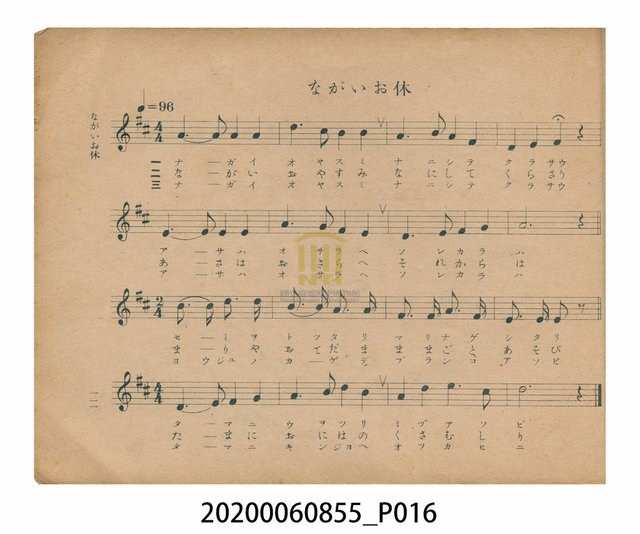
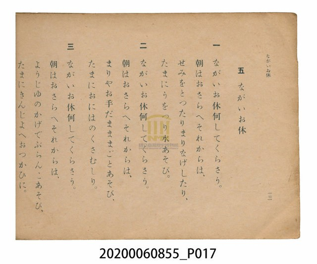

# ながいお休（長假）

<audio controls src="nagaioyasumi.mp3"></audio>

- 日治時期公學校唱歌（第三學年・第五課）
- 國立臺灣歷史博物館典藏

## 說明

【曲目說明】
・出處：臺灣總督府編《公學校唱歌》第三學年用，第五課〈ながいお休〉（長假／暑假），原書第 12–13 頁。
・調性與拍號：ニ調（D 大調），4/4 拍，速度 != 96。
・背景與曲風：描寫公學校學童迎接漫長暑假（ながいお休）的歡欣心情：早晨先溫習功課（おさらへ），
接著去捕蟬、拍球、釣魚戲水、玩沙包與扮家家酒，或在臺灣常見的「榕樹（ようじゆ）」樹蔭下盪鞦韆、
幫家裡拔草與跑腿。第三樂句（Song2）以密集的附點八分音符表現孩童嬉戲的雀躍感。
・版本說明：本檔案為原書單聲部簡譜（數字譜）之忠實數位化版本。

・編曲說明（鋼琴伴奏版）：
1. 前奏 (Intro, 4 小節)：引用結尾樂句（Song3）明亮上行的旋律線，帶出假期的喜悅期待。
2. 主歌伴奏 (Song1 + Song2 + Song3, 共 14 小節 × 3 段)：依原譜節奏細分拆為三段連接，
右手 (PianoRH) 演奏主旋律，左手 (PianoLH) 以輕快明朗的四拍和聲伴奏襯托孩童嬉戲的活力。

## 歌詞

```text
一　ながいお休何してくらさう。
朝はおさらへそれからは、
せみをとつたりまりなげしたり、
たまにうをつり水あそび。

二　ながいお休何してくらさう。
朝はおさらへそれからは、
まりやおてだまままごとあそび、
たまにおにはのくさむしり。

三　ながいお休何してくらさう。
朝はおさらへそれからは、
ようじゆのかげでぶらんこあそび、
たまにきんじよへおつかひに。
```

## ABC

```abc
X:1
T:ながいお休（長假）
C:TMD (Chen, Chih-Han / aguai)
M:4/4
L:1/16
Q:1/4=96
K:D
V:V1 name="Piano" snm="Pia"
[V:V1]
A32/5 A8/5 A4 A4 | d6 c2 B4 B4 | A6 B2 A4 F4 | D4 E4 F8 |
D32/5 E8/5 D4 D4 | A6 G2 F4 E4 | D6 E2 F4 G4 | A12 z4 |
c16/5 c4/5 d16/5 d4/5 B16/5 B4/5 A16/5 A4/5 | F16/5 F4/5 A16/5 F4/5 D16/5 D4/5 D2 z2 | D6 E2 F4 G4 | A6 B2 d4 B4 |
A4 d4 e6 c2 | d12 z4 |
```

## TMD 檔案連結

- [主旋律 TMD 檔案](nagaioyasumi.tmd)
- [鋼琴伴奏 TMD 檔案](nagaioyasumi_piano.tmd)

## 分析

```text
================================================================================
📊 TMD Song Profile: [ ながいお休（長假） ]
================================================================================
⏱  Duration:       0:35 (35.0s), 14 measures total
🎼 Key & Tempo:    首調基準 D, != 96.0 BPM, <4/4>
   - 分析範圍：      由實際發聲的音符與和弦推測調性；播放脈絡另行呈現
🎤 人聲音域:    D4 (MIDI 62) – E5 (MIDI 76) [跨度: 14 個半音 / 1.2 個八度, 難度: moderate]
   - 最低音:  D4 in [Song1 #1 @ m.4, 0:07]
   - 最高音: E5 in [Song3 #1 @ m.13, 0:31]
   - 適合: soprano, mezzo-soprano, contralto, tenor, baritone, bass
🏛  結構:      Song1 (20.0s) -> Song2 (5.0s) -> Song3 (10.0s)
⚡ 編曲密度:        Peak 1 軌道同時演奏
🗝  調性診斷：       D 大調（純淨自然大調，未偵測到可信轉調）
   - 風格氣質:    純淨自然大調（陽光明朗、易唱易記，無明顯調外色彩）
   - 轉調歷程:    全曲維持單一推測調性（未偵測到可信轉調）
   - 核心骨幹音:  D, A, F#, B, E
   - 調性數值:    D 大調 [相關度: 0.95, 穩定度: High, 自然音純度: 100.0%]
   - 候選調性 (K-S): D 大調 (0.95), A 大調 (0.73), F# 小調 (0.58)
   - 五度圈歷程:   +2 -> +2 -> +2
   - 各段落調性細節:
     • [Song1 #1]: D 大調 (r: 0.89, 自然音純度: 100.0%)
     • [Song2 #1]: D 大調 (r: 0.87, 自然音純度: 100.0%)
     • [Song3 #1]: D 大調 (r: 0.90, 自然音純度: 100.0%)

  [ 五度圈游移軌跡 ]
               C  
         F            G  
      Bb              [D ]*
      Eb               A  
         Ab           E  
            Db       B  
               F# 
     (* = active key center)

  [ 十二半音累積音高分佈 ]
     C  :                            0.0%
     C# : ███                        3.7%
     D  : ████████████████████████  31.0%
     D# :                            0.0%
     E  : ███████                    9.2%
     F  :                            0.0%
     F# : ██████████                13.5%
     G  : ████                       4.7%
     G# :                            0.0%
     A  : ██████████████████████    28.6%
     A# :                            0.0%
     B  : ███████                    9.3%
--------------------------------------------------------------------------------
Assignment 軌道音域：
  - Piano         : D4 – E5 (14 個半音 / 1.2 個八度, 56 個音符)
================================================================================
```


## 原書掃描頁






