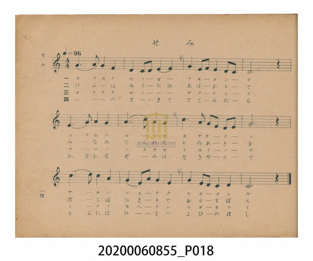
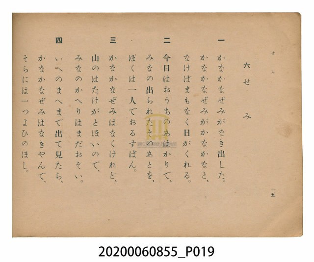

# せみ（蟬）

<audio controls src="semi.mp3"></audio>

- 日治時期公學校唱歌（第三學年・第六課）
- 國立臺灣歷史博物館典藏

## 說明

【曲目說明】
・出處：臺灣總督府編《公學校唱歌》第三學年用，第六課〈せみ〉（蟬），原書第 14–15 頁。
・調性與拍號：ハ調（C 大調），4/4 拍，速度 != 96。
・背景與曲風：描寫農家收割小米（粟刈り／あはかり）的日子，家人們都到遙遠的山上田地工作，
孩童獨自一人看家（おるすばん）；傍晚時分寒蟬（かなかなぜみ）鳴叫，走到家門前仰望暮色天空，
蟬聲漸歇，天邊升起一顆明亮的晚星（よひのほし）。曲調溫柔恬靜，充滿鄉村向晚的詩意與思親之情。
・版本說明：本檔案為原書單聲部簡譜（數字譜）之忠實數位化版本。

・編曲說明（鋼琴伴奏版）：
1. 前奏 (Intro, 4 小節)：以「かなかな」寒蟬鳴叫動機結合結尾樂句，營造寧靜向晚的氛圍。
2. 主歌伴奏 (Semi, 12 小節 × 4 段)：右手 (PianoRH) 演奏柔和起伏的主旋律；
左手 (PianoLH) 採用溫暖平穩的四拍低音與和聲伴奏，襯托暮色與晚星的靜謐感。

## 歌詞

```text
一　かなかなぜみがなき出した。
かなかなぜみがかなかなと、
なけばまもなく日がくれる。

二　今日はおうちのあはかりで、
みなの出られたそのあとを、
ぼくは一人でおるすばん。

三　かなかなぜみはなくけれど、
山のはたけがとほいので、
みなのかへりはまだおそい。

四　いへのまへまで出て見たら、
かなかなぜみはなきやんで、
そらには一つよひのほし。
```

## 原書掃描頁





## 分析

```text
================================================================================
📊 TMD Song Profile: [ せみ（蟬） ]
================================================================================
⏱  Duration:       0:30 (30.0s), 12 measures total
🎼 Key & Tempo:    首調基準 C, != 96.0 BPM, <4/4>
   - 分析範圍：      由實際發聲的音符與和弦推測調性；播放脈絡另行呈現
🎤 人聲音域:    C4 (MIDI 60) – D5 (MIDI 74) [跨度: 14 個半音 / 1.2 個八度, 難度: moderate]
   - 最低音:  C4 in [Semi #1 @ m.2, 0:03]
   - 最高音: D5 in [Semi #1 @ m.9, 0:20]
   - 適合: soprano, mezzo-soprano, contralto, tenor, baritone, bass
🏛  結構:      Semi (30.0s)
⚡ 編曲密度:        Peak 1 軌道同時演奏
🗝  調性診斷：       C 大調（純淨自然大調，未偵測到可信轉調）
   - 風格氣質:    純淨自然大調（陽光明朗、易唱易記，無明顯調外色彩）
   - 轉調歷程:    全曲維持單一推測調性（未偵測到可信轉調）
   - 核心骨幹音:  G, C, E, D, A
   - 調性數值:    C 大調 [相關度: 0.84, 穩定度: Moderate, 自然音純度: 100.0%]
   - 候選調性 (K-S): C 大調 (0.84), G 大調 (0.80), E 小調 (0.67)
   - 五度圈歷程:   +0
   - 各段落調性細節:
     • [Semi #1]: C 大調 (r: 0.84, 自然音純度: 100.0%)

  [ 五度圈游移軌跡 ]
              [C ]*
         F            G  
      Bb               D  
      Eb               A  
         Ab           E  
            Db       B  
               F# 
     (* = active key center)

  [ 十二半音累積音高分佈 ]
     C  : ██████████████████        21.1%
     C# :                            0.0%
     D  : ██████████████            16.7%
     D# :                            0.0%
     E  : █████████████████         20.0%
     F  : █                          1.1%
     F# :                            0.0%
     G  : ████████████████████████  27.8%
     G# :                            0.0%
     A  : ████████████              13.3%
     A# :                            0.0%
     B  :                            0.0%
--------------------------------------------------------------------------------
Assignment 軌道音域：
  - Piano         : C4 – D5 (14 個半音 / 1.2 個八度, 46 個音符)
================================================================================
```

## ABC

```abc
X:1
T:せみ（蟬）
C:TMD (Chen, Chih-Han / aguai)
M:4/4
L:1/16
Q:1/4=96
K:C
V:V1 name="Piano" snm="Pia"
[V:V1]
g6 a2 g4 e4 | d4 c2 d2 e4 e4 | g4 e2 f2 e4 d2 c2 | d12 z4 |
e6 g2 a4 g4 | a6 c2 a4 g4 | c6 a2 g2 e2 d2 e2 | g12 z4 |
c6 d2 c4 a4 | g4 e2 a2 g4 e4 | g4 e2 d2 c4 d4 | c12 z4 |
```

- [主旋律 TMD 檔案](semi.tmd)
- [鋼琴伴奏 TMD 檔案](semi_piano.tmd)
