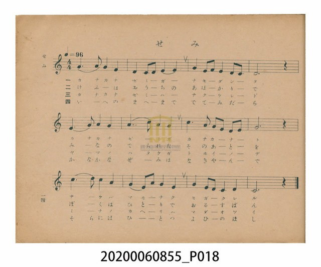
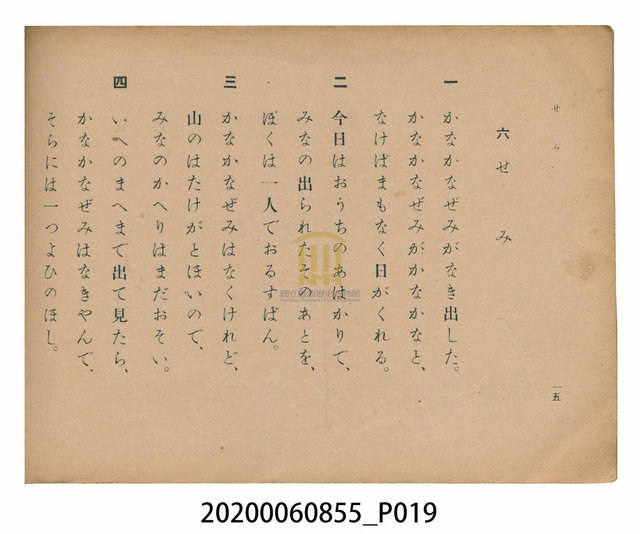

# せみ（蟬）

> Re:Shōka 使用 AI 協助辨識與重建樂譜，可能會有錯誤。歡迎[回報](https://github.com/TMDLang/reshoka/issues)。

- **鋼琴伴奏版**：<br><audio controls src="semi.mp3"></audio>
- **NEUTRINO 歌聲合成版**：<br><audio controls src="semi_neutrino.mp3"></audio>

- 日治時期公學校唱歌（第三學年・第六課）
- 國立臺灣歷史博物館典藏

## 說明


- 出處：臺灣總督府編《公學校唱歌》第三學年用，第六課〈せみ〉（蟬），原書第 14–15 頁。
- 調性與拍號：ハ調（C 大調），4/4 拍，速度 != 96。
- 背景與曲風：描寫農家收割小米（粟刈り／あはかり）的日子，家人們都到遙遠的山上田地工作，
孩童獨自一人看家（おるすばん）；傍晚時分寒蟬（かなかなぜみ）鳴叫，走到家門前仰望暮色天空，
蟬聲漸歇，天邊升起一顆明亮的晚星（よひのほし）。曲調溫柔恬靜，充滿鄉村向晚的詩意與思親之情。
- 版本說明：本檔案為原書單聲部簡譜（數字譜）之忠實數位化版本。

### 編曲說明（鋼琴伴奏版）：

1. 前奏 (Intro, 4 小節)：以「かなかな」寒蟬鳴叫動機結合結尾樂句，營造寧靜向晚的氛圍。
2. 主歌伴奏 (Semi, 12 小節 × 4 段)：右手 (PianoRH) 演奏柔和起伏的主旋律；
左手 (PianoLH) 採用溫暖平穩的四拍低音與和聲伴奏，襯托暮色與晚星的靜謐感。


## 歌詞

```text
一　かなかなぜみがなき出した。
かなかなぜみがかなかなと、
なけばまもなく日がくれる。

二　今日はおうちのあはかりで、
みなの出られたそのあとを、
ぼくは一人でおるすばん。

三　かなかなぜみはなくけれど、
山のはたけがとほいので、
みなのかへりはまだおそい。

四　いへのまへまで出て見たら、
かなかなぜみはなきやんで、
そらには一つよひのほし。
```

## ABC

<div class="abc-score" data-abc-src="semi.abc" aria-label="五線譜載入中"></div>

[下載 ABC 原始檔](semi.abc)

## TMD 檔案連結

- [主旋律 TMD 檔案](semi.tmd) [[在 TMD Studio 編輯](https://tmdlang.github.io/Tmd-TS/#tmd=s7IKdvYPcrWy4qpTUCpJTLdSSM7PyUlNLsnMz7PKzk9PzM7Ojy_OyM9OVIKrKMvPKc1NtUovSkxJjTdGiBfnlxYlp1oVJ2fk5-fEl6RWlCTl52cj5AuK8stS8xLzgGoKijLzSlJTwIoQClLLMlNSQdKpKZkl-UWZiTlIlqYWFYPcBLEkvqQoMa84uSizAORQhKqSjFSgyxLzMnOR9QKNSs_MsypJzCxPzIvPT0vLTEYxO7-oJCMf6J2CjEqrjMxikNXJiTnx2Yl5SL6GWlyQmJ5qFWBgaKHEpaWl8Lhx9uPG_e_3dLyYv-b9nk4FLS0uRVsFSzMue1sFZy4bE30TO5ABz6YvfbZp97OZTc_mzH_auubp2h3PFix8OmXjs7U9QL3P16x5sqMTKPh055bHzbuB3Keta1-s2gQ0EGz90zndz1d3v2jf9bxx8bO125_2b3raO-t558qXS1Y8bd3xYnq_EheXvpaCLbUAl4KCwuOGCc9mb3o-e92LVauezeh73DARLNq8-2n7rhczp77fMwvinuc79j6fu_jprjnPt6943NCF5rnHDd3Inns-ZcX7PT1w_z1u6ICE3-OGTngQAhU87Zv_bPYOoDIFQ5NHDZMNTRVeLmh83NAEdcGLVfufNSx_0dH-rLv3xcz5QKc8bu4HCgKNcFZ4umQ5mAkyBxj6CkA1QNbLhvlPdy1TAEcNkkHNPc9mrgcZNHvTy0VAp8161t__dP3qF_s2PV237dmUbU87Nz3d0P9842ZQJG2a_7Sj43FT1_s9_Y8bmx43rn_c2A3mdj6f1QKM4KdrJ4Dcvm7bk127njZMfNm892nHhpeNM182LgAqeLpx45MdXc-nbHg6Z8PT7Uuf7J0DVAxyh4LC07Urn69e-rx3xYv2VU92NAC1P5_TDTQHaOnjxq7HTd2PG2c-btzwuGky2Fuznzb1Pps5C5iYnna0PV0_CRxsQJVAZatg5Bxwoux8uXnL0_7VQItebN0AdAzQzJfTGp529j7ZveHZnNnPZq17AfTgkpXPV-6COwZo2ovGTc_27Hi2th3knSUrXzZ1Pe1tf7F1O9BtLxe2ARPDk13rQF4GumEGMPSBYQK0fdPjxnWPG3c_bpwOtBcYxMAgBcXTrtXP5k951rjm5VyQf5-2tj7bvf9lS-ezuROfTpgINAFozouVK5-19INioWHui2Wrnuzsftbcioik550dz-asgaRCUAzNWfNs1ZRnCzueN-2CpJOn09YBXfyyecXzDQtfrAVa0_Fs6o6na6eD2Z1A457uX_B0_TKg4JO9vU97pkEMBFkATecQY4Cp9cXKeU9bVzyb1g50zJMda0GMVfNerF0PTPxAU59u6H3W3qkALFnSU430sgpS0xX0FYAFgSXQFrBRwPB53NCAGRGPG3vA7F5g1gGGz-PG-TDfYVeKLAjMU40QpUDORFAqaNz3uAmY-oDcfmCiA2vof9zUA0omEFNBOQnsbGBoQZLHy2ndT5d3QxLDk11tQHXPp26DSD1u6Hnau_DphG0Q8nFDLzB9QlQCExgo5eztfD5nz8tpk58uWfVy5t6nGza-WNb4ZEc3KD2DjYL7fhcwtzc82d0FdhUwc3Q9bmx73LgQnC4Q2eVx43K4l4DeBXpjHShYmjpBfgCGTONcmIYVj5smwZXuAfmycT0ke4DMQM0YWLwOdAkw8T6bsR6Y6l8sXoicm1Hy65LlQAVAJ4ByBjhfglLMPmCx3POsYyJmpkT28Q5gQsca30C_guIHFGMgX62EegMYZmDPAaWBHgXGJlBuBTjTtIDFMUIGbOoOcKgB9ex73LgAHKzAIGrB4uOXs6c9b4HG69Ptm55vm_x0zgp4rAM99GRv29PZC0AZB1IYzWqBlkf7OoCFFCIwZs8DkuAc3gSM-JdNLc_mNAPVALMrku-fzp4N9j3Q6TvATgU6D8gAksvB6XzZi2VAx88HxSzMV7gCqvdxUwsoEpECYC5IX-NqSJQ_blyCVsZg8T16EbejARhhID8hh0fjnGdrFwEDA14wPl0yB1j6ATM7sEwDFXG72qClHLhwg3oXaBPllSoUKGjpc3EFp-ZmWgVkJublO9QY1FSDS14bEy07MANbTa4ArkUbXizsUdAwUQCl4vUNOpCiCKkkstDEohNoH8jUGgUNUwVdIDTTVNXQ1dVUMFUwBgoaKWgYKhiBhDSBfJCIqYKGsYIJTETDSMEQwgapBek3UKgBG-hjCDTycdNqsODj5i5NBRAHyACqfNy0ByjXPF8BqO9x0xqgAqAYUAaofi1YrLkBxN4OYoNU70c12QhkcuNEiMmNWzXB1HqQykaQGY1tYDMaFwLxOrBoE0h0PUS0G2RyF9TkxuWoJhsT6ebmfmQ3Q0xu2giSB3oGbHJzJ6rJJmA3t4AFwe7YAXfdPpDMDojoPrCbIC4Dii6DiO4HscE2g9yBMBl_etjVQ1l6MAbbYwpND2bAmAcKmoEFDeNQRQ3jUNIOMCkZQ1IFMH1AWaCUQ2z6AIrvgYcUMMhBaQRdNYQHooFaoGHegS2dQBIPOBxXQcMcKAqJeGBgguztAYrPh4jPhaaqdSCTgQkHbEPjCljYT8KSXpqXINw6D4j7wCaBkwjIhv2QtAHzA9SRj5tng_0A1Av2Qx_MD-3Y0k031FWrICkY5BOw-ByE3_ZD8wBQdBVUdS_YBmCaA9OTMdM8gfKkk7L0A00URrC0AuSbwQoQcEqBFTJgEWghAyxtgCKGWJIKKJqhngUFZ_MEcHDNA8ksggR-F1AGXAw0TwJ5GJwVQSKgXAkShaQetOSBSGiN_fBiZBM80kFlBSxLgjM7MCpAamcC8QZwkgCGK2aSAGZWWJIA6gcnCVB6BcrMgIgCkyIwhcB90ACxCyjatBesFpKm0JIBNHGCE20jMLMgXAv1wQogXgLW3wFSvwkiug6Id4NVToebWsvFpWunAKpowBYA2cpcAA)]
- [鋼琴伴奏 TMD 檔案](semi_piano.tmd) [[在 TMD Studio 編輯](https://tmdlang.github.io/Tmd-TS/#tmd=s7IKdvYPcrWy4qpTUCpJTLdSSM7PyUlNLsnMz7PKzk9PzM7Ojy_OyM9OVIKrKMvPKc1NtTJGiBTnlxYlp-JSX1CUX5aal5gHVFGSmFmemBefDhQoyssvik9PzUstSsxBqE0ty0xJBaksKMrMTSyqjE_JTwZalleCZH1qUTHIdQWZiXn58YlFRYl56amoSvKLSjLy04sSCzIqrTIyi0vyizKTE3PisxPzkJxVkgHUZZWaUpqcCPItum_iCxLTU60CDAwtlLi0tBQeN85-3Lj__Z6OF_PXPG7e_bJ7z_MJW57s2fJ0af_zzo73ezoVtLS4FG0VLM247G0VnLlsTPRN7EBGPpu-9Nmm3c9mNj2bM_9p65qna3c8W7Dw6ZSNz9b2AE17vmbNkx2dQMGnO7cAjQVyn7aufbFqE9BAsIOezul-vrr7Rfuu542Ln63d_rR_09PeWc87V75csuJp644X0_uVuLj0tRRsqQW4FBQUHjdMeDZ70_PZ616sWvVsRt_jholg0ebdT9t3vZg59f2eWRD3PN-x9_ncxU93zXm-fcXjhi40zz1u6Eb23PMpK97v6YH773FDByREHzd0QgIV6GOggqd985_N3gFUpmBo8qhhsqGpwssFjY8bmqAueLFq_7OG5S862p91976YOR_olMfN_UBBoBHOCk-XLAczQeYAQ18BqAbIetkw_-muZQrgqEEyqLnn2cz1IINmb3q5COi0Wc_6-5-uX_1i36an67Y9m7Ltaeempxv6n2_c_GRnNzAKQU5bu_L56qXPe1e8aF_1fE43UNnjhsYXjW0vGvc-bep9NnPW0_WTwP4A-qz7ceMqGDkHnG46X27e8rR_NdAckAsUFJ7P3vK0YwNQ_YvGTc_WLnrWuB5o2tMlc56v3PVs67rn_fuerl3ybAbQhx2Pm4AGbnrcuO5x4-7HjdOBRj2f1fJs1-qXy1Y865r0rLn1WUv_00XNCL8BowPoK0jkAfVjJlWgbyGOMNRTeNrZCxRX0PDMKynK11EwUQD5en2DJlDNk91LHzf0oHimoRfiSYhnnnZPfbZy_vOtE55O6ACRG_Y9W9H0tB8UWM_b579sWPB0_fKXc-c8nTARGDogR2-Y_XROL9ShCgpGegpPduwGJhWI2xQ0glNzM3UUDI2gblA4PB3onmfrtoIc87R_87PObgWNAFCuD_LQVHi2ZwpQ07P5U55O6nmxdfuTPf1AG0DmTe9-uq_7_Z7ZEEuA4On2ZQitPiCtfQuByREYhM9mTXu6c_PzlSuBWp_Ong1MME_29r2cvxmYLkCmNm6CuAzonxdL1z_rnPFs1roXnZtAqWbmLGDkAHUBvfdizYRnLfNBvoJmHkgaBvrrxcp5T1tXPJvWDtTxZMdaEGPVvBdrgTE9ERgvTzf0PmvvVAAWc-mpRnpZBanpCvoKwPLGEhhDYKOe7Gh43NCAmZgeNwIjBcjuBeZHYIJ43Ai2HGQ3dqXIgsCM2ghRCuRMfNy44XHjvsdNTWBuPzCdgzX0P27qedzUDTUVlD3BzgbFAiT2p3U_Xd4NSQNPdrUB1T2fug0iBUwwT3sXPp2wDUKCEsycDRCVwCIQFJB7O5_P2fNy2uSnS1a9nLn36YaNL5Y1PtnR_XTjRohRcN_vAhYhDU92d4Fdtf5xY9fjxrbHjQvBGQHoYKBI9-MmoOByuJeA3gV6Yx0oWJo6QX4AhkzjXJiGFY-bJsGV7gH5snE9MIif7AIG4nKQ8UAfN84EBUnTZCxeB7rk6ZKVz2asB2b8F4sXIhcRoKQ9fenTtRNApcSS5UAFQCe8nNbwdPvSJ3vnAAuQp_uAZX3Ps46JkNIDYiusDEH4eEcnjvgG-hUUP6AYA_lqJdQbwDADew4oDfQoMDaBcivApUQLWBwjZMCm7gCHGlDPvseNC8DBCgyiFiw-fjl72vMWaLw-3b7p-bbJT-esgMc60ENP9rY9nb3gedMuUOTt6AIGw_MpG4Dx_XRfx8vGBYjAmD0PSIICaWYTMOJfNrU8m9MMVAPMREi-B-Y_sO-BTt8BdirQeUAGkFwOTufLXiwDOn4-KGZhvsIVUL2Pm1pAkYgUAHNB-hpXQ6L8ceMStEIVi-9fbN0ALKCBDgdFZGcvUBswwkB-Qg6PxjnAshsYGPDCHVKCAzP7k13rQKXSrjagxpcL2yAFBtS7QJsor6mhQEFLn8IWADjwkWsBTSt4NaCgAa1INcEJdPdSSAkI9B88u6PVD5CQgBeRTzvmAusySIUFLKshhfPTjVOBRQhlwQD2N9i5VtAqwaHGoKYaXOjbmGjZgRk1ChqmCrpAaKapqqGrq6lgqmAMEjQDCxrGQUXNgOI1QKxhrGAEEtJUMFQwAooYgpUZKNRw1aLY5YPdLsN4hWjDWAVTCFWjYAJkmMTChIEWABmmEHkgBVcPwlA7KI5HSH0KrDIhlSkwJhG1KUpUQqpTUNYFN9aQ6s0eSHUJkkKrvcFVLaRGpELcgdyHJ-qwBYUCuEHZ8GJhD9AzUG_pQCpQpPrTQhOLTqCNeBKEkYIGMMYhUW8MFgEnBhOYiIaRgiGEDVILSxQgA30MgUY-bloNFnzc3KWpAOIAGUCVj5v2AOWa5ysA9T1uWgNUABQDygDVrwWLNQMj5XHTdhAbpHo_qslGIJMbJ0JMbtyqCabWg1Q2gsxobAOb0bgQiNeBRZtAoushosDmDrCYh5rcuBzVZGMi3dzcj-xmiMlNG0HyQM-ATW7uRDXZBOzmFrAg2B074K7bB5LZARHdB3YTxGVA0WUQ0f0gNthmkDsQJuNPD7t6KEsPxmB7TFGKAuwFhIZhHEraASYlY0iqAKYPKAuUcohNH0DxPfCQAgY5KI2gq4bwQDRQCzTMO7ClE0jiAYfjKmiYA0UhEQ8MTJC9PUDx-RDxudBUtQ5kMjDhgG1oXAEL-0lY0kvzEoRb5wFxH9gkcBIB2bAfkjZgfoA68nHzbLAfgHrBfuiD-aEdW7rphrpqFSQFg3wCFp-D8Nt-aB4Aiq6Cqu4F2wBMc2B6MmaaJ1CedFKWfqCJwgiWVoB8M1gBAk4psEIGX_2CSCqgaIZ6FhSczRPAwTUPJLMIEvhdQBlwMdA8CeRhcFYEiYByJUgUknrQkgcioTX2w4uRTfBIB5UVsCwJzuzAqACpnQnEG8BJAhiumEkCmFlhSQKoH5wkQOkVKDMDIgpMisAUAvdBA8QuoGjTXrBaSJpCSwbQxAlOtI3AzIJwLdQHK4B4CVh_B0j9JojoOiDeDVY5HW4qsE5F1DNYq21i6xm8iQC95odW8fCaH8owA1JmuUgKjKBNAdKKOGKcAm17YDZCcDRKiHQJWmbB6xKoTXCX4AoEPO0hXTsFcLMLbCKQA4rLaB_DWFS-ERrfGI1vAucrcwEA)]

## 分析

```text
================================================================================
📊 TMD Song Profile: [ せみ（蟬） ]
================================================================================
⏱  Duration:       0:30 (30.0s), 12 measures total
🎼 Key & Tempo:    首調基準 C, != 96.0 BPM, <4/4>
   - 分析範圍：      由實際發聲的音符與和弦推測調性；播放脈絡另行呈現
🎤 人聲音域:    C4 (MIDI 60) – D5 (MIDI 74) [跨度: 14 個半音 / 1.2 個八度, 難度: moderate]
   - 最低音:  C4 in [Semi #1 @ m.2, 0:03]
   - 最高音: D5 in [Semi #1 @ m.9, 0:20]
   - 適合: soprano, mezzo-soprano, contralto, tenor, baritone, bass
🏛  結構:      Semi (30.0s)
⚡ 編曲密度:        Peak 1 軌道同時演奏
🗝  調性診斷：       C 大調（純淨自然大調，未偵測到可信轉調）
   - 風格氣質:    純淨自然大調（陽光明朗、易唱易記，無明顯調外色彩）
   - 轉調歷程:    全曲維持單一推測調性（未偵測到可信轉調）
   - 核心骨幹音:  G, C, E, D, A
   - 調性數值:    C 大調 [相關度: 0.84, 穩定度: Moderate, 自然音純度: 100.0%]
   - 候選調性 (K-S): C 大調 (0.84), G 大調 (0.80), E 小調 (0.67)
   - 五度圈歷程:   +0
   - 各段落調性細節:
     • [Semi #1]: C 大調 (r: 0.84, 自然音純度: 100.0%)

  [ 五度圈游移軌跡 ]
              [C ]*
         F            G  
      Bb               D  
      Eb               A  
         Ab           E  
            Db       B  
               F# 
     (* = active key center)

  [ 十二半音累積音高分佈 ]
     C  : ██████████████████        21.1%
     C# :                            0.0%
     D  : ██████████████            16.7%
     D# :                            0.0%
     E  : █████████████████         20.0%
     F  : █                          1.1%
     F# :                            0.0%
     G  : ████████████████████████  27.8%
     G# :                            0.0%
     A  : ████████████              13.3%
     A# :                            0.0%
     B  :                            0.0%
--------------------------------------------------------------------------------
Assignment 軌道音域：
  - Piano         : C4 – D5 (14 個半音 / 1.2 個八度, 46 個音符)
================================================================================
```


## 原書掃描頁






