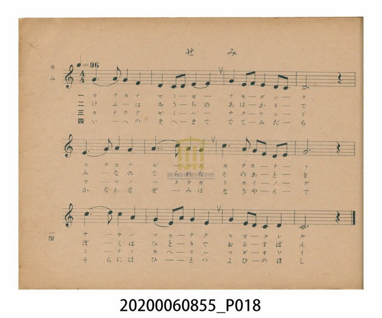
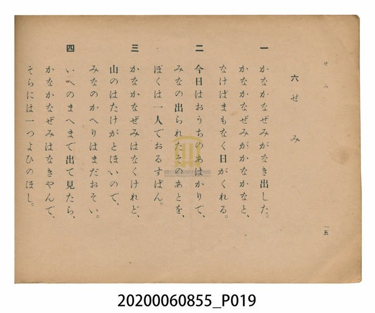

# せみ（蟬）

> Re:Shōka 使用 AI 協助辨識與重建樂譜，可能會有錯誤。歡迎回報。

- **鋼琴伴奏版**：<br><audio controls src="semi.mp3"></audio>
- **NEUTRINO 歌聲合成版**：<br><audio controls src="semi_neutrino.mp3"></audio>

- 日治時期公學校唱歌（第三學年・第六課）
- 國立臺灣歷史博物館典藏

## 說明


- 出處：臺灣總督府編《公學校唱歌》第三學年用，第六課〈せみ〉（蟬），原書第 14–15 頁。
- 調性與拍號：ハ調（C 大調），4/4 拍，速度 != 96。
- 背景與曲風：描寫農家收割小米（粟刈り／あはかり）的日子，家人們都到遙遠的山上田地工作，
孩童獨自一人看家（おるすばん）；傍晚時分寒蟬（かなかなぜみ）鳴叫，走到家門前仰望暮色天空，
蟬聲漸歇，天邊升起一顆明亮的晚星（よひのほし）。曲調溫柔恬靜，充滿鄉村向晚的詩意與思親之情。
- 版本說明：本檔案為原書單聲部簡譜（數字譜）之忠實數位化版本。

### 編曲說明（鋼琴伴奏版）：

1. 前奏 (Intro, 4 小節)：以「かなかな」寒蟬鳴叫動機結合結尾樂句，營造寧靜向晚的氛圍。
2. 主歌伴奏 (Semi, 12 小節 × 4 段)：右手 (PianoRH) 演奏柔和起伏的主旋律；
左手 (PianoLH) 採用溫暖平穩的四拍低音與和聲伴奏，襯托暮色與晚星的靜謐感。


## 歌詞

```text
一　かなかなぜみがなき出した。
かなかなぜみがかなかなと、
なけばまもなく日がくれる。

二　今日はおうちのあはかりで、
みなの出られたそのあとを、
ぼくは一人でおるすばん。

三　かなかなぜみはなくけれど、
山のはたけがとほいので、
みなのかへりはまだおそい。

四　いへのまへまで出て見たら、
かなかなぜみはなきやんで、
そらには一つよひのほし。
```

## ABC

```abc
X:1
T:せみ（蟬）
M:4/4
L:1/16
Q:1/4=96
K:C
V:V1 name="Piano" snm="Pia"
[V:V1]
G6 A2 G4 E4 | D4 C2 D2 E4 E4 | G4 E2 F2 E4 D2 C2 | D12 z4 |
w: 1.~カ ナ カ ナ | ゼ ミ _ ガ _ | ナ キ _ ダ シ _ | タ
w: 2.~け ふ _ は | お う _ ち の | あ は _ か り _ | で
w: 3.~カ ナ カ ナ | ゼ ミ _ ハ _ | ナ ク _ ケ レ _ | ド
w: 4.~い _ へ の | ま へ _ ま で | で て _ み た _ | ら
E6 G2 A4 G4 | A6 c2 A4 G4 | c6 A2 G2 E2 D2 E2 | G12 z4 |
w: 1.~カ ナ カ ナ | ゼ _ ミ ガ | カ ナ カ _ ナ _ | ト
w: 2.~み _ な の | で ら れ た | そ の あ _ と _ | を
w: 3.~ヤ _ マ ノ | ハ タ ケ ガ | ト ホ イ _ ノ _ | デ
w: 4.~か な か な | ぜ _ み は | な き や _ ん _ | で
c6 d2 c4 A4 | G4 E2 A2 G4 E4 | G4 E2 D2 C4 D4 | C12 z4 |
w: 1.~ナ _ ケ バ | マ モ _ ナ ク | ヒ ガ _ ク レ | ル
w: 2.~ぼ _ く は | ひ と _ り で | お る _ す ば | ん
w: 3.~ミ _ ナ ノ | カ ヘ _ リ ハ | マ ダ _ オ ソ | イ
w: 4.~そ ら に は | ひ _ _ と つ | よ ひ _ の ほ | し
```

## TMD 檔案連結

- [主旋律 TMD 檔案](semi.tmd) [[在 TMD Studio 編輯](https://tmdlang.github.io/Tmd-TS/#tmd=s7IKdvYPcrWy4qpTUCpJTLdSSM7PyUlNLsnMz7PKzk9PzM7Ojy_OyM9OVIKrKMvPKc1NtUovSkxJjTdGiBfnlxYlp1oVJ2fk5-fEl6RWlCTl52cj5AuK8stS8xLzgGoKijLzSlJTwIoQClLLMlNSQdKpKZkl-UWZiTlIlqYWFYPcBLEkvqQoMa84uSizAORQhKqSjFSgyxLzMnOR9QKNSs_MsypJzCxPzIvPT0vLTAabraWl8Lhx9uPG_e_3dLyYv-b9nk4FLS0uRVsFSzMue1sFZy4bE30TO5Axz6YvfbZp97OZTc_mzH_auubp2h3PFix8OmXjs7U9QL3P16x5sqMTKPh055bHzbuB3Keta1-s2gQ0EOyIp3O6n6_uftG-63nj4mdrtz_t3_S0d9bzzpUvl6x42rrjxfR-JS4ufS0FW2oBLgUFhccNE57N3vR89roXq1Y9m9H3uGEiWLR599P2XS9mTn2_ZxbEPc937H0-d_HTXXOeb1_xuKELzXOPG7qRPfd8yor3e3rg_nvc0AEJv8cNnfAgBCp42jf_2ewdQGUKhiaPGiYbmiq8XND4uKEJ6oIXq_Y_a1j-oqP9WXfvi5nzgU553NwPFAQa4azwdMlyMBNkDjD0FYBqgKyXDfOf7lqmAI4aJIOae57NXA8yaPaml4uATpv1rL__6frVL_Zterpu27Mp2552bnq6of_5xs2gSNo0_2lHx-Omrvd7-h83Nj1uXP-4sRvM7Xw-qwUYwU_XTgC5fd22J7t2PW2Y-LJ579OODS8bZ75sXABU8HTjxic7up5P2fB0zoan25c-2TsHqBjkDgWFp2tXPl-99Hnvihftq57saABqfz6nG2gO0NLHjV2Pm7ofN8583LjhcdNksLdmP23qfTZzFjAxPe1oe7p-EjjYgCqBylbByDngRNn5cvOWp_2rgRa92LoB6BigmS-nNTzt7H2ye8OzObOfzVr3AujBJSufr9wFdwzQtBeNm57t2fFsbTvIO0tWvmzqetrb_mLrdqDbXi5sAyaGJ7vWgbwMdMMMYOgDwwRo-6bHjeseN-5-3DgdaC8wiIFBCoqnXaufzZ_yrHHNy7kg_z5tbX22e__Lls5ncyc-nTARaALQnBcrVz5r6QfFQsPcF8tWPdnZ_ay5FRFJzzs7ns1ZA0mFoBias-bZqinPFnY8b9oFSSdPp60Duvhl84rnGxa-WAu0puPZ1B1P104HszuBxj3dv-Dp-mVAwSd7e5_2TIMYCLIAms4hxgBT64uV8562rng2rR3omCc71oIYq-a9WLsemPiBpj7d0PusvVMBWDSkpxrpZRWkpivoKwQYGFoCbQEbBQyfxw0NmBHxuLEHzO4FZh1g-DxunA_zHXalyILAPNUIUQrkTASlgsZ9j5uAqQ_I7QcmOrCG_sdNPaBkAjEVlJPAzgaGFiR5vJzW_XR5NyQxPNnVBlT3fOo2iNTjhp6nvQufTtgGIR839ALTJ0QlMIGBUs7ezudz9rycNvnpklUvZ-59umHji2WNT3Z0g9Iz2Ci473cBc3vDk91dYFcBM0fX48a2x40LwekCkV0eNy6HewnoXaA31oGCpakT5AdgyDTOhWlY8bhpElzpHpAvG9dDsgfIDNSMgcXrQJcAE--zGeuBqf7F4oXIuRklvy5ZDlQAdAIoZ4DzJSjF7AMWyz3POiZiZkpkH-8AJnSs8Q30Kyh-QDEG8tVKqDeAYQb2HFAa6FFgbALlVoAzTQtYHCNkwKbuAIcaUM--x40LwMEKDKIWLD5-OXva8xZovD7dvun5tslP56yAxzrQQ0_2tj2dvQCUcSCF0awWaHm0rwNYSCECY_Y8IAnO4U3AiH_Z1PJsTjNQDTC7Ivn-6ezZYN8Dnb4D7FSg84AMILkcnM6XvVgGdPx8UMzCfIUroHofN7WAIhEpAOaC9DWuhkT548YlaGUMFt-jF3E7GoARBvITcng0znm2dhEwMOAF49Mlc4ClHzCzA8s0UBG3qw1ayoELN6h3gTZRXqlCgYKWPhdXcGpuplVAZmJevkONQU01uOS1MdGyAzOw1eQK4Fq04cXCHgUNEwVQKl7foAMpipBKIgtNLDqB9oFMrVHQMFXQBUIzTVUNXV1NBVMFY6CgkYKGoYIRSEgTyAeJmCpoGCuYwEQ0jBQMIWyQWpB-A4UasIE-hkAjHzetBgs-bu7SVABxgAygysdNe4ByzfMVgPoeN60BKgCKAWWA6teCxZobQOztIDZI9X5Uk41AJjdOhJjcuFUTTK0HqWwEmdHYBjajcSEQrwOLNoFE10NEu0Emd0FNblyOarIxkW5u7kd2M8Tkpo0geaBnwCY3d6KabAJ2cwtYEOyOHXDX7QPJ7ICI7gO7CeIyoOgyiOh-EBtsM8gdCJPxp4ddPZSlB2OwPabQ9GAGjHmgoBlY0DAOVdQwDiXtAJOSMSRVANMHlAVKOcSmD6D4HnhIAYMclEbQVUN4IBqoBRrmHdjSCSTxgMNxFTTMgaKQiAcGJsjeHqD4fIj4XGiqWgcyGZhwwDY0roCF_SQs6aV5CcKt84C4D2wSOImAbNgPSRswP0Ad-bh5NtgPQL1gP_TB_NCOLd10Q121CpKCQT4Bi89B-G0_NA8ARVdBVfeCbQCmOTA9GTPNEyhPOilLP9BEYQRLK0C-GawAAacUWCEDFoEWMsDSBihiiCWpgKIZ6llQcDZPAAfXPJDMIkjgdwFlwMVA8ySQh8FZESQCypUgUUjqQUseiITW2A8vRjbBIx1UVsCyJDizA6MCpHYmEG8AJwlguGImCWBmhSUJoH5wkgClV6DMDIgoMCkCUwjcBw0Qu4CiTXvBaiFpCi0ZQBMnONE2AjMLwrVQH6wA4iVg_R0g9ZsgouuAeDdY5XS4qbVcXLp2CqCKBmwBkK3MBQA)]
- [鋼琴伴奏 TMD 檔案](semi_piano.tmd) [[在 TMD Studio 編輯](https://tmdlang.github.io/Tmd-TS/#tmd=s7IKdvYPcrWy4tLSUnjcOPtx4_73ezpezF_zuHn3y-49zydsebJny9Ol_c87O97v6VTQ0uJStFWwNOOyt1Vw5rIx0Tex46pTUHo2femzTbufzWx6Nmf-09Y1T9fueLZg4dMpG5-t7QGa9nzNmic7OoGCT3duARoL5D5tXfti1SaggUog3U_ndD9f3f2ifdfzxsXP1m5_2r_pae-s550rXy5Z8bR1x4vp_UpcXPpaCrbUAlwKCgqPGyY8m73p-ex1L1atejaj73HDRLBo8-6n7btezJz6fs8siHue79j7fO7ip7vmPN--4nFDF5rnHjd0I3vu-ZQV7_f0wP33uKEDEqKPGzohgQr0MVDB0775z2bvACpTMDR51DDZ0FTh5YLGxw1NUBe8WLX_WcPyFx3tz7p7X8ycD3TK4-Z-oCDQCGeFp0uWg5kgc4ChrwBUA2S9bJj_dNcyBXDUIBnU3PNs5nqQQbM3vVwEdNqsZ_39T9evfrFv09N1255N2fa0c9PTDf3PN25-srMbGIUgp61d-Xz10ue9K160r3o-pxuo7HFD44vGtheNe5829T6bOevp-klgfwB91v24cRWMnANON50vN2952r8aaA7IBQoKz2dvedqxAaj-ReOmZ2sXPWtcDzTt6ZI5z1fuerZ13fP-fU_XLnk2A-jDjsdNQAM3PW5c97hx9-PG6UCjns9qebZr9ctlK551TXrW3Pqspf_pomaE34DRAfQVJPKA-jGTKtC3EEcY6ik87ewFiitoeOaVFOXrKJgogHy9vkETqObJ7qWPG3pQPNPQC_EkxDNPu6c-Wzn_-dYJTyd0gMgN-56taHraDwqs5-3zXzYseLp--cu5c55OmAgMHZCjN8x-OqcX6lAFBSM9hSc7dgOTCsRtChrBqbmZOgqGRlA3KByeDnTPs3VbQY552r_5WWe3gkZAZmJefpCHpsKzPVOAmp7Nn_J0Us-Lrduf7OkH2gAyb3r3033d7_fMhlgCBE-3L0No9QFp7VsITI7AIHw2a9rTnZufr1wJ1Pp09mxggnmyt-_l_M3AdAEytXETxGVA_7xYuv5Z54xns9a96NwESjUzZwEjB6gL6L0XayY8a5kP8hU080DSMNBfL1bOe9q64tm0dqCOJzvWghir5r1YC4zpicB4ebqh91l7p0JmbmJ6qpFeVkFquoK-QoCBoSUwhsBGPdnR8LihATMxPW4ERgqQ3QvMj8AE8bgRbDnIbuxKkQWBGbURohTImfi4ccPjxn2Pm5rA3H5gOgdr6H_c1PO4qRtqKih7gp0NigVI7E_rfrq8G5IGnuxqA6p7PnUbRAqYYJ72Lnw6YRuEBCWYORsgKoFFICgg93Y-n7Pn5bTJT5esejlz79MNG18sa3yyo_vpxo0Qo-C-3wUsQhqe7O4Cu2r948aux41tjxsXgjMC0MFAke7HTUDB5XAvAb0L9MY6ULA0dYL8AAyZxrkwDSseN02CK90D8mXjemAQP9kFDMTlIOOBPm6cCQqSpslYvA50ydMlK5_NWA_M-C8WL0QuIkBJe_rSp2sngEqJJcuBCoBOeDmt4en2pU_2zgEWIE_3Acv6nmcdEyGlB8RWWBmC8PGOThzxDfQrKH5AMQby1UqoN4BhBvYcUBroUWBsAuVWgEuJFrA4RsiATd0BDjWgnn2PGxeAgxUYRC1YfPxy9rTnLdB4fbp90_Ntk5_OWQGPdaCHnuxtezp7wfOmXaDI29EFDIbnUzYA4_vpvo6XjQsQgTF7HpAEBdLMJmDEv2xqeTanGagGmImQfA_Mf2DfA52-A-xUoPOADCC5HJzOl71YBnT8fFDMwnyFK6B6Hze1gCIRKQDmgvQ1roZE-ePGJWiFKhbfv9i6AVhAAx0OisjOXqA2YISB_IQcHo1zgGU3MDDghTukBAdm9ie71oFKpV1tQI0vF7ZBCgyod4E2UV5TQ4GClj6FLQBw4CPXAppW8GpAQQNakWqCE-jupZASEOg_eHZHqx8gIQEvIp92zAXWZZAKC1hWQwrnpxunAosQyoIB7G-wc62gVYJDjUFNNbjQtzHRsgMzahQ0TBV0gdBMU1VDV1dTwVTBGCRoBhY0jIOKmgHFa4BYw1jBCCSkqWCoYAQUMQQrM1Co4apFscsHu12G8QrRhrEKphCqRsEEyDCJhQkDLQAyTCHyQAquHoShdlAcj5D6FFhlQipTYEwialOUqIRUp6CsC26sIdWbPZDqEiSFVnuDq1pIjUiFuAO5D0_UYQsKBXCDsuHFwh6gZ6De0oFUoEj1p4UmFp1AG_EkCCMFDWCMQ6LeGCwCTgwmMBENIwVDCBukFpYoQAb6GAKNfNy0Giz4uLlLUwHEATKAKh837QHKNc9XAOp73LQGqAAoBpQBql8LFmsGRsrjpu0gNkj1flSTjUAmN06EmNy4VRNMrQepbASZ0dgGNqNxIRCvA4s2gUTXQ0SBzR1gMQ81uXE5qsnGRLq5uR_ZzRCTmzaC5IGeAZvc3IlqsgnYzS1gQbA7dsBdtw8kswMiug_sJojLgKLLIKL7QWywzSB3IEzGnx529VCWHozB9piiFAXYCwgNwziUtANMSsaQVAFMH1AWKOUQmz6A4nvgIQUMclAaQVcN4YFooBZomHdgSyeQxAMOx1XQMAeKQiIeGJgge3uA4vMh4nOhqWodyGRgwgHb0LgCFvaTsKSX5iUIt84D4j6wSeAkArJhPyRtwPwAdeTj5tlgPwD1gv3QB_NDO7Z00w111SpICgb5BCw-B-G3_dA8ABRdBVXdC7YBmObA9GTMNE-gPOmkLP1AE4URLK0A-WawAgScUmCFDL76BZFUQNEM9SwoOJsngINrHkhmESTwu4Ay4GKgeRLIw-CsCBIB5UqQKCT1oCUPREJr7IcXI5vgkQ4qK2BZEpzZgVEBUjsTiDeAkwQwXDGTBDCzwpIEUD84SYDSK1BmBkQUmBSBKQTugwaIXUDRpr1gtZA0hZYMoIkTnGgbgZkF4VqoD1YA8RKw_g6Q-k0Q0XVAvBuscjrcVGCdiqhnsFbbxNYzeBMBes0PreLhNT-UYQakzHKRFBhBmwKkFXHEOAXa9sBshOBolBDpErTMgtclUJvgLsEVCHjaQ7p2CuBmF9hEIAcUl9E-hrGofCM0vjEa3wTOV-YCAA)]

## 分析

```text
================================================================================
📊 TMD Song Profile: [ せみ（蟬） ]
================================================================================
⏱  Duration:       0:30 (30.0s), 12 measures total
🎼 Key & Tempo:    首調基準 C, != 96.0 BPM, <4/4>
   - 分析範圍：      由實際發聲的音符與和弦推測調性；播放脈絡另行呈現
🎤 人聲音域:    C4 (MIDI 60) – D5 (MIDI 74) [跨度: 14 個半音 / 1.2 個八度, 難度: moderate]
   - 最低音:  C4 in [Semi #1 @ m.2, 0:03]
   - 最高音: D5 in [Semi #1 @ m.9, 0:20]
   - 適合: soprano, mezzo-soprano, contralto, tenor, baritone, bass
🏛  結構:      Semi (30.0s)
⚡ 編曲密度:        Peak 1 軌道同時演奏
🗝  調性診斷：       C 大調（純淨自然大調，未偵測到可信轉調）
   - 風格氣質:    純淨自然大調（陽光明朗、易唱易記，無明顯調外色彩）
   - 轉調歷程:    全曲維持單一推測調性（未偵測到可信轉調）
   - 核心骨幹音:  G, C, E, D, A
   - 調性數值:    C 大調 [相關度: 0.84, 穩定度: Moderate, 自然音純度: 100.0%]
   - 候選調性 (K-S): C 大調 (0.84), G 大調 (0.80), E 小調 (0.67)
   - 五度圈歷程:   +0
   - 各段落調性細節:
     • [Semi #1]: C 大調 (r: 0.84, 自然音純度: 100.0%)

  [ 五度圈游移軌跡 ]
              [C ]*
         F            G  
      Bb               D  
      Eb               A  
         Ab           E  
            Db       B  
               F# 
     (* = active key center)

  [ 十二半音累積音高分佈 ]
     C  : ██████████████████        21.1%
     C# :                            0.0%
     D  : ██████████████            16.7%
     D# :                            0.0%
     E  : █████████████████         20.0%
     F  : █                          1.1%
     F# :                            0.0%
     G  : ████████████████████████  27.8%
     G# :                            0.0%
     A  : ████████████              13.3%
     A# :                            0.0%
     B  :                            0.0%
--------------------------------------------------------------------------------
Assignment 軌道音域：
  - Piano         : C4 – D5 (14 個半音 / 1.2 個八度, 46 個音符)
================================================================================
```


## 原書掃描頁






