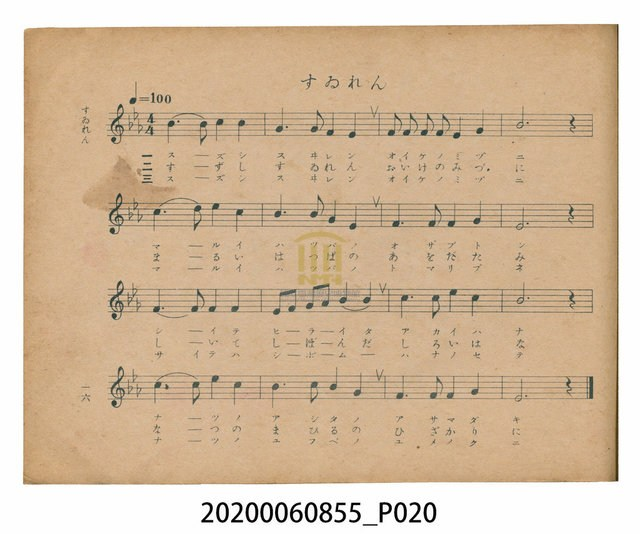
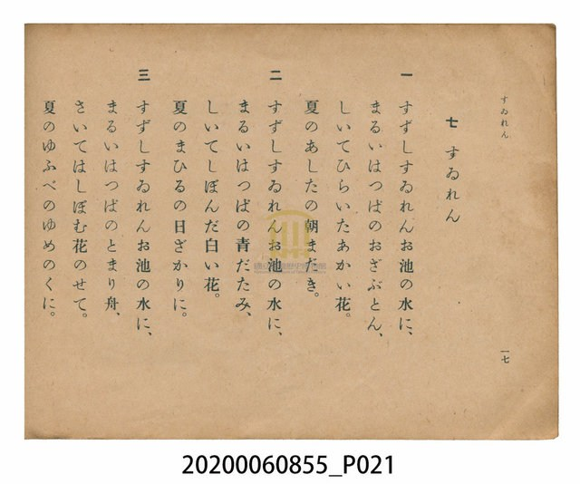

# すゐれん（睡蓮）

> Re:Shōka 使用 AI 協助辨識與重建樂譜，可能會有錯誤。歡迎回報。

- **鋼琴伴奏版**：<br><audio controls src="suiren.mp3"></audio>
- **NEUTRINO 歌聲合成版**：<br><audio controls src="suiren_neutrino.mp3"></audio>

- 木本森太郎 作詞（鶯歌庄柑園公學校・懸賞募集入選原題〈睡蓮〉）
- 日治時期公學校唱歌（第三學年・第七課）
- 國立臺灣歷史博物館典藏

## 說明


- 出處：臺灣總督府編《公學校唱歌》第三學年用，第七課〈すゐれん〉（睡蓮），原書第 16–17 頁。
- 調性與拍號：變ホ調（Eb 大調），4/4 拍，速度 != 100。
- 背景與曲風：描寫夏日池塘裡清涼的睡蓮，三段歌詞依序以「清晨（朝まだき）」、「正午（日ざかり）」、
「傍晚（ゆふべ）」的時間推移，將圓圓的蓮葉比擬為「小坐墊（おざぶとん）」、「青草蓆（青だたみ）」
與「停泊的小船（とまり舟）」，襯托紅花綻放、白花收攏與夕暮夢之國的詩意畫面。
- 版本說明：本檔案為原書單聲部簡譜（數字譜）之忠實數位化版本。

### 編曲說明（鋼琴伴奏版）：

1. 前奏 (Intro, 4 小節)：引用最末樂句「夏のあしたの朝まだき」之優美下行線條，如池面微風泛起漣漪。
2. 主歌伴奏 (Suiren, 16 小節 × 3 段)：右手 (PianoRH) 演奏溫婉流暢的主旋律；
左手 (PianoLH) 以 Eb 大調穩定柔和的四拍和聲伴奏，烘托睡蓮浮於水面的恬靜意境。


## 歌詞

```text
一　すずしすゐれんお池の水に、
まるいはつぱのおざぶとん、
しいてひらいたあかい花。
夏のあしたの朝まだき。

二　すずしすゐれんお池の水に、
まるいはつぱの青だたみ、
しいてしぼんだ白い花。
夏のまひるの日ざかりに。

三　すずしすゐれんお池の水に、
まるいはつぱのとまり舟、
さいてはしぼむ花のせて。
夏のゆふべのゆめのくに。
```

## ABC

<div class="abc-score" data-abc-src="suiren.abc" aria-label="五線譜載入中"></div>

[下載 ABC 原始檔](suiren.abc)

## TMD 檔案連結

- [主旋律 TMD 檔案](suiren.tmd) [[在 TMD Studio 編輯](https://tmdlang.github.io/Tmd-TS/#tmd=s7IKdvYPcrWy4qpTUCpJTLdSSM7PyUlNLsnMz7PKzk9PzM7Ojy_OyM9OVIKrKMvPKc1NtUovSkxJjTdGiBfnlxYlp1oVJ2fk5-fEl6RWlCTl52cj5AuK8stS8xLzgGoKijLzSlJTwIoQClLLMlNSQdKpKZkl-UWZiTlIlqYWFYPcBLEkvqQoMa84uSizAORQhKqSjFSgywpyEvOQjIUIlieWpBYhBIHGp2fmWZUkZpYn5sXnp6VlJqPYhyqfnA90bnFJvKGlMZKH84tKMvKBwVCQUWmVkVkMcnJyYk58dmIeUmhBHVyQmJ5qFWBgZKDEpaWl8Lhx5uOmCY-beh43TX6_p-P53IUvJq97v6dTQUuLS9FWwdDAgMveVsE1icvGRN_EDmTWszkrns1Z82zxuqdLVr1s7lN4snfOi5XzgHpfblv_bG3P010tz-ZPfDpn0tPWNU_X7ni2YOHj5t3P2ne82Dzvaff8l7PbnrYufdm442nf_JcLex43QG183NAJtBTs1mfTlz7btPvZzKZnc-bDzXg6ZSPQbJAD16x5sqMTKPh05xagwWBu84tVm2C6n87pfr66-0X7rueNi5-t3f60f9PT3lnPO1e-XLLiaeuOF9P7lbi49LUUbKkFuBQUFB43THg2e9Pz2eterFr1bEbf44aJYNHm3U_bd72YOfX9nlkQ9zzfsff53MVPd815vn3F44YuNM89buhG9tzzKSve7-mB-w8YUshRBQ4vRGwBVQID9NnsHUD1CoZmjxomG5orvFzQ-LihCeqUF6v2P2tY_qKj_Vl374uZ80FuWtf1uHk2UBxokGuSwtMly8FskFnAqFYAqgOyXjbMf7prmQIkJSCZ1tzzbOZ6kGmzN71cBHTorGf9_U_Xr366pB8UfRsXPF0448Xihc92tD7btuf5rBaYQ3uA3nu2bivQt8Ak82Tf3Ke7-p_sXvq4oQekcibQnI5nc-Y-btz3uHHB40ag_Z2PG3ofNwC90fNs7eKnvR0gBdOXPm6c9rix-3FTF1wByFmgeOh52tT7bOYsoLLHTW2PG7c-btwJUQN0AzBFvZw2-VnfiufLd4PCa0P70zmTgQgoBXTbi4mdz9ZPeTZ5zfOmXSBzNvQ_nTvh6SKgFcBw7wLbuO1x4wpwLkG46uXcSS96O19MbgMl_7mTwM6e_7gRFIxANRBXAUMJZGDjnGebu4B2AU1-0QF0FdDYFSCfNnW96ABGB0g90FUvlq5_1jnj-ZbWF10bn2_b_WzKPqBFz2fuBXKfTdn2bApQb_vTJVOfzQLmvkVPdnaDkjvQ_StXPmvpfz519cu5ixCR9LwTGJprIGkSFEPATLtqyrOFHUAfQhLL02nrXjRuetm84vmGhS_WzgEF7tQdT9dOB7M7QabvX_B0_TKg4JO9vU97pkEMBFkATfUQYyCx-bR1xbNp7UDnPdmxFsRYNe_F2vXArAA09emG3mftnQqZucCSx0gvqyA1XUFfAVgCGQJtARv1ZEfD44YGUPpunPW4cTpKQm_sAianx43rnm3Y8rhxNTSuwQHX_bix5XHj-seNSx43bgSqQIsnuFKgeUB1yx43bnrc1AlmA6OoCZSCGluA4QoNMGDSBZsBlABqAKpYh5wUoYqAnoF4DBSeqIn72dZ1T4El48YFQIc-2QFMNz2I5DURmKcnPG3uR0pVPS-7V4HUb9gCjDOgekhkAwsMUNx3bgLpAkb5nK1Ai182zHw2Yz00a4HzyfMFW57N7gQm6KcdbUAF8GDcBSxEKA5G5HSMGYZAxh6weQuAqRJrAAJDDBjQQFPXIWdVsKXUCENQluvc9GzZbiB6vnEzZkhC8smTXW2gbIMnJMEFyvNmUIHyfOq25yt3ARM8MEiRw3MHMFdSIVki8jlc3VRYeALVQYK0ARSSINWzQeIoQQoryqDspkawOqAUlYIUo2zqebGn88XE6S-ndQOD8Wl_x9MJHbiC8emEicACF6QXVh4B6wtoGAJdRnkFCwUKWvpcXMGlmUWpeVYBmYl5-Q41BjXV4BLWxkTLDszAVq8rgGvQhhcLexQ0TBSAHny-vkEHUhQhlUQGmlh0Am0EmVqjoGGqoAuEppqqGrq6mgpmCqYgQWOwoDFU0EjBECRopGAEEtBEYhkC5WqAWkCqDRRqwGb6GALVPm7aCRYEqnnctAuIt4NMgIk-bt4AFG9eA8SbIeKrgEqWAE1-3LQRKNgHkp0PxK1A2cfN3ajmG4F0NM6Em984C5SJweZARYFJGWRvDxBPhoh3AZW0gMxvnAhkrQPp2g_ES0HmN65GNd-Ydu7HH5W7eiiLSjOwPebQWDOMA8YmPILNoKKmCsaQuAQJgmMRHMEgQUMs0dg8Dx4MzatBfgR7t7kfGgzAIH3cDAxRYFMZGgyQ4N8GEp8GxB3gANiMLQL3IQK4GxQ7kIhaDzGhERiYwCIGFFcQ8SaoyZNA4guAeD446vZjiTrS3Ax0IkR8HkgcGI9Ad4Pc3EtkpO3opCzS0GMClKE0gPkKmtWMFUwgLFNIzoTEMSw2oXGMNQNuR4TvEqB_2iC-nQQSAdIr4TJN-yFxtwgawqthOvrB4dCFLe6mIzJfCxAvg8QRUBScxfZAzJ4Mjikk9Y-bemE61oNjD5Jc0DLeVqhaUAoAuhriDoh_wC6fA4nZBUBFKPHaBRLtA2rcDXZ3G3Hx93T2bGpkOrQIoTDTQcIc7E1gYMEyFyyCtoMCF1h6oYtvBamfB8QNoABoWost4iAhDo44YBTDMhckKwLbNrDMCBXfBBWfBlIPFG_qwlleYndz8zJo5EwFic_EFF8IizRwgkAqKWu5uHTtFCCVItgaIE-ZCwA)]
- [鋼琴伴奏 TMD 檔案](suiren_piano.tmd) [[在 TMD Studio 編輯](https://tmdlang.github.io/Tmd-TS/#tmd=s7IKdvYPcrWy4qpTUCpJTLdSSM7PyUlNLsnMz7PKzk9PzM7Ojy_OyM9OVIKrKMvPKc1NtTJGiBTnlxYlp-JSX1CUX5aal5gHVFGSmFmemBefDhQoyssvik9PzUstSsxBqE0ty0xJBaksKMrMTSyqjE_JTwZalleCZH1qUTHIdQWZiXn58YlFRYl56amoSvKLSjLy04sSCzIqrTIyi0vyizKTE3PisxPzkJxVkgHUZZWaUpqcCPItum_iCxLTU60CDIwMlLi0tBQeN8583DThcVPP46bJ7_d0PJ-78MXkdY-bd7_s3vN8wpYne7Y8Xdr_vLPj_Z5OBS0tLkVbBUMDAy57WwXXJC4bE30TO5Dpz6YvfbZp97OZTc_mzH_auubp2h3PFix8OmXjs7U9ICPXrHmyoxMo-HTnFqDBYG7zi1WbgEaC3fZ0Tvfz1d0v2nc9b1z8bO32p_2bnvbOet658uWSFU9bd7yY3q_ExaWvpWBLLcCloKDwuGHCs9mbns9e92LVqmcz-h43TASLNu9-2r7rxcyp7_fMgrjn-Y69z-cufrprzvPtKx43dKF57nFDN7Lnnk9Z8X5PD9x_jxs6kAP3cUMnPHyBXgeqfNo3_9nsHUD1CoZmjxomG5orvFzQ-LihCeqUF6v2P2tY_qKj_Vl374uZ80FuWtf1uHk2UBxokGuSwtMly8FskFnAqFAAqgOyXjbMf7prmQIkppBMa-55NnM9yLTZm14uAjp01rP-_qfrVz9d0g-Kvo0LnuxYC3Hci_ZVz3a0Ppu54vm23c-m7Hvc0Phs7eKnvR3Ppmx7NqX_Rfvmp029z2bOerqs6emSRU_27Hm6c_fzWS0gLdv2gKxo34KwFRhsQPsggQx0NGaiAroDpFRBwVBP4WlnL1BcQcMzr6QoX0fBROHphv7n6xs0gWqe7pkKDN1ncxqezVn9bEXT0_6ljxt6gE5_3LjucWPT48bpjxvnA9nP5sx93LjvceOCx429jxt6n-zsftqy6vm-vic7ul8s7Hm-fdazRXNBAb-sCejhl3MXPd23DhgWzzbPfrF1-7M9i5_tWQV1uoKCkZ7Ckx27gZEMca2CRnBpZlFqng4wrqDuUjg8XcFY4dm6rWAH9m9-1tmtoBEAyrxBHpoKz_ZMAWp7tmv105Wdz7Y2Ppu1CBhIIBOndz_d1_1-z2yINUDwdPsyhFYfoNYnu5cCsxc0ep-vXPl03axn86c8ndQDNOHp7NnAaAayXzRugrgMlOSaZzzrnAGJvWdb1z2btufZhi1A74GipXHNy7lznrX0P13UDPIbNPFDkh7Qdy9WznvauuLZtHZgygCmABBj1bwXa9cDcwQwvp5u6H3W3qkALLHSU430sgpS0xX0FYBFhyEw5sBGPdnR8LihAZTMG2eBYwEpvTd2AQMZFCkbtjxuXA1MRmC7gdHT1P24seVx4_rHjUseN24ER2HX48Zpjxu3PW5cAc4pUKVA84Dqlj1u3PS4qRPMBkYyMLZB-l90bYTGFaFkAFYE9AzEY6CED06qwMCBh9jTOSuAbgU69MmOLlD6mDMZiIAKXkwEZu0JT5v7gTH-dO6Ep4tAsi-7V4HUg0MYqB6SS4DlxvMtrS86N4F0dW18Nmcr0OKXDTOfzVgPzWGQLLVgy7PZncCS8mlHG1ABPBh3AcsSioPx5dxJYD8Dg2A_ZhgCGXvA5i14PnMv1gAEhhgwoIGmrgO6Fxwh3Y-bgDEDtJQaYQh0HjB8ni3bDUTPN27GDElIAfNkVxvQgfhCElwaPW_uALKfT932fOUuYD4HBilyeO7opEqyXAEW73rRMR-ubiosPIHqIEHaAApJkOrZIHGUIG1qe9y49XHjTii7qRGsDihFpSB92jjn2eYuULGwof9Fx06gmhd7Ol9MnP5yWjcwGJ_2dzyd0IErGJ9OmAgsxUF6gaU4sKCc0w2sNqBhCHQZ5fUsFCho6VNYf4MDFLlu0LSCVw4KGtCaTxOkClilPd-5CjnDQcIPErTAOIQELTAUgUEILPEgAYNeZG5e9LSVwjAAexrsVitojeBQY1BTDS7zbUy07MCMGgUNMwVdIDTTVNXQ1dVUMIxTMAOJmqKImgJrGaCgEVjQCCpoBBY0BIsZKNRw1aJY54PdOpN4hWiTWBgF1A5kGMYqmAEps1yQgCmQZRoLo-AKQBhqCcURCalUgbUmrEYFRiaiSkWJTUid-rxpF6S1hVR59kDqTKAUNH7BdfeLjjWg6ANXlZC6kQqRCHEknljEFiIK4EZgA7DNAfQR1G86kGoUqRY10MSiE2gnNG1AUoEpNMLNgOkAKGgMFjSGpwJDSNIAJwtNJJYhUA4Yn_D0ATLTxxCo9nHTTrAgUM3jpl1AvB1kAkz0cfMGoHjzGiDeDBFfBVSyBGjy46aNQME-kOx8IG4Fyj5u7kY13wiko3Em3PzGWaAKCGwOVBRYDIPs7QHiyRDxLqCSFpD5jROBrHUgXfuBeCnI_MbVqOYb0879-KNyVw9lUQnJ5uaUZ3NENDbPgwdD82qQH8Hebe6HBgMwSB83A0O0uQ8WDJDg3wYSnwbEHeAA2IwtAvchArgbFDuQiFoPMaERGJjA6hEUVxDxJqjJk0DiC4B4Pjjq9mOJOtLcDHQiRHweSBwYj0B3g9zcS2Sk7eikLNLQYwKUoTSA-Qqa1YwVTCAsU0jOxFqUY82A2xHhuwTonzaIbyeBRID0SrhM035I3C2ChvBqmI5-cDh0YYu76YjM1wLEyyBxBBQFZ7E9ELMng2MKSf3jpl6YjvXg2IMkF7SMtxWqFpQCgK6GuAPiH7DL50BidgFQEUq8doFE-4Aad4Pd3UZc_AF7OtTIdFSoW5EyHSTMwd4EBhYsc8EiaDsocIGlF7r4VpD6eUDcAAqAprXYIg4S4uCIA0YxLHNBsiKwXQ7LjFDxTVDxaSD1QPGmLpzlJXY3Ny-DRs5UkPhMTPGFsEgDJwikkhLYCECuE7E2NYitE_FGILTxAWqMACksrRUjIMsIyEJvrsD4pBXqeN1CacuJpJIKr0ugNoD8ju5ncCihuxRNPWl5jqZhAkxIunYK4FYr2EQgB5Kwon0MY9FFjDBEjOEiylwA)]

## 分析

```text
================================================================================
📊 TMD Song Profile: [ すゐれん（睡蓮） ]
================================================================================
⏱  Duration:       0:38 (38.4s), 16 measures total
🎼 Key & Tempo:    首調基準 E,, != 100.0 BPM, <4/4>
   - 分析範圍：      由實際發聲的音符與和弦推測調性；播放脈絡另行呈現
🎤 人聲音域:    D#4 (MIDI 63) – D#5 (MIDI 75) [跨度: 12 個半音 / 1.0 個八度, 難度: easy]
   - 最低音:  D#4 in [Suiren #1 @ m.2, 0:04]
   - 最高音: D#5 in [Suiren #1 @ m.5, 0:10]
   - 適合: soprano, mezzo-soprano, contralto, tenor, baritone, bass
🏛  結構:      Suiren (38.4s)
⚡ 編曲密度:        Peak 1 軌道同時演奏
🗝  調性診斷：       A# 大調（純淨自然大調，未偵測到可信轉調）
   - 風格氣質:    純淨自然大調（陽光明朗、易唱易記，無明顯調外色彩）
   - 轉調歷程:    全曲維持單一推測調性（未偵測到可信轉調）
   - 核心骨幹音:  A#, F, D#, C, G
   - 調性數值:    A# 大調 [相關度: 0.85, 穩定度: Moderate, 自然音純度: 99.2%]
   - 候選調性 (K-S): A# 大調 (0.85), D# 大調 (0.73), F 大調 (0.59)
   - 五度圈歷程:   -2
   - 各段落調性細節:
     • [Suiren #1]: A# 大調 (r: 0.85, 自然音純度: 99.2%, 調外音: G#)

  [ 五度圈游移軌跡 ]
               C  
         F            G  
     [Bb]*              D  
      Eb               A  
         Ab           E  
            Db       B  
               F# 
     (* = active key center)

  [ 十二半音累積音高分佈 ]
     C  : ████████████████          17.5%
     C# :                            0.0%
     D  : █                          0.8%
     D# : █████████████████         19.2%
     E  :                            0.0%
     F  : ██████████████████████    24.2%
     F# :                            0.0%
     G  : ██████████                10.8%
     G# : █                          0.8%
     A  :                            0.0%
     A# : ████████████████████████  26.7%
     B  :                            0.0%
--------------------------------------------------------------------------------
Assignment 軌道音域：
  - Piano         : D#4 – D#5 (12 個半音 / 1.0 個八度, 56 個音符)
================================================================================
```


## 原書掃描頁






