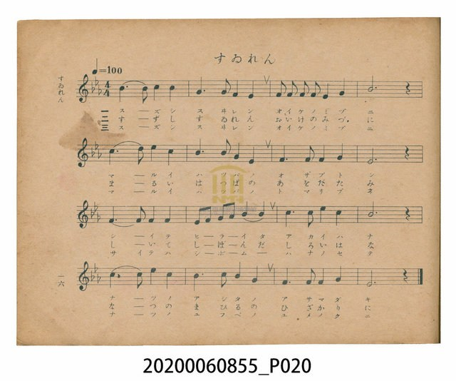
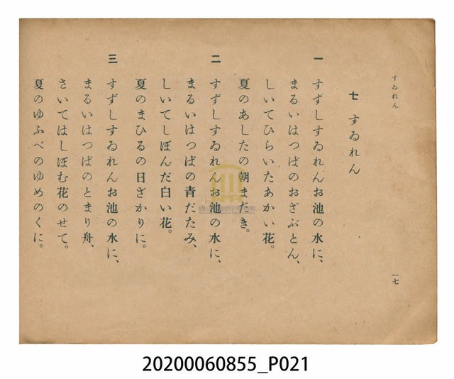

# すゐれん（睡蓮）

> Re:Shōka 使用 AI 協助辨識與重建樂譜，可能會有錯誤。歡迎回報。

- **鋼琴伴奏版**：<br><audio controls src="suiren.mp3"></audio>
- **NEUTRINO 歌聲合成版**：<br><audio controls src="suiren_neutrino.mp3"></audio>

- 木本森太郎 作詞（鶯歌庄柑園公學校・懸賞募集入選原題〈睡蓮〉）
- 日治時期公學校唱歌（第三學年・第七課）
- 國立臺灣歷史博物館典藏

## 說明

【曲目說明】
・出處：臺灣總督府編《公學校唱歌》第三學年用，第七課〈すゐれん〉（睡蓮），原書第 16–17 頁。
・調性與拍號：變ホ調（Eb 大調），4/4 拍，速度 != 100。
・背景與曲風：描寫夏日池塘裡清涼的睡蓮，三段歌詞依序以「清晨（朝まだき）」、「正午（日ざかり）」、
「傍晚（ゆふべ）」的時間推移，將圓圓的蓮葉比擬為「小坐墊（おざぶとん）」、「青草蓆（青だたみ）」
與「停泊的小船（とまり舟）」，襯托紅花綻放、白花收攏與夕暮夢之國的詩意畫面。
・版本說明：本檔案為原書單聲部簡譜（數字譜）之忠實數位化版本。

・編曲說明（鋼琴伴奏版）：
1. 前奏 (Intro, 4 小節)：引用最末樂句「夏のあしたの朝まだき」之優美下行線條，如池面微風泛起漣漪。
2. 主歌伴奏 (Suiren, 16 小節 × 3 段)：右手 (PianoRH) 演奏溫婉流暢的主旋律；
左手 (PianoLH) 以 Eb 大調穩定柔和的四拍和聲伴奏，烘托睡蓮浮於水面的恬靜意境。

## 歌詞

```text
一　すずしすゐれんお池の水に、
まるいはつぱのおざぶとん、
しいてひらいたあかい花。
夏のあしたの朝まだき。

二　すずしすゐれんお池の水に、
まるいはつぱの青だたみ、
しいてしぼんだ白い花。
夏のまひるの日ざかりに。

三　すずしすゐれんお池の水に、
まるいはつぱのとまり舟、
さいてはしぼむ花のせて。
夏のゆふべのゆめのくに。
```

## ABC

```abc
X:1
T:すゐれん（睡蓮）
M:4/4
L:1/16
Q:1/4=100
K:Eb
V:V1 name="Piano" snm="Pia"
[V:V1]
B6 B2 c4 B4 | G6 G2 F4 E4 | F2 F2 F2 F2 E4 F4 | B12 z4 |
w: 1.~ス _ ズ シ | ス ヰ レ ン | オ イ ケ ノ ミ ヅ | ニ
w: 2.~す _ ず し | す ゐ れ ん | お い け の み づ | に
w: 3.~ス _ ズ シ | ス ヰ レ ン | オ イ ケ ノ ミ ヅ | ニ
c6 d2 e4 c4 | B6 c2 B4 G4 | F6 F2 F4 G4 | E12 z4 |
w: 1.~マ _ ル イ | ハ ツ パ ノ | オ ザ ブ ト | ン
w: 2.~ま _ る い | は つ ぱ の | あ を だ た | み
w: 3.~マ _ ル イ | ハ ツ パ ノ | ト マ リ ブ | ネ
F6 F2 F4 F4 | E2 F2 G2 A2 B4 B4 | c6 c2 e4 c4 | B12 z4 |
w: 1.~シ _ イ テ | ヒ _ ラ _ イ タ | ア カ イ ハ | ナ
w: 2.~し _ い て | し _ ぼ _ ん だ | し ろ い は | な
w: 3.~サ イ テ ハ | シ _ ボ _ ム _ | ハ ナ ノ セ | テ
c6 c2 e4 c4 | B6 c2 B4 G4 | F6 F2 F4 G4 | E12 z4 |
w: 1.~ナ _ ツ ノ | ア シ タ ノ | ア サ マ ダ | キ
w: 2.~な _ つ の | ま ひ る の | ひ ざ か り | に
w: 3.~ナ _ ツ ノ | ユ フ ベ ノ | ユ メ ノ ク | ニ
```

## TMD 檔案連結

- [主旋律 TMD 檔案](suiren.tmd) [[在 TMD Studio 編輯](https://tmdlang.github.io/Tmd-TS/#tmd=s7IKdvYPcrWy4qpTUCpJTLdSSM7PyUlNLsnMz7PKzk9PzM7Ojy_OyM9OVIKrKMvPKc1NtUovSkxJjTdGiBfnlxYlp1oVJ2fk5-fEl6RWlCTl52cj5AuK8stS8xLzgGoKijLzSlJTwIoQClLLMlNSQdKpKZkl-UWZiTlIlqYWFYPcBLEkvqQoMa84uSizAORQhKqSjFSgywpyEvOQjIUIlieWpBYpcWlpKTxunPm4acLjpp7HTZPf7-l4Pnfhi8nr3u_pVNDS4lK0VTA0MOCyt1VwTeKyMdE3sQMZ82zOimdz1jxbvO7pklUvm_sUnuyd82LlPKDel9vWP1vb83RXy7P5E5_OmfS0dc3TtTueLVj4uHn3s_YdLzbPe9o9_-XstqetS1827njaN__lwp7HDVAbHzd0Ai0FO_PZ9KXPNu1-NrPp2Zz5cDOeTtkINBvkwDVrnuzoBAo-3bkFaDCY2_xi1SaY7qdzup-v7n7Rvut54-Jna7c_7d_0tHfW886VL5eseNq648X0fiUuLn0tBVtqAS4FBYXHDROezd70fPa6F6tWPZvR97hhIli0effT9l0vZk59v2cWxD3Pd-x9Pnfx011znm9f8bihC81zjxu6kT33fMqK93t64P4DhhRyVIHDCxFbQJXAAH02ewdQvYKh2aOGyYbmCi8XND5uaII65cWq_c8alr_oaH_W3fti5nyQm9Z1PW6eDRQHGuSapPB0yXIwG2QWMKoVgOqArJcN85_uWqYASQlIpjX3PJu5HmTa7E0vFwEdOutZf__T9aufLukHRd_GBU8XznixeOGzHa3Ptu15PqsF5tAeoPeerdsK9C0wyTzZN_fprv4nu5c-bugBqZwJNKfj2Zy5jxv3PW5c8LgRaH_n44bexw1Ab_Q8W7v4aW8HSMH0pY8bpz1u7H7c1AVXAHIWKB56njb1Pps5C6jscVPb48atjxt3QtQA3QBMUS-nTX7Wt-L58t2g8NrQ_nTOZCACSgHd9mJi57P1U55NXvO8aRfInA39T-dOeLoIaAUw3LvANm573LgCnEsQrno5d9KL3s4Xk9tAyX_uJLCz5z9uBAUjUA3EVcBQAhnYOOfZ5i6gXUCTX3QAXQU0dgXIp01dLzqA0QFSD3TVi6Xrn3XOeL6l9UXXxufbdj-bsg9o0fOZe4HcZ1O2PZsC1Nv-dMnUZ7OAuW_Rk53doOQOdP_Klc9a-p9PXf1y7iJEJD3vBIbmGkiaBMUQMNOumvJsYQfQh5DE8nTauheNm142r3i-YeGLtXNAgTt1x9O108HsTpDp-xc8Xb8MKPhkb-_TnmkQA0EWQFM9xBhIbD5tXfFsWjvQeU92rAUxVs17sXY9MCsATX26ofdZe6dCZm5ieqqRXlZBarqCvkKAgZEh0BawUU92NDxuaACl78ZZjxunoyT0xi5gcnrcuO7Zhi2PG1dD4xoccN2PG1seN65_3LjkceNGoAq0eIIrBZoHVLfsceOmx02dYDYwippAKaixBRiu0AADJl2wGUAJoAaginXISRGqCOgZiMdA4YmauJ9tXfcUWDJuXAB06JMdwHTTg0heE4F5esLT5n6kVNXzsnsVSP2GLcA4A6qHRDawwADFfecmkC5glM_ZCrT4ZcPMZzPWQ7MWOJ88X7Dl2exOYIJ-2tEGVAAPxl3AQoTiYEROx5hhCGTsAZu3AJgqsQYgMMSAAQ00dR1yVgVbSo0wBGW5zk3Plu0GoucbN2OGJCSfPNnVBso2eEISXKA8bwYVKM-nbnu-chcwwQODFDk8dwBzJRWSJSKfw9VNhYUnUB0kSBtAIQlSPRskjhKksKIMym5qBKsDSlEpSDHKpp4XezpfTJz-clo3MBif9nc8ndCBKxifTpgILHBBemHlEbC-gIYh0GWUV7BQoKClz8UVXJpZlJpnFZCZmJfvUGNQUw0uYW1MtOzADGz1ugK4Bm14sbBHQcNEAejB5-sbdCBFEVJJZKCJRSfQRpCpNQoapgq6QGiqqaqhq6upYKZgChI0BgsaQwWNFAxBgkYKRiABTSSWIVCuBqgFpNpAoQZspo8hUO3jpp1gQaCax027gHg7yASY6OPmDUDx5jVAvBkivgqoZAnQ5MdNG4GCfSDZ-UDcCpR93NyNar4RSEfjTLj5jbNAmRhsDlQUmJRB9vYA8WSIeBdQSQvI_MaJQNY6kK79QLwUZH7jalTzjWnnfvxRuauHsqg0A9tjDo01wzhgbMIj2AwqaqpgDIlLkCA4FsERDBI0xBKNzfPgwdC8GuRHsHeb-6HBAAzSx83AEAU2laHBAAn-bSDxaUDcAQ6AzdgicB8igLtBsQOJqPUQExqBgQksYkBxBRFvgpo8CSS-AIjng6NuP5aoI83NQCdCxOeBxIHxCHQ3yM29REbajk7KIg09JkAZSgOYr6BZzVjBBMIyheRMSBzDYhMax1gz4HZE-C4B-qcN4ttJIBEgvRIu07QfEneLoCG8GqajHxwOXdjibjoi87UA8TJIHAFFwVlsD8TsyeCYQlL_uKkXpmM9OPYgyQUt422FqgWlAKCrIe6A-Afs8jmQmF0AVIQSr10g0T6gxt1gd7cRF39PZ8-mRqZDixAKMx0kzMHeBAYWLHPBImg7KHCBpRe6-FaQ-nlA3AAKgKa12CIOEuLgiANGMSxzQbIisG0Dy4xQ8U1Q8Wkg9UDxpi6c5SV2Nzcvg0bOVJD4TEzxhbBIAycIpJKylotL104BUimCrQHylLkA)]
- [鋼琴伴奏 TMD 檔案](suiren_piano.tmd) [[在 TMD Studio 編輯](https://tmdlang.github.io/Tmd-TS/#tmd=s7IKdvYPcrWy4tLSUnjcOPNx04THTT2Pmya_39PxfO7CF5PXPW7e_bJ7z_MJW57s2fJ0af_zzo73ezoVtLS4FG0VDA0MuOxtFVyTuGxM9E3suOoUlJ5NX_ps0-5nM5uezZn_tHXN07U7ni1Y-HTKxmdre0BGrlnzZEcnUPDpzi1Ag8Hc5herNgGNVALpfjqn-_nq7hftu543Ln62dvvT_k1Pe2c971z5csmKp607XkzvV-Li0tdSsKUW4FJQUHjcMOHZ7E3PZ697sWrVsxl9jxsmgkWbdz9t3_Vi5tT3e2ZB3PN8x97ncxc_3TXn-fYVjxu60Dz3uKEb2XPPp6x4v6cH7r_HDR3Igfu4oRMevkCvA1U-7Zv_bPYOoHoFQ7NHDZMNzRVeLmh83NAEdcqLVfufNSx_0dH-rLv3xcz5IDet63rcPBsoDjTINUnh6ZLlYDbILGBUKADVAVkvG-Y_3bVMARJTSKY19zybuR5k2uxNLxcBHTrrWX__0_Wrny7pB0XfxgVPdqyFOO5F-6pnO1qfzVzxfNvuZ1P2PW5ofLZ28dPejmdTtj2b0v-iffPTpt5nM2c9Xdb0dMmiJ3v2PN25-_msFpCWbXtAVrRvQdgKDDagfZBABjoaM1EB3QFSqqBgqKfwtLMXKK6g4ZlXUpSvo2Ci8HRD__P1DZpANU_3TAWG7rM5Dc_mrH62oulp_9LHDT1Apz9uXPe4selx4_THjfOB7Gdz5j5u3Pe4ccHjxt7HDb1PdnY_bVn1fF_fkx3dLxb2PN8-69miuaCAX9YE9PDLuYue7lsHDItnm2e_2Lr92Z7Fz_asgjpdQcFIT-HJjt3ASIa4VkEjuDSzKDVPBxhXUHcpHJ6uYKzwbN1WsAP7Nz_r7FbQCMhMzMsP8tBUeLZnClDbs12rn67sfLa18dmsRcBAApk4vfvpvu73e2ZDrAGCp9uXIbT6ALU-2b0UmL2g0ft85cqn62Y9mz_l6aQeoAlPZ88GRjOQ_aJxE8RloCTXPONZ5wxI7D3buu7ZtD3PNmwBeg8ULY1rXs6d86yl_-miZpDfoIkfkvSAvnuxct7T1hXPprUDUwYwBYAYq-a9WLsemCOA8fV0Q--z9k6FzNzE9FQjvayC1HQFfYUAAyNDYMyBjXqyo-FxQwMomTfOAscCUnpv7AIGMihSNmx53LgamIzAdgOjp6n7cWPL48b1jxuXPG7cCI7CrseN0x43bnvcuAKcU6BKgeYB1S173LjpcVMnmA2MZGBsg_S_6NoIjStCyQCsCOgZiMdACR-cVIGBAw-xp3NWAN0KdOiTHV2g9DFnMhABFbyYCMzaE5429wNj_OncCU8XgWRfdq8CqQeHMFA9JJcAy43nW1pfdG4C6era-GzOVqDFLxtmPpuxHprDIFlqwZZnszuBJeXTjjagAngw7gKWJRQH48u5k8B-BgbBfswwBDL2gM1b8HzmXqwBCAwxYEADTV0HdC84QrofNwFjBmgpNcIQ6Dxg-DxbthuInm_cjBmSkALmya42oAPxhSS4NHre3AFkP5-67fnKXcB8DgxS5PDc0UmVZLkCLN71omM-XN1UWHgC1UGCtAEUkiDVs0HiKEHa1Pa4cevjxp1QdlMjWB1QikpB-rRxzrPNXaBiYUP_i46dQDUv9nS-mDj95bRuYDA-7e94OqEDVzA-nTARWIqD9AJLcWBBOacbWG1AwxDoMsrrWShQ0NKnsP4GByhy3aBpBa8cFDSgNZ8mSBWwSnu-cxVyhoOEHyRogXEICVpgKAKDEFjiQQIGvcjcvOhpK4VhAPY02K1W0BrBocagphpc5tuYaNmBGTUKGmYKukBopqmqoaurqWAYp2AGEjVFETUF1jJAQSOwoBFU0AgsaAgWM1Co4apFsc4Hu3Um8QrRJrEwCqgdyDCMVTADUma5IAFTIMs0FkbBFYAw1BKKIxJSqQJrTViNCoxMRJWKEpuQOvV50y5Iawup8uyB1JlAKWj8guvuFx1rQNEHriohdSMVIhHiSDyxiC1EFMCNwAZgmwPoI6jfdCDVKFItaqCJRSfQTmjagKQCU2iEmwHTAVDQGCxoDE8FhpCkAU4WmkgsQ6AcMD7h6QNkpo8hUO3jpp1gQaCax027gHg7yASY6OPmDUDx5jVAvBkivgqoZAnQ5MdNG4GCfSDZ-UDcCpR93NyNar4RSEfjTLj5jbNAFRDYHKgosBgG2dsDxJMh4l1AJS0g8xsnAlnrQLr2A_FSkPmNq1HNN6ad-_FH5a4eyqISks3NKc_miGhsngcPhubVID-CvdvcDw0GYJA-bgaGaHMfLBggwb8NJD4NiDvAAbAZWwTuQwRwNyh2IBG1HmJCIzAwgdUjKK4g4k1QkyeBxBcA8Xxw1O3HEnWkuRnoRIj4PJA4MB6B7ga5uZfISNvRSVmkoccEKENpAPMVNKsZK5hAWKaQnIm1KMeaAbcjwncJ0D9tEN9OAokA6ZVwmab9kLhbBA3h1TAd_eBw6MIWd9MRma8FiJdB4ggoCs5ieyBmTwbHFJL6x029MB3rwbEHSS5oGW8rVC0oBQBdDXEHxD9gl8-BxOwCoCKUeO0CifYBNe4Gu7uNuPgD9nSokemoULciZTpImIO9CQwsWOaCRdB2UOACSy908a0g9fOAuAEUAE1rsUUcJMTBEQeMYljmgmRFYLsclhmh4pug4tNA6oHiTV04y0vsbm5eBo2cqSDxmZjiC2GRBk4QSCUlsBGAXCdibWoQWyfijUBo4wPUGAFSWForRkCWEZCF3lyB8Ukr1PG6hdKWE0klFV6XQG0A-R3dz-BQQncpmnrS8hxNwwSYkHTtFMCtVrCJQA4kYUX7GMaiixhhiBjDRZS5AA)]

## 分析

```text
================================================================================
📊 TMD Song Profile: [ すゐれん（睡蓮） ]
================================================================================
⏱  Duration:       0:38 (38.4s), 16 measures total
🎼 Key & Tempo:    首調基準 E,, != 100.0 BPM, <4/4>
   - 分析範圍：      由實際發聲的音符與和弦推測調性；播放脈絡另行呈現
🎤 人聲音域:    D#4 (MIDI 63) – D#5 (MIDI 75) [跨度: 12 個半音 / 1.0 個八度, 難度: easy]
   - 最低音:  D#4 in [Suiren #1 @ m.2, 0:04]
   - 最高音: D#5 in [Suiren #1 @ m.5, 0:10]
   - 適合: soprano, mezzo-soprano, contralto, tenor, baritone, bass
🏛  結構:      Suiren (38.4s)
⚡ 編曲密度:        Peak 1 軌道同時演奏
🗝  調性診斷：       A# 大調（純淨自然大調，未偵測到可信轉調）
   - 風格氣質:    純淨自然大調（陽光明朗、易唱易記，無明顯調外色彩）
   - 轉調歷程:    全曲維持單一推測調性（未偵測到可信轉調）
   - 核心骨幹音:  A#, F, D#, C, G
   - 調性數值:    A# 大調 [相關度: 0.85, 穩定度: Moderate, 自然音純度: 99.2%]
   - 候選調性 (K-S): A# 大調 (0.85), D# 大調 (0.73), F 大調 (0.59)
   - 五度圈歷程:   -2
   - 各段落調性細節:
     • [Suiren #1]: A# 大調 (r: 0.85, 自然音純度: 99.2%, 調外音: G#)

  [ 五度圈游移軌跡 ]
               C  
         F            G  
     [Bb]*              D  
      Eb               A  
         Ab           E  
            Db       B  
               F# 
     (* = active key center)

  [ 十二半音累積音高分佈 ]
     C  : ████████████████          17.5%
     C# :                            0.0%
     D  : █                          0.8%
     D# : █████████████████         19.2%
     E  :                            0.0%
     F  : ██████████████████████    24.2%
     F# :                            0.0%
     G  : ██████████                10.8%
     G# : █                          0.8%
     A  :                            0.0%
     A# : ████████████████████████  26.7%
     B  :                            0.0%
--------------------------------------------------------------------------------
Assignment 軌道音域：
  - Piano         : D#4 – D#5 (12 個半音 / 1.0 個八度, 56 個音符)
================================================================================
```


## 原書掃描頁






