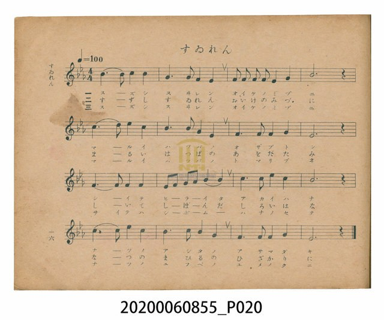
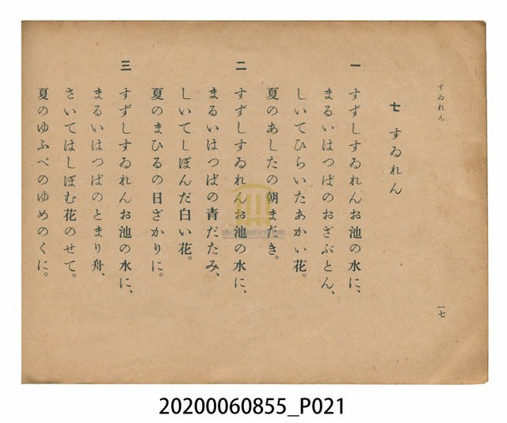

# すゐれん（睡蓮）

<audio controls src="suiren.mp3"></audio>

- 日治時期公學校唱歌（第三學年・第七課）
- 國立臺灣歷史博物館典藏

## 說明

【曲目說明】
・出處：臺灣總督府編《公學校唱歌》第三學年用，第七課〈すゐれん〉（睡蓮），原書第 16–17 頁。
・調性與拍號：變ホ調（Eb 大調），4/4 拍，速度 != 100。
・背景與曲風：描寫夏日池塘裡清涼的睡蓮，三段歌詞依序以「清晨（朝まだき）」、「正午（日ざかり）」、
「傍晚（ゆふべ）」的時間推移，將圓圓的蓮葉比擬為「小坐墊（おざぶとん）」、「青草蓆（青だたみ）」
與「停泊的小船（とまり舟）」，襯托紅花綻放、白花收攏與夕暮夢之國的詩意畫面。
・版本說明：本檔案為原書單聲部簡譜（數字譜）之忠實數位化版本。

・編曲說明（鋼琴伴奏版）：
1. 前奏 (Intro, 4 小節)：引用最末樂句「夏のあしたの朝まだき」之優美下行線條，如池面微風泛起漣漪。
2. 主歌伴奏 (Suiren, 16 小節 × 3 段)：右手 (PianoRH) 演奏溫婉流暢的主旋律；
左手 (PianoLH) 以 Eb 大調穩定柔和的四拍和聲伴奏，烘托睡蓮浮於水面的恬靜意境。

## 歌詞

```text
一　すずしすゐれんお池の水に、
まるいはつぱのおざぶとん、
しいてひらいたあかい花。
夏のあしたの朝まだき。

二　すずしすゐれんお池の水に、
まるいはつぱの青だたみ、
しいてしぼんだ白い花。
夏のまひるの日ざかりに。

三　すずしすゐれんお池の水に、
まるいはつぱのとまり舟、
さいてはしぼむ花のせて。
夏のゆふべのゆめのくに。
```

## ABC

```abc
X:1
T:すゐれん（睡蓮）
M:4/4
L:1/16
Q:1/4=100
K:Eb
V:V1 name="Piano" snm="Pia"
[V:V1]
B6 B2 c4 B4 | G6 G2 F4 E4 | F2 F2 F2 F2 E4 F4 | B12 z4 |
c6 d2 e4 c4 | B6 c2 B4 G4 | F6 F2 F4 G4 | E12 z4 |
F6 F2 F4 F4 | E2 F2 G2 A2 B4 B4 | c6 c2 e4 c4 | B12 z4 |
c6 c2 e4 c4 | B6 c2 B4 G4 | F6 F2 F4 G4 | E12 z4 |
```

## TMD 檔案連結

- [主旋律 TMD 檔案](suiren.tmd) [[在 TMD Studio 編輯](https://tmdlang.github.io/Tmd-TS/#tmd=s7IKdvYPcrWy4qpTUCpJTLdSSM7PyUlNLsnMz7PKzk9PzM7Ojy_OyM9OVIKrKMvPKc1NtUovSkxJjTdGiBfnlxYlp1oVJ2fk5-fEl6RWlCTl52cj5AuK8stS8xLzgGoKijLzSlJTwIoQClLLMlNSQdKpKZkl-UWZiTlIlqYWFYPcBLEkvqQoMa84uSizAORQhKqSjFSgywpyEvOQjIUIlieWpBYpcWlpKTxunPm4acLjpp7HTZPf7-l4Pnfhi8nr3u_pVNDS4lK0VTA0MOCyt1VwTeKyMdE3sQMZ82z60mebdj-b2fRszvynrWuert3xbMHCp1M2PlvbAzJgzZonOzqBgk93bnncvBvMbX6xahPQSLAjns7pfr66-0X7rueNi5-t3f60f9PT3lnPO1e-XLLiaeuOF9P7lbi49LUUbKkFuBQUFB43THg2e9Pz2eterFr1bEbf44aJYNHm3U_bd72YOfX9nlkQ9zzfsff53MVPd815vn3F44YuNM89buhG9tzzKSve7-mB--9xQwdyUD5u6EQOTaDKp33zn83eAVSvYGj2qGGyobnCywWNjxuaoE55sWr_s4blLzran3X3vpg5H-SmdV2Pm2cDxYEGuSYpPF2yHMwGmQWMCgWgOiDrZcP8p7uWKUBiCsm05p5nM9eDTJu96eUioENnPevvf7p-9dMl_aDo27jg6cIZLxYvfLaj9dm2Pc9ntcAc2gP03rN1W4G-fbFy3pN9c5_u6n-ye-njhh6QyplAczqezZn7uHHf48YFjxuB9nc-buh93AD0Rs-ztYuf9naAFExf-rhx2uPG7sdNXXAFIGeB4qHnaVPvs5mzgMoeN7U9btz6uHEnRA3QDcAU9XLa5Gd9K54v3w0Krw3tT-dMBiKgFNBtLyZ2Pls_5dnkNc-bdoHM2dD_dO6Ep4uAVgDDvQts47bHjSvAqRjhqpdzJ73o7XwxuQ2oDMgGO3v-40ZQMALVQFwFDCWQgY1znm3uAtoFNPlFB9BVQGNXgHza1PWiAxgdIPVAV71Yuv5Z54znW1pfdG18vm33syn7gBY9n7kXyH02ZduzKUC97U-XTH02a93TJYue7OwGJXeg-1eufNbS_3zq6pdzFyEi6XknMDTXQNIkKIbmrHm2asqzhR1AH0ISy9Np6140bnrZvOL5hoUv1s4BBe7UHU_XTgezO0Gm71_wdP0yoOCTvb1Pe6ZBDARZAE31EGMgsfm0dcWzae1A5z3ZsRbEWDXvxdr1wKwANPXpht5n7Z0KmbmJ6alGelkFqekK-goBBkaGQFvARj3Z0fC4oQGUvhtnPW6cjpLQG7uAyelx47pnG7Y8blwNjWtwwHU_bmx53Lj-ceOSx40bgSrQ4gmuFGgeUN2yx42bHjd1gtnAKGoCpaDGFmC4QgMMmHTBZgAlgBqAKtYhJ0WoIqBnIB4DhSdq4n62dd3TOSuAbgU69MkOYLrpQSSvicA8PeFpcz9Squp52b0KpH7DFmCcAdVDIhtYYIDivnMTSBcwyudsBVr8smHmsxnroVkLnE-eL9jybHYnMEE_7WgDKoAH4y5gIUJxMCKnY8wwBDL2gM1bAEyVWAMQGGLAgAaaug45q4ItpUYYgrJc56Zny3YD0fONmzFDEpJPnuxqA2UbPCEJLlCeN4MKlOdTtz1fuQuY4IFBihyeO4C5kgrJEpHP4eqmwsITqA4SpA2gkASpng0SRwlSWFEGZTc1gtUBpagUpBhlU8-LPZ0vJk5_Oa0bGIxP-zueTujAFYxPJ0wEFrggvbDyCFhfQMMQ6DLKK1goUNDS5-IKLs0sSs2zCshMzMt3qDGoUagGF7E2Jlp2YAa2il0BXIU2vFjYo6BhogD04fP1DTqQsgipKDLQxKITaCXUVKABVgqPm3YCi9U9QHoXEG9XqIGKbADiNUC8GSyyCoiXAPFGoEgfEM8H4laQTHM3uDpQQDZ2Vw_Q2MaZEGMbZ4EyGkgpSKRpAhD3APFksEgXELcA8UQgXgfE-4F4KVhmNaaxOzqp7toaBQ1TBV1dBVNNVQ1dXU0FMwVTkJgxSMwYKmakYAgSM1IwAgloIrEMgXI1QB1AxQYKNeDMhTuydvVQI7Ka50G837wa7EWQl_qBGBiGzcAwBHoW5v1tQN40IO6AehikcjOuqNoHDdNucHSAgn89EANDsBEYgsCIAYk0AeUnAekFQDwfYSgwyrBHFDEuBboOog7oYqBrES7txYgmM1Aom0OjxDAOGFOwuDODCpoqGEPiCSgGjiBw3IHEDImLoR2dVMlO26GBCQy-5jawb4DBBg6JlQiZpv3gmFoExJDwAYUOSG0XrjiaDs1OoOyyDBzyMBGQ0SBjJ4NjByrT1AtVux4ssgpHLDVthbsU6gKY-5vnQGlghANpWPwBcywoSzXtBou0YcQTWvCDMogGMJ9As46xggmEZQrJaOBYhUUgNFaJy09PZ8-mSn4C-QfkS1C6hOQeUJwAwwAYQ8giwHACp9QGRCptWosrrkDJGRQzoBwEyT3AHNa4CZrDICJAXiMwgzYCRZpgkY6v4MN0afMyIJ4KxKCSFiGyEBpD6xGGYin2sIU8yfmplotL104BUn-BWMpcXAA)]
- [鋼琴伴奏 TMD 檔案](suiren_piano.tmd) [[在 TMD Studio 編輯](https://tmdlang.github.io/Tmd-TS/#tmd=s7IKdvYPcrWy4tLSUnjcOPNx04THTT2Pmya_39PxfO7CF5PXPW7e_bJ7z_MJW57s2fJ0af_zzo73ezoVtLS4FG0VDA0MuOxtFVyTuGxM9E3suOoUlJ5NX_ps0-5nM5uezZn_tHXN07U7ni1Y-HTKxmdre0BGrlnzZEcnUPDpzi1Ag8Hc5herNgGNVALpfjqn-_nq7hftu543Ln62dvvT_k1Pe2c971z5csmKp607XkzvV-Li0tdSsKUW4FJQUHjcMOHZ7E3PZ697sWrVsxl9jxsmgkWbdz9t3_Vi5tT3e2ZB3PN8x97ncxc_3TXn-fYVjxu60Dz3uKEb2XPPp6x4v6cH7r_HDR3Igfu4oRMevkCvA1U-7Zv_bPYOoHoFQ7NHDZMNzRVeLmh83NAEdcqLVfufNSx_0dH-rLv3xcz5IDet63rcPBsoDjTINUnh6ZLlYDbILGBUKADVAVkvG-Y_3bVMARJTSKY19zybuR5k2uxNLxcBHTrrWX__0_Wrny7pB0XfxgVPdqyFOO5F-6pnO1qfzVzxfNvuZ1P2PW5ofLZ28dPejmdTtj2b0v-iffPTpt5nM2c9Xdb0dMmiJ3v2PN25-_msFpCWbXtAVrRvQdgKDDagfZBABjoaM1EB3QFSqqBgqKfwtLMXKK6g4ZlXUpSvo2Ci8HRD__P1DZpANU_3TAWG7rM5Dc_mrH62oulp_9LHDT1Apz9uXPe4selx4_THjfOB7Gdz5j5u3Pe4ccHjxt7HDb1PdnY_bVn1fF_fkx3dLxb2PN8-69miuaCAX9YE9PDLuYue7lsHDItnm2e_2Lr92Z7Fz_asgjpdQcFIT-HJjt3ASIa4VkEjuDSzKDVPBxhXUHcpHJ6uYKzwbN1WsAP7Nz_r7FbQCMhMzMsP8tBUeLZnClDbs12rn67sfLa18dmsRcBAApk4vfvpvu73e2ZDrAGCp9uXIbT6ALU-2b0UmL2g0ft85cqn62Y9mz_l6aQeoAlPZ88GRjOQ_aJxE8RloCTXPONZ5wxI7D3buu7ZtD3PNmwBeg8ULY1rXs6d86yl_-miZpDfoIkfkvSAvnuxct7T1hXPprUDUwYwBYAYq-a9WLsemCOA8fV0Q--z9k6FzNzE9FQjvayC1HQFfYUAAyNDYMyBjXqyo-FxQwMomTfOAscCUnpv7AIGMihSNmx53LgamIzAdgOjp6n7cWPL48b1jxuXPG7cCI7CrseN0x43bnvcuAKcU6BKgeYB1S173LjpcVMnmA2MZGBsg_S_6NoIjStCyQCsCOgZiMdACR-cVIGBAw-xp3NWAN0KdOiTHV2g9DFnMhABFbyYCMzaE5429wNj_OncCU8XgWRfdq8CqQeHMFA9JJcAy43nW1pfdG4C6era-GzOVqDFLxtmPpuxHprDIFlqwZZnszuBJeXTjjagAngw7gKWJRQH48u5k8B-BgbBfswwBDL2gM1b8HzmXqwBCAwxYEADTV0HdC84QrofNwFjBmgpNcIQ6Dxg-DxbthuInm_cjBmSkALmya42oAPxhSS4NHre3AFkP5-67fnKXcB8DgxS5PDc0UmVZLkCLN71omM-XN1UWHgC1UGCtAEUkiDVs0HiKEHa1Pa4cevjxp1QdlMjWB1QikpB-rRxzrPNXaBiYUP_i46dQDUv9nS-mDj95bRuYDA-7e94OqEDVzA-nTARWIqD9AJLcWBBOacbWG1AwxDoMsrrWShQ0NKnsP4GByhy3aBpBa8cFDSgNZ8mSBWwSnu-cxVyhoOEHyRogXEICVpgKAKDEFjiQQIGvcjcvOhpK4VhAPY02K1W0BrBocagRqEaXOjbmGjZgRk1ChpmCrq6Cmaaqhq6upoKhnEKZiBBU2RBU2AlAxQzAokZQcWMwGKGICEDhRquWhS7fHDYZRKvEG0SC6OA2oEMw1gFMyBllgsSMAWyTGNhFFwBCENtoTgaIVUqsM6E1afAqERUqChxCalRnzftgrS1kKrOHkiNCZSCxi645n7RsQYUeeCKElIzUiEKIY7EF4fYgkQB3AZsADY5gF6Cek4HUosiVaIGmlh0Ai2Fmgo0wErhcdNOYDNqD5DeBcTbgZECEdkAxGuAeDNYZBUQLwHijUCRPiCeD8StIJnmbmgbA8nYXT1AYxtnQoxtnAWqIkBKQSJNE4C4B4gng0W6gLgFiCcC8Tog3g_ES8EyqzGN3dFJddfCcoIpNNWbAfMCUMwYJGYMzwmGkNwBzhqaSCxDoBwwTcPyCP7I2tVDjchqngfxfvNqsBdBXuoHYmAYNgPDEOhZmPe3AXnTgLgD6mGQys24omofNEy7wdEBCv71QAwMwUZgCAIjBiTSBJSfBKQXAPF8hKHAKMMeUcS4FOg6iDqgi4GuRbi0FyOawKWYOYWlGIHs1EmV7LQdGpjA4GtuA_sGGGzgkFiJkGnaD46pRUAMCR9Q6IDUduGKo-nQ7ATKLsvAIQ8TARkNMnYyOHagMk29ULXrwSKrcMRS01a4S6EugLm_eQ6UBkY4kIbFHzDHgrJU026wSBtGPKEFPyiDaADzCTTrGCuYQFimkIyGrW4iLj8BeylUyU8g_4B8CUqXkNwDihNgGABjCFkEGE7glNqASKVNa3HFFSg5g2IGlIMguQeYwxo3QXMYRATIawRm0EagSBMs0vEVfJgubV4GxFOBGFTSIkQWQmNoPcJQLMUetVoFyNUX9mYBsdUXnuiCNxRADQcghaVlYQRkGQFZ6E0LGJ-00hmvWyht5ZBUCuF1CdQGkN_R_QwOJXSXoqknLYfRNEyAKUnXTgHcxFQAMiCpChdLmYsLAA)]

## 分析

```text
================================================================================
📊 TMD Song Profile: [ すゐれん（睡蓮） ]
================================================================================
⏱  Duration:       0:38 (38.4s), 16 measures total
🎼 Key & Tempo:    首調基準 E,, != 100.0 BPM, <4/4>
   - 分析範圍：      由實際發聲的音符與和弦推測調性；播放脈絡另行呈現
🎤 人聲音域:    D#4 (MIDI 63) – D#5 (MIDI 75) [跨度: 12 個半音 / 1.0 個八度, 難度: easy]
   - 最低音:  D#4 in [Suiren #1 @ m.2, 0:04]
   - 最高音: D#5 in [Suiren #1 @ m.5, 0:10]
   - 適合: soprano, mezzo-soprano, contralto, tenor, baritone, bass
🏛  結構:      Suiren (38.4s)
⚡ 編曲密度:        Peak 1 軌道同時演奏
🗝  調性診斷：       A# 大調（純淨自然大調，未偵測到可信轉調）
   - 風格氣質:    純淨自然大調（陽光明朗、易唱易記，無明顯調外色彩）
   - 轉調歷程:    全曲維持單一推測調性（未偵測到可信轉調）
   - 核心骨幹音:  A#, F, D#, C, G
   - 調性數值:    A# 大調 [相關度: 0.85, 穩定度: Moderate, 自然音純度: 99.2%]
   - 候選調性 (K-S): A# 大調 (0.85), D# 大調 (0.73), F 大調 (0.59)
   - 五度圈歷程:   -2
   - 各段落調性細節:
     • [Suiren #1]: A# 大調 (r: 0.85, 自然音純度: 99.2%, 調外音: G#)

  [ 五度圈游移軌跡 ]
               C  
         F            G  
     [Bb]*              D  
      Eb               A  
         Ab           E  
            Db       B  
               F# 
     (* = active key center)

  [ 十二半音累積音高分佈 ]
     C  : ████████████████          17.5%
     C# :                            0.0%
     D  : █                          0.8%
     D# : █████████████████         19.2%
     E  :                            0.0%
     F  : ██████████████████████    24.2%
     F# :                            0.0%
     G  : ██████████                10.8%
     G# : █                          0.8%
     A  :                            0.0%
     A# : ████████████████████████  26.7%
     B  :                            0.0%
--------------------------------------------------------------------------------
Assignment 軌道音域：
  - Piano         : D#4 – D#5 (12 個半音 / 1.0 個八度, 56 個音符)
================================================================================
```


## 原書掃描頁






