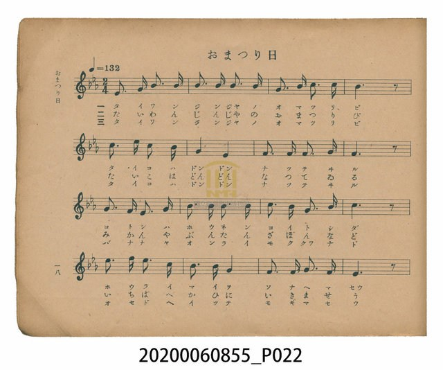
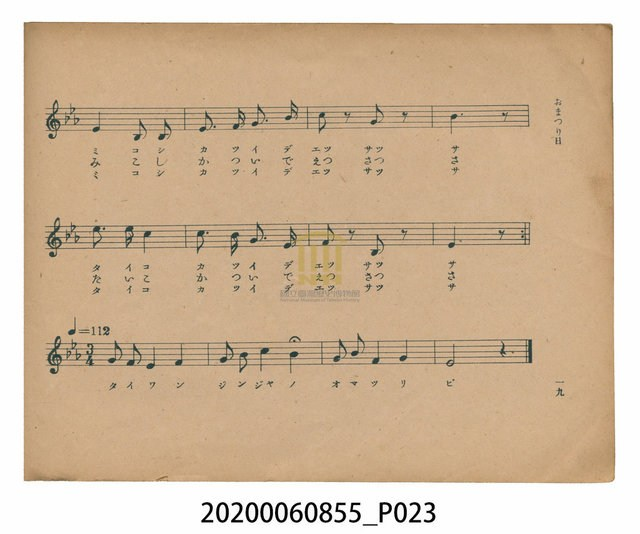
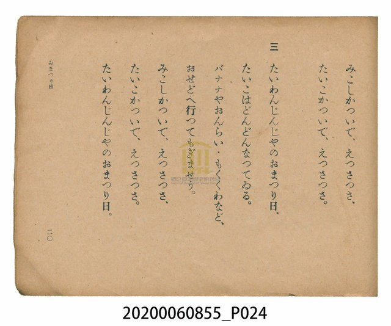
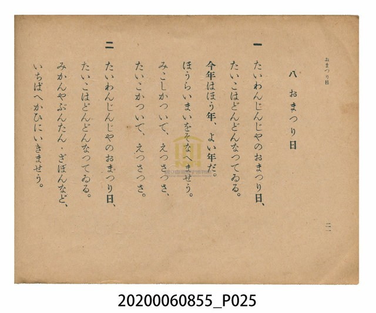

# おまつり日（祭典之日）

> Re:Shōka 使用 AI 協助辨識與重建樂譜，可能會有錯誤。歡迎回報。

- **鋼琴伴奏版**：<br><audio controls src="omatsuribi.mp3"></audio>
- **NEUTRINO 歌聲合成版**：<br><audio controls src="omatsuribi_neutrino.mp3"></audio>

- 日治時期公學校唱歌（第三學年・第八課）
- 國立臺灣歷史博物館典藏

## 說明


- 出處：臺灣總督府編《公學校唱歌》第三學年用，第八課〈おまつり日〉（祭典之日），原書第 18–21 頁。
- 調性與拍號：變ホ調（Eb 大調），主歌 2/4 拍（速度 != 132），尾奏轉 3/4 拍（速度 != 112）。
- 背景與曲風：描寫秋季「臺灣神社」（たいわんじんじや，原址位於今臺北圓山）大祭之熱鬧景象。
歌詞融入濃厚的臺灣物產特色：第一段獻上豐收的「蓬萊米（ほうらいまい）」，第二段到市場購買
「蜜柑、文旦、朱欒／白柚（みかんやぶんたん・ざぼん）」，第三段到後院採摘「香蕉、鳳梨（おんらい，
臺語『旺來』音譯）、木瓜（もくくわ）」，並穿插抬神轎與抬太鼓「えつさつさ」的吆喝聲。
最具特色的是全曲三段唱畢後，設有一段 4 小節轉為 3/4 拍（!= 112）的莊重尾奏「たいわんじんじやのおまつり日」。
- 版本說明：本檔案為原書單聲部簡譜（數字譜）之忠實數位化版本。

### 編曲說明（鋼琴伴奏版）：

1. 前奏 (Intro, 4 小節)：引用第六行「たいこかついで、えつさつさ」的頓音與節奏動機，熱鬧開場。
2. 主歌伴奏 (Omatsuribi, 24 小節 × 3 段)：右手 (PianoRH) 演奏充滿附點彈性的祭典旋律，
左手 (PianoLH) 以太鼓般的低音與和弦節奏支撐，並在「えつさつさ」處與右手齊奏斷音呼應。
3. 尾奏 (Coda, 4 小節)：三段歌詞唱畢後，依原譜轉為 3/4 拍（!= 112），以寬廣莊重的三拍子和聲收束全曲。


## 歌詞

```text
一　たいわんじんじやのおまつり日、
たいこはどんどんなつてゐる。
今年はほう年、よい年だ。
ほうらいまいをそなへませう。
みこしかついで、えつさつさ、
たいこかついで、えつさつさ。

二　たいわんじんじやのおまつり日、
たいこはどんどんなつてゐる。
みかんやぶんたん・ざぼんなど、
いちばへかひにいきませう。
みこしかついで、えつさつさ、
たいこかついで、えつさつさ。

三　たいわんじんじやのおまつり日、
たいこはどんどんなつてゐる。
バナナやおんらい・もくくわなど、
おせどへ行つてもぎませう。
みこしかついで、えつさつさ、
たいこかついで、えつさつさ。

（尾奏：たいわんじんじやのおまつり日）
```

## ABC

```abc
X:1
T:おまつり日（祭典之日）
M:2/4
L:1/16
Q:1/4=132
K:Eb
V:V1 name="Piano" snm="Pia"
[V:V1]
E3 G B3 B | B3 B B3 B | G3 B c3 c | B6 z2 |
w: 1.~タ イ ワ ン | ジ ン ジャ ノ | オ マ ツ リ | ビ
w: 2.~た い わ ん | じ ん じゃ の | お ま つ り | び
w: 3.~タ イ ワ ン | ジ ン ジャ ノ | オ マ ツ リ | ビ
c3 e c3 B | G4 E4 | F3 F F3 G | F6 z2 |
w: 1.~タ イ コ ハ | ドン ドン | ナ ツ テ ヰ | ル
w: 2.~た い こ は | どん どん | な つ て ゐ | る
w: 3.~タ イ コ ハ | ドン ドン | ナ ツ テ ヰ | ル
G3 F E3 G | B3 B B3 B | c3 B G3 B | c6 z2 |
w: 1.~コ ト シ ハ | ホ ウ ネ ン | ヨ イ ト シ | ダ
w: 2.~み か ん や | ぶ ん た ん | ざ ぼ ん な | ど
w: 3.~バ ナ ナ ヤ | オ ン ラ イ | モ ク クヮ ナ | ド
e3 f e3 c | B3 B G4 | F3 F G3 F | E6 z2 |
w: 1.~ホ ウ ラ イ | マ イ ヲ | ソ ナ ヘ マ | セウ
w: 2.~い ち ば へ | か ひ に | い き ま せ | う
w: 3.~オ セ ド ヘ | イ ツ テ | モ ギ マ セ | ウ
G4 E2 E2 | G3 A B3 e | c2 z2 B2 z2 | B6 z2 |
w: 1.~ミ コ シ | カ ツ イ デ | エッ サッ | サ
w: 2.~み こ し | か つ い で | えっ さっ | さ
w: 3.~ミ コ シ | カ ツ イ デ | エッ サッ | サ
e3 e c4 | c3 B G3 F | F2 z2 B,2 z2 | E6 z2 |
w: 1.~タ イ コ | カ ツ イ デ | エッ サッ | サ
w: 2.~た い こ | か つ い で | えっ さっ | さ
w: 3.~タ イ コ | カ ツ イ デ | エッ サッ | サ
[M:3/4] [Q:1/4=112] G2 F2 E4 F4 | G2 B2 c4 B4 | G2 B2 F4 G4 | E8 z4 |
w: 1.~タ イ ワ ン | ジ ン ジャ ノ | オ マ ツ リ | ビ
w: 2.~た い わ ん | じ ん じゃ の | お ま つ り | び
w: 3.~タ イ ワ ン | ジ ン ジャ ノ | オ マ ツ リ | ビ
```

## TMD 檔案連結

- [主旋律 TMD 檔案](omatsuribi.tmd) [[在 TMD Studio 編輯](https://tmdlang.github.io/Tmd-TS/#tmd=s7IKdvYPcrWy4qpTUCpJTLdSSM7PyUlNLsnMz7PKzk9PzM7Ojy_OyM9OVIKrKMvPKc1NtUovSkxJjTdGiBfnlxYlp1oVJ2fk5-fEl6RWlCTl52cj5AuK8stS8xLzgGoKijLzSlJTwIoQClLLMlNSQdKpKZkl-UWZiTlIlqYWFYPcBLEkvqQoMa84uSizAORQhKqSjFSgy9JSi0syy5B1Aw1Lz8yzKknMLE_Mi89PS8tMBpuupaXwuLHrceO-x41LHjd1PZu-9P2ejudL1z5t3fFkZzeY26mgpcWlaKtgaGzEZW-r4JrEZWOkb2IHMhoo_2zT7mczm57Nmf-0dc3TtTueLVj4dMrGZ2t7QMasWfNkRydQ8OnOLY-bdwO5T1tXv1i1CWgk2GFP53Q_X939on3X88bFz9Zuf9q_6WnvrOedK18uWQG0_sX0fiUuLn0tBVtqAS4FBYXHDROezd70fPa6F6tWPZvR97hhIli0effT9l0vZk59v2cWxD3Pd-x9Pnfx011znm9f8bihC81zjxu6kT33fMqK93t64P573NCBFqaPGzoxgxWo5Wnf_GezdwA1KhhaPGqYbGSo8HJB4-OGJqibXqza_6xh-YuO9mfdvS9mzgc5bl3X4-bZQHGgca5JCk-XLAezQWY92bEb6DIFYNQoAJUD5V82zH-6a5kCJOag9m3Y93Rp_4u9nQrG2JQZgpQhWd_c82zmepD1sze9XAT04qxn_f1P169-vrz76drFjxt6oEG1dN7zJfseN4AMe9w4_3Fjy-Om_sdNkx83zoCRLRC_Pp3b8GRv77Npe57s7gLqfdoz_emcyU83bgTaCvQJMHiAYfO8bePLNctB9m5cCHWKggLQYy9Wznsxr_dp69Jn-5uf9s16PqsFanvnyudTFj3v3PmiE5iwZoGjpeHZuq3Pe3c_2dH1YuOEZ1O2ARWDXDt5zYsJXc83bga7c_fjxrbHTZ0g14IiCuhCoM-BXgBF45NdPUATnnZseLqj6emCLS8273mxaTvEJSBz5sx5Nn_i44bGZ9Pan01fBmLM2fhszaT3e_qfz9z7bP4ssPn7Hzd2g7zfBDR_Gzgc5oPIZqC90x437gGyUWzc0Qm1cV_Py5mLnvUtfDZxBtCul8tmvpgKVNb4cvPmZ6AoAKcskLEglwP1QlwFDIoXq-Y9buh7Nn3Xk31tjxv6X87f_GLterAVQOeteD55DkhvU9Pjxn4QauqH2_5kx7LnK_c_65_0rGsNMCpf7O0DxXjXmqdLVr3cMxnohseNQEuXPG6cCiUbeoHh-XRC29Npc180AhM7LI7mNDxt3Q6JCKCCZzPWP21dAUw5UK9N2fh86iKg74A2vlix9tmcTkg0KZgoPN3Q_3x9AzBRPm_ahZQu4QkSFNV9XS_beyGpF-wi7KnsceM6jIzXi0jPzzs7ns1ZA8n4oMQ8Z82zVVOeLewA2gvJiE-nrQP66GXziucbFr5YCwqxZ1N3PF07HczuBCbOp_sXPF2_DCgITMZPe6ZBDARZAC1aIMZAUivI99PagWH5ZMdaEGPVPGCEAMsboKlPN_Q-a-9UyMxNTE811ssqSE1XUIPwTCA8fYUAAyMTYIkApEyBVoPNBwbY44YGUvzeCHYWREMjUN36x40rwRog5CpwhC573DThcVM3NJiAORNUWoOUgnIIiN3Q-LgJmAJawOILYMGJkYEeN0163DgXbOoOsMhskAKYamB2ANo4HZQpQJYC9SwHGYyetNBdjF812GxgeELCFlF2gwskYLJBLXB7ICn66aRZIDRnw8v5-582dD_Z0fu0cQ7QLIjPgckWWGZAvP106V4g42nbGlAu2dcGLVFgpcjTCUA3NQEzyout2yH5BmTFjP1PJy6DkO_3zIbIQuxFkwXqhUfsLmCFQuuIJaZEAutcCTceqG7h48YN4PgERsSmx42rwYK9QzF60UptYL6EFdbAErABFEt9u6HF_abtT2fPA0Y4FWN4B7CwpXkMN0943AxsHgDrB6AeRC0BimGkgh8tkoH2AmNyJTCSXywEFqwQU4Gq-4ZiJKNVl6CKDFr39YDq1o3dwAro2bw5T-dMAsY2sIZ9sqObqvEMLttBlRTQH8THNkg3UDPlDVwoUNDS5-Lyz00sKS4tykzKtArITMzLd6gxqKkG19Q2Flp2YAa2trUCpAEFTAsKGrCqWQdSNyFVTUaaWHQCbQWZWqOgYaigC4TGmqoaurqaChqmYK4plAuURxXAlDdGlTcDc83g8hD1Bgo1YPt8DIE6HjftBws-bloC1PC4eT2E17wZbN7jph0IPoj3uHkxVKAPqmAVlD8PrL0FylsFkn3cPBnVQiOQjsb5EDWNLWAj-6HWT4aY1zgDwQfxHjc1Q5WvgyrogvL3gRUsgSrvAlvYuBnVQmM6-hB_ytjVQ1nKgESlYRxq1CKiHhTzoNQDVGoEljKCqYRwYWmqRgHCx5cImiCh-Li5H-LHTmDggPlQBkhHMzQamsGx2NwG5W2A6FhNMN4bIQEHLJ8hEQcqncF8KAOsAxryjWBXNS6DunECWEdTN8GopqY_COT7TspiF5Jv4VGGWgwQke9RUwNaMVCjAJFGi3JY4HSAg2o7clABA2I2NCCXgYOlFyoLzTPNK5CDubkDytsOCbQGbJEPjZjGbrBt0MhvAgY6WHYblA_J9NCEAi8SpkH17kHW2wjJgI0rsSSD5glQ9wJLBaQoBroWJUODc3wzxACwX8B6F0H5wIQJVLv-cfM6hGHgVERcmng6ezaFdUEcJFHAszxUAFGco6UDUKxjZn_UpFUDLiTQ0wJabKOHyDwE_3HzJogtj5v2ooQxtNgGFZKgzAlsOEGyK1oygJaejQvBEb0BytsBjWhIlgY2mIEWNYLyHoqeXrCefVDebEj0QzIsWikAjeCm3WCnQSIM6ERo9EOrDFCOh2R4lGgHVjNIXgaaAPIOwi8ESvkp2OLcCCnSjTEjHRHnkELcEFEimKDmeHjxD8rSBsDqHOgiLJX642ZQDgLlcFC-BvsZUpBBSzl4CLRDfLficXMz0IDHTVshDJDYVozYg-RhUMENbMqixhekfIbF03JIzACbq4tBpoJarCAGSGwqRmxR1634c2TrWopiB5YB4bEAKlZxFb6IDGcEiql4sFOx5T3kKgtSKFMrwlCrXEiNS61oo4W7CVSxzeDIg_QS4INfBOMQFn3VirbAQbFahWob4ECZXS08wxmBIwVUZoJ4puA4BeUoCA8kDilWIVEHciiQh8hpwFAA-RLSqoS1KkBtShAb3poEtiWhEqtARSQoeMCioHIK0YhEMRyc4eaDog6oC9RGhjWLQC1kEBveNga2jKESXaBWMShewcpBtR6iSYxiOCjf0cLltVxcunYKiA4U2DagiDIXAA)]
- [鋼琴伴奏 TMD 檔案](omatsuribi_piano.tmd) [[在 TMD Studio 編輯](https://tmdlang.github.io/Tmd-TS/#tmd=s7IKdvYPcrWy4tLSUnjc2PW4cd_jxiWPm7qeTV_6fk_H86Vrn7bueLKzG8h93Lz7Zfee5xO2PNmz5enS_uedHe_3dCpoaXEp2ioYGhtx2dsquCZx2Rjpm9hx1SkoAXU827T72cymZ3PmP21d83TtjmcLFj6dsvHZ2h6QwWvWPNnRCRR8unML0GAg92nr6herNgGNVALpfjqn-_nq7hftu543Ln62dvvT_k1Pe2c971z5cskKoINeTO9X4uLS11KwpRbgUlBQeNww4dnsTc9nr3uxatWzGX2PGyaCRZt3P23f9WLm1Pd7ZkHc83zH3udzFz_dNef59hWPG7rQPPe4oRvZc8-nrHi_pwfuv8cNHWih_LihEy2ggWEA1PK0b_6z2TuAGhUMLR41TDYyVHi5oPFxQxPUTS9W7X_WsPxFR_uz7t4XM-eDHLeu63HzbKA40DjXJIWnS5aD2SCznuzYDXSZAjBqFIDKgfIvG-Y_3bVMARJzUPs27APG6ou9nQrG2JQZgpQhWd_c82zmepD1sze9XAT04qxn_f1P16-GhtDSec-X7EP209Mlq17umfx02vKnS1Y-bmh83rv7yY6uF5PXvJjQ9XzjZqA5EI1P56x4OmfDsw1bns2bA7T_xZw5z-ZPBKp_Nq392fRlII0z9z6bPwvIeLls5oupQAc1vty8-dkiYDw0Ppuz4vlkoK5OkBMVFJ7sXvq0v-tZ1xqgY17sBcZmz-NGYNgvedw4FUo29D6f1fJs7cKXKzaA_LJxIcJ7wJgFegySDkDhgJHugR6GWGOop_C0sxcorqDhmVdSlK-jYKLwdEP_8_UNmkA1T_dMBSYAcOyvfbEQmDaAjpj_uLHlcePkx43dYHcA2cuBrsfquJcLJr-cDwodoHFAK552T322EhjVPc_bNr5cs_zltO6nC7ZAHa2gYKSnAIlniDsVNPxzE0uKS4sykzJ1FIxgrlI4PF3BWOHZuq1g5_VvftbZraARkJmYlx_koanwbM8UkD2trc927385s-Xl7nlP93YA0xnQLZDYfDa9--m-bqATIHYCwdPtyxBm-ADNAAU8OLZfdKwB6nuytw_ih6eTep7uWQbxybMp659NmgBOmcuAcY41coBZDqQL7MSXe7tAuqZtBxr1dOKeZ-2wpKigYAyMAHDSVdBwzk9JRA1_YDYEehUYJi9WzgNmz-dTFz3dByx-ep7smwvMXy_WzgGm9-dNu5CSPDytg1QBfbJ-zdPdi1_0db1sB0UIyLzu3qdrJwA986Jx07Mp257NBZZuoMQCchC0FIFkXaitQMlp7UCPPNmxFsRYNe_F2vXAogVo1dMNvUCPKGTmJqanGutlFaSmK6hBeCYQnr5CgIGRCTDzAylTUMIGmf9kR8PjhgZoMmrqf9wETEkzYCQwMa3DKF8awc5CpLv1jxtXgjVAyFXgEF_2uGnC46ZuaLA-2d0FKphBSnc_bmwDsYFJtAkYRS1g8QWwrAKWftzUCTYbaCnQSZMeN84Fm7oDLDIbpACmej_YAdMJpX10F-NXDTYbVFqAwxZRTEMKIVjKhZWtPdCiaNIsEJqz4eX8_U8bup_s6H3aOAdoFsTnz2YAy4MJEG8_XboXyHjatgacbtrQiq6nE4BuagIWMy-2boeUNCArZux_OnEZhHy_ZzZEFmIvmixQLzxidwHLB1pHLDgKukHSICO3gdXNB5HNwIic9rhxD0wnqJSGaACqW_i4cQM4PoERselx42qwYO9QjF60GgVUtIJrFHBR1ACKpb7dT3c0AcvVF5u2P509DxjhVIzhHcBii-Yx3DzhcTOwJdAFNhJIAqManD2BMdzU9LixH4SAlqNGMtBeYEyuBEYyqJqCmgpU3TcUIxmtbQBqpUDbBj1POzY83QiswnqADYyncyYBY_vZxBlPdnRTNZ7BZTuoSgL6g_jYhrZcKG_LQoGClj6FbWSQc1AaN5pW8NpVQQPamtSE1BdLITEECRpwfY6UUIGVOTAOiGuKQZs6G6cCmzeUhQc4AMDutoI2cBxqDGqqwc0GGwstOzCjRkHDME5BFwgN4zRVNXR1NRXMgBygMIjSVTCFCmoYg7lGUG6NgpGCgYJpPJCoUTAESwFZXLUoFvpgt9AkXiHaJBZGAbUDGYaxCmZAyiwXJGAEMhZmNkQShKEWUBylkFYisF2E3EQERi2ijYgSt5AWGLCVBOnfgHTDGoGQth9QCjnyIc2-Z1t2P9s7EdIUpUI0IhyKJy6xhYwCuDPWACzVFDRg_tOBtLKQGllGmlh0Au2FpRBwBBvDkoIpSsoAyqMKYMpD0g5cHpKyzODyEPWg6AXZ52MI1PG4aT9Y8HHTEqCGx83rIbzmzWDzHjftQPBBvMfNi6ECfVAFq6D8eWDtLVDeKpDs4-bJqBYagXQ0zoeoaWwBG9kPtX4yxLzGGQg-iPe4qRmqfB1UQReUvw-sYAlUeRfYwsbNqBYa09GH-FPGrh7KUgYkKuFFB1qhUQPsagFlgRio1AgsBStAoFxYmgKVJ4QSQRMkFB8390P82AkMHDAfygDpaIZGQzM4FpvboLwNEB2rCcZ7IyTggC0NSMSBim8wH8oA64CGfCPYVY3LoG6cANbR1E0wqqnpDwL5vpOy2EUt89GKASLyPdYqBCEPkUaLcljgdICDajtyUAEDYjY0IJeBg6UXKgvNM80rkIO5uQPK2w4JtAZskQ-NmMZusG3QyG8CBjpYdhuUD8n00IQCLxKmQfXuQdbbCMmAjSuxJIPmCVD3AksFpCgGuhYlQ4NzfDPEALBfwHoXQfnAhAlUu_5x8zqEYeBURFyaeDp7NoV1AaS1YATP8lABRHGOlg5AsY6Z_dGbE4g2BCItoMU2eojMQ_AfN2-C2PK4aS9KGEOLbVAhCcqcwC4AJLuiJQNo6dm4EBzRG6C8HdCIhmRpYNcPaFEjKO-h6OkF69kH5c2GRD8kw6KVAtAIbtoNdhokwoBOhEY_tMoA5XhIhkeJdmA1g-RloAkg7yD8QqCUn4Itzo2QIt0YM9IRcQ4pxA0RJYIJao6HF_-gLA1suYEbbpiV-uNmUA4C5XBQvgb7GVKQQUs5eAi0Q3y34nFzM9CAx01bIQyQ2FaM2IPkYVDBDeyUocYXpHyGxdNySMwAG96LQaaC2t4gBkhsKkZsUdet-HMkeGiU_NihZvsde9ULKZSpFWGoVS6kxqVWtNHC3cAuB3rrG2vHhtjWN97iFdrdAUYMiMLJR-87QSKStLYeXncQ00eLNgKyYDQwwwNZpkQ6Ba1hQlGQQN0IFQYWQVA3AmmSa0PKwgQRAiAKrgBIkVxEUxoiBlBbSYkV9IKI4gSC3omHBgQ1-vCQ8SVwHx4064EyMIM0h6cDnbuDDNLgmgzBPc3xZO-c51snUKH_DnIkWT33ZnCUQGd4iK4iYPFUrWgL9H2tQrUNMEDsauH1uRG4zAc1yUA8U3CVAaqwITyQOKTVBqkZQOUgkAcpZUGF435Q-QosP0F9VlifBdRjBbHhfVVgTxUqsQrUAAMVvmBRUCsI0UWFmQ1MFIgwwlq-YvcLME3pghMX0AMgJkwEmChh4lAhsDQoLyAUgaXh9uvaKYAHr8AmAzmIUj_axzAWm6gRVlFjuCjIRzC2MhcA)]

## 分析

```text
================================================================================
📊 TMD Song Profile: [ おまつり日（祭典之日） ]
================================================================================
⏱  Duration:       0:28 (28.2s), 28 measures total
🎼 Key & Tempo:    首調基準 E,, != 132.0 BPM, <2/4>
   - 分析範圍：      由實際發聲的音符與和弦推測調性；播放脈絡另行呈現
🎤 人聲音域:    A#3 (MIDI 58) – F5 (MIDI 77) [跨度: 19 個半音 / 1.6 個八度, 難度: challenging]
   - 最低音:  A#3 in [Omatsuribi #1 @ m.23, 0:20]
   - 最高音: F5 in [Omatsuribi #1 @ m.13, 0:11]
   - 適合: soprano, mezzo-soprano, contralto, tenor, baritone, bass
🏛  結構:      Omatsuribi (28.2s)
⚡ 編曲密度:        Peak 1 軌道同時演奏
🗝  調性診斷：       D# 大調（純淨自然大調，未偵測到可信轉調）
   - 風格氣質:    純淨自然大調（陽光明朗、易唱易記，無明顯調外色彩）
   - 轉調歷程:    全曲維持單一推測調性（未偵測到可信轉調）
   - 核心骨幹音:  A#, D#, G, C, F
   - 調性數值:    D# 大調 [相關度: 0.85, 穩定度: Moderate, 自然音純度: 100.0%]
   - 候選調性 (K-S): D# 大調 (0.85), A# 大調 (0.76), G 小調 (0.66)
   - 五度圈歷程:   -3
   - 各段落調性細節:
     • [Omatsuribi #1]: D# 大調 (r: 0.85, 自然音純度: 100.0%)

  [ 五度圈游移軌跡 ]
               C  
         F            G  
      Bb               D  
     [Eb]*              A  
         Ab           E  
            Db       B  
               F# 
     (* = active key center)

  [ 十二半音累積音高分佈 ]
     C  : ██████████████            15.3%
     C# :                            0.0%
     D  :                            0.0%
     D# : █████████████████████     23.1%
     E  :                            0.0%
     F  : ██████████████            15.3%
     F# :                            0.0%
     G  : ██████████████████        19.9%
     G# :                            0.5%
     A  :                            0.0%
     A# : ████████████████████████  25.9%
     B  :                            0.0%
--------------------------------------------------------------------------------
Assignment 軌道音域：
  - Piano         : A#3 – F5 (19 個半音 / 1.6 個八度, 82 個音符)
================================================================================
```


## 原書掃描頁










