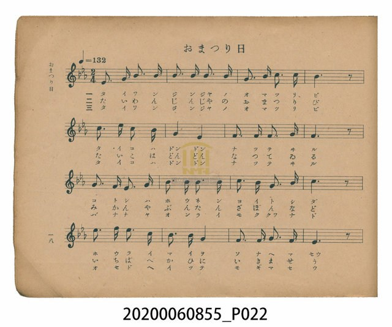
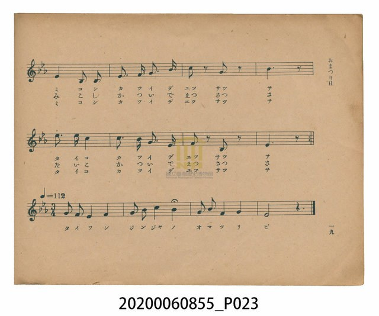
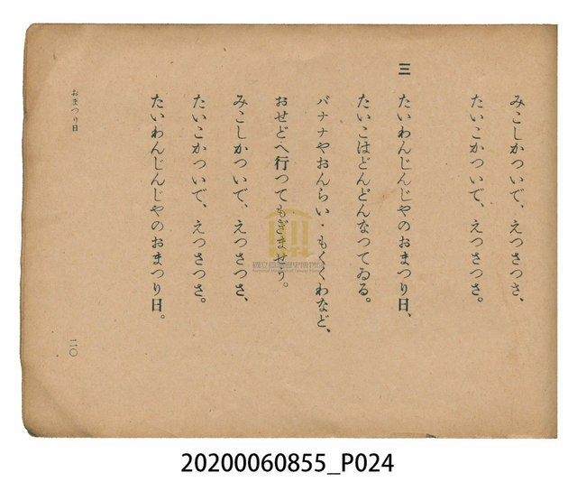
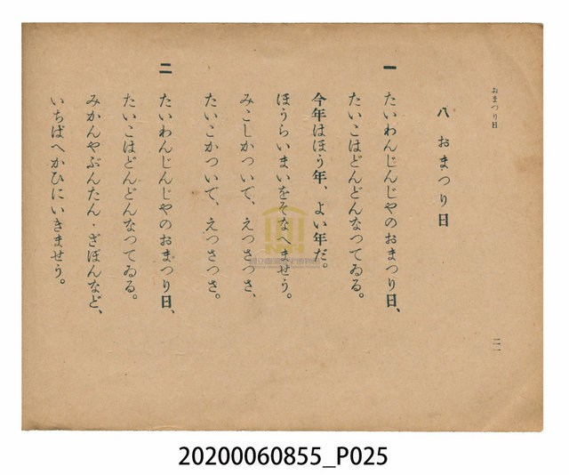

# おまつり日（祭典之日）

> Re:Shoka 使用 AI 辨識樂譜，可能會有錯誤。歡迎回報。

<audio controls src="omatsuribi.mp3"></audio>

- 日治時期公學校唱歌（第三學年・第八課）
- 國立臺灣歷史博物館典藏

## 說明

【曲目說明】
・出處：臺灣總督府編《公學校唱歌》第三學年用，第八課〈おまつり日〉（祭典之日），原書第 18–21 頁。
・調性與拍號：變ホ調（Eb 大調），主歌 2/4 拍（速度 != 132），尾奏轉 3/4 拍（速度 != 112）。
・背景與曲風：描寫秋季「臺灣神社」（たいわんじんじや，原址位於今臺北圓山）大祭之熱鬧景象。
歌詞融入濃厚的臺灣物產特色：第一段獻上豐收的「蓬萊米（ほうらいまい）」，第二段到市場購買
「蜜柑、文旦、朱欒／白柚（みかんやぶんたん・ざぼん）」，第三段到後院採摘「香蕉、鳳梨（おんらい，
臺語『旺來』音譯）、木瓜（もくくわ）」，並穿插抬神轎與抬太鼓「えつさつさ」的吆喝聲。
最具特色的是全曲三段唱畢後，設有一段 4 小節轉為 3/4 拍（!= 112）的莊重尾奏「たいわんじんじやのおまつり日」。
・版本說明：本檔案為原書單聲部簡譜（數字譜）之忠實數位化版本。

・編曲說明（鋼琴伴奏版）：
1. 前奏 (Intro, 4 小節)：引用第六行「たいこかついで、えつさつさ」的頓音與節奏動機，熱鬧開場。
2. 主歌伴奏 (Omatsuribi, 24 小節 × 3 段)：右手 (PianoRH) 演奏充滿附點彈性的祭典旋律，
左手 (PianoLH) 以太鼓般的低音與和弦節奏支撐，並在「えつさつさ」處與右手齊奏斷音呼應。
3. 尾奏 (Coda, 4 小節)：三段歌詞唱畢後，依原譜轉為 3/4 拍（!= 112），以寬廣莊重的三拍子和聲收束全曲。

## 跨冊／重複收錄參照

> 同曲（《公學校唱歌》與《新定兒童唱歌》第三學年共用教材）

- **[同曲]** 《新定兒童唱歌》尋常科第三學年用（2020.006.0847.0003）：[**〈お祭日（祭典之日）〉**](../../../shintei_jido_shoka/grade_3_2020.006.0847.0003/2_04_omatsuribi/index.md)（`Eb` / `2/4` — [原始 TMD](../../../shintei_jido_shoka/grade_3_2020.006.0847.0003/2_04_omatsuribi/omatsuribi.tmd)）
- 總表：[跨冊重複與同名歌曲總索引](../../../duplicate_songs.md)

## 歌詞

```text
一　たいわんじんじやのおまつり日、
たいこはどんどんなつてゐる。
今年はほう年、よい年だ。
ほうらいまいをそなへませう。
みこしかついで、えつさつさ、
たいこかついで、えつさつさ。

二　たいわんじんじやのおまつり日、
たいこはどんどんなつてゐる。
みかんやぶんたん・ざぼんなど、
いちばへかひにいきませう。
みこしかついで、えつさつさ、
たいこかついで、えつさつさ。

三　たいわんじんじやのおまつり日、
たいこはどんどんなつてゐる。
バナナやおんらい・もくくわなど、
おせどへ行つてもぎませう。
みこしかついで、えつさつさ、
たいこかついで、えつさつさ。

（尾奏：たいわんじんじやのおまつり日）
```

## ABC

```abc
X:1
T:おまつり日（祭典之日）
M:2/4
L:1/16
Q:1/4=132
K:Eb
V:V1 name="Piano" snm="Pia"
[V:V1]
E3 G B3 B | B3 B B3 B | G3 B c3 c | B6 z2 |
c3 e c3 B | G4 E4 | F3 F F3 G | F6 z2 |
G3 F E3 G | B3 B B3 B | c3 B G3 B | c6 z2 |
e3 f e3 c | B3 B G4 | F3 F G3 F | E6 z2 |
G4 E2 E2 | G3 A B3 e | c2 z2 B2 z2 | B6 z2 |
e3 e c4 | c3 B G3 F | F2 z2 B,2 z2 | E6 z2 |
[M:3/4] [Q:1/4=112] G2 F2 E4 F4 | G2 B2 c4 B4 | G2 B2 F4 G4 | E8 z4 |
```

## TMD 檔案連結

- [主旋律 TMD 檔案](omatsuribi.tmd) [[在 TMD Studio 編輯](https://tmdlang.github.io/Tmd-TS/#tmd=s7IKdvYPcrWy4qpTUCpJTLdSSM7PyUlNLsnMz7PKzk9PzM7Ojy_OyM9OVIKrKMvPKc1NtUovSkxJjTdGiBfnlxYlp1oVJ2fk5-fEl6RWlCTl52cj5AuK8stS8xLzgGoKijLzSlJTwIoQClLLMlNSQdKpKZkl-UWZiTlIlqYWFYPcBLEkvqQoMa84uSizAORQhKqSjFSgy9JSi0syy0C6tbQUHjd2PW7c97hxyeOmrmfTl77f0_F86dqnrTue7OwGczsVtLS4FG0VDI2NuOxtFVyTuGyM9E3sQEYC5Z9t2v1sZtOzOfOftq55unbHswULn07Z-GxtD8iYNWue7OgECj7dueVx824g92nr6herNgGNBDvo6Zzu56u7X7Tvet64-Nna7U_7Nz3tnfW8c-XLJSuA1r-Y3q_ExaWvpWBLLcCloKDwuGHCs9mbns9e92LVqmcz-h43TASLNu9-2r7rxcyp7_fMgrjn-Y69z-cufrprzvPtKx43dKF57nFDN7Lnnk9Z8X5PD9x_jxs60ML0cUMnZrACtTztm_9s9g6gRgVDi0cNk40MFV4uaHzc0AR104tV-581LH_R0f6su_fFzPkgx63retw8GygONM41SeHpkuVgNsisJzt2A12mAIwaBaByoPzLhvlPdy1TgMQc1L4N-54u7X-xt1PBGJsyQ5AyJOube57NXA-yfvaml4uAXpz1rL__6frVz5d3P127-HFDDzSols57vmTf4waQYY8b5z9ubHnc1P-4afLjxhkwsgXi16dzG57s7X02bc-T3V1AvU97pj-dM_npxo1AW4E-AQYPMGyet218uWY5yN6NC6FOUVAAeuzFynkv5vU-bV36bH_z075Zz2e1QG3vXPl8yqLnnTtfdAIT1ixwtDQ8W7f1ee_uJzu6Xmyc8GzKNqBikGsnr3kxoev5xs1gd-5-3Nj2uKkT5FpQRAFdCPQ50AugaHyyqwdowtOODU93ND1dsOXF5j0vNm2HuARkzpw5z-ZPfNzQ-Gxa-7Ppy0CMORufrZn0fk__85l7n82fBTZ__-PGbpD3m4DmbwOHw3wQ2Qy0d9rjxj1ANoqNOzqhNu7reTlz0bO-hc8mzgDa9XLZzBdTgcoaX27e_AwUBeCUBTIW5HKgXoirgEHxYtW8xw19z6bverKv7XFD_8v5m1-sXQ-2Aui8Fc8nzwHpbWp63NgPQk39cNuf7Fj2fOX-Z_2TnnWtAUbli719oBjvWvN0yaqXeyYD3fC4EWjpkseNU6FkQy8wPJ9OaHs6be6LRmBih8XRnIanrdshEQFU8GzG-qetK4ApB-q1KRufT10E9B3Qxhcr1j6b0wmJJgUThacb-p-vbwAmyudNu5DSJTxBgqK6r-tley8k9YJdhD2VPW5ch5HxehHp-Xlnx7M5ayAZH5SY56x5tmrKs4UdQHshGfHptHVAH71sXvF8w8IXa0Eh9mzqjqdrp4PZncDE-XT_gqfrlwEFgcn4ac80iIEgC6BFC8QYSGoF-X5aOzAsn-xYC2KsmgeMEGB5AzT16YbeZ-2dCpm5iempxnpZBanpCmoQngmEp68QYGBkAiwRgJQp0Gqw-cAAe9zQQIrfG8HOgmhoBKpb_7hxJVgDhFwFjtBlj5smPG7qhgYTMGeCSmuQUlAOAbEbGh83AVNAC1h8ASw4MTLQ46ZJjxvngk3dARaZDVIAUw3MDkAbp4MyBchSoJ7lIIPRkxa6i_GrBpsNDE9I2CLKbnCBBEw2qAVuDyRFP500C4TmbHg5f__Thu4nO3qfNs4BmgXxOTDZAssMiLefLt0LZDxtWwPKJfvaoCUKrBR5OgHopiZgRnmxdTsk34CsmLH_6cRlEPL9ntkQWYi9aLJAvfCI3QWsUGgdscSUSGCdK-HGA9UtfNy4ARyfwIjY9LhxNViwdyhGL1qpDcyXsMIaWAI2gGKpbze0uN-0_ensecAIp2IM7wAWtjSP4eYJj5uBzQNg_QDUg6glQDGMVPCjRTLQXmBMrgRG8ouFwIIVYipQdd9QjGS06hJUkUHrvh5Q3bqxG1gBPZs35-mcScDYBtawT3Z0UzWewWU7qJIC-oP42AbpBmqmvIELBQpa-lxc_rmJJcWlRZlJmVYBmYl5-Q41BjUK1eCq2sZCyw7MwNa4VoC0oICJQUEDVjfrQConpLrJSBOLTqC1UFOBBlgpPG7aD0oITUuAKXM9OH1uVqgB8ndA2UDW42aQZB9YeBVYeB4Qt4BZq0CizZPBbQsQQDJ9Vw_Q9Mb5kEIKqLUfbM9kkIbGGVA2JLCB1DqwcBdY8T4gXgJW0AUW3YzN9B2dtHJ7jYKGoYKuroKxpqqGrq6mgoYpiGcK5QFlUfgYssYosmYgnhlcFqgYCA0UasAJEXfU7uqhbtQ2gcLwcXM_2MedoLABcaEMkBg45IHh8ri5DczaABZdTUS8NoICEFj0gaMKVO6BuVAGSAwc7MAIBZZZYOdMAEdGNxGRSi1XA2MFHA-GcSjRgog0YJwpAOMcpNAIJGMEUwfmwRJCjQKQS1T07eikSvRB_NsBZG1HCojZ4OBZBmT1gkXBab55BSzQgOpBrO1g0QbcEQgO5cZucDYEaWgBR9Y2MBuUMcERDM2u08Bq98DUAqMUHNk4o7B5AthlXfAoWoKUAYH5shmkFeRakBsXgdnrQRiUjUFawPGNJRbBeQseOSi5lGC-RIly1FxaowCUJCZin86eTY2IRYpC5ICYB4_CTWB_g4JsLzwgwUUmUA1IFNhUAOUlrPEKLtsaFwLxBjBrBziuQNkN2DgEYkjuAIlBVPaCS1wQazZYFJSTsMcqJP6adkMjB-QkkGOWIHIgzGhonK6De2o3WCXMzShFbRw4TuE5E8JHlJio8QjKqBiZFCVV1IAzMlFl7BRscWmEFJnGmJGJGZegfALyIqi6AWVTkEdBYQwOFWBsgljtYNEV0IqnaSuEARLbii20ERkUFC2gzDgdGmWQaASVpZDIWw4WBTXWwFxQew2qcirOaKS2i2HFpyE8h5qg5EF4qQvKZgbAKhAYNcRWhE9b11IjktCqFCpGEmo1SL1IoraL4TkNHhugIg97sYjISkag-IoHRxixuWpHMzjCIA1s-LgRwXhDCgCgVkgAoDbsIB7bAalAEA07iPAqcEmDaNhBSiGMpl01ZLiqVqHaBjiEZVcLT79GYP-BqncQzxQcOKAkCuGBxCElDyQUQOEA5HHVcnHp2ikg2vAgnjIXFwA)]
- [鋼琴伴奏 TMD 檔案](omatsuribi_piano.tmd) [[在 TMD Studio 編輯](https://tmdlang.github.io/Tmd-TS/#tmd=s7IKdvYPcrWy4tLSUnjc2PW4cd_jxiWPm7qeTV_6fk_H86Vrn7bueLKzG8h93Lz7Zfee5xO2PNmz5enS_uedHe_3dCpoaXEp2ioYGhtx2dsquCZx2Rjpm9hx1SkoAXU827T72cymZ3PmP21d83TtjmcLFj6dsvHZ2h6QwWvWPNnRCRR8unML0GAg92nr6herNgGNVALpfjqn-_nq7hftu543Ln62dvvT_k1Pe2c971z5cskKoINeTO9X4uLS11KwpRbgUlBQeNww4dnsTc9nr3uxatWzGX2PGyaCRZt3P23f9WLm1Pd7ZkHc83zH3udzFz_dNef59hWPG7rQPPe4oRvZc8-nrHi_pwfuv8cNHWih_LihEy2ggWEA1PK0b_6z2TuAGhUMLR41TDYyVHi5oPFxQxPUTS9W7X_WsPxFR_uz7t4XM-eDHLeu63HzbKA40DjXJIWnS5aD2SCznuzYDXSZAjBqFIDKgfIvG-Y_3bVMARJzUPs27APG6ou9nQrG2JQZgpQhWd_c82zmepD1sze9XAT04qxn_f1P16-GhtDSec-X7EP209Mlq17umfx02vKnS1Y-bmh83rv7yY6uF5PXvJjQ9XzjZqA5EI1P56x4OmfDsw1bns2bA7T_xZw5z-ZPBKp_Nq392fRlII0z9z6bPwvIeLls5oupQAc1vty8-dkiYDw0Ppuz4vlkoK5OkBMVFJ7sXvq0v-tZ1xqgY17sBcZmz-NGYNgvedw4FUo29D6f1fJs7cKXKzaA_LJxIcJ7wJgFegySDkDhgJHugR6GWGOop_C0sxcorqDhmVdSlK-jYKLwdEP_8_UNmkA1T_dMBSYAcOyvfbEQmDaAjpj_uLHlcePkx43dYHcA2cuBrsfquJcLJr-cDwodoHFAK552T322EhjVPc_bNr5cs_zltO6nC7ZAHa2gYKSnAIlniDsVNPxzE0uKS4sykzJ1FIxgrlI4PF3BWOHZuq1g5_VvftbZraARkJmYlx_koanwbM8UkD2trc927385s-Xl7nlP93YA0xnQLZDYfDa9--m-bqATIHYCwdPtyxBm-ADNAAU8OLZfdKwB6nuytw_ih6eTep7uWQbxybMp659NmgBOmcuAcY41coBZDqQL7MSXe7tAuqZtBxr1dOKeZ-2wpKigYAyMAHDSVdBwzk9JRA1_YDYEehUYJi9WzgNmz-dTFz3dByx-ep7smwvMXy_WzgGm9-dNu5CSPDytg1QBfbJ-zdPdi1_0db1sB0UIyLzu3qdrJwA986Jx07Mp257NBZZuoMQCchC0FIFkXaitQMlp7UCPPNmxFsRYNe_F2vXAogVo1dMNvUCPKGTmJqanGutlFaSmK6hBeCYQnr5CgIGRCTDzAylTUMIGmf9kR8PjhgZoMmrqf9wETEkzYCQwMa3DKF8awc5CpLv1jxtXgjVAyFXgEF_2uGnC46ZuaLA-2d0FKphBSnc_bmwDsYFJtAkYRS1g8QWwrAKWftzUCTYbaCnQSZMeN84Fm7oDLDIbpACmej_YAdMJpX10F-NXDTYbVFqAwxZRTEMKIVjKhZWtPdCiaNIsEJqz4eX8_U8bup_s6H3aOAdoFsTnz2YAy4MJEG8_XboXyHjatgacbtrQiq6nE4BuagIWMy-2boeUNCArZux_OnEZhHy_ZzZEFmIvmixQLzxidwHLB1pHLDgKukHSICO3gdXNB5HNwIic9rhxD0wnqJSGaACqW_i4cQM4PoERselx42qwYO9QjF60GgVUtIJrFHBR1ACKpb7dT3c0AcvVF5u2P509DxjhVIzhHcBii-Yx3DzhcTOwJdAFNhJIAqManD2BMdzU9LixH4SAlqNGMtBeYEyuBEYyqJqCmgpU3TcUIxmtbQBqpUDbBj1POzY83QiswnqADYyncyYBY_vZxBlPdnRTNZ7BZTuoSgL6g_jYhrZcKG_LQoGClj6FbWSQc1AaN5pW8NpVQQPamtSE1BdLITEECRpwfY6UUIGVOTAOiGuKQZs6G6cCmzeUhQc4AMDutoI2cBxqDGoUqsHtBhsLLTswo0ZBwzBOQVdXwTBOU1VDV1dTwUxBFyQKpHQVTKFiGsYgnhGUV6NgpGCgYBoPJGoUDIHKdUEsrloU63xwWGcSrxBtEgujgPqBDMNYBTMgZZYLEjACmQszHCIJwlAbKI5RSCMR2CxCbiECYxbRRESJWkgDDNhIgnRvQLphbUBI0w8ohRz3kFbfsy27n-2dCGmJUiEWEQ7FF5XYgkYB3BlrAJZqChowD-pAWllIjSwjTSw6gRZDTQUaYKXwuGk_qERrWgIsYteDC9rNwAh63LQDygayHjeDJPvAwqvAwvOAuAXMWgUSbZ4MazYjm76rB2h643xIbQvU2g-2ZzJIQ-MMKBtSagCpdWDhLrDifUC8BKygCyy6GZvpOzpp5XZQ1gFlC2NYJjFFzjJAWRQ-hiw4S8FlwdnNDC4LVAzNVfijdlcPdaO2CRSGj5v7wT7uBIUNiAtlgMTAIQ8Ml8fNbWDWBrDoaiLitREUgMA6HBxVoHIRzIUyQGLgYAdGKLDyBTtnAjgyuomIVGq5GlbswctC1FKwBth1BEpCykcj5BIRwoMlBFD5SFz07eikSvRB_NsBZG1HCojZ4OBZBmT1gkXBab55BSzQgOpBrO1g0QbcEQgO5cZucDYEaWgBR9Y2MBuUMcERDM2u08Bq98DUAqMUHNk4o7B5AthlXfAoWoKUAYH5shmkFeRakBsXgdnrQRiUjUFawPGNJRZRqivUXEowX2Kp-BCyoMqRiIh9Ons2NSIWKQqRA2IePAo3gf0NCrK98IAEF5lANSBRYJsXlJewxiu4bGtcCMQbwKwd4LgCZTdgLweIIbkDJAZR2QsucUGs2WBRUE7CHquQ-GvaDY0ckJNAjlmCyIEwo6Fxug7uqd1glTA3oxS14FaKETxnQviIEhM1HkEZFSOTojViEC0XAmXsFGxxaYQUmcaYkYkZl6B8AvIiqLoBZVOQR0FhDA4VYGyCWO1g0RXQiqdpK4QBEtuKLbQRGRQULaDMOB0aZZBoBJWlkMhbDhYFtTrBXFDDE6pyKs5opLaLYcWnITyHmqDkQXipC8pmwCYguAVIZEUIGWCkOJLQqhQqRhJqNUi9SKK2i6nbH0BvuGLvFBDbcMVTZMK7CkBXgCicfPR-B8TVpLWy8LqDmP5NtBGQBaOBaRzIMiXSKWgtBoqCBOpGqDAw10HdCKRJruEoCxNECIAouAIgRXLxTGmIGEBtJSVW0EsfihMIegcYGhDU6P9ChmbA_V_QhAHKmAbS9JcOdNoLMr6Bax4B9wzBk71znm-dQIW-L8iR5PV6m8FxAp0dIbpiQCphgVohJSxqzxFScu6AtFARPUeI8CpwUwbRc4Q0czD6jtWQ0K1VqLYBBrhdLbyCNAIXoKD-A4hnCi59QXUghAcShzRtIMUsqKAF8kAJAxFO2AtZHDYCU5YuOIkBrQExYSLApAkThwqBpUE5AqEILA13ga6dAnj8RwHIQBT8hHggd4NoZS4uAA)]

## 分析

```text
================================================================================
📊 TMD Song Profile: [ おまつり日（祭典之日） ]
================================================================================
⏱  Duration:       0:28 (28.2s), 28 measures total
🎼 Key & Tempo:    首調基準 E,, != 132.0 BPM, <2/4>
   - 分析範圍：      由實際發聲的音符與和弦推測調性；播放脈絡另行呈現
🎤 人聲音域:    A#3 (MIDI 58) – F5 (MIDI 77) [跨度: 19 個半音 / 1.6 個八度, 難度: challenging]
   - 最低音:  A#3 in [Omatsuribi #1 @ m.23, 0:20]
   - 最高音: F5 in [Omatsuribi #1 @ m.13, 0:11]
   - 適合: soprano, mezzo-soprano, contralto, tenor, baritone, bass
🏛  結構:      Omatsuribi (28.2s)
⚡ 編曲密度:        Peak 1 軌道同時演奏
🗝  調性診斷：       D# 大調（純淨自然大調，未偵測到可信轉調）
   - 風格氣質:    純淨自然大調（陽光明朗、易唱易記，無明顯調外色彩）
   - 轉調歷程:    全曲維持單一推測調性（未偵測到可信轉調）
   - 核心骨幹音:  A#, D#, G, C, F
   - 調性數值:    D# 大調 [相關度: 0.85, 穩定度: Moderate, 自然音純度: 100.0%]
   - 候選調性 (K-S): D# 大調 (0.85), A# 大調 (0.76), G 小調 (0.66)
   - 五度圈歷程:   -3
   - 各段落調性細節:
     • [Omatsuribi #1]: D# 大調 (r: 0.85, 自然音純度: 100.0%)

  [ 五度圈游移軌跡 ]
               C  
         F            G  
      Bb               D  
     [Eb]*              A  
         Ab           E  
            Db       B  
               F# 
     (* = active key center)

  [ 十二半音累積音高分佈 ]
     C  : ██████████████            15.3%
     C# :                            0.0%
     D  :                            0.0%
     D# : █████████████████████     23.1%
     E  :                            0.0%
     F  : ██████████████            15.3%
     F# :                            0.0%
     G  : ██████████████████        19.9%
     G# :                            0.5%
     A  :                            0.0%
     A# : ████████████████████████  25.9%
     B  :                            0.0%
--------------------------------------------------------------------------------
Assignment 軌道音域：
  - Piano         : A#3 – F5 (19 個半音 / 1.6 個八度, 82 個音符)
================================================================================
```


## 原書掃描頁










