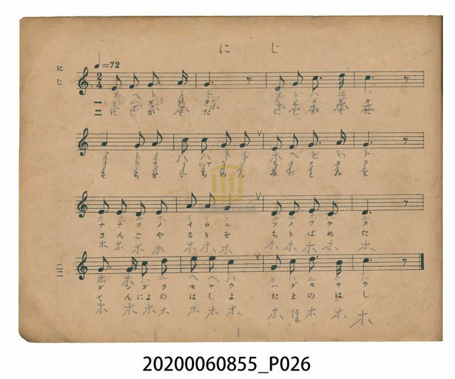
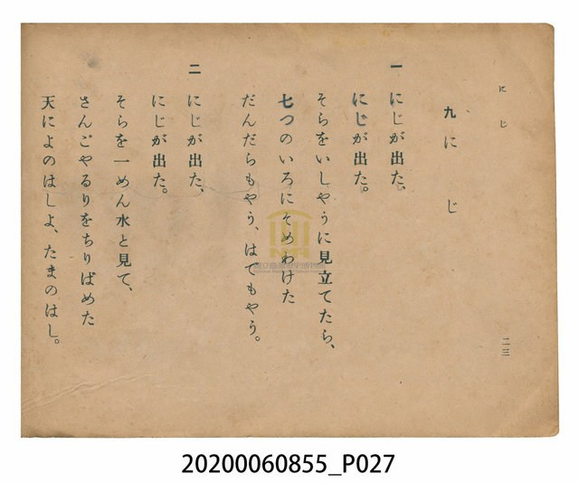

# にじ（彩虹）

> Re:Shōka 使用 AI 協助辨識與重建樂譜，可能會有錯誤。歡迎回報。

- **鋼琴伴奏版**：<br><audio controls src="niji.mp3"></audio>
- **NEUTRINO 歌聲合成版**：<br><audio controls src="niji_neutrino.mp3"></audio>

- 日治時期公學校唱歌（第三學年・第九課）
- 國立臺灣歷史博物館典藏

## 說明


- 出處：臺灣總督府編《公學校唱歌》第三學年用，第九課〈にじ〉（彩虹），原書第 22–23 頁。
- 調性與拍號：ハ調（C 大調），2/4 拍，速度 != 72。
- 背景與曲風：描寫雨後天空中浮現絢麗的七彩長虹。第一段將天空比作衣裳（いしやう），染上七彩條紋
（だんだらもやう、はでもやう）；第二段將天空比作汪洋水面，鑲嵌著珊瑚與琉璃（さんごやるり），
化為天女走過的玉橋（天によのはしよ、たまのはし）。開頭兩句「にじが出た」由五度音域（3–5–6–5）
推升至高音八度（3–5–1^–2^–1^），第四行更攀升至高音 Mi（3^），宛如虹橋橫跨天際的壯麗弧線。
- 版本說明：本檔案為原書單聲部簡譜（數字譜）之忠實數位化版本。

### 編曲說明（鋼琴伴奏版）：

1. 前奏 (Intro, 4 小節)：以「にじが出た」的上行拱形動機展開，勾勒彩虹升起的光彩。
2. 主歌伴奏 (Niji, 16 小節 × 2 段)：右手 (PianoRH) 演奏橫跨至高音 3^ 的寬廣旋律；
左手 (PianoLH) 以八分音符低音與和弦溫柔擺動，襯托徐緩優雅的 2/4 拍抒情曲風。


## 歌詞

```text
一　にじが出た、
にじが出た。
そらをいしやうに見立てたら、
七つのいろにそめわけた
だんだらもやう、はでもやう。

二　にじが出た、
にじが出た。
そらを一めん水と見て、
さんごやるりをちりばめた
天によのはしよ、たまのはし。
```

## ABC

<div class="abc-score" data-abc-src="niji.abc" aria-label="五線譜載入中"></div>

[下載 ABC 原始檔](niji.abc)

## TMD 檔案連結

- [主旋律 TMD 檔案](niji.tmd) [[在 TMD Studio 編輯](https://tmdlang.github.io/Tmd-TS/#tmd=s7IKdvYPcrWy4qpTUCpJTLdSSM7PyUlNLsnMz7PKzk9PzM7Ojy_OyM9OVIKrKMvPKc1NtUovSkxJjTdGiBfnlxYlp1oVJ2fk5-fEl6RWlCTl52cj5AuK8stS8xLzgGoKijLzSlJTwIoQClLLMlNSQdKpKZkl-UWZiTlIlqYWFYPcBLEkvqQoMa84uSizAORQhKqSjFSgy_ISS0qLUhGiQKPSM_OscvPzkkqBfkGWKMnIB_qjIKPSKiOzGGRncmJOfHZiHpJ3oTYWJKanWgUYGJkpcWlpKTxuXP24ccb7PR1P9658MXPn-z2dClpaXIq2CuZGXPa2Cs5cNkb6JnYgM55NX_ps0-5nM5uezZn_tHXN07U7ni1Y-HTKxmdre4Dan69Z82RHJ1Dw6c4tj5t3g7g7575YtQloINgFT-d0P1_d_aJ91_PGxc_Wbn_av-lp76znnStfLlnxtHXHi-n9Slxc-loKttQCXAoKCo8bJjybven57HUvVq16NqPvccNEsGjz7qftu17MnPp-zyyIe57v2Pt87uKnu-Y8377icUMXmuceN3Qje-75lBXv9_TA_fe4oQMShI8bOpFDEajmad_8Z7N3AFUqGBk9aphsZKzwckHj44YmqCNerNr_rGH5i472Z929L2bOB7rmcXM_UBBoirPC0yXLwUyQOcAIUACqAbJeNsx_umuZAjh2kAxq7nk2cz3IoNmbXi4Cum7Ws_7-p-tXv5y94um-nqdLVj5fuevJjrXPtq573r_v-dZFL3dNfz6r5cmOZqBjX07dDnQv0CywFxuerdv6dEM7RMuz9VOe7J3zYuHiF4s3A930uLHlceP0x01Asg3irmfzJz_Z0QUx59miuc-3dIMcpKAAVrzgcdNkMNn5uKkJoutxQ-PjxvWPG5fDRcDmzAZZvasH0-pnG1c929L9bMOWl3MXgTw_cdPTrT0vJk5_3t_1fOIsoH-fT-h8PqkZbN1UsHVTQMY2dT9u6oK4EOKepz3TnjftApr8dOnmF1s3vGzsA3r_eV_ns5XdoBhbshIUgU1AQ9aBnQf0YwfYqfMfN-6DCwINBIbSy2ndLxesfdq68mn_0scNPdCYb-wBJiiQ-obe51M2Ptk1BRhJL-dvfjofGKkdxsCoNwViMxANNAXipmd9K572tr9o3_xy9QyQ0tbVQD1Iqg3jQCkGRBjGQfwCDKWns2e_WNjzbPaWZ1MakHUr-GaCtEIVPl03--myJmCsAv33bOXqF9tXAL34ctZsoKefLl4PjPyne5Y_3z4LkX6ed3Y8m7MGkkdAiWfOmmerpjxb2AEKNHASfjpt3YvGTS-bVzzfsPDF2jlAu55N3fF07XQwu_PJzu6n-xc8Xb8MKPhkby8otMEGgiyA5kKIMcC89GLlvKetK55NawfGHihJAhmr5r1Yux6YNUFRsaH3WXunQmYusIQy0ssqSE1X0FcAllTmoGADGQVMoY8bGjBCvRFsDbooxHuNc8FJcBJy8gUqfbEMVBw9blwGUgpUADEDmJYfNy4BxzkwHfWCjQTqb3zc1P-4cSJQKcRIotI21AFAb0G8CAxZSOEAdN-TfW1PdgFTfw-aCFDPi-6lz7q6kLMB0NNPdm-D5cOel02Ln-zb_2zGemD2e9YxAejk5yvWvejcBDQKFMPgrPiiayMwNwLd9KIfFOEwbhM8HHcBSzXywhEUBaAAmQzMl48bVwDDERSIMK3o2RAc8AtBjMYNIG2QECQyy1EUgs-mbnneCS1Ons_pBhUn8IIEFoKQEgWoC61EAYUjuLQAJm1gJno6sQGU__b1QQpOSMkBDU2g-yivq6BAQUufi8svMyvTKiAzMS_focagphpcWthYaNmBGdgqSAVIyQ0sGBQ0TBSebuh_vr5BB5KHkLKQmSYWnUD7QKbWKBgrmChomCroAqGZpqqGrq4mUBDCNwBLmypoGMaB-UZxcAVQEaAKsDE-hjXA0qRb4XHTDgWNx01rwJKPm9tBSh837YebRoQaiHlGQLHG1UA8A6i2sQeitnE5WG3jfIR5hNWAEz3u0NvVQ1HomQEtMQWS4BABIlMgJBSmiBBr2gsOgpVAvAkcCkuAePvj5sVAahk4sEBBNh8cPBqPm9sgXmzaD_YiUBtmkM0FK-gE4kngYGgB4oVAXiMQTwaL7AfipaAAWwENMIhpjcuIDLAdnRQmN2MFIyAGBZ0ZOExqgHyQiCGYhZmquqAY6JXmPlgoNa8FBw9INygUHzcDPdm8HsjeiDM1TQUHAbCEAtItYFWgtAg0GRhUYHPAAQXkN24ABxgJqQhSOZMfKBrGYHuMoWkFmI6M4kBhFQdC4KwGSj5AhgZQHKTSHF9GBKaUBmjm2qwJJBrAaQUUlIuAGJTEQHEN4veD8h9I_SKo-iWQzIhIC7DgA6YXiCAwDIFmgkrwdiC1DhxKwHBvnA6U6YCGIzDBNu4DaVkHTWLrIUlsOtzYWi4uXTsFUHkHtgHIVuYCAA)]
- [鋼琴伴奏 TMD 檔案](niji_piano.tmd) [[在 TMD Studio 編輯](https://tmdlang.github.io/Tmd-TS/#tmd=s7IKdvYPcrWy4qpTUCpJTLdSSM7PyUlNLsnMz7PKzk9PzM7Ojy_OyM9OVIKrKMvPKc1NtTJGiBTnlxYlp-JSX1CUX5aal5gHVFGSmFmemBefDhQoyssvik9PzUstSsxBqE0ty0xJBaksKMrMTSyqjE_JTwZalleCZH1qUTHIdQWZiXn58YlFRYl56amoSvKLSjLy04sSCzIqrTIyi0vyizKTE3PisxPzkJxVkgHUZZWaUpqcCPItum_iCxLTU60CDIzMlLi0tBQeN65-3Djj_Z6Op3tXvpi583Hz7pfde55P2PJkz5anS_ufd3a839OpoKXFpWirYG7EZW-r4MxlY6RvYgcy9dn0pc827X42s-nZnPlPW9c8Xbvj2YKFT6dsfLa2B2jg8zVrnuzoBAo-3bkFaCyIu3Pui1WbgAaC3fR0Tvfz1d0v2nc9b1z8bO32p_2bnvbOet658uWSFU9bd7yY3q_ExaWvpWBLLcCloKDwuGHCs9mbns9e92LVqmcz-h43TASLNu9-2r7rxcyp7_fMgrjn-Y69z-cufrprzvPtKx43dKF57nFDN7Lnnk9Z8X5PD9x_jxs6IIH6uKETHq5ATwPVPO2b_2z2DqBKBSOjRw2TjYwVXi5ofNzQBHXEi1X7nzUsf9HR_qy798XM-UDXPG7uBwoCTXFWeLpkOZgJMgcYAQpANUDWy4b5T3ctUwDHDpJBzT3PZq4HGTR708tFQNfNetbf_3T96pezVzzd1_N0ycrnK3c927ruef--JzuagQ58OWcy2I09T5c1vehf_3LXdJCrFy5-3ND4tL8DKPhy4qanW3ue93c9nzjr-YTO55Oan89qAZrzdOnm532dz1Z2I-wGhhjQVkj4Ah2OmZqArgEpVVAw1FN42tkLFFfQ8MwrKcrXUTBReLqh__n6Bk2gmie7lz5u6IGGZGMPMIIeN85_3NALtPjJjq4XC3uedW98unfR0-6pz1bOf7px6stp3SAPdO972j0JEuZPe9tfbN0OcmhrJ1AE6kQFBSM9hSc7dgPjEeIqBQ2_zKxMHQVDM6jtCoenKxgpPFu3FeSMp_2bn3V2K2gEgHJlkIemwrM9U4Canq1c_WL7ihftm1-unvFy_mYF4zgFkEXr1zzdvfjZ9O6n-4COmQ2xDgiebl-GMMQHaAjQc09bVz_taAPqfb5m2ZO9fUAGML6eTup5umfZs12rn82f8mzyLqDngH56sXT9s84ZT_dNeL595dOWVS9ntwKtUoCmgWddk541t0LiGeRDaCqHpDSgH1-snPe0dcWzae1A05_sWAtirJr3Yu16YNIHJc4Nvc_aOxWARVJ6qpFeVkFquoK-ArBsMAfGE9ioJzsaHjc0YMRCI9gadFFIEmic-7ip83HTpMeNLY8bpz9uApJtQKUvloGy--PGZSClQAUQM4Dp73HjkseN60Cqm3rBRgL1Nz5u6n_cOBGoFGLkgsdNk8Ek0OAmqJENjY8b1z9uXI4kAnYA0FsQL4JiD5IQ2nc92df2ZFcbKIGgigD1vOhe-qyrC5op1k95sncO0NNPdm8Dpv8XizeD8ljT4if79j-bsf7Z_MnPOiYAnfx8xboXnZuARoHifO_KZ4vmvuja-HwLMBc0QrIPjNsED8ddwFKDvHAERQEoQCY_27DlceMKYDiCAhGmdSo4ZKaAQqCp-3FTFzjgF4IYjRtA2iAhCPQdyJYmYMkEDGlgqAHjpQMcgvMfN-5DCFISgs-mbnne2Q4Jx-dzuoHhCHTwy7mLkEMQUo4AdUGKEmCaRCtNnuzsBpYmTyc2gErUfX3AoARKwYsYUGgC3Ud5XQAFClr6FNYx4MBFLsQ0reClmIIGNI9qglQBS-DnO4GZF1oCv5w1G1L2AsMS6DlgMfKsfQcoGFpWAf39dM_y59vBxST5TgN7DuwmK2jh5VBjUFMNLpRsLLTswIwaBWOgezVMFXSB0ExTVUNXVxMoCOIbxgEJEBPI0DACcXQVzOEqwLK6CgYKNVy1KNb4YLfGMF4h2jBWwQRImcQi-GZAyiwXJGAKZJnGwii4AhCGWkJxREFKfWDBDinygVGFKPNR4gpS6D9v2gWp70H6oGV6D6QoB0o929r4bNYiSHSB4m1Sz4vGTZAahQrxBnIfnmjDFhQK4DZJA7BmVNCAJUEdSNGOVLKbaWLRCbSRQGIAxzRQ2lRBAxrzRnHY0gLIGB_DGmBDoFvhcdMOBY3HTWvAko-b20FKHzfth5tGhBqIeUZAscbVQDwDqLaxB6K2cTlYbeN8hHmE1YDLYtyht6uHotAzA1piCiTBIQJEpkBIKEwRIda0FxwEK4F4EzgUlgDx9sfNi4HUMnBggYJsPjh4NB43t0G82LQf7EWgNswgmwtW0AnEk8DB0ALEC4G8RiCeDBbZD8RLQQG2AhpgENMalxEZYDs6KUxuxsCWljE46MzAYVID5INEDMEszFTVBcVArzT3wUKpeS04eEC6QaH4uBnoyeb1QPZGnKlpKjgIgBUnkG4BqwKlRaDJwKACmwMOKCC_cQM4wEhIRU9nz6YoUDSMwfYYQ9MKMB0BC19gWMWBENGFMizIgCmlAZq5NmsCiQZwWgEF5SIgBiUxUFyD-P2g_AdSvwiqfgkkMyLSAiz4gOkFIggMQ6CZoIZFO5BaBw4lYLg3TgfKdEDDEZhgG_eBtKyDJrH1kCQ2HW4ssGhHFHdYqw9iizu84YqjBgJVOEAKhY9cAcHkSSs68LoE6gRCLoHLI6pGknMkMSECtxdqIVQYmAGBDCNg5YytkiY5G5DkEpiNWIIAV-tA104B3AoBmwjkgJJUtI9hLCrfCM5X5gIA)]

## 分析

```text
================================================================================
📊 TMD Song Profile: [ にじ（彩虹） ]
================================================================================
⏱  Duration:       0:26 (26.7s), 16 measures total
🎼 Key & Tempo:    首調基準 C, != 72.0 BPM, <2/4>
   - 分析範圍：      由實際發聲的音符與和弦推測調性；播放脈絡另行呈現
🎤 人聲音域:    C4 (MIDI 60) – E5 (MIDI 76) [跨度: 16 個半音 / 1.3 個八度, 難度: moderate]
   - 最低音:  C4 in [Niji #1 @ m.11, 0:17]
   - 最高音: E5 in [Niji #1 @ m.14, 0:21]
   - 適合: soprano, mezzo-soprano, contralto, tenor, baritone, bass
🏛  結構:      Niji (26.7s)
⚡ 編曲密度:        Peak 1 軌道同時演奏
🗝  調性診斷：       C 大調（純淨自然大調，未偵測到可信轉調）
   - 風格氣質:    純淨自然大調（陽光明朗、易唱易記，無明顯調外色彩）
   - 轉調歷程:    全曲維持單一推測調性（未偵測到可信轉調）
   - 核心骨幹音:  G, C, E, D, A
   - 調性數值:    C 大調 [相關度: 0.90, 穩定度: High, 自然音純度: 100.0%]
   - 候選調性 (K-S): C 大調 (0.90), G 大調 (0.78), E 小調 (0.65)
   - 五度圈歷程:   +0
   - 各段落調性細節:
     • [Niji #1]: C 大調 (r: 0.90, 自然音純度: 100.0%)

  [ 五度圈游移軌跡 ]
              [C ]*
         F            G  
      Bb               D  
      Eb               A  
         Ab           E  
            Db       B  
               F# 
     (* = active key center)

  [ 十二半音累積音高分佈 ]
     C  : ██████████████████████    24.6%
     C# :                            0.0%
     D  : ██████████████            15.3%
     D# :                            0.0%
     E  : █████████████████         18.6%
     F  : ███                        3.4%
     F# :                            0.0%
     G  : ████████████████████████  27.1%
     G# :                            0.0%
     A  : █████████                 10.2%
     A# :                            0.0%
     B  : █                          0.8%
--------------------------------------------------------------------------------
Assignment 軌道音域：
  - Piano         : C4 – E5 (16 個半音 / 1.3 個八度, 46 個音符)
================================================================================
```


## 原書掃描頁






