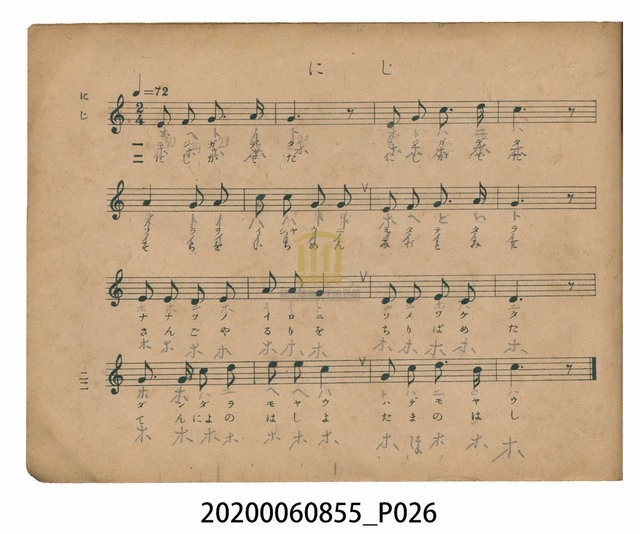
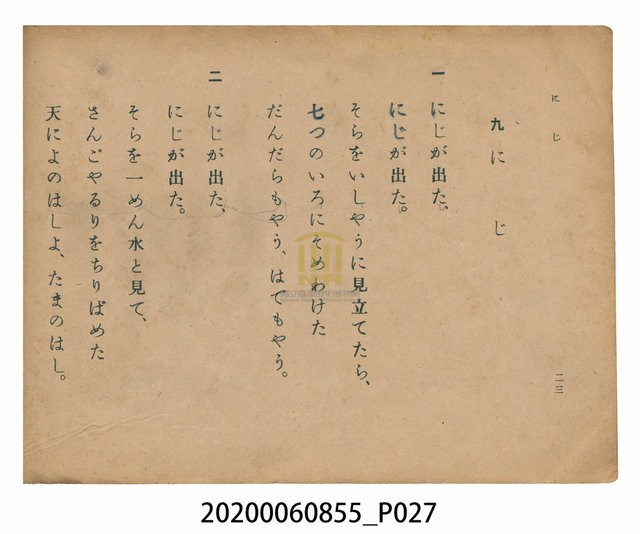

# にじ（彩虹）

> Re:Shōka 使用 AI 協助辨識與重建樂譜，可能會有錯誤。歡迎回報。

- **NEUTRINO 歌聲合成版**：<br><audio controls src="niji_neutrino.mp3"></audio>
- **鋼琴伴奏版**：<br><audio controls src="niji.mp3"></audio>


- 日治時期公學校唱歌（第三學年・第九課）
- 國立臺灣歷史博物館典藏

## 說明


- 出處：臺灣總督府編《公學校唱歌》第三學年用，第九課〈にじ〉（彩虹），原書第 22–23 頁。
- 調性與拍號：ハ調（C 大調），2/4 拍，速度 != 72。
- 背景與曲風：描寫雨後天空中浮現絢麗的七彩長虹。第一段將天空比作衣裳（いしやう），染上七彩條紋
（だんだらもやう、はでもやう）；第二段將天空比作汪洋水面，鑲嵌著珊瑚與琉璃（さんごやるり），
化為天女走過的玉橋（天によのはしよ、たまのはし）。開頭兩句「にじが出た」由五度音域（3–5–6–5）
推升至高音八度（3–5–1^–2^–1^），第四行更攀升至高音 Mi（3^），宛如虹橋橫跨天際的壯麗弧線。
- 版本說明：本檔案為原書單聲部簡譜（數字譜）之忠實數位化版本。

### 編曲說明（鋼琴伴奏版）：

1. 前奏 (Intro, 4 小節)：以「にじが出た」的上行拱形動機展開，勾勒彩虹升起的光彩。
2. 主歌伴奏 (Niji, 16 小節 × 2 段)：右手 (PianoRH) 演奏橫跨至高音 3^ 的寬廣旋律；
左手 (PianoLH) 以八分音符低音與和弦溫柔擺動，襯托徐緩優雅的 2/4 拍抒情曲風。


## 歌詞

```text
一　にじが出た、
にじが出た。
そらをいしやうに見立てたら、
七つのいろにそめわけた
だんだらもやう、はでもやう。

二　にじが出た、
にじが出た。
そらを一めん水と見て、
さんごやるりをちりばめた
天によのはしよ、たまのはし。
```

## ABC

```abc
X:1
T:にじ（彩虹）
M:2/4
L:1/16
Q:1/4=72
K:C
V:V1 name="Piano" snm="Pia"
[V:V1]
E2 F2 G3 A | G6 z2 | E2 G2 c3 d | c6 z2 |
w: 1.~ニ ジ ガ デ | タ | ニ ジ ガ デ | タ
w: 2.~に じ が で | た | に じ が で | た
A4 G2 A2 | c2 c2 G2 G2 | E2 F2 G3 A | G6 z2 |
w: 1.~ソ ラ ヲ | イ シャ ウ ニ | ミ タ テ タ | ラ
w: 2.~そ ら を | い ち め ん | み づ と み | て
E2 E2 D2 E2 | A2 A2 G4 | D2 D2 E2 C2 | D6 z2 |
w: 1.~ナ ナ ツ ノ | イ ロ ニ | ソ メ ワ ケ | タ
w: 2.~さ ん ご や | る り を | ち り ば め | た
E3 E c2 d2 | e2 e2 c4 | G2 c2 d3 B | c6 z2 |
w: 1.~ダ ン ダ ラ | モ ヤ ウ | ハ デ モ ヤ | ウ
w: 2.~て ん にょ の | は し よ | た ま の は | し
```

## TMD 檔案連結

- [主旋律 TMD 檔案](niji.tmd) [[在 TMD Studio 編輯](https://tmdlang.github.io/Tmd-TS/#tmd=s7IKdvYPcrWy4qpTUCpJTLdSSM7PyUlNLsnMz7PKzk9PzM7Ojy_OyM9OVIKrKMvPKc1NtUovSkxJjTdGiBfnlxYlp1oVJ2fk5-fEl6RWlCTl52cj5AuK8stS8xLzgGoKijLzSlJTwIoQClLLMlNSQdKpKZkl-UWZiTlIlqYWFYPcBLEkvqQoMa84uSizAORQhKqSjFSgy_ISS0qLUhGiQKPSM_OscvPzkkqBflHi0tJSeNy4-nHjjPd7Op7uXfli5s73ezoVtLS4FG0VzI247G0VnLlsjPRN7EBGPJu-9Nmm3c9mNj2bM_9p65qna3c8W7Dw6ZSNz9b2ALU_X7PmyY5OoODTnVseN-8GcXfOfbFqE9BAsAOezul-vrr7Rfuu542Ln63d_rR_09PeWc87V75csuJp644X0_uVuLj0tRRsqQW4FBQUHjdMeDZ70_PZ616sWvVsRt_jholg0ebdT9t3vZg59f2eWRD3PN-x9_ncxU93zXm-fcXjhi40zz1u6Eb23PMpK97v6YH773FDByQIHzd0IociUM3TvvnPZu8AqlQwMnrUMNnIWOHlgsbHDU1QR7xYtf9Zw_IXHe3PuntfzJwPdM3j5n6gINAUZ4WnS5aDmSBzgBGgAFQDZL1smP901zIFcOwgGdTc82zmepBBsze9XAR03axn_f1P169-OXvF0309T5esfL5y15Mda59tXfe8f9_zrYte7pr-fFbLkx3NQMe-nLod6F6gWWAvNjxbt_XphnaIlmfrpzzZO-fFwsUvFm8GuulxY8vjxumPm4BkG8Rdz-ZPfrKjC2LOs0Vzn2_pBjlIQQGseMHjpslgsvNxUxNE1-OGxseN6x83LoeLgM2ZDbJ6Vw-m1c82rnq2pfvZhi0v5y4CeX7ipqdbe15MnP68v-v5xFlA_z6f0Pl8UjPYuqlg66aAjG3qftzUBXEhxD1Pe6Y9b9oFNPnp0s0vtm542dgH9P7zvs5nK7tBMbZkJSgCm4CGrAM7D-jHDrBT5z9u3AcXBBoIDKWX07pfLlj7tHXl0_6ljxt6oDHf2ANMUCD1Db3Pp2x8smsKMJJezt_8dD4wUjuMgVFvCsRmIBpoCsRNz_pWPO1tf9G--eXqGSClrauBepBUG8aBUgyIMIyD-AUYSk9nz36xsOfZ7C3PpjQg61bwzQRphSp8um7202VNwFgF-u_ZytUvtq8AevHlrNlATz9dvB4Y-U_3LH--fRYi_Tzv7Hg2Zw0kj4ASz5w1z1ZNebawAxRo4CT8dNq6F42bXjaveL5h4Yu1c4B2PZu64-na6WB255Od3U_3L3i6fhlQ8MneXlBogw0EWQDNhRBjgHnpxcp5T1tXPJvWDow9UJIEMlbNe7F2PTBrgqJiQ--z9k6FzNzE9FQjvayC1HQFfYUAAyNzULCBjAKm0McNDRih3gi2Bl0U4r3GueAkOAk5-QKVvlgGKo4eNy4DKQUqgJgBTMuPG5eA4xyYjnrBRgL1Nz5u6n_cOBGoFGIkUWkb6gCgtyBeBIYspHAAuu_JvrYnu4CpvwdNBKjnRffSZ11dyNkA6Oknu7fB8mHPy6bFT_btfzZjPTD7PeuYAHTy8xXrXnRuAhoFimFwVnzRtRGYG4FuetEPinAYtwkejruApRp54QiKAlCATAbmy8eNK4DhCApEmFb0bAgO-IUgRuMGkDZICBKZ5SgKwWdTtzzvhBYnz-d0g4oTeEECC0FIiQLUhVaigMIRXFoAkzYwEz2d2ADKf_v6IAUnpOSAhibQfZTXVVCgoKXPxeWXmZVpFZCZmJfvUGNQUw0uLWwstOzADGwVpAKk5AYWDAoaJgpPN_Q_X9-gA8lDSFnITBOLTqB9IFNrFIwVTBQ0TBV0gdBMU1VDV1cTKAjhG4ClTRU0DOPAfKM4uAKoCFAF2BgfwxpgadKt8Lhph4LG46Y1YMnHze0gpY-b9sNNI0INxDwjoFjjaiCeAVTb2ANR27gcrLZxPsI8wmrAiR536O3qoSj0zICWmAJJcIgAkSkQEgpTRIg17QUHwUog3gQOhSVAvP1x82IgtQwcWKAgmw8OHo3HzW0QLzbtB3sRqA0zyOaCFXQC8SRwMLQA8UIgrxGIJ4NF9gPxUlCArYAGGMS0xmVEBtiOTgqTm7GCERCDgs4MHCY1QD5IxBDMwkxVXVAM9EpzHyyUmteCgwekGxSKj5uBnmxeD2RvxJmapoKDAFhCAekWsCpQWgSaDAwqsDnggALyGzeAA4yEVASpnMkPFA1jsD3G0LQCTEdGcaCwigMhcFYDJR8gQwMoDlJpji8jAlNKAzRzbdYEEg3gtAIKykVADEpioLgG8ftB-Q-kfhFU_RJIZkSkBVjwAdMLRBAYhkAzQSV4O5BaBw4lYLg3TgfKdEDDEZhgG_eBtKyDJrH1kCQ2HW5sLReXrp0CqLwD2wBkK3MBAA)]
- [鋼琴伴奏 TMD 檔案](niji_piano.tmd) [[在 TMD Studio 編輯](https://tmdlang.github.io/Tmd-TS/#tmd=s7IKdvYPcrWy4tLSUnjcuPpx44z3ezqe7l35YubOx827X3bveT5hy5M9W54u7X_e2fF-T6eClhaXoq2CuRGXva2CM5eNkb6JHVedgtKz6Uufbdr9bGbTsznzn7auebp2x7MFC59O2fhsbQ_QwOdr1jzZ0QkUfLpzC9BYEHfn3BerNgENVALpfjqn-_nq7hftu543Ln62dvvT_k1Pe2c971z5csmKp607XkzvV-Li0tdSsKUW4FJQUHjcMOHZ7E3PZ697sWrVsxl9jxsmgkWbdz9t3_Vi5tT3e2ZB3PN8x97ncxc_3TXn-fYVjxu60Dz3uKEb2XPPp6x4v6cH7r_HDR2QQH3c0AkPV6CngWqe9s1_NnsHUKWCkdGjhslGxgovFzQ-bmiCOuLFqv3PGpa_6Gh_1t37YuZ8oGseN_cDBYGmOCs8XbIczASZA4wABaAaIOtlw_ynu5YpgGMHyaDmnmcz14MMmr3p5SKg62Y96-9_un71y9krnu7rebpk5fOVu55tXfe8f9-THc1AB76cMxnsxp6ny5pe9K9_uWs6yNULFz9uaHza3wEUfDlx09OtPc_7u55PnPV8QufzSc3PZ7UAzXm6dPPzvs5nK7sRdgNDDGgrJHyBDsdMTUDXgJQqKBjqKTzt7AWKK2h45pUU5esomCg83dD_fH2DJlDNk91LHzf0QEOysQcYQY8b5z9u6AVa_GRH14uFPc-6Nz7du-hp99RnK-c_3Tj15bRukAe69z3tngQJ86e97S-2bgc5tLUTKAJ1ooKCkZ7Ckx27gfEIcZWChl9mVqaOgqEZ1HaFw9MVjBSerdsKcsbT_s3POrsVNAIyE_Pygzw0FZ7tmQLU9Gzl6hfbV7xo3_xy9YyX8zcrGMcpgCxav-bp7sXPpnc_3Qd0zGyIdUDwdPsyhCE-QEOAnnvauvppRxtQ7_M1y57s7QMygPH1dFLP0z3Lnu1a_Wz-lGeTdwE9B_TTi6Xrn3XOeLpvwvPtK5-2rHo5uxVolQI0DTzrmvSsuRUSzyAfQlM5JKUB_fhi5bynrSueTWsHmv5kx1oQY9W8F2vXA5M-KHFu6H3W3qmQmZuYnmqkl1WQmq6grxBgYGQOjCewUU92NDxuaMCIhUawNeiikCTQOPdxU-fjpkmPG1seN05_3AQk24BKXywDZffHjctASoEKIGYA09_jxiWPG9eBVDf1go0E6m983NT_uHEiUCnEyAWPmyaDSaDBTVAjGxofN65_3LgcSQTsAKC3IF4ExR4kIbTverKv7cmuNlACQRUB6nnRvfRZVxc0U6yf8mTvHKCnn-zeBkz_LxZvBuWxpsVP9u1_NmP9s_mTn3VMADr5-Yp1Lzo3AY0Cxfnelc8WzX3RtfH5FmAuaIRkHxi3CR6Ou4ClBnnhCIoCUIBMfrZhy-PGFcBwBAUiTOtUcMhMAYVAU_fjpi5wwC8EMRo3gLRBQhDoO5AtTcCSCRjSwFADxksHOATnP27chxCkJASfTd3yvLMdEo7P53QDwxHo4JdzFyGHIKQcAeqCFCXANIlWmjzZ2Q0sTZ5ObACVqPv6gEEJlIIXMaDQBLqP8roAChS09CmsY8CBi1yIaVrBSzEFDWge1QSpApbAz3cCMy-0BH45azak7AWGJdBzwGLkWfsOUDC0rAL6--me5c-3g4tJ8p0G9hzYTVbQwsuhxqCmGlwo2Vho2YEZNQrGQPdqmCroAqGZpqqGrq4mUBDEN4wDEiAmkKFhBOLoKpjDVYBldRUMFGq4alGs8cFujWG8QrRhrIIJkDKJRfDNgJRZLkjAFMgyjYVRcAUgDLWE4oiClPrAgh1S5AOjClHmo8QVpNB_3rQLUt-D9EHL9B5IUQ6Uera18dmsRZDoAsXbpJ4XjZsgNQoV4g3kPjzRhi0oFMBtkgZgzaigAUuCOpCiHalkN9PEohNoI4HEAI5poLSpggY05o3isKUFkDE-hjXAhkC3wuOmHQoaj5vWgCUfN7eDlD5u2g83jQg1EPOMgGKNq4F4BlBtYw9EbeNysNrG-QjzCKsBl8W4Q29XD0WhZwa0xBRIgkMEiEyBkFCYIkKsaS84CFYC8SZwKCwB4u2PmxcDqWXgwAIF2Xxw8Gg8bm6DeLFpP9iLQG2YQTYXrKATiCeBg6EFiBcCeY1APBkssh-Il4ICbAU0wCCmNS4jMsB2dFKY3IyBLS1jcNCZgcOkBsgHiRiCWZipqguKgV5p7oOFUvNacPCAdINC8XEz0JPN64HsjThT01RwEAArTiDdAlYFSotAk4FBBTYHHFBAfuMGcICRkIqezp5NUaBoGIPtMYamFWA6Aha-wLCKAyGiC2VYkAFTSgM0c23WBBIN4LQCCspFQAxKYqC4BvH7QfkPpH4RVP0SSGZEpAVY8AHTC0QQGIZAM0ENi3YgtQ4cSsBwb5wOlOmAhiMwwTbuA2lZB01i6yFJbDrcWGDRjijusFYfxBZ3eMMVRw0EqnCAFAofuQKCyZNWdOB1CdQJhFwCl0dUjSTnSGJCBG4v1EKoMDADAhlGwMoZWyVNcjYgySUwG7EEAa7Wga6dArgVAjYRyAElqWgfw1hUvhGcr8wFAA)]

## 分析

```text
================================================================================
📊 TMD Song Profile: [ にじ（彩虹） ]
================================================================================
⏱  Duration:       0:26 (26.7s), 16 measures total
🎼 Key & Tempo:    首調基準 C, != 72.0 BPM, <2/4>
   - 分析範圍：      由實際發聲的音符與和弦推測調性；播放脈絡另行呈現
🎤 人聲音域:    C4 (MIDI 60) – E5 (MIDI 76) [跨度: 16 個半音 / 1.3 個八度, 難度: moderate]
   - 最低音:  C4 in [Niji #1 @ m.11, 0:17]
   - 最高音: E5 in [Niji #1 @ m.14, 0:21]
   - 適合: soprano, mezzo-soprano, contralto, tenor, baritone, bass
🏛  結構:      Niji (26.7s)
⚡ 編曲密度:        Peak 1 軌道同時演奏
🗝  調性診斷：       C 大調（純淨自然大調，未偵測到可信轉調）
   - 風格氣質:    純淨自然大調（陽光明朗、易唱易記，無明顯調外色彩）
   - 轉調歷程:    全曲維持單一推測調性（未偵測到可信轉調）
   - 核心骨幹音:  G, C, E, D, A
   - 調性數值:    C 大調 [相關度: 0.90, 穩定度: High, 自然音純度: 100.0%]
   - 候選調性 (K-S): C 大調 (0.90), G 大調 (0.78), E 小調 (0.65)
   - 五度圈歷程:   +0
   - 各段落調性細節:
     • [Niji #1]: C 大調 (r: 0.90, 自然音純度: 100.0%)

  [ 五度圈游移軌跡 ]
              [C ]*
         F            G  
      Bb               D  
      Eb               A  
         Ab           E  
            Db       B  
               F# 
     (* = active key center)

  [ 十二半音累積音高分佈 ]
     C  : ██████████████████████    24.6%
     C# :                            0.0%
     D  : ██████████████            15.3%
     D# :                            0.0%
     E  : █████████████████         18.6%
     F  : ███                        3.4%
     F# :                            0.0%
     G  : ████████████████████████  27.1%
     G# :                            0.0%
     A  : █████████                 10.2%
     A# :                            0.0%
     B  : █                          0.8%
--------------------------------------------------------------------------------
Assignment 軌道音域：
  - Piano         : C4 – E5 (16 個半音 / 1.3 個八度, 46 個音符)
================================================================================
```


## 原書掃描頁






