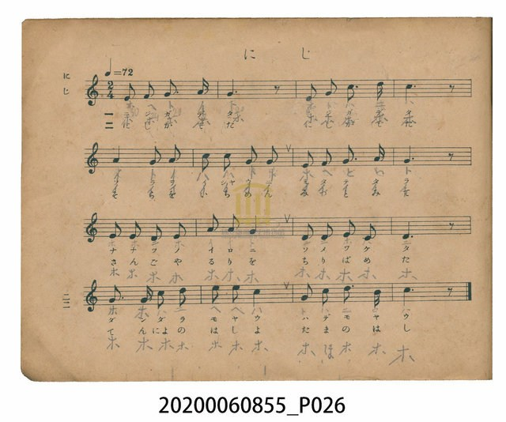
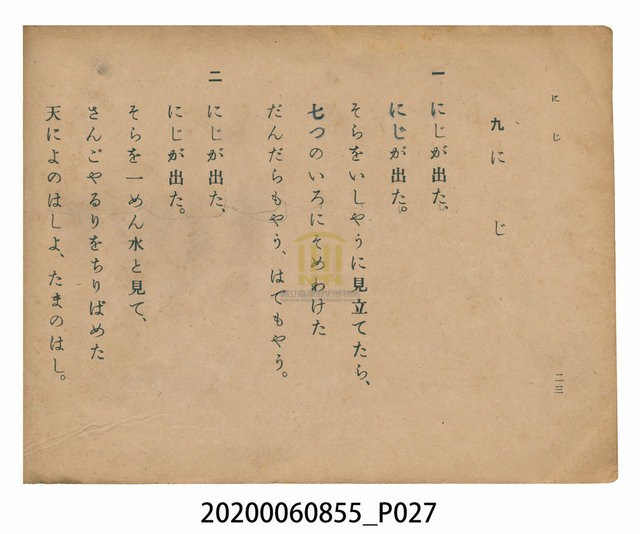

# にじ（彩虹）

> Re:Shoka 使用 AI 辨識樂譜，可能會有錯誤。歡迎回報。

<audio controls src="niji.mp3"></audio>

- 日治時期公學校唱歌（第三學年・第九課）
- 國立臺灣歷史博物館典藏

## 說明

【曲目說明】
・出處：臺灣總督府編《公學校唱歌》第三學年用，第九課〈にじ〉（彩虹），原書第 22–23 頁。
・調性與拍號：ハ調（C 大調），2/4 拍，速度 != 72。
・背景與曲風：描寫雨後天空中浮現絢麗的七彩長虹。第一段將天空比作衣裳（いしやう），染上七彩條紋
（だんだらもやう、はでもやう）；第二段將天空比作汪洋水面，鑲嵌著珊瑚與琉璃（さんごやるり），
化為天女走過的玉橋（天によのはしよ、たまのはし）。開頭兩句「にじが出た」由五度音域（3–5–6–5）
推升至高音八度（3–5–1^–2^–1^），第四行更攀升至高音 Mi（3^），宛如虹橋橫跨天際的壯麗弧線。
・版本說明：本檔案為原書單聲部簡譜（數字譜）之忠實數位化版本。

・編曲說明（鋼琴伴奏版）：
1. 前奏 (Intro, 4 小節)：以「にじが出た」的上行拱形動機展開，勾勒彩虹升起的光彩。
2. 主歌伴奏 (Niji, 16 小節 × 2 段)：右手 (PianoRH) 演奏橫跨至高音 3^ 的寬廣旋律；
左手 (PianoLH) 以八分音符低音與和弦溫柔擺動，襯托徐緩優雅的 2/4 拍抒情曲風。

## 跨冊／重複收錄參照

> 同名異曲（各冊收錄之不同詞曲版本）

- **[同名異曲]** 《新定兒童唱歌》尋常科第三學年用（2020.006.0847.0003）：[**〈虹〉**](../../../shintei_jido_shoka/grade_3_2020.006.0847.0003/1_08_niji/index.md)（`D` / `4/4` — [原始 TMD](../../../shintei_jido_shoka/grade_3_2020.006.0847.0003/1_08_niji/niji.tmd)）
- **[同名異曲]** 《新定兒童唱歌》尋常科第三學年用（2020.006.0847.0003）：[**〈にじ（彩虹）〉**](../../../shintei_jido_shoka/grade_3_2020.006.0847.0003/2_11_niji/index.md)（`Eb` / `4/4` — [原始 TMD](../../../shintei_jido_shoka/grade_3_2020.006.0847.0003/2_11_niji/niji.tmd)）
- 總表：[跨冊重複與同名歌曲總索引](../../../duplicate_songs.md)

## 歌詞

```text
一　にじが出た、
にじが出た。
そらをいしやうに見立てたら、
七つのいろにそめわけた
だんだらもやう、はでもやう。

二　にじが出た、
にじが出た。
そらを一めん水と見て、
さんごやるりをちりばめた
天によのはしよ、たまのはし。
```

## ABC

```abc
X:1
T:にじ（彩虹）
M:2/4
L:1/16
Q:1/4=72
K:C
V:V1 name="Piano" snm="Pia"
[V:V1]
E2 F2 G3 A | G6 z2 | E2 G2 c3 d | c6 z2 |
A4 G2 A2 | c2 c2 G2 G2 | E2 F2 G3 A | G6 z2 |
E2 E2 D2 E2 | A2 A2 G4 | D2 D2 E2 C2 | D6 z2 |
E3 E c2 d2 | e2 e2 c4 | G2 c2 d3 B | c6 z2 |
```

## TMD 檔案連結

- [主旋律 TMD 檔案](niji.tmd) [[在 TMD Studio 編輯](https://tmdlang.github.io/Tmd-TS/#tmd=s7IKdvYPcrWy4qpTUCpJTLdSSM7PyUlNLsnMz7PKzk9PzM7Ojy_OyM9OVIKrKMvPKc1NtUovSkxJjTdGiBfnlxYlp1oVJ2fk5-fEl6RWlCTl52cj5AuK8stS8xLzgGoKijLzSlJTwIoQClLLMlNSQdKpKZkl-UWZiTlIlqYWFYPcBLEkvqQoMa84uSizAORQhKqSjFSgy_ISS0qLUpW4tLQUHjeuftw44_2ejqd7V76YufP9nk4FLS0uRVsFcyMue1sFZy4bI30TO5D-Z9OXPtu0-9nMpmdz5j9tXfN07Y5nCxY-nbLx2doeoPbna9Y82dEJFHy6c8vj5t0g7s65L1ZtAhoItv3pnO7nq7tftO963rj42drtT_s3Pe2d9bxz5cslK5627ngxvV-Ji0tfS8GWWoBLQUHhccOEZ7M3PZ-97sWqVc9m9D1umAgWbd79tH3Xi5lT3--ZBXHP8x17n89d_HTXnOfbVzxu6ELz3OOGbmTPPZ-y4v2eHrj_Hjd0QILwcUMncigC1Tztm_9s9g6gSgUjo0cNk42MFV4uaHzc0AR1xItV-581LH_R0f6su_fFzPlA1zxu7gcKAk1xVni6ZDmYCTIHGAEKQDVA1suG-U93LVMAxw6SQc09z2auBxk0e9PLRUDXzXrW3_90_eqXs1c83dfzdMnK5yt3Pdmx9tnWdc_79z3fuujlrunPZ7U82dEMdOzLqduB7gWaBfZiw7N1W59uaIdoebZ-ypO9c14sXPxi8Wagmx43tjxunP64CUi2Qdz1bP7kJzu6IOY8WzT3-ZZukIMUFMCKFzxumgwmOx83NUF0PW5ofNy4_nHjcrgI2JzZIKt39WBa_Wzjqmdbup9t2PJy7iKQ5yduerq158XE6c_7u55PnAX07_MJnc8nNYOtmwq2bgrI2Kbux01dEBdC3PO0Z9rzpl1Ak58u3fxi64aXjX1A7z_v63y2shsUY0tWgiKwCWjIOrDzgH7sADt1_uPGfXBBoIHAUHo5rfvlgrVPW1c-7V_6uKEHGvONPcAEBVLf0Pt8ysYnu6YAI-nl_M1P5wMjtcMYGPWmQGwGooGmQNz0rG_F0972F-2bX66eAVLauhqoB0m1YRwoxYAIwziIX4Ch9HT27BcLe57N3vJsSgOybgXfTJBWqMKn62Y_XdYEjFWg_56tXP1i-wqgF1_Omg309NPF64GR_3TP8ufbZyHSz_POjmdz1kDyCCjxzFnzbNWUZws7QIEGTsJPp6170bjpZfOK5xsWvlg7B2jXs6k7nq6dDmZ3PtnZ_XT_gqfrlwEFn-ztBYU22ECQBdBcCDEGmJderJz3tHXFs2ntwNgDJUkgY9W8F2vXA7MmKCo29D5r71TIzE1MTzXSyypITVfQVwgwMDIHBRvIKGAKfdzQgBHqjWBr0EUh3mucC06Ck5CTL1Dpi2Wg4uhx4zKQUqACiBnAtPy4cQk4zoHpqBdsJFB_4-Om_seNE4FKIUYSlbahDgB6C-JFYMhCCgeg-57sa3uyC5j6e9BEgHpedC991tWFnA2Ann6yexssH_a8bFr8ZN_-ZzPWA7Pfs44JQCc_X7HuRecmoFGgGAZnxRddG4G5EeimF_2gCIdxm-DhuAtYqpEXjqAoAAXIZGC-fNy4AhiOoECEaUXPhuCAXwhiNG4AaYOEIJFZjqIQfDZ1y_NOaHHyfE43qDiBFySwEISUKEBdaCUKKBzBpQUwaQMz0dOJDaD8t68PUnBCSg5oaALdR3ldBQUKWvpcXH6ZWZlWAZmJefkONQY1CtXg4sLGQssOzMBWQypAim5gyaCgYaLwdEP_8_UNOpBMhJSHzDSx6ARaCDUVaIAVsCzoVnjctAOI14BLhnaFGiB7P7jAAgEgj4AKJAN39QANbFwNxDOAuAecPJaDlDfORzaQgAqogTUKxgomChqmCrq6Cmaaqhq6uppAMSAXCA3AsqYKGoZxIGmjOLg8SACiAJzqcYferh5qhF7TXnCYrATiTRDPNS0B4u2Pm0HUMnDggYJwPjjIHje3gZQDWSCxlbiDcC5YWScQT4IGWQsQLwSLNgLxZLAY0MDGpUC8AhyMYEMbl2EGoxkwPEyBJDhwgMgUCAkELoGw29FJlZTXBcVAvzX3IUKveS042KCJBRjCj5sXAvF6IHsjVAxP6psKDh5ggQSkW6DKQQkYaBE4MCHBCTQQJNK4ARygEDGsKdBYwQiIQYFoBg6eGiAfJGIIZhEVXJAqnPLgagAntc1gFij1gNLQIiCGpDSoz5r7wVkUJANSvQTsf4xEgQgukBQkwECFM5BaBw4LYGA3TgdKdMDDBlhKg2VBSW09WGw6ZnhpGIMSlDE0QQHTmlEcKBTjQAicM0FpDMjQAIoDFZpjy7a1XFy6dgqgMhFEK3NxAQA)]
- [鋼琴伴奏 TMD 檔案](niji_piano.tmd) [[在 TMD Studio 編輯](https://tmdlang.github.io/Tmd-TS/#tmd=s7IKdvYPcrWy4tLSUnjcuPpx44z3ezqe7l35YubOx827X3bveT5hy5M9W54u7X_e2fF-T6eClhaXoq2CuRGXva2CM5eNkb6JHVedgtKz6Uufbdr9bGbTsznzn7auebp2x7MFC59O2fhsbQ_QwOdr1jzZ0QkUfLpzC9BYEHfn3BerNgENVALpfjqn-_nq7hftu543Ln62dvvT_k1Pe2c971z5csmKp607XkzvV-Li0tdSsKUW4FJQUHjcMOHZ7E3PZ697sWrVsxl9jxsmgkWbdz9t3_Vi5tT3e2ZB3PN8x97ncxc_3TXn-fYVjxu60Dz3uKEb2XPPp6x4v6cH7r_HDR2QQH3c0AkPV6CngWqe9s1_NnsHUKWCkdGjhslGxgovFzQ-bmiCOuLFqv3PGpa_6Gh_1t37YuZ8oGseN_cDBYGmOCs8XbIczASZA4wABaAaIOtlw_ynu5YpgGMHyaDmnmcz14MMmr3p5SKg62Y96-9_un71y9krnu7rebpk5fOVu55tXfe8f9-THc1AB76cMxnsxp6ny5pe9K9_uWs6yNULFz9uaHza3wEUfDlx09OtPc_7u55PnPV8QufzSc3PZ7UAzXm6dPPzvs5nK7sRdgNDDGgrJHyBDsdMTUDXgJQqKBjqKTzt7AWKK2h45pUU5esomCg83dD_fH2DJlDNk91LHzf0QEOysQcYQY8b5z9u6AVa_GRH14uFPc-6Nz7du-hp99RnK-c_3Tj15bRukAe69z3tngQJ86e97S-2bgc5tLUTKAJ1ooKCkZ7Ckx27gfEIcZWChl9mVqaOgqEZ1HaFw9MVjBSerdsKcsbT_s3POrsVNAIyE_Pygzw0FZ7tmQLU9Gzl6hfbV7xo3_xy9YyX8zcrGMcpgCxav-bp7sXPpnc_3Qd0zGyIdUDwdPsyhCE-QEOAnnvauvppRxtQ7_M1y57s7QMygPH1dFLP0z3Lnu1a_Wz-lGeTdwE9B_TTi6Xrn3XOeLpvwvPtK5-2rHo5uxVolQI0DTzrmvSsuRUSzyAfQlM5JKUB_fhi5bynrSueTWsHmv5kx1oQY9W8F2vXA5M-KHFu6H3W3qmQmZuYnmqkl1WQmq6grxBgYGQOjCewUU92NDxuaMCIhUawNeiikCTQOPdxU-fjpkmPG1seN05_3AQk24BKXywDZffHjctASoEKIGYA09_jxiWPG9eBVDf1go0E6m983NT_uHEiUCnEyAWPmyaDSaDBTVAjGxofN65_3LgcSQTsAKC3IF4ExR4kIbTverKv7cmuNlACQRUB6nnRvfRZVxc0U6yf8mTvHKCnn-zeBkz_LxZvBuWxpsVP9u1_NmP9s_mTn3VMADr5-Yp1Lzo3AY0Cxfnelc8WzX3RtfH5FmAuaIRkHxi3CR6Ou4ClBnnhCIoCUIBMfrZhy-PGFcBwBAUiTOtUcMhMAYVAU_fjpi5wwC8EMRo3gLRBQhDoO5AtTcCSCRjSwFADxksHOATnP27chxCkJASfTd3yvLMdEo7P53QDwxHo4JdzFyGHIKQcAeqCFCXANIlWmjzZ2Q0sTZ5ObACVqPv6gEEJlIIXMaDQBLqP8roAChS09CmsY8CBi1yIaVrBSzEFDWge1QSpApbAz3cCMy-0BH45azak7AWGJdBzwGLkWfsOUDC0rAL6--me5c-3g4tJ8p0G9hzYTVbQwsuhxqBGoRpcKtlYaNmBGTUKxkAHa5gq6OoqmGmqaujqagLFgFwFwzggAWICGRpGQI6ugjlcAVhSV8FAoYarFsUWHxy2GMYrRBvGKpgAKZNYBN8MSJnlggRMgSzTWBgFVwDCUFsojihIqQ8s2CFFPjCqEGU-SlxBCv3nTbsg9T1IH7RM74EU5UCpZ1sbn81aBIkuULxN6nnRuAlSo1Ah3kDuwxdt2MJCAdwoaQBWjQoasDSoAynbkYp2M00sOoFWQk0FGmAFrMa7FR437QDiNeBKvR0YH4-b9sOqMxCPgAokA3f1AA1sXA3EM4C4B1xqLQcpb5yPbCABFVADcSdXcGIEypoqaIASp66CURy21Io_9Hb1UCP0mvaCw2QlEG-CeK5pCRBvf9wMopaBAw8UhPPBQfa4uQ2kHMgCia3EHYRzwco6gXgSNMhagHghWLQRiCeDxYAGNi4F4hXgYAQb2rgMMxjNgOFhCiTBgQNEpkBIIHAJhN2OTqqkvC4oBvqtuQ8Res1rwcEGTSzAEH7cvBCI1wPZG6FieFLfVHDwAOtJIN0CVQ5KwECLwIEJCU6ggSCRxg3gAIWIYU2BxsD2oTE4EM3AwVMD5INEDMEsooLr6ezZVAmuBnBS2wxmgVIPKA0tAmJISoP6rLkfnEVBMiDVS8D-x0gUiOACSUECDNRmAFLrwGEBDOzG6UCJDnjYABsPYFlQUlsPFpuOGV4axqAEZQxNUMC0BqxMgKEYB0IkVDKIIhF7HUNskYgnWHFWU6BaCUih8JFrKZg8acULXpdAnUDIJXB5RP1JclYlJkTg9kIthAoD0zuQYQSswbHV5CTnApJcArMRSxDgakLo2imA2yoKQAYoPSHTylxcAA)]

## 分析

```text
================================================================================
📊 TMD Song Profile: [ にじ（彩虹） ]
================================================================================
⏱  Duration:       0:26 (26.7s), 16 measures total
🎼 Key & Tempo:    首調基準 C, != 72.0 BPM, <2/4>
   - 分析範圍：      由實際發聲的音符與和弦推測調性；播放脈絡另行呈現
🎤 人聲音域:    C4 (MIDI 60) – E5 (MIDI 76) [跨度: 16 個半音 / 1.3 個八度, 難度: moderate]
   - 最低音:  C4 in [Niji #1 @ m.11, 0:17]
   - 最高音: E5 in [Niji #1 @ m.14, 0:21]
   - 適合: soprano, mezzo-soprano, contralto, tenor, baritone, bass
🏛  結構:      Niji (26.7s)
⚡ 編曲密度:        Peak 1 軌道同時演奏
🗝  調性診斷：       C 大調（純淨自然大調，未偵測到可信轉調）
   - 風格氣質:    純淨自然大調（陽光明朗、易唱易記，無明顯調外色彩）
   - 轉調歷程:    全曲維持單一推測調性（未偵測到可信轉調）
   - 核心骨幹音:  G, C, E, D, A
   - 調性數值:    C 大調 [相關度: 0.90, 穩定度: High, 自然音純度: 100.0%]
   - 候選調性 (K-S): C 大調 (0.90), G 大調 (0.78), E 小調 (0.65)
   - 五度圈歷程:   +0
   - 各段落調性細節:
     • [Niji #1]: C 大調 (r: 0.90, 自然音純度: 100.0%)

  [ 五度圈游移軌跡 ]
              [C ]*
         F            G  
      Bb               D  
      Eb               A  
         Ab           E  
            Db       B  
               F# 
     (* = active key center)

  [ 十二半音累積音高分佈 ]
     C  : ██████████████████████    24.6%
     C# :                            0.0%
     D  : ██████████████            15.3%
     D# :                            0.0%
     E  : █████████████████         18.6%
     F  : ███                        3.4%
     F# :                            0.0%
     G  : ████████████████████████  27.1%
     G# :                            0.0%
     A  : █████████                 10.2%
     A# :                            0.0%
     B  : █                          0.8%
--------------------------------------------------------------------------------
Assignment 軌道音域：
  - Piano         : C4 – E5 (16 個半音 / 1.3 個八度, 46 個音符)
================================================================================
```


## 原書掃描頁






