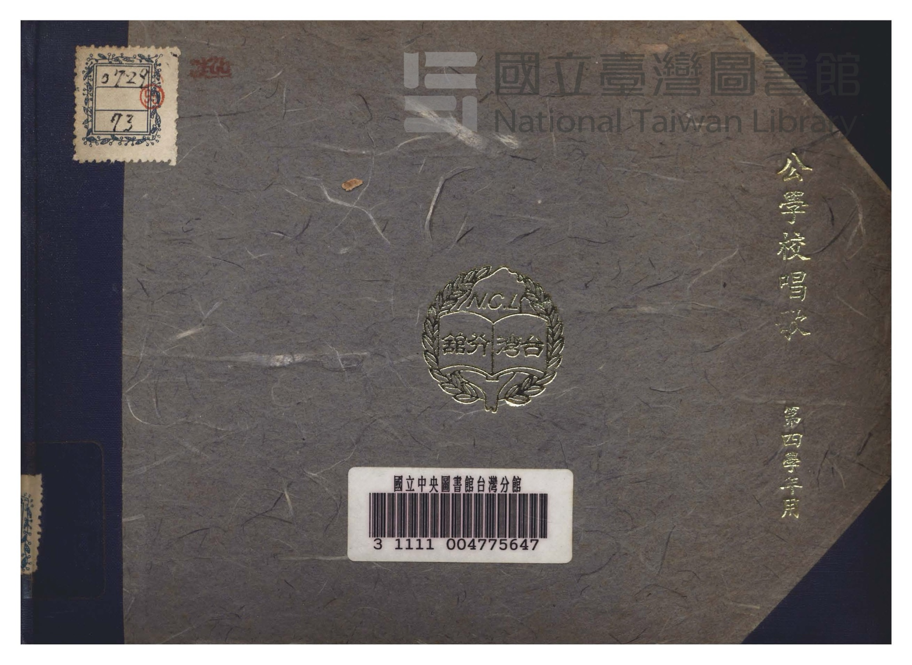
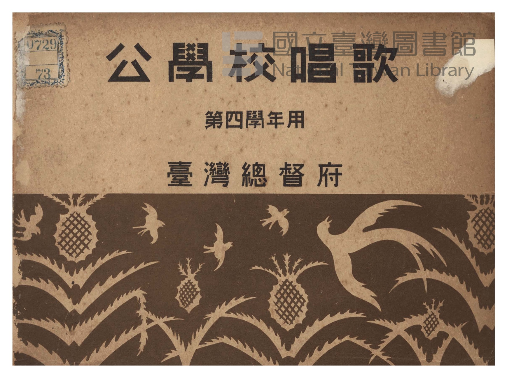
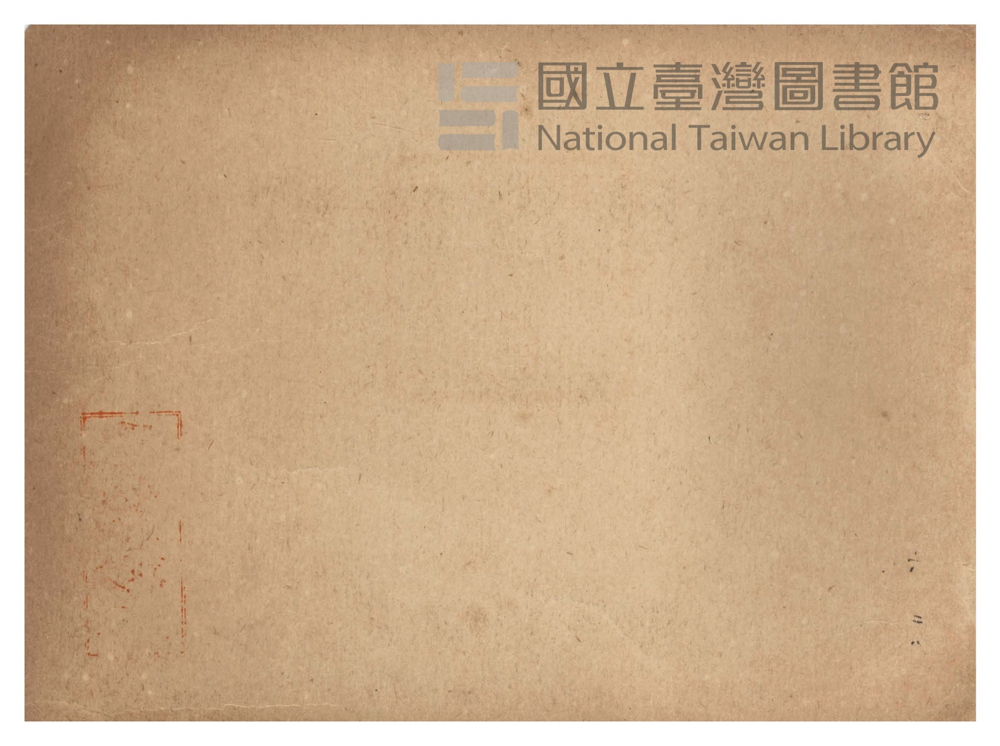
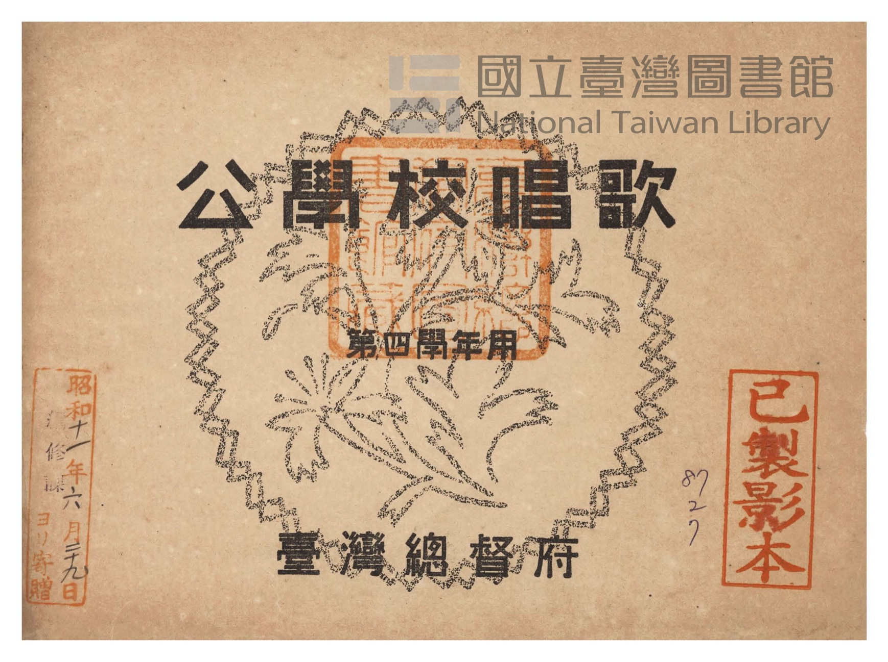
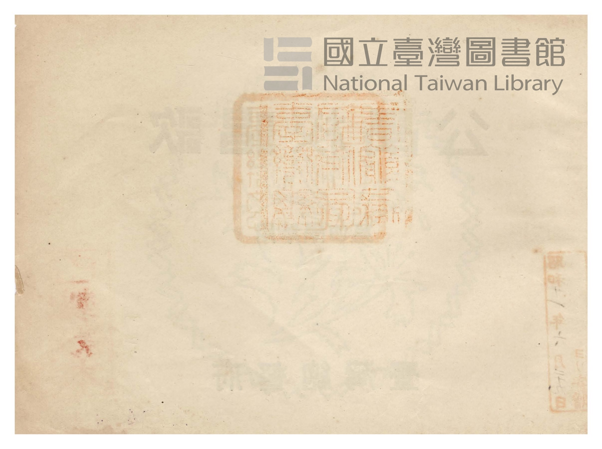
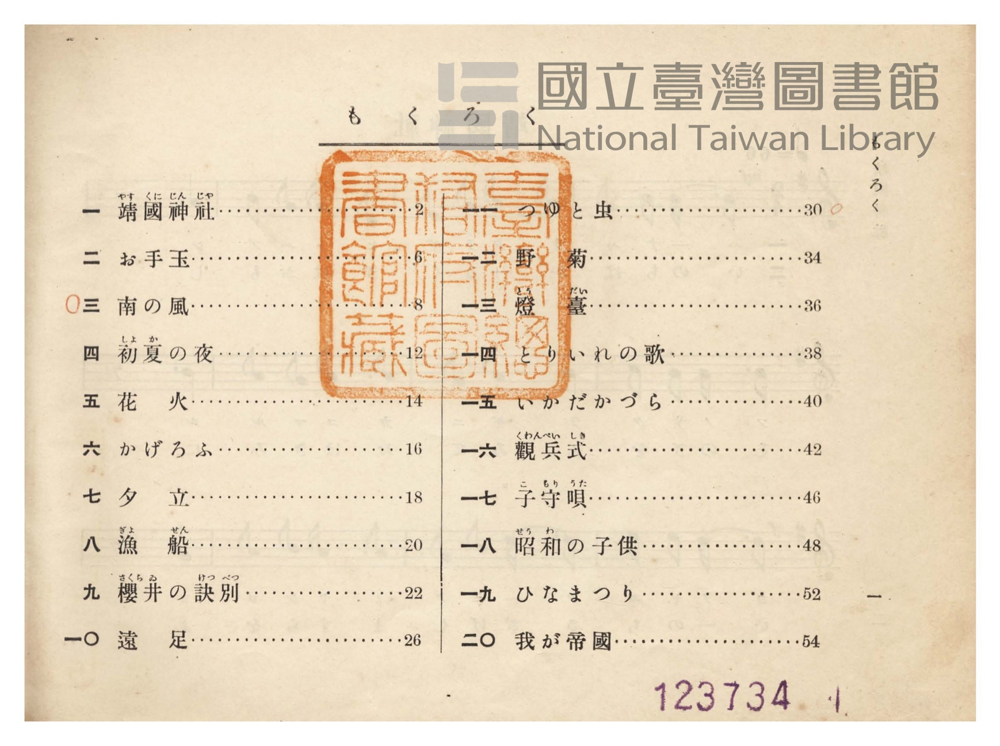
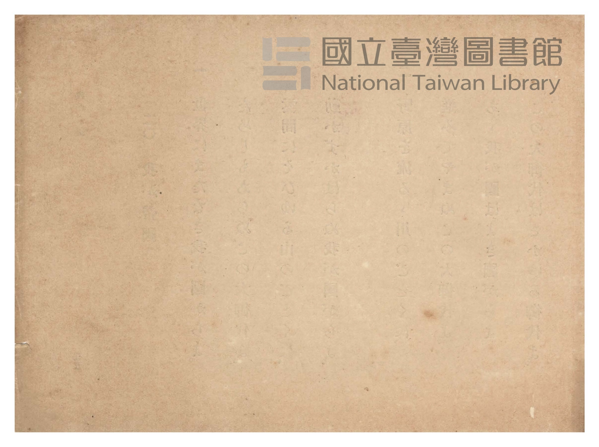

# 書訊與卷首／卷末掃描頁 — 《公學校唱歌》 尋常科 第四學年用（國臺圖 0729 73）

本頁收錄本冊之封面、扉頁、目次（もくろく）、樂典大要、版權頁與封底等原書掃描圖檔（共 7 頁）。

### P001.jpg

本冊封面（右頁），題「公學校唱歌　第四學年用　臺灣總督府」，下方繪有臺灣文旦（ザボン）果實與枝葉圖案，左上貼有舊藏圖書分類籤「0729 73 v.4」，左下貼有國立臺灣圖書館條碼籤「3 1111 004775688」。

### P002.jpg

封面裏（見返頁）。

### P003.jpg

扉頁，題「公學校唱歌　第四學年用　臺灣總督府」，右上蓋有「昭和十一年九月二十九日　編修課ヨリ寄贈」藏書印，右下蓋有「臺灣總督府圖書館藏」方形印記。

### P004.jpg

扉頁裏留白頁。

### P005.jpg

目次頁（「もくろく」，原書第 1 頁）：列出「一　靖國神社」至「二〇　我が帝國」共 20 首曲名與頁碼。

### P006.jpg

目次裏留白頁。

### P061.jpg

封底裏版權頁：標明「昭和十年三月二十七日第一版印刷、昭和十年三月三十日第一版發行、昭和十一年二月十日第二版發行」、「公學校唱歌 第四學年用（定價金七錢）」、「著作兼發行者 臺灣總督府」、「印刷者 臺北市榮町二丁目十五番地 加藤豐吉」、「印刷所 臺北市京町一丁目四十三番地 小塚本店印刷工場」。

