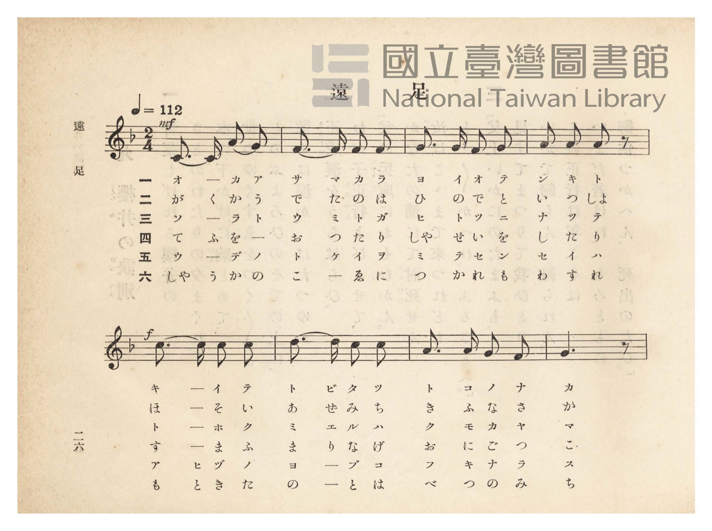
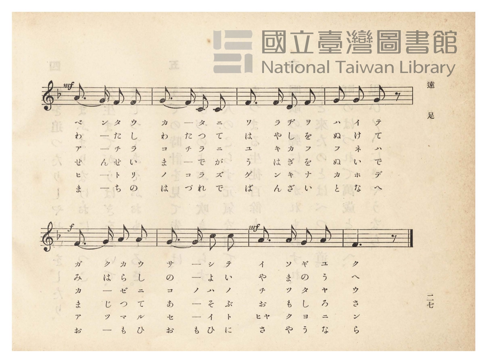
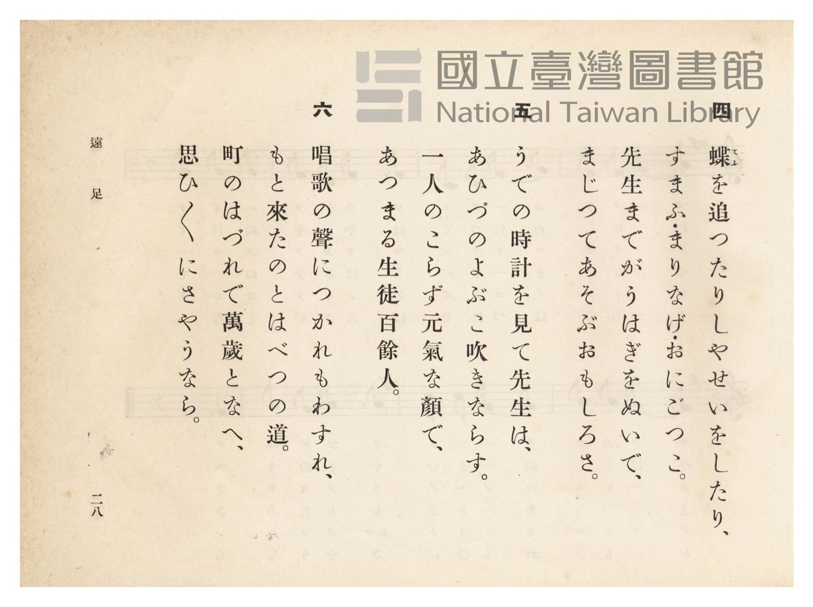
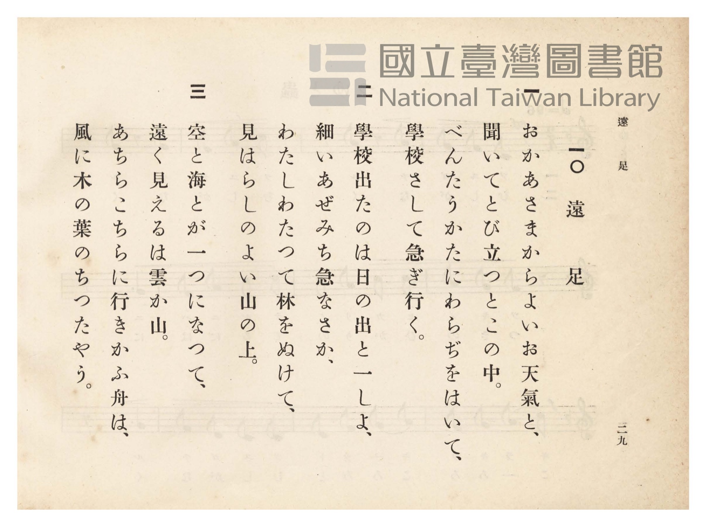

# 遠足

> Re:Shōka 使用 AI 協助辨識與重建樂譜，可能會有錯誤。歡迎回報。

<audio controls src="ensoku.mp3"></audio>

- 詞：文部省（尋常小學唱歌）
- 曲：文部省（尋常小學唱歌）
- 臺灣總督府《公學校唱歌》第四學年用（昭和十一年，索書號 0729 73）

## 說明

原書資訊與歌詞全文（對應 P031.jpg–P034.jpg，原書 pp. 26–29）：
調性與拍號：ヘ長調（F 大調）2/4 拍，速度 ♩=112


## 歌詞

```text
一
おかあさまからよいお天氣（てんき）と
聞いて飛（と）び立つとこの中、
べんたう肩（かた）にわらぢをはいて、
學校（がくかう）さして急（いそ）ぎ行く。

二
學校出たのは日の出と一しょ、
細（ほそ）いあぜ道、急（きふ）な坂（さか）、
わたしわたつて林（はやし）をぬけて、
見はらしのよい山の上。

三
空と海とが一つになつて、
遠く見えるは雲か山。
あちらこちらに行きかふ船は、
風に木の葉の散つたやう。

四
蝶（てふ）を追つたり寫生（しゃせい）をしたり、
すまふ・まり投・おにごつこ。
先生までが上衣（うはぎ）をぬいで、
まじつて遊ぶおもしろさ。

五
うでの時計（とけい）を見て先生は、
あひづのよぶこ吹きならす。
一人のこらず元氣（げんき）な顏（かほ）で、
あつまる生徒百餘人（よにん）。

六
唱歌（しゃうか）の聲（こゑ）につかれもわすれ、
もと來たのとは別（べつ）の道、
町のはづれで萬歲（ばんざい）となへ、
思ひ思ひにさやうなら。
```

## ABC

```abc
X:1
T:遠足
C:曲：文部省（尋常小學唱歌）
M:2/4
L:1/16
Q:1/4=112
K:F
V:V1 name="Piano" snm="Pia"
[V:V1]
!mf! C3 C A2 G2 | F3 F F2 F2 | G3 G F2 G2 | A2 A2 A2 z2 |
w: 1.~オ カ ア _ | サ マ カ ラ | ヨ イ オ テ | ン キ ト
w: 2.~が く か う | で た の は | ひ の で と | い っ しょ
w: 3.~ソ _ ラ ト | ウ ミ ト ガ | ヒ ト ツ ニ | ナ ッ テ
w: 4.~て ふ を _ | お っ た り | しゃ せ い を | し た り
w: 5.~ウ _ デ _ | ト ケ イ ヲ | ミ テ セ ン | セ イ ハ
w: 6.~しゃ う か の | こ _ ゑ に | つ か れ も | わ す れ
!f! c3 c c2 c2 | d3 d c2 c2 | A3 A G2 F2 | G6 z2 |
w: 1.~キ _ イ テ | ト ビ タ ツ | ト コ ノ ナ | カ
w: 2.~ほ _ そ い | あ ぜ み ち | き ふ な さ | か
w: 3.~ト _ ホ ク | ミ エ ル ハ | ク モ カ ヤ | マ
w: 4.~す _ ま ふ | ま り な げ | お に ご っ | こ
w: 5.~ア _ ヒ ヅ | ノ ヨ ブ コ | フ キ ナ ラ | ス
w: 6.~も _ と き | た の と は | べ つ の み | ち
!mf! A3 G F2 F2 | G3 F C2 C2 | F3 F E2 F2 | G2 A2 G2 z2 |
w: 1.~ベ ン タ ウ | カ _ タ ニ | ワ ラ ヂ ヲ | ハ イ テ
w: 2.~わ _ た し | わ た っ て | は や し を | ぬ け て
w: 3.~ア _ チ ラ | コ チ ラ ニ | ユ キ カ フ | フ ネ ハ
w: 4.~せ ん せ い | ま _ で が | う は ぎ を | ぬ い で
w: 5.~ヒ _ ト リ | ノ コ ラ ズ | ゲ ン キ ナ | カ ホ デ
w: 6.~ま _ ち の | は づ れ で | ば ん ざ い | と な へ
!f! F3 G A2 A2 | G3 G c2 c2 | !mf! A3 A G2 A2 | F6 z2 |
w: 1.~ガ ク カ ウ | サ _ シ テ | イ ソ ギ ユ | ク
w: 2.~み は ら し | の _ よ い | や ま の う | へ
w: 3.~カ _ ゼ ニ | コ ノ ハ ノ | チ ッ タ ヤ | ウ
w: 4.~ま _ じ っ | て あ そ ぶ | お も し ろ | さ
w: 5.~ア _ ツ マ | ル セ イ ト | ヒャ ク ヨ ニ | ン
w: 6.~お も ひ お | も _ ひ に | さ や う な | ら
```

## TMD 檔案連結

- [主旋律 TMD 檔案](ensoku.tmd) [[在 TMD Studio 編輯](https://tmdlang.github.io/Tmd-TS/#tmd=s7IKdvYPcrWy4qpTUCpJTLdSSM7PyUlNLsnMz7PKzk9PzM7Ojy_OyM9OVIKrKMvPKc1NtUovSkxJjTdBiBfnlxYlp1oVJ2fk5-fEl6RWlCTl52ejy8cXJKanWgUYGBsiZAqK8stS8xLzgLoLijLzSlJTwNoRClLLMlNSQdLFyYl58WWpRZlpmakpSE5KLSoGuRhqRUlRYl5xclFmAcgbCFX5RSUZ-UBnF2RUWmVkFpfkF2UmJ-bEZyfmIfmuJCMV6DmoJ3Iy01LRpfISS0qLgKJaWgovGxe82LZZQUuLS9FWwdDQiMveVsGNy8ZI38QOpOnFynnv98x6Nq39ZfOK53Ma3-_peLqh--mOHU839D9du-PplI3P1va839MJtuDZ7E1Eq33Rvut54-LnO_Y-n7v46a45jxu6nrauAap6tmAhROHjhu7na9Y8nT0bpHXnludTVgDNezZj7dNJPU97G5_saAAKvt_T83zLomezd7yYOV_BwNzIUsHcGGwBl76Wgi21AJeCgsLTvvkgaza3v1jR9aKjHeg-YMA8bV0B9CzYm73P2jsVQAlCL6sg_VHDZCDTBMQEuhCiVaGgQE_ByAwoZWQJdCIwnEDGvli1_1nDcpCB3b1APwBFHzfPeDl1O1AcaKybwtMly8HMTmB0KADVAI172TD_6a5lCo9mrrQFxRbIFGBggKjHjV2PG7sfNzY9bpz6uHEfiN3U-bip43FjC1Dq6ZKVzzYsBpr6uHHZ46bJjxuBhnU-blwBdkbjPLCiZS8XzwarAIY1UG7z89VA45YAuY8bgRrWPdmx9nFDI8SqnWAz5j9ubHvRtBKsB6gU6AGgttWPm_pBNjcuetw06XHjeojRUJ2QKAZr6Hnc2A_W1gbWBnTzdKC6Zw1LwbJAPXPB4n0vFoJVNjRBPLurB2HO0_ZdYEesA1rzbPpSIAMssgIYIiDTmtqhtj7fsgFs6G6YoUDTgcE05yXQXw2NMCt7HzduBcuuejq3CSwCdFM3SATqa6C_QLYBDYYwgEGz7Nm86WCl6x83AQ0FsoFBDvT1mseNExG-frEM6E2gCqDZQD-ug0TK040bwYHaBffajk6wY1eCvPBs63ZwwPeA_QK0aTXQXRAroYYCcy4wXMBGdzxuAlnwcvYmoINB5gJNBEcT0JMLwdYCIwvCWA0OTqBXgRq2vujYCXIX1LxFQOtWP5sDJNe9mAhUuu7Z1MVgG-eD_dYGcycwU4I9NXcbNDlBgq1p0ov9e2Hqu56uX_18CjBBABUAw6v5ceNsoJdhoQMMBJAaeGqaCU6vWx83AyNoH1DiWddUMBuYoIHengI2FBhTYE89be0AGgzWsBwcPF0vFkLSdRs4sfUhRQHQ1cvhlgA1zIAE4EuQwdtAxjcBAwjoPGBwTEUksCkQ9UDjgBasezaz6cWKDki2AEcq1BfggF8Gcw0sEMFBDowFUFoERzPQmslPJwCDGWjHKnAMzIR6BBixT3YBoxqYeCeDJWY9bW2G5dFJSHl01cuF_bAsthssgvAU0Dagj4Bh1g10xtN9k57P3PdyyQyguSANIPuBuXEyOAlD4651LZiCFsbw2AF6FpzSgVHfCCzFgeJAN02E5meQFcDCpAcUXKCkPxPEhuUJoAtWPNkH1A_Jh8AwWv-0A5KhgL5eAjEUktHAqXsKxMvAmFoKMqZx-YsJa56thdi5AezradAwBpkFTPI7oDqfNcwFBi2EBLtqKjRZQsIVEqiUF_dQoKClz8Xlmlecn11qFZCZmJfvUGNQUw2yQsHG0EzLDszCVs0oAKstYNQCs5mChokCsO57vr5BB143aGLRALQJZFiNQnVuWq2CabyCLhACKWMgZQTENQqGYCFDMA3CNWBxkCyIB1EDUg3DBiARsKE-hjXAOFoFVv24aTUQLwKzQToeN22FiDfPA8uBWCshMs0roDqWQHU_bm6DymwGi68Fi3UASZBzoXYZAeUbeyA6G_uBuBvMgupsXA6VmQ_E68Cs9VCZTVCZdVBVwKiHyrSAeYvBJKhAR7XQGOSJvVAPQRwPcRRIfBlUFGgdWOxx0xqoFyZBZTqAGGxBM8ihIJkuMK8Z7mEku0xAzoGa2bgVaBrEFIgzQfogDgV5D2QXSAQkA8peUMnZMP-AtYIloeEB04BknSnCCyDHtANxH8w6sHdAejaCYwgkDwpBkAzILIjjHzftBrNA8QUyC8yDqu5HtcsMzaFAzdCoA0UTSHIyzCFNE8HioMQCEgcZB-J3A2VAEQ8sDqDWgawAlhRgMZAMxDr8uWZXD1m5BpRpwO4wBdMgXKNgBhYxQxIBZQxQ9gBlF-RMBIHoWQaUwGFZADn5Q4O-eTJQZj-YBYpS5EjZDI0qSGoCmQUKLRhEzy6gaIGE4VwwCTWtERSOIP4cIAbb07gQKtMLlQGmwUZw1mycCpUBxRkWe0C5BOo6kKtmg10JzXqwBNO0AsiGFAGgmAO5GqQCxF8ELxxAIQHSMw-7PeAcAopxiPv2QV0JcRuIB0nmMFfDMgEs7wALp8YpYBYouyOnOjR7wFkDVoxBcvPj5lao2yCZBFSAPW6eBrYRmgGaQaEE4q-F53NoYde0E7s9oGwBTs8Q94GKJEjog9wGDTdwkQWRgRVmENNAeQNWzIHiDyQDikFUewjUIp2Y-cGIuFoEktgh9QNyYjeE1C9gAlGvmIO4CGWwigctTzRD4hZUpEDTPriAQk7hsDwBK09haWglEINCElFQgcsHpLyFli_A5QckHMHFI7ioRIhDKhFItQB1Azj8QWa2wApWeDELKveBTTe4avQaBJGWGqGuhdgFSjkQUVjdAvMXtB4ApSVo3oDmQTD9uBmUSjCKWXD-AOU-kE5g-QFmI3I8JIeARCBVIKjUBImDQgeSvoCNWyz-glSRID1oeQRaz4FcAq7_mkH5DimPgEsqsL-adkF9DK2IwTG8FsxCLsOgZQewMsKsPhCuB6VyRM0BjZXGpbAaAuxSkMwGpJAA51R4SEDyE6SU2AG3C29eAfZJyMorwKwCyQRG8MYTonGFqDuQ8hSkAoEohGiFQPQKBBQ5IO8Bow0SePDMAml1gUS2g4MTWrWAMwNIdC8QgwsOcDJDFMUYBRS4AgFlOGjyaOoEs6BZBRwFEBPB0Q8LXmAGgejYBy-gYC00UGBjsQecSRBZfA_YbdCsAM8kfbBMDU5eoGQGykwgfjO8WIBWIPB2DZo94AyCSEgzwCSsMoA1vZqAGFJVboPKQCsQYFENy_ig7AeSgRT5GPagVSCQJiCoUgO5GuJPUHsJVjxBG5TNkx43gxwDjVRwExlRIkCCAcMqcN5AdiAoh0FEUGsXiDisXQWrq0BlGShyILkBpAMUxaj21HJx6dopQLoqCkCWMhcA)]
- [鋼琴伴奏 TMD 檔案](ensoku_piano.tmd) [[在 TMD Studio 編輯](https://tmdlang.github.io/Tmd-TS/#tmd=s7IKdvYPcrWy4tLSUnjZuODFts3v93S87N7zfMKWJ3u2PF3a_7yz4_2eTgUtLS5FWwVDQyMue1sFNy4bI30TO646BaUXK-e93zPr2bT2l80rns9pBGp-uqH76Y4dTzf0P1274-mUjc_W9gD1K4HUPpu9iWi1L9p3PW9c_HzH3udzFz_dNedxQ9fT1jVAVc8WLIQofNzQ_XzNmqezZ4O07tzyfMoKoHnPZqx9OqnnaW_jkx0NQMH3e3qeb1n0bPaOFzPnKxiYG1kqmBuDLeByzSvOzy61CshMzMsP8nCoMaip5lIAAhtDMy07MKtGoTo3rVbBNF5BFwiBlDGQMgLiGgVDsJAhmAbhGrA4SBbEg6gBqYZhA5AI2FAfwxqFx02rwKofN60G4kVgNkjH46atEPHmeWA5EGslRKZ5BVTHEqjux81tUJnNYPG1YLEOIAlyLtQuI6B8Yw9EZ2M_EHeDWVCdjcuhMvOBeB2YtR4qswkqsw6q6nEjyH6QTAuYtxhMTn_c1I5qoTHIE3uhHoI4HuIokPgyqCjQOrDY46Y1UC9Mgsp0ADHYgmaQQ0EyXWBeM9zDSHaZgJwDNbNxK9A0iCkQZ4L0QRwK8h7ILpAISAboaJBxIMnZMP-AtYIloeEB04BknSnCCyDHtANxH8w6sHdAejaCYwgkDwpBkAzILIjjHzftBrNA8QUyC8yDqu5HtcsMzaFAzdCoA0UTSHIyzCFNE8HioMQCEgcZB-J3A2VAEf-4qQlqHciKx40zwWIgGYh1sIQOSudgraZgGoRrFMzAImZIIqC0DErRoBSOnO4hED2Vg9IkLNUip1hoaDVPBsrsB7NAsYAcjpuhoQtJACCzQB6EQfQUDgpJiLfngkmoaY0gr4P4c4AYbE_jQqhML1QGmGwawbmpcSpUBhTMWOwBJWyo60Cumg12JTS3wOK4aQWQDcm1oMAGuRqkAsRfBM_PoJAA6ZmH3R5wogZFEsR9-6CuhLgNxIOkTJirYekWltyB5UnjFDALlEOREwqaPeDUDCt5IBnwcXMr1G2QdA0qcx43TwPbCE2zzaBQAvHXwrMmtHxq2ondHlBKBidBiPtApQgk9EFug4YbuJSByMDKH4hpoOQMK5lA8QeSAcUgqj3IZTUkfUJKYeT0aQgpxcEEovQ2B3ERymDFO1oyboZEByjjQpMruBhATpSwZAwrtWDRvhKIQZ5HFAfgXIiUHdCSMjiXQrwOLoTABRJCHFJUQwpfqBvAQQYyswVWfMELM1Dp-rgRUj6AVKOX04job4S6FmIXKLIhorASHOYvaGkLin5ocoZmGzD9uBkUsRiFGThJgzIMSCcwy4PZiEwKSdQgEUhFAyqbQOKg0IEkiceN4KIAzV-QigikBy1ZQ2sTkEvAtUwzKKsgJWtw4QL2V9MuqI-h1R04hteCWcjFDjS7A4t8zEIa4XpQwkSUz9BYaVwKK4fBLgXJbEAKCXDmgocEJAtAMvYOuF1IJTQk3RrBWxWIVgeihEbKBpBiGqIQohUC0YtpUHiCXAQMaYh_4ekb0hwBiWwHhwC0AAenX5DoXiAGZ09wykAUeBjFALiYBuURaIw2dYJZ0NQNDjWIieAYg4UIME1DdOyDFwOwpgsofLDYA07XiFy5B-w2aOqFp-s-WD4EpwhQygClfxC_GZ6TocU0vMJHswecphFxPwNMwopcWJukCYghFdI2qAy0mAYWiLC8CsoxIBlIwYphD1oxDWkbgaoOkKsh_gQ1JGAlCrSl1TzpcTPIMdBIBbcdEZkYEgwYVoGTM7IDQZkCIoJahkPEYQ0OWI0AKn5AkQNJwCAdoChGtacWtdXtg9zqtoA3ug3jFaINY2EUJt80HsgyjY9FMJDVGED9g6nPBMgwwTTXDGSKWXwuhtG4TQIrA7IwHQCTIc0okDJ0Z-H0HDAQde0UIOEY7QMUR-IZofCMUXhAryPxTFF4ZmCeMhcA)]

## 分析

```text
================================================================================
📊 TMD Song Profile: [ 遠足 ]
================================================================================
⏱  Duration:       0:17 (17.1s), 16 measures total
🎼 Key & Tempo:    首調基準 F, != 112.0 BPM, <2/4>
   - 分析範圍：      由實際發聲的音符與和弦推測調性；播放脈絡另行呈現
🎤 人聲音域:    C4 (MIDI 60) – D5 (MIDI 74) [跨度: 14 個半音 / 1.2 個八度, 難度: moderate]
   - 最低音:  C4 in [Ensoku #1 @ m.1, 0:00]
   - 最高音: D5 in [Ensoku #1 @ m.6, 0:05]
   - 適合: soprano, mezzo-soprano, contralto, tenor, baritone, bass
🏛  結構:      Ensoku (17.1s)
⚡ 編曲密度:        Peak 1 軌道同時演奏
🗝  調性診斷：       F 大調（純淨自然大調，未偵測到可信轉調）
   - 風格氣質:    純淨自然大調（陽光明朗、易唱易記，無明顯調外色彩）
   - 轉調歷程:    全曲維持單一推測調性（未偵測到可信轉調）
   - 核心骨幹音:  F, G, A, C, D
   - 調性數值:    F 大調 [相關度: 0.78, 穩定度: Moderate, 自然音純度: 100.0%]
   - 候選調性 (K-S): F 大調 (0.78), C 大調 (0.74), A 小調 (0.60)
   - 五度圈歷程:   -1
   - 各段落調性細節:
     • [Ensoku #1]: F 大調 (r: 0.78, 自然音純度: 100.0%)

  [ 五度圈游移軌跡 ]
               C  
        [F ]*          G  
      Bb               D  
      Eb               A  
         Ab           E  
            Db       B  
               F# 
     (* = active key center)

  [ 十二半音累積音高分佈 ]
     C  : ██████████████████        20.0%
     C# :                            0.0%
     D  : ███                        3.3%
     D# :                            0.0%
     E  : ██                         1.7%
     F  : ████████████████████████  26.7%
     F# :                            0.0%
     G  : ███████████████████████   25.8%
     G# :                            0.0%
     A  : ████████████████████      22.5%
     A# :                            0.0%
     B  :                            0.0%
--------------------------------------------------------------------------------
Assignment 軌道音域：
  - Piano         : C4 – D5 (14 個半音 / 1.2 個八度, 56 個音符)
================================================================================
```


## 原書掃描頁










