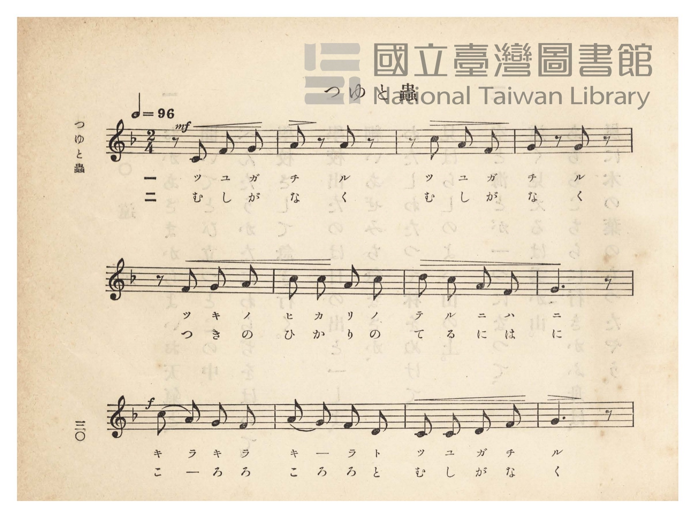
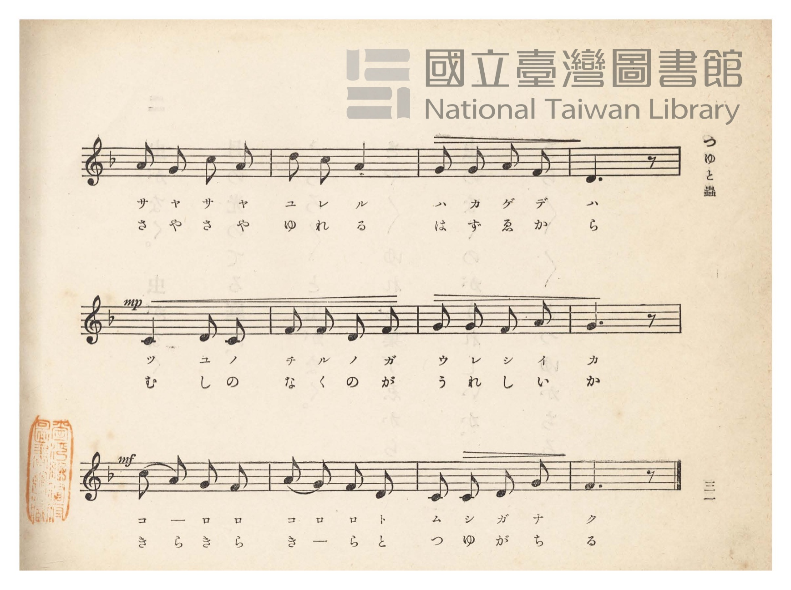
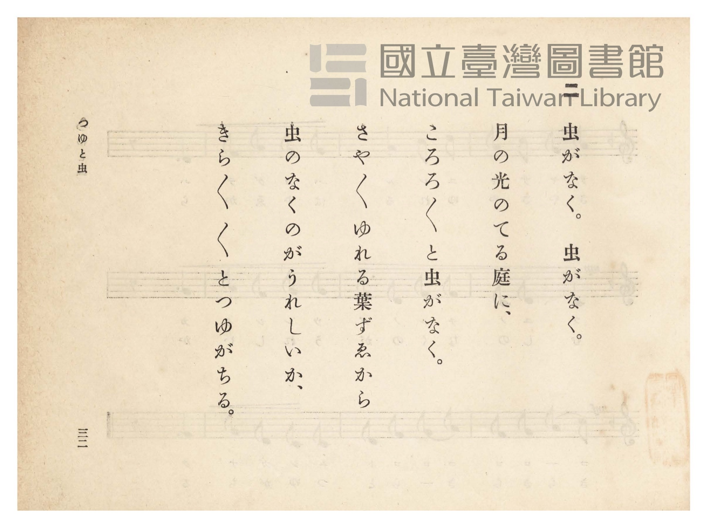
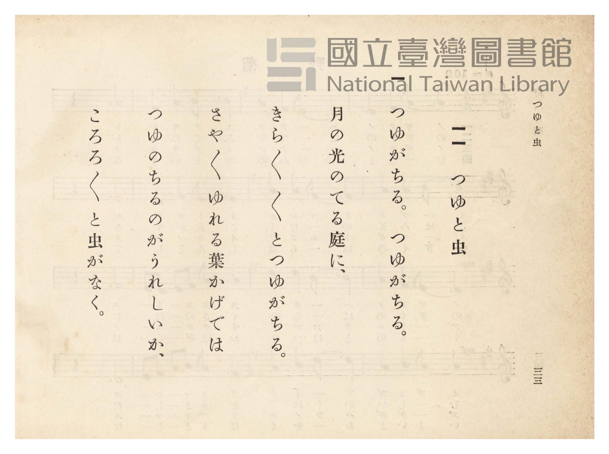

# つゆと虫

> Re:Shōka 使用 AI 協助辨識與重建樂譜，可能會有錯誤。歡迎回報。

- **NEUTRINO 歌聲合成版**：<br><audio controls src="tsuyu_to_mushi_neutrino.mp3"></audio>
- **鋼琴伴奏版**：<br><audio controls src="tsuyu_to_mushi.mp3"></audio>


- 臺灣總督府《公學校唱歌》第四學年用（昭和十一年，索書號 0729 73）

## 說明

原書資訊與歌詞全文（對應 P035.jpg–P038.jpg，原書 pp. 30–33）：
調性與拍號：ヘ長調（F 大調）2/4 拍，速度 ♩=96


## 歌詞

```text
一
つゆがちる、つゆがちる。
月の光のてる庭（には）に、
きらきらきらとつゆがちる。
さやさやゆれる葉かげでは、
つゆのちるのがうれしいか、
ころろころろと虫がなく。

二
虫がなく、虫がなく。
月の光のてる庭に、
ころろころろと虫がなく。
さやさやゆれる葉ずゑから、
虫のなくのがうれしいか、
きらきらきらとつゆがちる。
```

## ABC

```abc
X:1
T:つゆと虫
M:2/4
L:1/16
Q:1/4=96
K:F
V:V1 name="Piano" snm="Pia"
[V:V1]
!mf! z2 C2 F2 G2 | A2 z2 A2 z2 | z2 c2 A2 F2 | G2 z2 G2 z2 |
w: 1.~ツ ユ ガ | チ ル | ツ ユ ガ | チ ル
w: 2.~む し が | な く | む し が | な く
z2 F2 G2 A2 | c2 c2 A2 c2 | d2 c2 A2 F2 | G6 z2 |
w: 1.~ツ キ ノ | ヒ カ リ ノ | テ ル ニ ハ | ニ
w: 2.~つ き の | ひ か り の | て る に は | に
!f! c2 A2 G2 F2 | A2 G2 F2 D2 | C2 C2 D2 F2 | G6 z2 |
w: 1.~キ ラ キ ラ | キ _ ラ ト | ツ ユ ガ チ | ル
w: 2.~こ _ ろ ろ | こ ろ ろ と | む し が な | く
A2 G2 c2 A2 | d2 c2 A4 | G2 G2 A2 F2 | D6 z2 |
w: 1.~サ ヤ サ ヤ | ユ レ ル | ハ カ ゲ デ | ハ
w: 2.~さ や さ や | ゆ れ る | は ず ゑ か | ら
!mp! C4 D2 C2 | F2 F2 D2 F2 | G2 G2 F2 A2 | G6 z2 |
w: 1.~ツ ユ ノ | チ ル ノ ガ | ウ レ シ イ | カ
w: 2.~む し の | な く の が | う れ し い | か
!mf! c2 A2 G2 F2 | A2 G2 F2 D2 | C2 C2 D2 G2 | F6 z2 |
w: 1.~コ _ ロ ロ | コ ロ ロ ト | ム シ ガ ナ | ク
w: 2.~き ら き ら | き _ ら と | つ ゆ が ち | る
```

## TMD 檔案連結

- [主旋律 TMD 檔案](tsuyu_to_mushi.tmd) [[在 TMD Studio 編輯](https://tmdlang.github.io/Tmd-TS/#tmd=s7IKdvYPcrWy4qpTUCpJTLdSSM7PyUlNLsnMz7PKzk9PzM7Ojy_OyM9OVIKrKMvPKc1NtUovSkxJjTdBiBfnlxYlp1oVJ2fk5-fEl6RWlCTl52ejy8cXJKanWgUYGJsiZAqK8stS8xLzgLoLijLzSlJTwNoRClLLMlNSQdLFyYl58WWpRZlpmakpSE5KLSoGuRhqRUlRYl5xclFmAcgbCFX5RSUZ-UBnF2RUWmVkFpfkF2UmJ-bEZyfmIfmuJCMV6Lm8xJLSolR00cS8zNzEnGJ04eLUxOL8vPjE0pLSXBTrMtMz86xKEjPLgY7OT0vLTM5MzFHi0tJSeNy45HFT2-PGFS9mrlbQ0uJStFWwNOOyt1Vw47Ix0jexA5nxon3X88bFz3fsfT538dNdcx43dD1tXfN07Y5nCxY-nbLx2dqexw3dz9eseTp7NlDw6c4tz6eseL-n49mMtU8n9TztbXyyowEo-H5Pz_Mti57N3vFi5nwFA3MjSwVz4_d7OpW4uPS1FGypBbgUFBSe9s0HWbO5_cWKrhcd7UD3vVg572nrimfT2oHOerqh91l7pwIo2vWyCtIfNUwGMi1ATKALIVoVCgr0FIwNgFLGICe-3zMLZOyLVfufNSwHGdjdC_QDUPRx84yXU7cDxYHGuik8XbIczOwEBpsCUA3QuJcN85_uWqbwaOZKW2CgggwBhgWIgoV6z-PGhY-buh83NGKINIHUPZvT8bhx3dPWTiD5uHEZUOLprrVA2x43rn7cuB5oF4jR0AgxsvdxE5CPTK7AburjxqmPm1qgJFC6qQco92IiUEP348ZJjxuXA82GmwoxAGg72AAQA2gYWE_j9MeNQFNAroconfy4CWhvLxIDlKrAGlY9buwH2Q4Og1094PBEkWpEV4nL98g-JsJCvN6d9bhpIsgDwLCCGAnWDbQLrBuvX4kObMrTNBQoaOlzcYUUl1aWhuT7lhZnZFoFZCbm5TvUGNRUgyxSsLHQsgMzsGUoBWAGBSa-Fwt7FDRMFJ5u6H--vkEHngs0sWgAWgcyrEbBQKE6N61WwTRewVDBCMg3BoqAMEjGFMgyBLKMgGwQrgHr8TGsUYhXeNzcAsTLFB43rQGqeNzcCBZbDSQJyELMMAKramoABvZ0IO4BqWpcBRJr7IeZgVsWnNJwh8SuHvJCAhQCxkCWKdjnpkCWGVIY6AIhljBoWguk-8C-nATkrQbSq-AibWBfP27uBuJ-sEg32By0cGhcAkp0QLwO7NNNQAzU0dQFFwGFJFCkEWhW43qwyGq4OQRSRSc5YVENShJAnxuB_Q6hzUDRAkwnQARkYg8TSGishNMQEV2IWHMHOAQQKQOULkAiCL_AwgSY6UG6moBhAsQQPowHzIxgcxGpA5Q2QGr6iQsTYFWGGSZmBMMEFAqgMIGlCl1wCIBSDCgsgEGCGRhbgZ4DRi2UBnkV6PFmkMdBXgbx-yFJpgkY5c3tUBHMwJgKVAEMNigNMhmYsJqAHgcmCrA5wEQBLPCA_IngpANS0UlkAtk1hZzAqM4tABcauiCPA-kaYCCAkwgkXYDSCyiksKQQYPyD0gMoICB5pBGaR_pgpUUTNJCatgMxONiAQYQRKMD4B5oDTgGQPALMdcAUAOLBSgxoIIHVgIMNGDTEpZDWteQFCsFsAypiDbGklM3gQAFlmrVgD2-G82DZZgE0QECppwusZj2WlALKIp1wGiICykggMXC2ARU1oNQDzjYLweYgAqWWi0vXTgG5GlIA8pW5AA)]
- [鋼琴伴奏 TMD 檔案](tsuyu_to_mushi_piano.tmd) [[在 TMD Studio 編輯](https://tmdlang.github.io/Tmd-TS/#tmd=s7IKdvYPcrWy4tLSUnjcuORxU9vjxhUvZq5-v6fjZfee5xO2PNmz5enS_uedHe_3dCpoaXEp2ipYmnHZ2yq4cdkY6ZvYcdUpKL1o3_W8cfHzHXufz138dNecxw1dT1vXPF2749mChU-nbHy2tudxQ_fzNWuezp4NFHy6c8vzKSuA5j-bsfbppJ6nvY1PdjQABd_v6Xm-ZdGz2TtezJyvYGBuZKlgbgy0U4mLK6S4tLI0JN-3tDgj0yogMzEvP8jDocagpppLAQhsLLTswIwaBQOF6ty0WgXTeAVDBSMg3xgoAsIgGVMgyxDIMgKyQbgGrMfHsEYhXuFxcwsQL1N43LQGqOJxcyNYbDWQJCALMcMIrKqpARiA04G4B6SqcRVIrLEfZgZuWS6440GONgayTMGONQWyzJCcrQuEWJzdtBZI94EdNgnIWw2kV8FF2sAOfdzcDcT9YJFusDloTm9cAsS9QLwO7LhNQAzU0dQFFwF5HijSCDSrcT1YZDXcHKjzq0EBD3SsEdi5ENoM5HlgbAARkIndGxAPrITTEBFdiFhzB9jRiPAHhT5IBGE9zBuPGyeDdDUBvQHEED6MB0zSYHMRcQCKAZCafnRvgBwO8gYs7HXBjgbFC8j5QF9gun8r0D3AAITSINcB3doMcivIlSB-PyRimoAB29wOFcF0_1SgCqBPoTTIZGD0NQHdCgx6sDnAoH_cOAvInwiOIJCKToxoyC0AZwBdkFuBdA3Q3eCIgIQ-KFZAnsMSD8BQBoU6yO2QxNMITTx9sJTfBPVX03YgBvsU6CsMfwBDGWgOOJwhiQeYHIHhDOLBUj_UX2A1YJ8CfYPhD4LpCZTDDbHEx2awP0CpaS3YjZvhPFh6WgD1AyiOusBq1mOJD1Da6YTTEBFQCgOJgdMTKNuA4gicnhaCzUH4oxZbueWDvdwyjFeINoyFUWA-sDQAEZhypvEgcQgJcS1W_Sh8EyDDBM2MaNP4WOzGgGWRzTEDCZjF56JoxSqI31k4nQEXQRgKYhH0IFY3UNWXcAayG0BmAaNX104BOYajfYCyGGJGYDFlLgA)]

## 分析

```text
================================================================================
📊 TMD Song Profile: [ つゆと虫 ]
================================================================================
⏱  Duration:       0:30 (30.0s), 24 measures total
🎼 Key & Tempo:    首調基準 F, != 96.0 BPM, <2/4>
   - 分析範圍：      由實際發聲的音符與和弦推測調性；播放脈絡另行呈現
🎤 人聲音域:    C4 (MIDI 60) – D5 (MIDI 74) [跨度: 14 個半音 / 1.2 個八度, 難度: moderate]
   - 最低音:  C4 in [TsuyuToMushi #1 @ m.1, 0:00]
   - 最高音: D5 in [TsuyuToMushi #1 @ m.7, 0:07]
   - 適合: soprano, mezzo-soprano, contralto, tenor, baritone, bass
🏛  結構:      TsuyuToMushi (30.0s)
⚡ 編曲密度:        Peak 1 軌道同時演奏
🗝  調性診斷：       C 大調（純淨自然大調，未偵測到可信轉調）
   - 風格氣質:    純淨自然大調（陽光明朗、易唱易記，無明顯調外色彩）
   - 轉調歷程:    全曲維持單一推測調性（未偵測到可信轉調）
   - 核心骨幹音:  G, C, F, A, D
   - 調性數值:    C 大調 [相關度: 0.77, 穩定度: Moderate, 自然音純度: 100.0%]
   - 候選調性 (K-S): C 大調 (0.77), F 大調 (0.72), G 大調 (0.57)
   - 五度圈歷程:   +0
   - 各段落調性細節:
     • [TsuyuToMushi #1]: C 大調 (r: 0.77, 自然音純度: 100.0%)

  [ 五度圈游移軌跡 ]
              [C ]*
         F            G  
      Bb               D  
      Eb               A  
         Ab           E  
            Db       B  
               F# 
     (* = active key center)

  [ 十二半音累積音高分佈 ]
     C  : ██████████████████        20.2%
     C# :                            0.0%
     D  : ███████████               13.1%
     D# :                            0.0%
     E  :                            0.0%
     F  : ██████████████████        20.2%
     F# :                            0.0%
     G  : ████████████████████████  27.4%
     G# :                            0.0%
     A  : █████████████████         19.0%
     A# :                            0.0%
     B  :                            0.0%
--------------------------------------------------------------------------------
Assignment 軌道音域：
  - Piano         : C4 – D5 (14 個半音 / 1.2 個八度, 72 個音符)
================================================================================
```


## 原書掃描頁










