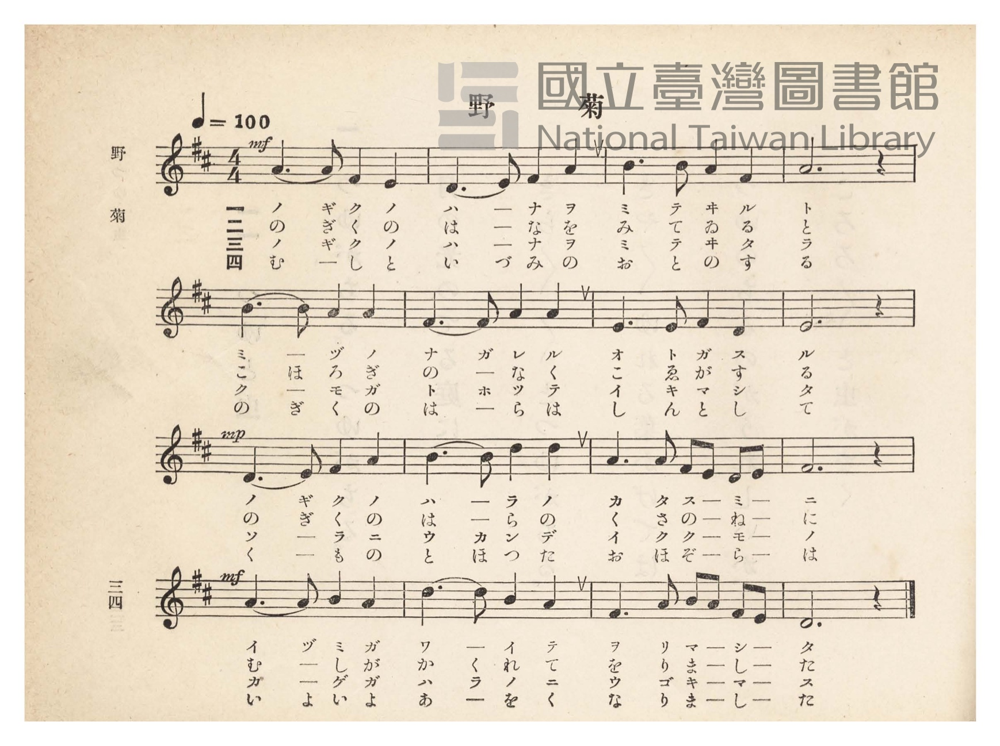
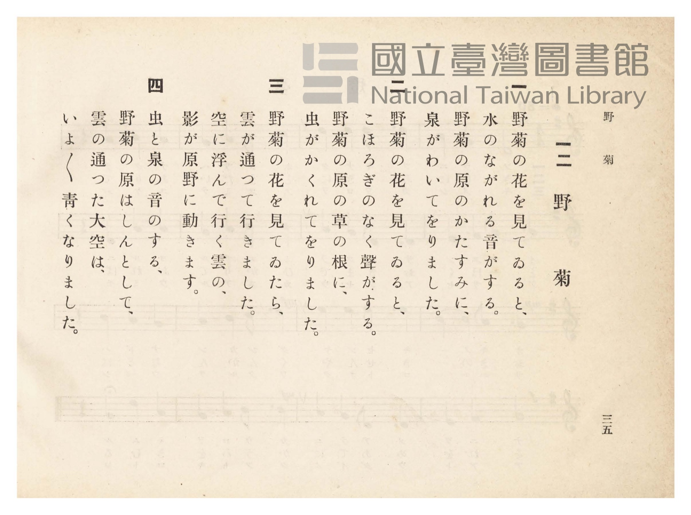

# 野菊

> Re:Shōka 使用 AI 協助辨識與重建樂譜，可能會有錯誤。歡迎回報。

- **鋼琴伴奏版**：<br><audio controls src="nogiku.mp3"></audio>
- **NEUTRINO 歌聲合成版**：<br><audio controls src="nogiku_neutrino.mp3"></audio>

- 臺灣總督府《公學校唱歌》第四學年用（昭和十一年，索書號 0729 73）

## 說明

原書資訊與歌詞全文（對應 P039.jpg–P040.jpg，原書 pp. 34–35）：
調性與拍號：ニ長調（D 大調）4/4 拍，速度 ♩=100


## 歌詞

```text
一
野菊（のぎく）の花を見てゐると、
水のながれる音がする。
野菊の原のかたすみに、
泉（いづみ）がわいてをりました。

二
野菊の花を見てゐると、
こほろぎのなく聲（こゑ）がする。
野菊の原の草の根に、
虫がかくれてをりました。

三
野菊の花を見てゐたら、
雲が通（とほ）つて行きました。
空に浮（うか）んで行く雲の、
影（かげ）が原野（はらの）に動（うご）きます。

四
虫と泉の音のする、
野菊の原はしんとして、
雲の通つた大空（おほぞら）は、
いよいよ青くなりました。
```

## ABC

<div class="abc-score" data-abc-src="nogiku.abc" aria-label="五線譜載入中"></div>

[下載 ABC 原始檔](nogiku.abc)

## TMD 檔案連結

- [主旋律 TMD 檔案](nogiku.tmd) [[在 TMD Studio 編輯](https://tmdlang.github.io/Tmd-TS/#tmd=s7IKdvYPcrWy4qpTUCpJTLdSSM7PyUlNLsnMz7PKzk9PzM7Ojy_OyM9OVIKrKMvPKc1NtUovSkxJjTdBiBfnlxYlp1oVJ2fk5-fEl6RWlCTl52ejy8cXJKanWgUYGFsiZAqK8stS8xLzgLoLijLzSlJTwNoRClLLMlNSQdLFyYl58WWpRZlpmakpSE5KLSoGuRhqRUlRYl5xclFmAcgbCFX5RSUZ-UBnF2RUWmVkFpfkF2UmJ-bEZyfmIfmuJCMV6Lm8xJLSolR00YKcxLySYnTR4tTE4vy8-MTSktJcFNsy0zPzrHLz85JKgSGoxKWlpfCyve9Ff5eClhaXoq2CoYEBl72tgguXjYm-iR1I34v2Xc8bFz_fsff53MVPd8153ND1tHXN07U7ni1Y-HTKxmdrex43dD9fs-bp7NlAwac7tzyfsuL9no5nM9Y-ndTztLfxyY4GoOD7PT3Ptyx6NnvHi5nzFQzMjSwVzI3f7-lU4uLS11KwpRbgUlBQeNo3H2TN5vYXK7pedLQD3fdi5bynrSueTWsHOuvpht5n7Z0KoJjWyypIf9QwOcDAxADEBLoQolWhoEBPwdgEKGVsCnTi-z2zQMa-WLX_WcNykIHdvUA_AEUfN3e_nLodKA401kXh6ZLlYGYnMNgUgGqAxr1smP901zKFRzNX2oJCFWQKMDBAFCTEgfoeN6573Nj3uLEfqBHIftG18XHTpBfLuh83LnvcNOFxE5Cx4nFDI0jPsw1bwKpXPW7sedwERN0v528GsRtngtQ1NCEMBqoDegWsGmgAkDHzceP-x42rYSZtBnoKaHXL48alQAmw1UDz-sEiQHsnPW4CGrHvceN0kGagwWCX7-pBsQCfUx83Tn7cuPtxUy_YbxA3979o3AS2dfLjpolQK_G4_EUvKDyeLdiJcPaLmavBmoAW9YMCALdTd3TidSpQZVMn1NCXszcBDX3ZMAvsthVAZ4PdtgSo9MVCoB1ALyCZDtTwfOUuoJOebV0H1tAGdA5IQxPQw8vBGvrBJq6DGv9070awOqDVkyCeBnoP6DCw4HqQMxqBBgHJ1U-7p8JMnAIWgdg8E-YpYPaCB8IKYAwCNYLjHxi6kFCEeAclFNeDXA5yGtBfQC8sQ_bzOqCfwf6cD0y5QE-BLQfq3P24cR7QXWAnrIfHZ8vjJnCCaep4OXcSKPyBUYoW8kB1lGdgKFDQ0ufi8stPz8wutQrITMzLd6gxqKkGWaFgY6FlB2ZgKzcUgOUQMIsBI0JBw0Th6Yb-5-sbdOCZXROLBqBFIMNqFKpz02oVTBV0gdBUwRhIGgFxjYIhWMQILAKSrVEwA4uYgXkg0RqoLgg0AImAjfQxrFF43NwHFn3ctA6I14NYYBGQTD9Ux-PmLjC5CSo-HyraBsQbwKzVUJkOJHviEfYYAeUa10F0NfYBMchkiAhIBmQrRG4V2CWToOL7oaLLgGITwDLdUJkV2O0xppJ_mkA2g2RWYrfHBCjX1AB39XQwCXITyG0tUNGlUB8g_AmyFaISIgbMFxAZsL9Q7cGfgHb1kJOAkNMFJKWAUgcojSBEQGkKlppAKQsmgj3tQEIOFHatKCEN9WnTGiB7DVgGmkKaQDEM4neAZUFqdkL1gFTgSjuToSG3G6i-F8yC2gRNVfC0A05ZSDqaJgLZPQTCGp52wOkF4r5FUPcjp-vHzbOBuBnMaoOatgRqz1qg2DwwaztUBpJ6saYdYvJCUydYHMQHiYPSGEh0MjSlQURAMssw7CFQ-HSSV_gU1OIpagzjgBSYgBU2oCLKCKjDCJ7MsCchYrIrKBvCxZsgCQUUwJDEA0mGIB04opbY4gca5DBxiP2PG6fCs-taqAyOpApOQnvRXA0tspog0QRy_ePmzWCZdqgMLAmth4cAKPEhwgZ7EoKHTlMTiqshRSM4qzQuBrOgoQMvfkAykKQK8i9yCBCZhIAVPcX1FyjhQJIQONWAEw9CDJJgQKogyQhWy2FNQrAABJZBkKSAyLeIqAWpgedacMkP4q8iNteCkhBGiQ8qV0DBB0l2oCgBNvrALFBkg3SAajKQ6V1AsX1wnSA9sJITWxKCJa_HTSB3InwDTZDAhAVJGpiJawu4JALJgHwFkgFlEFxJCFpTNQHLYjAbxIK4DpSkIHIgHyBKVWjpTZR_arm4dO0UIE0kBSBLmQsA)]
- [鋼琴伴奏 TMD 檔案](nogiku_piano.tmd) [[在 TMD Studio 編輯](https://tmdlang.github.io/Tmd-TS/#tmd=s7IKdvYPcrWy4tLSUnjZ3veiv-v9no6X3XueT9jyZM-Wp0v7n3d2vN_TqaClxaVoq2BoYMBlb6vgwmVjom9ix1WnoPSifdfzxsXPd-x9Pnfx011zHjd0PW1d83TtjmcLFj6dsvHZ2p7HDd3P16x5Ons2UPDpzi3Pp6wAWvBsxtqnk3qe9jY-2dEAFHy_p-f5lkXPZu94MXO-goG5kaWCuTHQUiUuLr_89MzsUquAzMS8_CAPhxqDmmouBSCwsdCyAzNqFKpz02oVTBV0gdBUwRhIGgFxjYIhWMQILAKSrVEwA4uYgXkg0RqoLgg0AImAjfQxrFF43NwHFn3ctA6I14NYYBGQTD9Ux-PmLjC5CSo-HyraBsQbwKzVUJkOJHviEfYYAeUa10F0NfYBMchkiAhIBmQrRG4V2CWToOL7oaLLgGITwDLdUJkV2O0xppJ_mkA2g2RWYrfHBCjX1AB39XQwCXITyG0tUNGlUB8g_AmyFaISIva4cSZEBuwvVHugcY4clZDIBUUoKFoRIqBkAEsAoMQAE8Ee3RDPgrzbihI4UMc1rQGy14BloJHaBIoUEL8DLAtSsxOqB6QCV3RPhnp2N1B9L5gFtQmaEODRDU4MSDqaJgLZPQSCBx7d4CiGuG8R1P3ISfFx82wgbgaz2qCmLYHasxYoNg_M2g6VgSQ4rNFNTPJt6gSLg_ggcVCyAIlOhiYOiAhIZhmGPfAsXlCLJ0MbxgEpMAHL0qCCwAiowwieMrDHOjGZApTY4eJNkLgFhQkkviEpB6QDR2wQm8mhoQQTh9j_uHEqPFOshcrgSF3gWN-L5mpowdAECVmQ6x83bwbLtENlYLG-Hh4CoPSCCBvssQ4PnaYmFFdDCiBw6m5cDGZBQweeyUEykNQF8i9yCGCJdaSCHRTXkFgHRzQ4vhFikDgGqYLEPKz4xxrrMD8Dczok9hC5AxEbIDXwvAEuEkH8VcTmDVCsYxSFoNwL8jEkpYBC8XETJEeD4gekA1TEg0zvAortg-sE6YGVT9hiHZYiHjeB3InwDTQNAdMCJDYx08MWcH4HyYB8BZIBpWlcsQ4twpuAJR6YDWJBXAdKBRA5kA8QZRe0jCTKP7Wotb0Pcm1vAq_tDeMVog1jYRQm3wTIMEHim8YDWabxsWCGAdQ7mMrQjYFrI2QQDvuhFFwerBvNJgxD0DWB-Mh64E5ANwUYdLp2CpDQi_YBiiPxjFB4xig8oGVAnjIXAA)]

## 分析

```text
================================================================================
📊 TMD Song Profile: [ 野菊 ]
================================================================================
⏱  Duration:       0:38 (38.4s), 16 measures total
🎼 Key & Tempo:    首調基準 D, != 100.0 BPM, <4/4>
   - 分析範圍：      由實際發聲的音符與和弦推測調性；播放脈絡另行呈現
🎤 人聲音域:    D4 (MIDI 62) – D5 (MIDI 74) [跨度: 12 個半音 / 1.0 個八度, 難度: easy]
   - 最低音:  D4 in [Nogiku #1 @ m.2, 0:02]
   - 最高音: D5 in [Nogiku #1 @ m.10, 0:22]
   - 適合: soprano, mezzo-soprano, contralto, tenor, baritone, bass
🏛  結構:      Nogiku (38.4s)
⚡ 編曲密度:        Peak 1 軌道同時演奏
🗝  調性診斷：       A 調性不明確（純淨自然大調，未偵測到可信轉調）
   - 風格氣質:    純淨自然大調（陽光明朗、易唱易記，無明顯調外色彩）
   - 轉調歷程:    全曲維持單一推測調性（未偵測到可信轉調）
   - 核心骨幹音:  A, F#, D, E, B
   - 調性數值:    A 調性不明確 [相關度: 0.80, 穩定度: Ambiguous, 自然音純度: 100.0%]
   - 候選調性 (K-S): A 大調 (0.80), D 大調 (0.80), F# 小調 (0.71)
   - 五度圈歷程:   +3
   - 各段落調性細節:
     • [Nogiku #1]: A 調性不明確 (r: 0.80, 自然音純度: 100.0%)

  [ 五度圈游移軌跡 ]
               C  
         F            G  
      Bb               D  
      Eb              [A ]*
         Ab           E  
            Db       B  
               F# 
     (* = active key center)

  [ 十二半音累積音高分佈 ]
     C  :                            0.0%
     C# :                            0.0%
     D  : ███████████████           19.2%
     D# :                            0.0%
     E  : ███████████               14.2%
     F  :                            0.0%
     F# : ████████████████          20.8%
     G  :                            0.0%
     G# :                            0.0%
     A  : ████████████████████████  31.7%
     A# :                            0.0%
     B  : ███████████               14.2%
--------------------------------------------------------------------------------
Assignment 軌道音域：
  - Piano         : D4 – D5 (12 個半音 / 1.0 個八度, 56 個音符)
================================================================================
```


## 原書掃描頁






