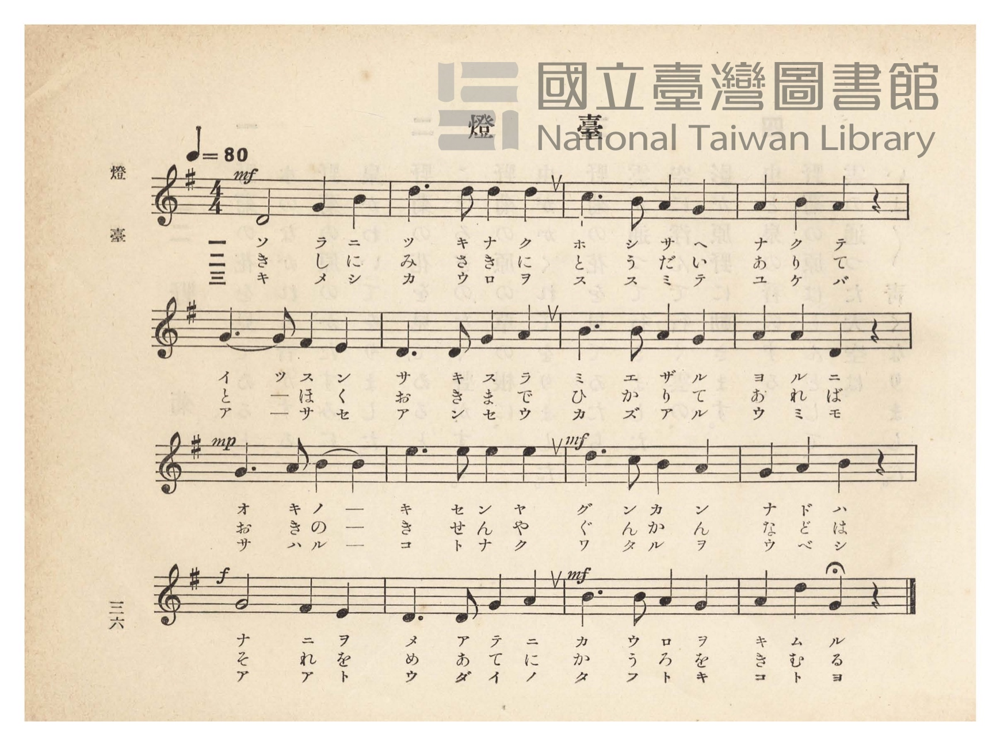
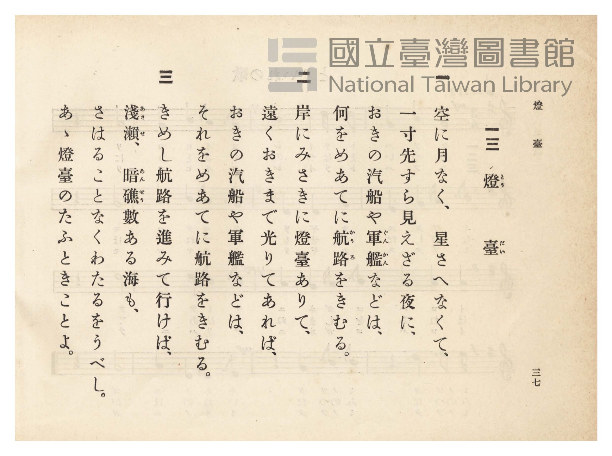

# 燈臺

> Re:Shōka 使用 AI 協助辨識與重建樂譜，可能會有錯誤。歡迎回報。

- **NEUTRINO 歌聲合成版**：<br><audio controls src="todai_neutrino.mp3"></audio>
- **鋼琴伴奏版**：<br><audio controls src="todai.mp3"></audio>


- 詞：文部省（尋常小學唱歌）
- 曲：文部省（尋常小學唱歌）
- 臺灣總督府《公學校唱歌》第四學年用（昭和十一年，索書號 0729 73）

## 說明

原書資訊與歌詞全文（對應 P041.jpg–P042.jpg，原書 pp. 36–37）：
調性與拍號：ト長調（G 大調）4/4 拍，速度 ♩=80


## 跨冊／重複收錄參照

> 同詞異曲（同採文部省『尋常小學唱歌』「遠く見ゆるは沖の島…」歌詞；《公學校唱歌》第四學年為文部省 G 大調原曲，《新定兒童唱歌》第四學年為田村虎藏 e 小調曲）

- **[同詞異曲]** 《新定兒童唱歌》尋常科第四學年用（2020.006.0847.0004）：[**〈燈臺〉**](../../../shintei_jido_shoka/grade_4_2020.006.0847.0004/2_08_todai/index.md)（`G` / `4/4` — [原始 TMD](../../../shintei_jido_shoka/grade_4_2020.006.0847.0004/2_08_todai/todai.tmd)）
- **[同名異曲]** 《新編小公學校唱歌教材集》第五、六學年（大正12年／1923，國臺圖 0725-41）：[**〈燈臺〉**](../../../shoka_kyozai_shu_1923/grade_5_6/33_todai/index.md)（`G` / `4/4` — [原始 TMD](../../../shoka_kyozai_shu_1923/grade_5_6/33_todai/todai.tmd)）
- 總表：[跨冊重複與同名歌曲總索引](../../../duplicate_songs.md)

## 歌詞

```text
一
空に月なく星さへなくて、
一寸先（さき）すら見えざる夜（よる）に、
沖の汽船や軍艦などは、
何を目あてに航路（かうろ）をきむる。

二
岸にみさきに燈臺（とうだい）ありて、
遠く沖まで光りてをれば、
沖の汽船や軍艦などは、
それを目あてに航路をきむる。

三
きめし航路を進みて行けば、
淺瀨暗礁（あさせあんせう）數ある海も、
さはることなくわたるを得べし。
ああ燈臺のたふときことよ。
```

## ABC

```abc
X:1
T:燈臺
C:曲：文部省（尋常小學唱歌）
M:4/4
L:1/16
Q:1/4=80
K:G
V:V1 name="Piano" snm="Pia"
[V:V1]
!mf! D8 G4 B4 | d6 d2 d4 d4 | c6 B2 A4 G4 | A4 B4 A4 z4 |
w: 1.~ソ ラ ニ | ツ キ ナ ク | ホ シ サ ヘ | ナ ク テ
w: 2.~き し に | み さ き に | と う だ い | あ り て
w: 3.~キ メ シ | カ ウ ロ ヲ | ス ス ミ テ | ユ ケ バ
G6 G2 F4 E4 | D6 D2 G4 A4 | B6 B2 A4 G4 | A4 A4 D4 z4 |
w: 1.~イ ッ ス ン | サ キ ス ラ | ミ エ ザ ル | ヨ ル ニ
w: 2.~と _ ほ く | お き ま で | ひ か り て | を れ ば
w: 3.~ア _ サ セ | ア ン セ ウ | カ ズ ア ル | ウ ミ モ
!mp! G6 A2 B4 B4 | e6 e2 e4 e4 | !mf! d6 c2 B4 A4 | G4 A4 B4 z4 |
w: 1.~オ キ ノ _ | キ セ ン ヤ | グ ン カ ン | ナ ド ハ
w: 2.~お き の _ | き せ ん や | ぐ ん か ん | な ど は
w: 3.~サ ハ ル _ | コ ト ナ ク | ワ タ ル ヲ | ウ ベ シ
!f! G8 F4 E4 | D6 D2 G4 A4 | !mf! B6 B2 A4 G4 | A4 d4 G4 z4 |
w: 1.~ナ ニ ヲ | メ ア テ ニ | カ ウ ロ ヲ | キ ム ル
w: 2.~そ れ を | め あ て に | か う ろ を | き む る
w: 3.~ア ア ト | ウ ダ イ ノ | タ フ ト キ | コ ト ヨ
```

## TMD 檔案連結

- [主旋律 TMD 檔案](todai.tmd) [[在 TMD Studio 編輯](https://tmdlang.github.io/Tmd-TS/#tmd=s7IKdvYPcrWy4qpTUCpJTLdSSM7PyUlNLsnMz7PKzk9PzM7Ojy_OyM9OVIKrKMvPKc1NtUovSkxJjTdBiBfnlxYlp1oVJ2fk5-fEl6RWlCTl52ejy8cXJKanWgUYmBgiZAqK8stS8xLzgLoLijLzSlJTwNoRClLLMlNSQdLFyYl58WWpRZlpmakpSE5KLSoGuRhqRUlRYl5xclFmAcgbCFX5RSUZ-UBnF2RUWmVkFpfkF2UmJ-bEZyfmIfmuJCMV6LniVAyhgpzE5FQlLi0theftHS_adyloaXEp2ipYGHDZ2yq4c9mY6JvYgbS8WDnv_Z5Zz6a1v2xe8XxO4_s9HU83dD_dsePphv6na3c8nbLx2dqe93s6wcY_m72JaLVAK583Ln6-Y-_zuYuf7przuKHraesaoKpnCxZCFD5u6H6-Zs3T2bNBWndueT5lBdC8ZzPWPp3U87S38cmOBqDg-z09z7csejZ7x4uZ8xUMzI0sFcyNwRZw6Wsp2FILcCkoKDztmw-yZnP7ixVdLzrage4DBszT1hVAz4K92fusvVMBlAz0sgrSHzVMBjKNQEygCyFaFQoK9BSMzYBSxuZAJwLDCWTsi1X7nzUsBxnY3Qv0A1D0cXPHy6nbgeJAY90Vni5ZDmZ2AqNDAagGaNzLhvlPdy1TeDRzpS0wskCGAMMCRD1fuetx4-pnczoeN6563Nj_bMb8x41THzfugHAfNy573NAIVf50_Y6nrR1AG8AqgKZ2Pm6c-bip88Wy7seNQMFpj5u6ny6ZA1LQBETdYAWrofqfbZr2uHHds417X3TsfNzU8mJ374vOZWBLVj5uXA-zZO_Ux02Tns9e97ixCWR14-oXHatebF8PthNoSdvjJrC1TZOA9j9uagBa8rihCeKdXT3gEN8EdPnqx437IW4EsiEJFWzCCpAJjQseN7aAndb0uKkL4cGXIIl-sDP3PW5c_rQVaA1YGmhZU8_jxg2keORx41yQJmx-wer4HZ0QXUDxxseN0-EqXzZsAvtl2YuFQCdMRHLF9l3PG1Y8mzX9-RJQjgHbAfTwbLCvJoMZbUBPPpsKDA6gSPezrdsfNzXBXQdUCjQeGKJApcBQAUd1EzC254MEmyY93Tf9ceNOoENADgRrABrfBAlJoOdB6hq3gnUCQxhsBDDCIUopzzhQoKClz8UVkp-SmGkVkJmYl-9QY1BTDbJBwcZCyw7MwJZdFYDZH5hWgeGloGGiACxDnq9v0IHnMU0sGoD2gAyrUajOTatVMI1X0AVDQyA2BuIaBVMw3xRMg3CNgglYxFjBCKquBswCqQbRBiARsJk-hjUKj5v2Qk183LwSTHaDdTxuboGINq0FsrvArPVQmdlQme1AvBWsZwZUBqHucXMbkAS5FmqXEVC-sRdmV-N0MLkaoq9xP1R0KlQNQmYFVKYNiBeAWSB3gWSawHaBbWxchmqXMchfa-H-Wgh1LVhfE8hkEH8ZUAak5nHzJqjMTqjMTqDYfLgfQP4Cmf-4aSNYbALcLvyxvKuHnFgGxRco1sxBVpiB7YFFOpACyYLisAYcm5hxDMJg1eiRvAQaFM1Qbz5u3gz1NCgCodEMlQElA5CnQUEAklkBxNvAMtBIaQZFCoQHSS7o0QyJNFDE7AaT_dAoA0UWiN8LxPvArOVQGVAUgPjdKFEKct8ksBt6wGIbUO0CR_MimF2QpNgEshEhDvInRAwU4agJYBdUFdxfYBWwqAfJEBPNOzrJy8wFtdC4NgLHJSQvm4FFzMA0CMNyPVjYBJ6FIckElqnR43oVIkab-6Chg8gQoNCAxP7jZlCqAMmAwhUWVpBYhaYOSIZu7gSToFhEj2nkGF2HsAua0YEFPdDEyWBbYdkWlH1A_Mng2IawIDIgdwOrKTAJKkLQYxqaUoHugMQYzF8gt4LEOzAKKhAN4u-Hp1ZYVofE9EywLKhgICKmga02smIaGH-QiNYlmKnBkY09Z4OSAIiHFtlgD0O8Dw5MmAfBZR7Ic4ugpRi8XMdT_kF44FIWHFzokT0XZhckO4KzJkhfI0QUWCJDsi2i9AbZCeIDS-8mcLkO0wMp5ZsawCRaEYKWrSFZtAMp4kD8BmihBkniIBloHdIMrEPAqiH-gSUQqBi46ILYVcvFpWunAK7CFYAMZS4A)]
- [鋼琴伴奏 TMD 檔案](todai_piano.tmd) [[在 TMD Studio 編輯](https://tmdlang.github.io/Tmd-TS/#tmd=s7IKdvYPcrWy4tLSUnje3vGifdf7PR0vu_c8n7DlyZ4tT5f2P-_seL-nU0FLi0vRVsHCgMveVsGdy8ZE38SOq05B6cXKee_3zHo2rf1l84rncxqBep9u6H66Y8fTDf1P1-54OmXjs7U9QO1KILXPZm8iWi3QHc8bFz_fsff53MVPd8153ND1tHUNUNWzBQshCh83dD9fs-bp7NkgrTu3PJ-yAmjesxlrn07qedrb-GRHA1Dw_Z6e51sWPZu948XM-QoG5kaWCubGYAu4QvJTEjOtAjIT8_KDPBxqDGqquRSAwMZCyw7MqFGozk2rVTCNV9AFQ0MgNgbiGgVTMN8UTINwjYIJWMRYwQiqrgbMAqkG0QYgEbCZPoY1Co-b9kJNfNy8Ekx2g3U8bm6BiDatBbK7wKz1UJnZUJntQLwVrGcGVAah7nFzG5AEuRZqlxFQvrEXZlfjdDC5GqKvcT9UdCpUDUJmBVSmDYgXgFkgd4FkmsB2gW1sXIZqlzHIX2vh_loIdS1YXxPIZBB_GVAGpOZx8yaozE6ozE6g2Hy4H0D-Apn_uGkjWGwC3C5oxICCGBTQ5iBRM7AULJ6AFEgWFOw14AjAjBYQBqtGj5clUNc3Q132uHkz1J2gMIfGDFQGFHMgd4JcDZJZAcTbwDLQcGwGhSOEB4lh9JiBhDMoLHeDyX5oKIPCF8TvBeJ9YNZyqAwo1ED8bpRYALlvEtgNPWCxDah2gWNmEcwuSOppAtmIEAf5EyIGiiPUONsFVQX3F1gFLLZAMigxU51bUAuNHiNw8ENyjBlYxAxMgzAsb4GFTeAZBRKzsKyDHj2rEJHQ3Af1ECLZgTwAibDHzaCIBMmAggLmPUhEQCMUkm2aO8EkKODRIwc5EtYh7IJmp8eNs4EmTgbbCsscoEQK4k8GRxCEBZEBuftxIzirN4IyKnrkQBMX0B2QQIb5C-RWkHgHRnEAokH8_fAEBstQkMiZCZYFZT_UyAEGOSRudAlmHXD8YM8_oFgD8dDiB-xGiIvB_oe5CVwYgNyzCJq94QUenoIBwgMXP2AfosfPXJhdkEQPzgAgfY0QUWBRBckciGINZCeIDyzWmsAFHkwPpPhragCTaBkVLfNAMkIHUliD-A3QogOSKkEy0MK1GVi4glVD_AOLU6gYuICA2FWLUhv5INdGJvDayDBeIdowFkZh8k2ADNN4JAHTeKgIiGEA9RJcH1yWsMn4DUJxgEksjILIw3Rh2EQV90DNAQafrp0COASjfYAqEBwjZI4xmKPMBQA)]

## 分析

```text
================================================================================
📊 TMD Song Profile: [ 燈臺 ]
================================================================================
⏱  Duration:       0:48 (48.0s), 16 measures total
🎼 Key & Tempo:    首調基準 G, != 80.0 BPM, <4/4>
   - 分析範圍：      由實際發聲的音符與和弦推測調性；播放脈絡另行呈現
🎤 人聲音域:    D4 (MIDI 62) – E5 (MIDI 76) [跨度: 14 個半音 / 1.2 個八度, 難度: moderate]
   - 最低音:  D4 in [Todai #1 @ m.1, 0:00]
   - 最高音: E5 in [Todai #1 @ m.10, 0:27]
   - 適合: soprano, mezzo-soprano, contralto, tenor, baritone, bass
🏛  結構:      Todai (48.0s)
⚡ 編曲密度:        Peak 1 軌道同時演奏
🗝  調性診斷：       G 大調（純淨自然大調，未偵測到可信轉調）
   - 風格氣質:    純淨自然大調（陽光明朗、易唱易記，無明顯調外色彩）
   - 轉調歷程:    全曲維持單一推測調性（未偵測到可信轉調）
   - 核心骨幹音:  D, G, A, B, E
   - 調性數值:    G 大調 [相關度: 0.85, 穩定度: Moderate, 自然音純度: 100.0%]
   - 候選調性 (K-S): G 大調 (0.85), D 大調 (0.82), B 小調 (0.62)
   - 五度圈歷程:   +1
   - 各段落調性細節:
     • [Todai #1]: G 大調 (r: 0.85, 自然音純度: 100.0%)

  [ 五度圈游移軌跡 ]
               C  
         F           [G ]*
      Bb               D  
      Eb               A  
         Ab           E  
            Db       B  
               F# 
     (* = active key center)

  [ 十二半音累積音高分佈 ]
     C  : ████                       3.3%
     C# :                            0.0%
     D  : ████████████████████████  22.5%
     D# :                            0.0%
     E  : ███████████               10.0%
     F  :                            0.0%
     F# : ████                       3.3%
     G  : ████████████████████████  22.5%
     G# :                            0.0%
     A  : ██████████████████████    20.8%
     A# :                            0.0%
     B  : ███████████████████       17.5%
--------------------------------------------------------------------------------
Assignment 軌道音域：
  - Piano         : D4 – E5 (14 個半音 / 1.2 個八度, 58 個音符)
================================================================================
```


## 原書掃描頁






