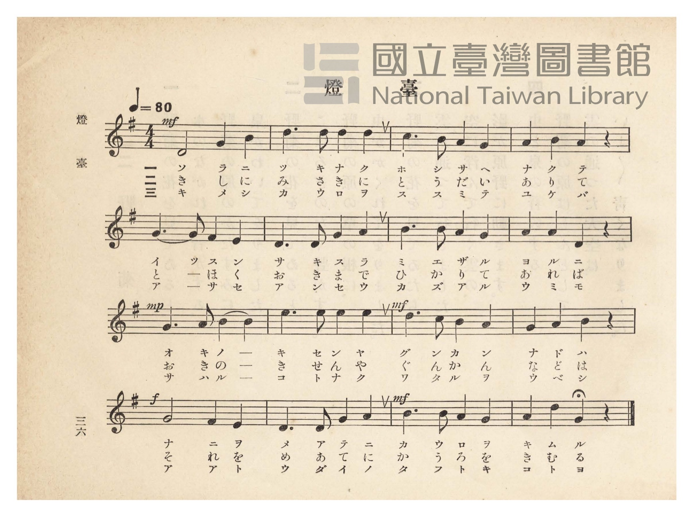
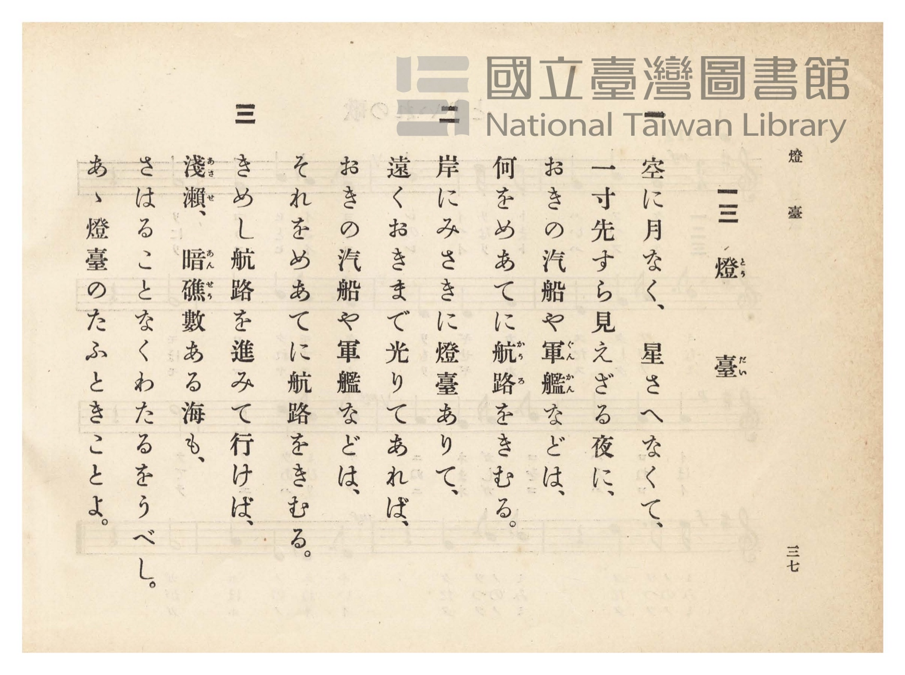

# 燈臺

> Re:Shōka 使用 AI 協助辨識與重建樂譜，可能會有錯誤。歡迎[回報](https://github.com/TMDLang/reshoka/issues)。

- **鋼琴伴奏版**：<br><audio controls src="todai.mp3"></audio>
- **NEUTRINO 歌聲合成版**：<br><audio controls src="todai_neutrino.mp3"></audio>

- 詞：文部省（尋常小學唱歌）
- 曲：文部省（尋常小學唱歌）
- 臺灣總督府《公學校唱歌》第四學年用（昭和十一年，索書號 0729 73）

## 說明

原書資訊與歌詞全文（對應 P041.jpg–P042.jpg，原書 pp. 36–37）：
調性與拍號：ト長調（G 大調）4/4 拍，速度 ♩=80


## 歌詞

```text
一
空に月なく星さへなくて、
一寸先（さき）すら見えざる夜（よる）に、
沖の汽船や軍艦などは、
何を目あてに航路（かうろ）をきむる。

二
岸にみさきに燈臺（とうだい）ありて、
遠く沖まで光りてをれば、
沖の汽船や軍艦などは、
それを目あてに航路をきむる。

三
きめし航路を進みて行けば、
淺瀨暗礁（あさせあんせう）數ある海も、
さはることなくわたるを得べし。
ああ燈臺のたふときことよ。
```

## ABC

<div class="abc-score" data-abc-src="todai.abc" aria-label="五線譜載入中"></div>

[下載 ABC 原始檔](todai.abc)

## TMD 檔案連結

- [主旋律 TMD 檔案](todai.tmd) [[在 TMD Studio 編輯](https://tmdlang.github.io/Tmd-TS/#tmd=s7IKdvYPcrWy4qpTUCpJTLdSSM7PyUlNLsnMz7PKzk9PzM7Ojy_OyM9OVIKrKMvPKc1NtUovSkxJjTdBiBfnlxYlp1oVJ2fk5-fEl6RWlCTl52ejy8cXJKanWgUYmBgiZAqK8stS8xLzgLoLijLzSlJTwNoRClLLMlNSQdLFyYl58WWpRZlpmakpSE5KLSoGuRhqRUlRYl5xclFmAcgbCFX5RSUZ-UBnF2RUWmVkFpfkF2UmJ-bEZyfmIfmuJCMV6LniVAyhgpzE5FRkwzLTM_OscvPzkkqBAYQpkZqZlYkUClpaCs_bO16071LQ0uJStFWwMOCyt1Vw57Ix0TexA2l-sXLe-z2znk1rf9m84vmcxvd7Op5u6H66Y8fTDf1P1-54OmXjs7U97_d0gi16NnsT0WqBVj5vXPx8x97ncxc_3TXncUPX09Y1QFXPFiyEKHzc0P18zZqns2eDtO7c8nzKCqB5z2asfTqp52lv45MdDUDB93t6nm9Z9Gz2jhcz5ysYmBtZKpgbgy3g0tdSsKUW4FJQUHjaNx9kzeb2Fyu6XnS0A90HDJinrSuAngV7s_dZe6cCKPnoZRWkP2qYDGQagZhAF0K0KhQU6CkYmwGljM2BTgSGE8jYF6v2P2tYDjKwuxfoB6Do4-aOl1O3A8WBxrorPF2yHMzsBEaHAlAN0LiXDfOf7lqm8GjmSltgZIEMAYYFiHq-ctfjxtXP5nQ8blz1uLH_2Yz5jxunPm7cAeE-blz2uKERqvzp-h1PWzuANoBVAE3tfNw483FT54tl3Y8bgYLTHjd1P10yB6SgCYi6wQpWQ_U_2zTtceO6Zxv3vujY-bip5cXu3hedy8CWrHzcuB5myd6pj5smPZ-97nFjE8jqxtUvOla92L4ebCfQkrbHTWBrmyYB7X_c1AC05HFDE8Q7u3rAIb4J6PLVjxv3Q9wIZEMSKtiEFSATGhc8bmwBO63pcVMXwoMvQRL9YGfue9y4_Gkr0BqwNNCypp7HjRtI8cjjxrkgTdj8gtXxOzohuoDijY8bp8NVvmzYBPbLshcLgU6YiOSK7bueN6x4Nmv68yWgHAO2A-jh2WBfTQYz2oCefDYVGBxAke5nW7c_bmqCuw6oFGg8MESBSoGhAo7qJmBszwcJNk16um_648adQIeAHAjWADS-CRKSQM-D1DVuBesEhjDYCGCEQ5RSnnGgQEFLn4srJD8lMdMqIDMxL9-hxqCmGmSDgo2Flh2YgS27KgCzPzCtAsNLQcNEAViGPF_foAPPY5pYNADtARlWo1Cdm1arYBqvoAuGhkBsDMQ1CqZgvimYBuEaBROwiLGCEVRdDZgFUg2iDUAiYDN9DGsUHjfthZr4uHklmOwG63jc3AIRbVoLZHeBWeuhMrOhMtuBeCtYzwyoDELd4-Y2IAlyLdQuI6B8Yy_MrsbpYHI1RF_jfqjoVKgahMwKqEwbEC8As0DuAsk0ge0C29i4DNUuY5C_1sL9tRDqWrC-JpDJIP4yoAxIzePmTVCZnVCZnUCx-XA_gPwFMv9x00aw2AS4XfhjeVcPObEMii9QrJmDrDAD2wOLdCAFkgXFYQ04NjHjGITBqtEjeQk0KJqh3nzcvBnqaVAEQqMZKgNKBiBPg4IAJLMCiLeBZaCR0gyKFAgPklzQoxkSaaCI2Q0m-6FRBoosEL8XiPeBWcuhMqAoAPG7UaIU5L5JYDf0gMU2oNoFjuZFMLsgSbEJZCNCHORPiBgowlETwC6oKri_wCpgUQ-SISaad3SSl5kLaqFxbQSOS0heNgOLmIFpEIblerCwCTwLQ5IJLFOjx_UqRIw290FDB5EhQKEBif3HzaBUAZIBhSssrCCxCk0dkAzd3AkmQbGIHtPIMboOYRc0owMLeqCJk8G2wrItKPuA-JPBsQ1hQWRA7gZWU2ASVISgxzQ0pQLdAYkxmL9AbgWJd2AUVCAaxN8PT62wrA6J6ZlgWVDBQERMA1ttZMU0MP4gEa1LMFODIxt7zgYlARAPLbLBHoZ4HxyYMA-CyzyQ5xZBSzF4uY6n_IPwwKUsOLjQI3suzC5IdgRnTZC-RogosESGZFtE6Q2yE8QHlt5N4HIdpgdSyjc1gEm0IgQtW0OyaAdSxIH4DdBCDZLEQTLQOqQZWIeAVUP8A0sgUDFw0QWxq5aLS9dOAVyFKwAZylwA)]
- [鋼琴伴奏 TMD 檔案](todai_piano.tmd) [[在 TMD Studio 編輯](https://tmdlang.github.io/Tmd-TS/#tmd=s7IKdvYPcrWy4qpTUCpJTLdSSM7PyUlNLsnMz7PKzk9PzM7Ojy_OyM9OVIKrKMvPKc1NtTJBiBTnlxYlp-JSD5GNL0hMT7UKMDAx1AUSRgjpgqL8stS8xDygASWJmeWJefHpQIGivPyi-PTUvNSixByE2tSyzJRUkMqCoszcxKLK-JT8ZKBb8kqQXJdaVAxyfEFmYl5-fGJRUWJeeiqqkvyikoz89KLEgoxKq4zM4pL8oszkxJz47MQ8JFeXZAB1WaWmlCYnggJDiUtLS-F5e8eL9l3v93S87N7zfMKWJ3u2PF3a_7yz4_2eTgUtLS5FWwULAy57WwV3LhsTfRM7kFkvVs57v2fWs2ntL5tXPJ_TCNT7dEP30x07nm7of7p2x9MpG5-t7QFqB9v7bPYmotUC3fG8cfHzHXufz138dNecxw1dT1vXAFU9W7AQovBxQ_fzNWuezp4N0rpzy_MpK4DmPZux9umknqe9jU92NAAF3-_peb5l0bPZO17MnK9gYG5kqWBuDLaAKyQ_JTHTKgAUhkEeDjUGNdVcCkBgY6FlB2bUKFTnptUqmMYr6IKhIRAbA3GNgimYbwqmQbhGwQQsYqxgBFVXA2aBVINoA5AI2EwfwxqFx017oSY-bl4JJrvBOh43t0BEm9YC2V1g1nqozGyozHYg3grWMwMqg1D3uLkNSIJcC7XLCCjf2Auzq3E6mFwN0de4Hyo6FaoGIbMCKtMGxAvALJC7QDJNYLvANjYuQ7XLGOSvtXB_LYS6FqyvCWQyiL8MKANS87h5E1RmJ1RmJ1BsPtwPIH-BzH_ctBEsNgFuFzRiQEEMCmhzkKgZWAoWT0AKJAsK9hpwBGBGCwiDVaPHyxKo65uhLnvcvBnqTlCYQ2MGKgOKOZA7Qa4GyawA4m1gGWg4NoPCEcKDxDB6zEDCGRSWu8FkPzSUQeEL4vcC8T4wazlUBhRqIH43SiyA3DcJ7IYesNgGVLvAMbMIZhck9TSBbESIg_wJEQPFEWqc7YKqgvsLrAIWWyAZlJipzi2ohUaPETj4ITnGDCxiBqZBGJa3wMIm8IwCiVlY1kGPnlWISGjug3oIkexAHoBE2ONmUESCZEBBAfMeJCKgEQrJNs2dYBIU8OiRgxwJ6xB2QbPT48bZQBMng22FZQ5QIgXxJ4MjCMKCyIDc_bgRnNUbQRkVPXKgiQvoDkggw_wFcitIvAOjOADRIP5-eAKDZShI5MwEy4KyH2rkAIMcEje6BLMOOH6w5x9QrIF4aPEDdiPExWD_w9wELgxA7lkEzd7wAg9PwQDhgYsfsA_R42cuzC5IogdnAJC-RogosKiCZA5EsQayE8QHFmtN4AIPpgdS_DU1gEm0jIqWeSAZoQMprEH8BmjRAUmVIBlo4doMLFzBqiH-gcUpVAxcQEDsqkWpjXyQayMTeG1kGK8QbRgLozD5JkCGaTySgGk8VATEMIB6Ca4PLkvYZPwGoTjAJBZGQeRhujBsoop7oOYAg0_XTgEcgtE-QBUIjhEyxxjMUeYCAA)]

## 分析

```text
================================================================================
📊 TMD Song Profile: [ 燈臺 ]
================================================================================
⏱  Duration:       0:48 (48.0s), 16 measures total
🎼 Key & Tempo:    首調基準 G, != 80.0 BPM, <4/4>
   - 分析範圍：      由實際發聲的音符與和弦推測調性；播放脈絡另行呈現
🎤 人聲音域:    D4 (MIDI 62) – E5 (MIDI 76) [跨度: 14 個半音 / 1.2 個八度, 難度: moderate]
   - 最低音:  D4 in [Todai #1 @ m.1, 0:00]
   - 最高音: E5 in [Todai #1 @ m.10, 0:27]
   - 適合: soprano, mezzo-soprano, contralto, tenor, baritone, bass
🏛  結構:      Todai (48.0s)
⚡ 編曲密度:        Peak 1 軌道同時演奏
🗝  調性診斷：       G 大調（純淨自然大調，未偵測到可信轉調）
   - 風格氣質:    純淨自然大調（陽光明朗、易唱易記，無明顯調外色彩）
   - 轉調歷程:    全曲維持單一推測調性（未偵測到可信轉調）
   - 核心骨幹音:  D, G, A, B, E
   - 調性數值:    G 大調 [相關度: 0.85, 穩定度: Moderate, 自然音純度: 100.0%]
   - 候選調性 (K-S): G 大調 (0.85), D 大調 (0.82), B 小調 (0.62)
   - 五度圈歷程:   +1
   - 各段落調性細節:
     • [Todai #1]: G 大調 (r: 0.85, 自然音純度: 100.0%)

  [ 五度圈游移軌跡 ]
               C  
         F           [G ]*
      Bb               D  
      Eb               A  
         Ab           E  
            Db       B  
               F# 
     (* = active key center)

  [ 十二半音累積音高分佈 ]
     C  : ████                       3.3%
     C# :                            0.0%
     D  : ████████████████████████  22.5%
     D# :                            0.0%
     E  : ███████████               10.0%
     F  :                            0.0%
     F# : ████                       3.3%
     G  : ████████████████████████  22.5%
     G# :                            0.0%
     A  : ██████████████████████    20.8%
     A# :                            0.0%
     B  : ███████████████████       17.5%
--------------------------------------------------------------------------------
Assignment 軌道音域：
  - Piano         : D4 – E5 (14 個半音 / 1.2 個八度, 58 個音符)
================================================================================
```


## 原書掃描頁






