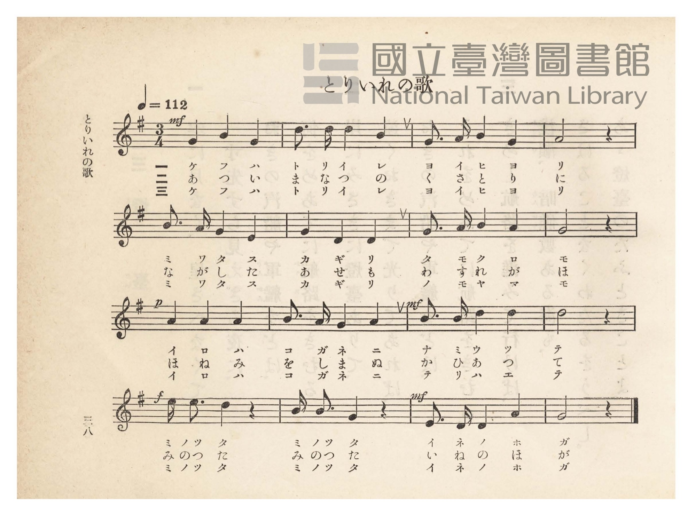
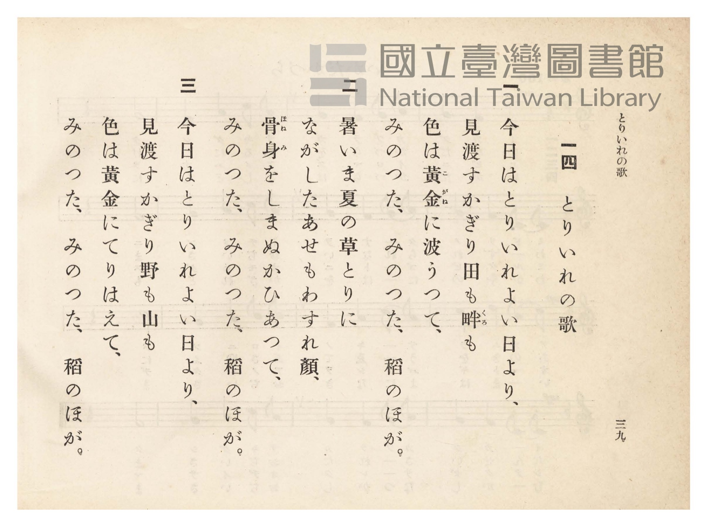

# とりいれの歌

> Re:Shōka 使用 AI 協助辨識與重建樂譜，可能會有錯誤。歡迎回報。

- **鋼琴伴奏版**：<br><audio controls src="toriire_no_uta.mp3"></audio>
- **NEUTRINO 歌聲合成版**：<br><audio controls src="toriire_no_uta_neutrino.mp3"></audio>

- 臺灣總督府《公學校唱歌》第四學年用（昭和十一年，索書號 0729 73）

## 說明

原書資訊與歌詞全文（對應 P043.jpg–P044.jpg，原書 pp. 38–39）：
調性與拍號：ト長調（G 大調）3/4 拍，速度 ♩=112


## 歌詞

```text
一
今日はとりいれ、よい日和（ひより）、
見わたすかぎり田もくろも、
色は黃金（こがね）に波うつて、
實（みの）つた、實つた、稻（いね）の穗（ほ）が。

二
あつい眞夏（まなつ）の草とりに、
ながしたあせもわすれ顏（がほ）、
骨身（ほねみ）をしまぬかひあつて、
實つた、實つた、稻の穗が。

三
今日はとりいれ、よい日和、
見わたすかぎり野も山も、
色は黃金にかがやいて、
實つた、實つた、稻の穗が。
```

## ABC

<div class="abc-score" data-abc-src="toriire_no_uta.abc" aria-label="五線譜載入中"></div>

[下載 ABC 原始檔](toriire_no_uta.abc)

## TMD 檔案連結

- [主旋律 TMD 檔案](toriire_no_uta.tmd) [[在 TMD Studio 編輯](https://tmdlang.github.io/Tmd-TS/#tmd=s7IKdvYPcrWy4qpTUCpJTLdSSM7PyUlNLsnMz7PKzk9PzM7Ojy_OyM9OVIKrKMvPKc1NtUovSkxJjTdBiBfnlxYlp1oVJ2fk5-fEl6RWlCTl52ejy8cXJKanWgUYmBgjZAqK8stS8xLzgLoLijLzSlJTwNoRClLLMlNSQdLFyYl58WWpRZlpmakpSE5KLSoGuRhqRUlRYl5xclFmAcgbCFX5RSUZ-UBnF2RUWmVkFpfkF2UmJ-bEZyfmIfmuJCMV6LnEdKBcaU5JaVEqulRxamJxfl58YmlJaS6K4ZnpmXlWJYmZ5UAn5qelZSZnJuYocWlpKTxuXPG4qetxY8vjpp7Hjeuere1R0NLiUrRVMDQ04rK3VXDnsjHWN7EDGfWifdfzxsXPd-x9Pnfx011zHjd0PW1d83TtjmcLFj6dshGo83FD9_M1a57Ong0UfLpzy_MpK97v6Xg2Y-3TST1Pexuf7GgACr7f0_N8y6Jns3e8mDlfwcDcyFLB3Pj9nk4lLi59LQVbagEuBQWFp33zQdZsbn-xoutFRzvQfS9WznvauuLZtHags55u6H3W3qkAimu9rIL0Rw2TgUwTEBPoQohWhYICPQVjC6CUsSXQie_3zAIZ-2LV_mcNy0EGdvcC_QAUfdzc8XLqdqA40Fh3hadLloOZncBgUwCqARr3smH-013LFB7NXGkLClWQKcDAAFO7u55NX_q4cT1KNDQ0Pm7qALKBUsCgA5r6uHETSKSpC2gsUBbsjGXdj5v6HzfOf9w483Fj9-PGPqD08ykbHjc1PW7sf9zUC2JAlXZuAtrwcnfzy_aJYMMmP24ExvVakGGNq59tXvS4se1x45LHjcugGp6uXwZWtx-YIMCKgHLzgXJAcTj7-YrdYDUtMIPWPV85HSwCFAdygb5ogvh0Vw-IetwIdBdQb8vzOfOeLukHq9z3uHEVUBCi_UUvkIQEwmqoO8DSQJdOB3sTqH82yFMgX88EBtPLhRBTgArAVkL0vFy14sWu1RCHAJ0G9ARIrmkS2BSghWvAgQUMEIhzkLyMy5sQryH7aEcnsXGHL7JetgPJpqcbN2KPKVAwgJT2PG4ChjEQkepUoFLKMxIUKGjpc3GFAIuRzKJUv_zQkkSrgMzEvHyHGoOaapBFCjaGZlp2YBa2bKwALBaAKf7Fwh4FDROFpxv6n69v0IHnPU0sGoD2gQyrUajOTatVMFTQBUNjKA3j1yiYgmlTKI1QUQNVY4RFjxGUBYMGMBmwlT6GNQqPmzZCxR43T4Wz-uEmAHM8VGwVUO0SuIo1SCpWQMSAso-bJ8FVQEQhKlahuSMe1R1GQDWNTTCdjXBbGlsQZjTug4oB3YGkYh2SCoirHzdOBRX1MBVNXUgqVuN3h_HAhwf-hLWrh5yEBUkXRvB0YQa3Di5kChOCMzCTFSwxIXTBIJZk1Twf6u31wIDYDwuEpp2IQGiCRcbjJlgkIgIGJA_R9bh5EZC9Hq5iLUIFUAZXMCKSFcREYEEBxNNhpjRCXAdJFIiENxvuIpgYyB2wZDUTyO6Bq4WxQCbsxu8OULKiPDya-6BiwPBoRiS8eUgqcIcHgfKqk6zyqqAWnibQacxEh5ABl3MQaWN4aQajYeUcAmIrsxDeXwtnIeXRps0QsaY1QPFeuIpupKCClAqgaHnctAyuohlJRRuaO7AlLljEA6tfOAsWuSB3QHI_KOHByi8QD6msaIS4CVhNoyTExUgqYK7D4Q5wmUVxeEATH0QF3DS4ufjDA2_iAraRyUpcwDRiBoQgG2ApAp4SgOkGkn5giQshA05c0AIOWJbBizNSCy9gdoMlB0R-RZSNxCiBhh4oxGGZF8SDFTIgFbCUgBmmiDS2H1TLwZIEouRCsogYJZCaFJROEXUmIv2CVMAKNBxugRZiAx0utVxcunYKyO0zBSBfmQsA)]
- [鋼琴伴奏 TMD 檔案](toriire_no_uta_piano.tmd) [[在 TMD Studio 編輯](https://tmdlang.github.io/Tmd-TS/#tmd=s7IKdvYPcrWy4tLSUnjcuOJxU9fjxpbHTT2PG9c9W9vzfk_Hy-49zydsebJny9Ol_c87O97v6VTQ0uJStFUwNDTisrdVcOeyMdY3seOqU1B60b7reePi5zv2Pp-7-OmuOY8bup62rnm6dsezBQufTtkINO5xQ_fzNWuezp4NFHy6c8vzKSuAFjybsfbppJ6nvY1PdjQABd_v6Xm-ZdGz2TtezJyvYGBuZKlgbgy0VImLKyS_KDOzKNUvP7Qk0SogMzEvP8jDocagpppLAQhsDM207MCsGoXq3LRaBUMFXTA0htIwfo2CKZg2hdIIFTVQNUZY9BhBWTBoAJMBW-ljWKPwuGkjVOxx81Q4qx9uwuPmDqjYKqDaJXAVa5BUrICIAWUfN0-Cq4CIQlSsQnNHPKo7jIBqGptgOhvhtjS2IMxo3AcVA7oDScU6JBUQVz9unApKEzAVTV1IKlbjd4fxwIcHNC1AotIIHpVmcBVwIVOYEJyBmRJg8Y_QBYNYUkLzfKhL1wPdvh_m7qadCHc3wcLvcRMs3BF-AclDdD1uXgRkr4erWItQAZTB5XNESoCY-LixB4inw0xphLgOEo-ItDIb7iKYGMgdsJQwE8jugauFsUAm7MbvDlBKoDw8mvugYsDwaEaklXlIKnCHB6xUKKiFRyM6jZlOEDLg0gQibQwvM2A0rDRBQGwlA8LFa-EspJzQtBki1rQGKN4LV9GN5DtI3gOF5OOmZXAVzUgq2tDcgS09wOLqcSPcHY2w-AC5A5LHQGkFVkqAeEg5shHipseNm1DSzmIkFTDX4XAHuGSgODyg6QWiAm4a3Fz84QFLD8BoNQNCkCAsEuGRB4xqSJTD0gNCBpweoMUIsMSAFxqkFhHARA2LQUSuQJRAxCiBehgUSLAsAuLBsjJIBSzyMIMBkSz2g4p_WCwiygcki4hRAqliQEkLUZkgkhxIBazYwOEWaFEx0OFSi62p4YPc1DCBtzQM4xWiDWPBGB_HNB7IM42PBaYEiF8R8mbxuSgqwARCGoWH0E2Ucpx2m8CNQzIZl5kgbcAg0bVTQA6VaB-gFIaYERYxY7CYMhcA)]

## 分析

```text
================================================================================
📊 TMD Song Profile: [ とりいれの歌 ]
================================================================================
⏱  Duration:       0:25 (25.7s), 16 measures total
🎼 Key & Tempo:    首調基準 G, != 112.0 BPM, <3/4>
   - 分析範圍：      由實際發聲的音符與和弦推測調性；播放脈絡另行呈現
🎤 人聲音域:    D4 (MIDI 62) – E5 (MIDI 76) [跨度: 14 個半音 / 1.2 個八度, 難度: moderate]
   - 最低音:  D4 in [ToriireNoUta #1 @ m.6, 0:08]
   - 最高音: E5 in [ToriireNoUta #1 @ m.13, 0:19]
   - 適合: soprano, mezzo-soprano, contralto, tenor, baritone, bass
🏛  結構:      ToriireNoUta (25.7s)
⚡ 編曲密度:        Peak 1 軌道同時演奏
🗝  調性診斷：       G 大調（純淨自然大調，未偵測到可信轉調）
   - 風格氣質:    純淨自然大調（陽光明朗、易唱易記，無明顯調外色彩）
   - 轉調歷程:    全曲維持單一推測調性（未偵測到可信轉調）
   - 核心骨幹音:  G, D, A, B, E
   - 調性數值:    G 大調 [相關度: 0.86, 穩定度: Moderate, 自然音純度: 100.0%]
   - 候選調性 (K-S): G 大調 (0.86), D 大調 (0.76), B 小調 (0.56)
   - 五度圈歷程:   +1
   - 各段落調性細節:
     • [ToriireNoUta #1]: G 大調 (r: 0.86, 自然音純度: 100.0%)

  [ 五度圈游移軌跡 ]
               C  
         F           [G ]*
      Bb               D  
      Eb               A  
         Ab           E  
            Db       B  
               F# 
     (* = active key center)

  [ 十二半音累積音高分佈 ]
     C  :                            0.0%
     C# :                            0.0%
     D  : ████████████████████      24.4%
     D# :                            0.0%
     E  : █████                      6.5%
     F  :                            0.0%
     F# :                            0.0%
     G  : ████████████████████████  29.8%
     G# :                            0.0%
     A  : █████████████████         21.4%
     A# :                            0.0%
     B  : ██████████████            17.9%
--------------------------------------------------------------------------------
Assignment 軌道音域：
  - Piano         : D4 – E5 (14 個半音 / 1.2 個八度, 47 個音符)
================================================================================
```


## 原書掃描頁






