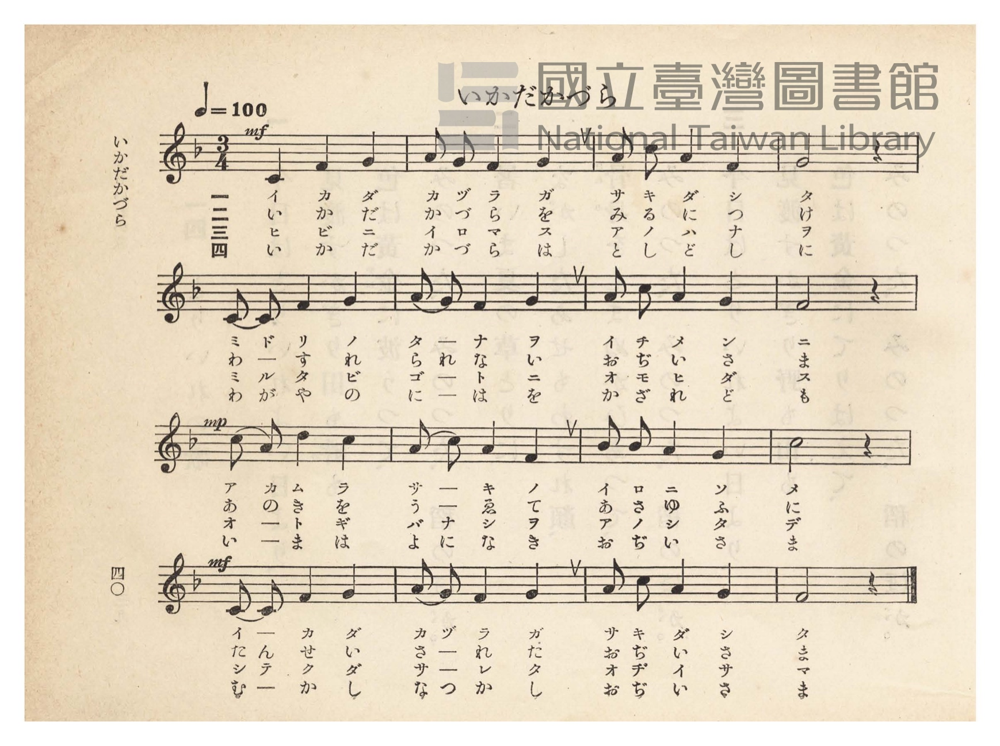
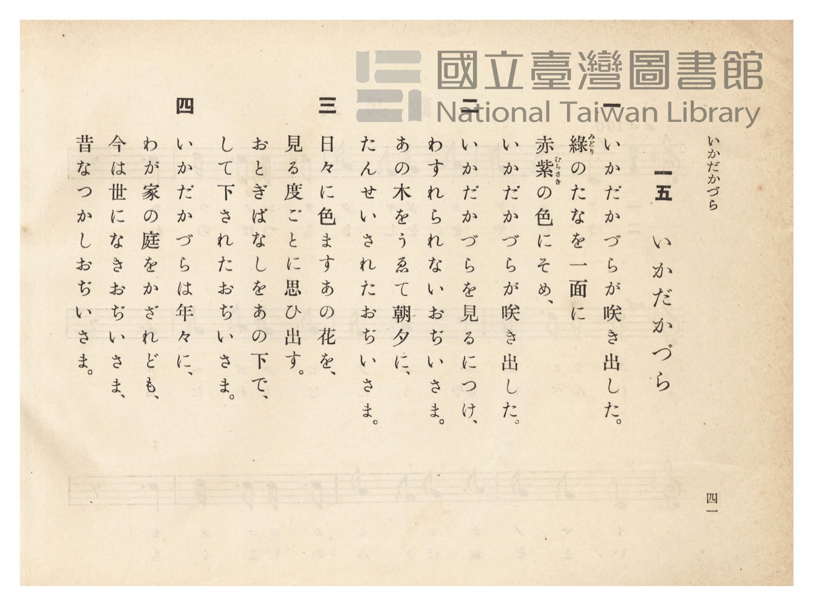

# いかだかづら

> Re:Shōka 使用 AI 協助辨識與重建樂譜，可能會有錯誤。歡迎回報。

- **NEUTRINO 歌聲合成版**：<br><audio controls src="ikadakazura_neutrino.mp3"></audio>
- **鋼琴伴奏版**：<br><audio controls src="ikadakazura.mp3"></audio>


- 臺灣總督府《公學校唱歌》第四學年用（昭和十一年，索書號 0729 73）

## 說明

原書資訊與歌詞全文（對應 P045.jpg–P046.jpg，原書 pp. 40–41）：
調性與拍號：ヘ長調（F 大調）3/4 拍，速度 ♩=100


## 歌詞

```text
一
いかだかづらが咲き出した。
綠（みどり）のたなを一面に
赤紫（あかむらさき）の色にそめ、
いかだかづらが咲き出した。

二
いかだかづらを見るにつけ、
わすれられないおぢいさま。
あの木をうゑて朝夕に、
たんせいされたおぢいさま。

三
日々に色ますあの花を、
見る度ごとに思ひ出す。
おとぎばなしをあの下で、
して下されたおぢいさま。

四
いかだかづらは年々に、
わが家の庭をかざれども、
今は世になきおぢいさま、
昔なつかしおぢいさま。
```

## ABC

```abc
X:1
T:いかだかづら
M:3/4
L:1/16
Q:1/4=100
K:F
V:V1 name="Piano" snm="Pia"
[V:V1]
!mf! C4 F4 G4 | A2 G2 F4 G4 | A2 c2 A4 F4 | G8 z4 |
w: 1.~イ カ ダ | カ ヅ ラ ガ | サ キ ダ シ | タ
w: 2.~い か だ | か づ ら を | み る に つ | け
w: 3.~ヒ ビ ニ | イ ロ マ ス | ア ノ ハ ナ | ヲ
w: 4.~い か だ | か づ ら は | と し ど し | に
C2 C2 F4 G4 | A2 G2 F4 G4 | A2 c2 A4 G4 | F8 z4 |
w: 1.~ミ ド リ ノ | タ ー ナ ヲ | イ チ メ ン | ニ
w: 2.~わ ー す れ | ら れ な い | お ぢ い さ | ま
w: 3.~ミ ル タ ビ | ゴ ー ト ニ | オ モ ヒ ダ | ス
w: 4.~わ が や の | に ー は を | か ざ れ ど | も
!mp! c2 A2 d4 c4 | A2 c2 A4 F4 | B2 B2 A4 G4 | c8 z4 |
w: 1.~ア カ ム ラ | サ ー キ ノ | イ ロ ニ ソ | メ
w: 2.~あ の き を | う ー ゑ て | あ さ ゆ ふ | に
w: 3.~オ ー ト ギ | バ ー ナ シヲ | ア ノ シ タ | デ
w: 4.~い ー ま は | よ に な き | お ぢ い さ | ま
!mf! C2 C2 F4 G4 | A2 G2 F4 G4 | A2 c2 A4 G4 | F8 z4 |
w: 1.~イ ー カ ダ | カ ヅ ラ ガ | サ キ ダ シ | タ
w: 2.~た ん せ い | さ ー れ た | お ぢ い さ | ま
w: 3.~シ テ ク ダ | サ ー レ タ | オ ヂ イ サ | マ
w: 4.~む ー か し | な つ か し | お ぢ い さ | ま
```

## TMD 檔案連結

- [主旋律 TMD 檔案](ikadakazura.tmd) [[在 TMD Studio 編輯](https://tmdlang.github.io/Tmd-TS/#tmd=s7IKdvYPcrWy4qpTUCpJTLdSSM7PyUlNLsnMz7PKzk9PzM7Ojy_OyM9OVIKrKMvPKc1NtUovSkxJjTdBiBfnlxYlp1oVJ2fk5-fEl6RWlCTl52ejy8cXJKanWgUYmJgiZAqK8stS8xLzgLoLijLzSlJTwNoRClLLMlNSQdLFyYl58WWpRZlpmakpSE5KLSoGuRhqRUlRYl5xclFmAcgbCFX5RSUZ-UBnF2RUWmVkFpfkF2UmJ-bEZyfmIfmuJCMV6LmCnMS8kmJ00ZLEzPJEJAMhommJuZk5lcjWZKZn5kEVx-enpWUmZybmKHFpaSk8bmx53Nj9uHEBmFz6uKlTQUuLS9FWwdDAgMveVsGNy8ZY38QOZNSL9l3PGxc_37H3-dzFT3fNedzQ9bR1zdO1O54tWPh0ysZna3seN3Q_X7Pm6ezZQMGnO7c8n7Li_Z6OZzPWPp3U87S38cmOBqDg-z09z7csejZ7x4uZ8xUMzI0sFcyN3-_pVOLi0tdSsKUW4FJQUHjaNx9kzeb2Fyu6XnS0A933YuW8p60rnk1rBzrr6YbeZ-2dCqBY18sqSH_UMBnINAMxgS6EaFUoKNBTMDEASpkYAp34fs8skLEvVu1_1rAcZGB3L9APQNHHzTNeTt0OFAca66bwdMlyMLMTGGwKQDVA4142zH-6a5nCo5krbUGhCjIFGBggCjP0Hzf2PJ206XFj79P2XY8bpz9unP-4oQmk9Pm2BUDzHzfuf9y48nFTF9CCx43rQNKNqx43TQKa93LuoseNq8FO3Lrk-ZbVYNVNIIObGsAGTwWaCtH2ohNow-rHjXMfNzU-bmgkxSVgx-_qwaGladKLZUD7gFyg6UseN06Emd7U_7hx5uOmHrCiHpCbQZq7HjcC3QxkAJ22D-pPsJvXPZuzAmjY48a2x00THzcuezZn7tMlQEWr4a6d_7hp8uPG2VDdICOBIYFhHiSoO0HUs-lLHze0Ao0Ae34fyDlgm150bQTZBDEX4npgZD1unPK4cQVQ9bOGuY8bN4GDYCbchUB7gHJ9jxs3gH0yHexUkGFPdgC9vhzuSGCgLQML4XchMMfgioL1wCwDcTZySPY8XbcNaNvTXWvBNgNVTwNbAEwYTVB1T3YDrVr_ZMc0cFQAHdmLYTlY3bMZQI8CpYGRBTQG6GBscUJ5hoQCBS19Li7P7MSUxOzEqtKiRKuAzMS8fIcag5pqkD0KNhZadmAGtsJAAVi4ANP5i4U9ChomCk839D9f36ADz8GaWDQAbQMZVqNQnZtWq2Aar6CrYAjERkBco2AMpJF5pkAMka8Bi4GgAYgHNsPHsAYY9kuA_MdNq0FkcwNYJYj3uLkViFeC5dZARbcC8VqoqsdN26Gi-6HmglwCNdcIKN7YAlLV2A0mF0DUAnnARADU0wk2YRJUdD-QDZIBu6ER5B6Q6ERMc42B4s0gXY-bJ4NJkOkQPzxuBrlsHtjcnVDRRUCRPiDuB6vtgog2b8I014Qo9zauh4quAGUDIAaHDpAFEQW5HmEu_hjf1UNOjAMjG4gIxTaEBxLHEtvN84G4E4hXgcOkDx6Hj5v3QMMIEkKwUG0E4oVg0c3Q8AOFEJb4buqHmNE4ExwHPVAzgHYB2cDsCA4rUBiDwqoLiIGxAw3zqVDRfThiHORmYIoEpzRIzINM3gJ1cwdKSlgFZIPiHZJKYOkZlCKwxDnIzY1A1zVB3LEOHpMQn4DiG5FKQWlhGtRnkLgHmdBEQqzv6CQvnxcA8zkwas2AVpiiRDUkY5sAISLiQSqwZXNgoICzNShpQzI2NEuDvArM1sjJAZadwJmhaS804kHJAFtGbwIHHbA0RgmuNqjJoGwMrDKgoiC1U4GibWDRrfAAxxrx4MiER3ETNHqaJyAn1qbtiPQKze_gkgmSWkDK27HHPTDtQWIZlOrgebupAxL_0PQK8hKx6RVv3AOrQ0rKeEqzPThGQbFB_WIemDmbJgPp2eCggWVwYByD7YNklvkkBCMi9rcDzQCmoiZwNoS7GZpim0GuhUcyOKUA0xa0MoOmK3B1gC3bN0CjHlLYwwpwoBnAygddlBg313Jx6dopILUBFIBcZS4A)]
- [鋼琴伴奏 TMD 檔案](ikadakazura_piano.tmd) [[在 TMD Studio 編輯](https://tmdlang.github.io/Tmd-TS/#tmd=s7IKdvYPcrWy4tLSUnjc2PK4sftx4wIwufRxU-f7PR0vu_c8n7DlyZ4tT5f2P-_seL-nU0FLi0vRVsHQwIDL3lbBjcvGWN_EjqtOQelF-67njYuf79j7fO7ip7vmPG7oetq65unaHc8WLHw6ZeOztT2PG7qfr1nzdPZsoODTnVueT1kBtODZjLVPJ_U87W18sqMBKPh-T8_zLYuezd7xYuZ8BQNzI0sFc2OgpUpcXJ7ZiSmJ2YlVpUWJVgGZiXn5QR4ONQY11VwKQGBjoWUHZtQoVOem1SqYxivoKhgCsREQ1ygYA2lknikQQ-RrwGIgaADigc3wMaxReNy0BMh_3LQaRDY3gFWCeI-bW4F4JVhuDVR0KxCvhap63LQdKrofai7IJVBzjYDijS0gVY3dYHIBRC2QBwxwoJ5OsAmToKL7gWyQDNgNjSD3gEQnYpprDBRvBul63DwZTIJMh_jhcTPIZfPA5u6Eii4CivQBcT9YbRdEtHkTprkmRLm3cT1UdAUQTwdicOgAWRBRkOsR5kIjCRg_QEQogiA8kDiWCGqeD8SdQLwK7I0-eLA_bt4D9RbEU7CAaATihWDRzVAvgzyFJYqa-iFmNM4EB1sP1AygXUD240awfeBgAXmvC4iBAQoNpqlQ0X04IgnkZmAiAicOSGSBTN4CdXMHSuStArJBUQWJWFgSBEUilmgCubkR6LomiDvWwQMf4hNQFCESFij6pkF9BokukAlN2CKqOrcAmJuAsWEGFDVFiR1I9jEBQkRcgVRgy0xAf4AzDygBQbIPNOOAXAfMPMgxCEu04CTXtBcaV6CYw5admsC-fdzYi-LDNqjJoMzyuHEZVBSkdipQtA0suhUeRljjChz-8FhpgoZo8wTk9NW0HZHEoLkKnP8hEQxS3o49uoDJBRIxoIQCz0FNHZAogyYxkJeITWJohR-lmQscCaAApH75B8wCTZOB9Gywb2DZCBgtYPsgSXI-CT5HRNh2oBnAiG8CJ3a4m6GJrBnkWni8gCMXmBygpTw0KYDLSWyZqwEaW5BSEFayAc0AlsroosS4uRZLdeaDXJ2ZwKszw3iFaMNYhWjT-FicPCAGFalAHkjcAOp04vSi8FC1msCMRrHHhLBGku0EhoeunQJSkET7AGXQhYwwhYwxhYCuBgopcwEA)]

## 分析

```text
================================================================================
📊 TMD Song Profile: [ いかだかづら ]
================================================================================
⏱  Duration:       0:28 (28.8s), 16 measures total
🎼 Key & Tempo:    首調基準 F, != 100.0 BPM, <3/4>
   - 分析範圍：      由實際發聲的音符與和弦推測調性；播放脈絡另行呈現
🎤 人聲音域:    C4 (MIDI 60) – D5 (MIDI 74) [跨度: 14 個半音 / 1.2 個八度, 難度: moderate]
   - 最低音:  C4 in [Ikadakazura #1 @ m.1, 0:00]
   - 最高音: D5 in [Ikadakazura #1 @ m.9, 0:15]
   - 適合: soprano, mezzo-soprano, contralto, tenor, baritone, bass
🏛  結構:      Ikadakazura (28.8s)
⚡ 編曲密度:        Peak 1 軌道同時演奏
🗝  調性診斷：       F 大調（純淨自然大調，未偵測到可信轉調）
   - 風格氣質:    純淨自然大調（陽光明朗、易唱易記，無明顯調外色彩）
   - 轉調歷程:    全曲維持單一推測調性（未偵測到可信轉調）
   - 核心骨幹音:  G, F, A, C, D
   - 調性數值:    F 大調 [相關度: 0.77, 穩定度: Moderate, 自然音純度: 100.0%]
   - 候選調性 (K-S): F 大調 (0.77), C 大調 (0.71), A 小調 (0.51)
   - 五度圈歷程:   -1
   - 各段落調性細節:
     • [Ikadakazura #1]: F 大調 (r: 0.77, 自然音純度: 100.0%)

  [ 五度圈游移軌跡 ]
               C  
        [F ]*          G  
      Bb               D  
      Eb               A  
         Ab           E  
            Db       B  
               F# 
     (* = active key center)

  [ 十二半音累積音高分佈 ]
     C  : ████████████████          19.3%
     C# :                            0.0%
     D  : ██                         2.3%
     D# :                            0.0%
     E  :                            0.0%
     F  : ███████████████████████   27.3%
     F# :                            0.0%
     G  : ████████████████████████  28.4%
     G# :                            0.0%
     A  : █████████████████         20.5%
     A# : ██                         2.3%
     B  :                            0.0%
--------------------------------------------------------------------------------
Assignment 軌道音域：
  - Piano         : C4 – D5 (14 個半音 / 1.2 個八度, 51 個音符)
================================================================================
```


## 原書掃描頁






