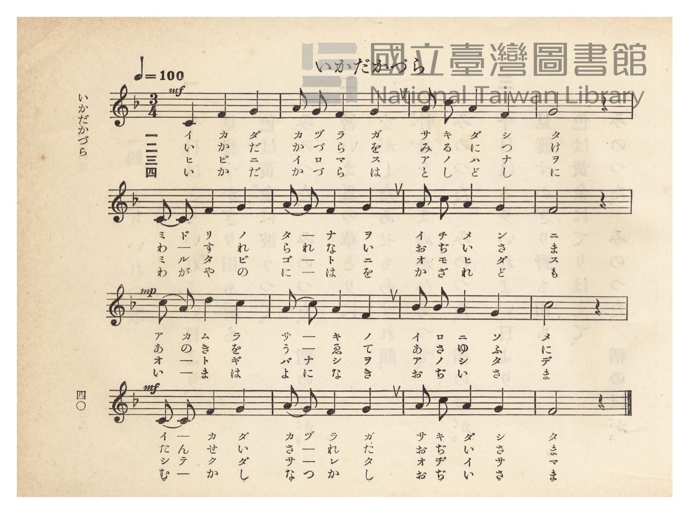
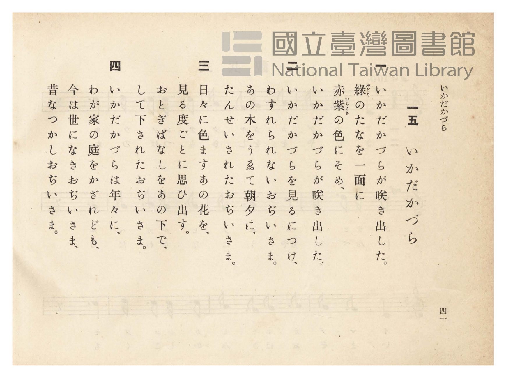

# いかだかづら

> Re:Shōka 使用 AI 協助辨識與重建樂譜，可能會有錯誤。歡迎回報。

- **鋼琴伴奏版**：<br><audio controls src="ikadakazura.mp3"></audio>
- **NEUTRINO 歌聲合成版**：<br><audio controls src="ikadakazura_neutrino.mp3"></audio>

- 臺灣總督府《公學校唱歌》第四學年用（昭和十一年，索書號 0729 73）

## 說明

原書資訊與歌詞全文（對應 P045.jpg–P046.jpg，原書 pp. 40–41）：
調性與拍號：ヘ長調（F 大調）3/4 拍，速度 ♩=100


## 歌詞

```text
一
いかだかづらが咲き出した。
綠（みどり）のたなを一面に
赤紫（あかむらさき）の色にそめ、
いかだかづらが咲き出した。

二
いかだかづらを見るにつけ、
わすれられないおぢいさま。
あの木をうゑて朝夕に、
たんせいされたおぢいさま。

三
日々に色ますあの花を、
見る度ごとに思ひ出す。
おとぎばなしをあの下で、
して下されたおぢいさま。

四
いかだかづらは年々に、
わが家の庭をかざれども、
今は世になきおぢいさま、
昔なつかしおぢいさま。
```

## ABC

<div class="abc-score" data-abc-src="ikadakazura.abc" aria-label="五線譜載入中"></div>

[下載 ABC 原始檔](ikadakazura.abc)

## TMD 檔案連結

- [主旋律 TMD 檔案](ikadakazura.tmd) [[在 TMD Studio 編輯](https://tmdlang.github.io/Tmd-TS/#tmd=s7IKdvYPcrWy4qpTUCpJTLdSSM7PyUlNLsnMz7PKzk9PzM7Ojy_OyM9OVIKrKMvPKc1NtUovSkxJjTdBiBfnlxYlp1oVJ2fk5-fEl6RWlCTl52ejy8cXJKanWgUYmJgiZAqK8stS8xLzgLoLijLzSlJTwNoRClLLMlNSQdLFyYl58WWpRZlpmakpSE5KLSoGuRhqRUlRYl5xclFmAcgbCFX5RSUZ-UBnF2RUWmVkFpfkF2UmJ-bEZyfmIfmuJCMV6LmCnMS8kmJ00ZLEzPJEJAMhommJuZk5lcjWZKZn5kEVx-enpWUmZybmKHFpaSk8bmx53Nj9uHEBmFz6uKlTQUuLS9FWwdDAgMveVsGNy8ZY38QOZNSL9l3PGxc_37H3-dzFT3fNedzQ9bR1zdO1O54tWPh0ysZna3seN3Q_X7Pm6ezZQMGnO7c8n7Li_Z6OZzPWPp3U87S38cmOBqDg-z09z7csejZ7x4uZ8xUMzI0sFcyN3-_pVOLi0tdSsKUW4FJQUHjaNx9kzeb2Fyu6XnS0A933YuW8p60rnk1rBzrr6YbeZ-2dCqBY18sqSH_UMBnINAMxgS6EaFUoKNBTMDEASpkYAp34fs8skLEvVu1_1rAcZGB3L9APQNHHzTNeTt0OFAca66bwdMlyMLMTGGwKQDVA4142zH-6a5nCo5krbUGhCjIFGBggCjP0Hzf2PJ206XFj79P2XY8bpz9unP-4oQmk9Pm2BUDzHzfuf9y48nFTF9CCx43rQNKNqx43TQKa93LuoseNq8FO3Lrk-ZbVYNVNIIObGsAGTwWaCtH2ohNow-rHjXMfNzU-bmgkxSVgx-_qwaGladKLZUD7gFyg6UseN06Emd7U_7hx5uOmHrCiHpCbQZq7HjcC3QxkAJ22D-pPsJvXPZuzAmjY48a2x00THzcuezZn7tMlQEWr4a6d_7hp8uPG2VDdICOBIYFhHiSoO0HUs-lLHze0Ao0Ae34fyDlgm150bQTZBDEX4npgZD1unPK4cQVQ9bOGuY8bN4GDYCbchUB7gHJ9jxs3gH0yHexUkGFPdgC9vhzuSGCgLQML4XchMMfgioL1wCwDcTZySPY8XbcNaNvTXWvBNgNVTwNbAEwYTVB1T3YDrVr_ZMc0cFQAHdmLYTlY3bMZQI8CpYGRBTQG6GBscUJ5hoQCBS19Li7P7MSUxOzEqtKiRKuAzMS8fIcag5pqkD0KNhZadmAGtsJAAVi4ANP5i4U9ChomCk839D9f36ADz8GaWDQAbQMZVqNQnZtWq2Aar6CrYAjERkBco2AMpJF5pkAMka8Bi4GgAYgHNsPHsAYY9kuA_MdNq0FkcwNYJYj3uLkViFeC5dZARbcC8VqoqsdN26Gi-6HmglwCNdcIKN7YAlLV2A0mF0DUAnnARADU0wk2YRJUdD-QDZIBu6ER5B6Q6ERMc42B4s0gXY-bJ4NJkOkQPzxuBrlsHtjcnVDRRUCRPiDuB6vtgog2b8I014Qo9zauh4quAGUDIAaHDpAFEQW5HmEu_hjf1UNOjAMjG4gIxTaEBxLHEtvN84G4E4hXgcOkDx6Hj5v3QMMIEkKwUG0E4oVg0c3Q8AOFEJb4buqHmNE4ExwHPVAzgHYB2cDsCA4rUBiDwqoLiIGxAw3zqVDRfThiHORmYIoEpzRIzINM3gJ1cwdKSlgFZIPiHZJKYOkZlCKwxDnIzY1A1zVB3LEOHpMQn4DiG5FKQWlhGtRnkLgHmdBEQqzv6CQvnxcA8zkwas2AVpiiRDUkY5sAISLiQSqwZXNgoICzNShpQzI2NEuDvArM1sjJAZadwJmhaS804kHJAFtGbwIHHbA0RgmuNqjJoGwMrDKgoiC1U4GibWDRrfAAxxrx4MiER3ETNHqaJyAn1qbtiPQKze_gkgmSWkDK27HHPTDtQWIZlOrgebupAxL_0PQK8hKx6RVv3AOrQ0rKeEqzPThGQbFB_WIemDmbJgPp2eCggWVwYByD7YNklvkkBCMi9rcDzQCmoiZwNoS7GZpim0GuhUcyOKUA0xa0MoOmK3B1gC3bN0CjHlLYwwpwoBnAygddlBg313Jx6dopILUBFIBcZS4A)]
- [鋼琴伴奏 TMD 檔案](ikadakazura_piano.tmd) [[在 TMD Studio 編輯](https://tmdlang.github.io/Tmd-TS/#tmd=s7IKdvYPcrWy4qpTUCpJTLdSSM7PyUlNLsnMz7PKzk9PzM7Ojy_OyM9OVIKrKMvPKc1NtTJBiBTnlxYlp-JSD5GNL0hMT7UKMDAx1QUSZgjpgqL8stS8xDygASWJmeWJefHpQIGivPyi-PTUvNSixByE2tSyzJRUkMqCoszcxKLK-JT8ZKBb8kqQXJdaVAxyfEFmYl5-fGJRUWJeeiqqkvyikoz89KLEgoxKq4zM4pL8oszkxJz47MQ8JFeXZAB1WaWmlCYnggJDiUtLS-FxY8vjxu7HjQvA5NLHTZ3v93S87N7zfMKWJ3u2PF3a_7yz4_2eTgUtLS5FWwVDAwMue1sFNy4bY30TO5DBL9p3PW9c_HzH3udzFz_dNedxQ9fT1jVP1-54tmDh0ykbn63tedzQ_XzNmqezZwMFn-7c8nzKCqAFz2asfTqp52lv45MdDUDB93t6nm9Z9Gz2jhcz5ysYmBtZKpgbAy1V4uLyzE5MScxOrCotSrQKAHk_yMOhxqCmmksBCGwstOzAjBqF6ty0WgXTeAVdBUMgNgLiGgVjII3MMwViiHwNWAwEDUA8sBk-hjUKj5uWAPmPm1aDyOYGsEoQ73FzKxCvBMutgYpuBeK1UFWPm7ZDRfdDzQW5BGquEVC8sQWkqrEbTC6AqAXygAEO1NMJNmESVHQ_kA2SAbuhEeQekOhETHONgeLNIF2PmyeDSZDpED88bga5bB7Y3J1Q0UVAkT4g7ger7YKINm_CNNeEKPc2roeKrgDi6UAMDh0gCyIKcj3CXGgkAeMHiAhFEIQHEscSQc3zgbgTiFeBvdEHD_bHzXug3oJ4ChYQjUC8ECy6GeplkKewRFFTP8SMxpngYOuBmgG0C8h-3Ai2DxwsIO91ATEwQKHBNBUqug9HJIHcDExE4MQBiSyQyVugbu5AibxVQDYoqiARC0uCoEjEEk0gNzcCXdcEccc6eOBDfAKKIkTCAkXfNKjPINEFMqEJW0RV5xYAcxMwNsyAoqYosQPJPiZAiIgrkApsmQnoD3DmASUgSPaBZhyQ64CZBzkGYYkWnOSa9kLjChRz2LJTE9i3jxt7UXzYBjUZlFkeNy6DioLUTgWKtoFFt8LDCGtcgcMfHitN0BBtnoCcvpq2I5IYNFeB8z8kgkHK27FHFzC5QCIGlFDgOaipAxJl0CQG8hKxSQyt8KM0c4EjARSA1C__gFmgaTKQng32DSwbAaMFbB8kSc4nweeICNsONAMY8U3gxA53MzSRNYNcC48XcOQCkwO0lIcmBXA5iS1zNUBjC1IKwko2oBnAUhldlBg312KpznyQqzMTeHVmGK8QbRirEG0aH4uTB8SgIhXIA4kbQJ1OnF4UHqpWE5jRKPaYENZIsp3A8NC1U0AKkmgfoAy6kBGmkDGmENDVQCFlLgA)]

## 分析

```text
================================================================================
📊 TMD Song Profile: [ いかだかづら ]
================================================================================
⏱  Duration:       0:28 (28.8s), 16 measures total
🎼 Key & Tempo:    首調基準 F, != 100.0 BPM, <3/4>
   - 分析範圍：      由實際發聲的音符與和弦推測調性；播放脈絡另行呈現
🎤 人聲音域:    C4 (MIDI 60) – D5 (MIDI 74) [跨度: 14 個半音 / 1.2 個八度, 難度: moderate]
   - 最低音:  C4 in [Ikadakazura #1 @ m.1, 0:00]
   - 最高音: D5 in [Ikadakazura #1 @ m.9, 0:15]
   - 適合: soprano, mezzo-soprano, contralto, tenor, baritone, bass
🏛  結構:      Ikadakazura (28.8s)
⚡ 編曲密度:        Peak 1 軌道同時演奏
🗝  調性診斷：       F 大調（純淨自然大調，未偵測到可信轉調）
   - 風格氣質:    純淨自然大調（陽光明朗、易唱易記，無明顯調外色彩）
   - 轉調歷程:    全曲維持單一推測調性（未偵測到可信轉調）
   - 核心骨幹音:  G, F, A, C, D
   - 調性數值:    F 大調 [相關度: 0.77, 穩定度: Moderate, 自然音純度: 100.0%]
   - 候選調性 (K-S): F 大調 (0.77), C 大調 (0.71), A 小調 (0.51)
   - 五度圈歷程:   -1
   - 各段落調性細節:
     • [Ikadakazura #1]: F 大調 (r: 0.77, 自然音純度: 100.0%)

  [ 五度圈游移軌跡 ]
               C  
        [F ]*          G  
      Bb               D  
      Eb               A  
         Ab           E  
            Db       B  
               F# 
     (* = active key center)

  [ 十二半音累積音高分佈 ]
     C  : ████████████████          19.3%
     C# :                            0.0%
     D  : ██                         2.3%
     D# :                            0.0%
     E  :                            0.0%
     F  : ███████████████████████   27.3%
     F# :                            0.0%
     G  : ████████████████████████  28.4%
     G# :                            0.0%
     A  : █████████████████         20.5%
     A# : ██                         2.3%
     B  :                            0.0%
--------------------------------------------------------------------------------
Assignment 軌道音域：
  - Piano         : C4 – D5 (14 個半音 / 1.2 個八度, 51 個音符)
================================================================================
```


## 原書掃描頁






