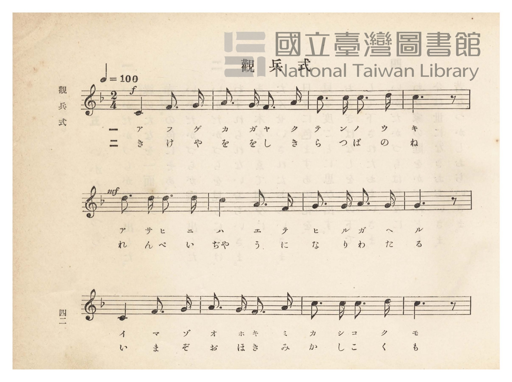
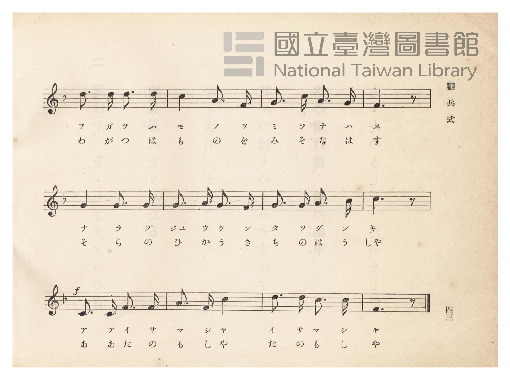
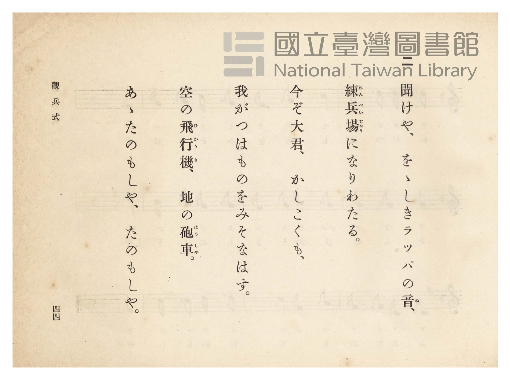
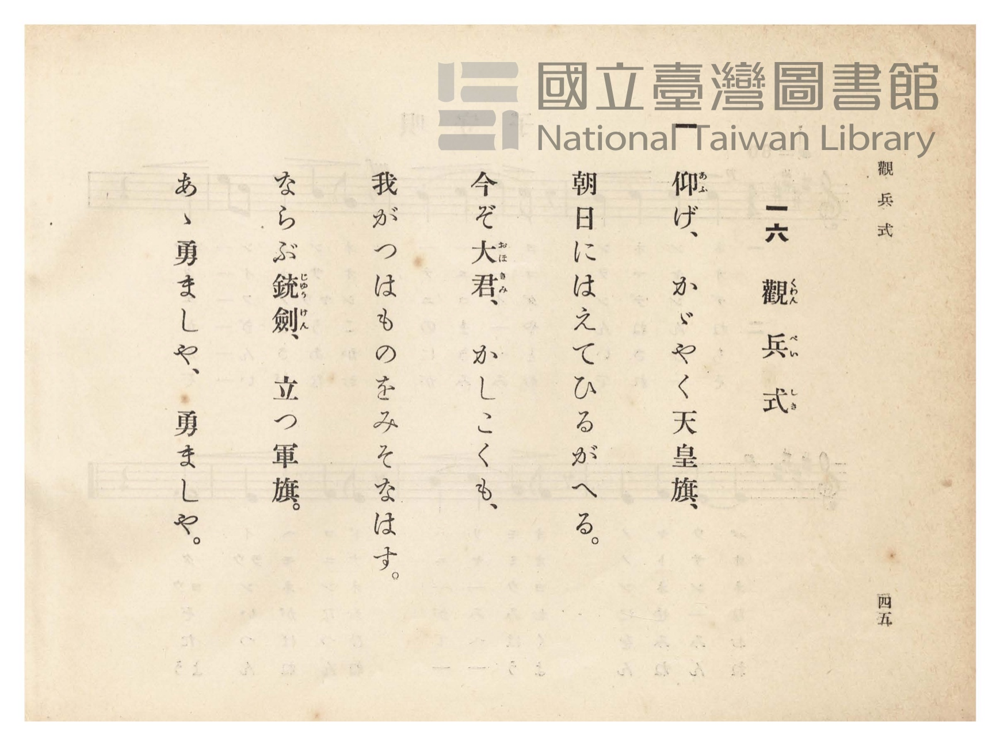

# 觀兵式

> Re:Shōka 使用 AI 協助辨識與重建樂譜，可能會有錯誤。歡迎回報。

- **NEUTRINO 歌聲合成版**：<br><audio controls src="kanpeishiki_neutrino.mp3"></audio>
- **鋼琴伴奏版**：<br><audio controls src="kanpeishiki.mp3"></audio>


- 詞：文部省（新訂尋常小學唱歌）
- 曲：文部省（新訂尋常小學唱歌）
- 臺灣總督府《公學校唱歌》第四學年用（昭和十一年，索書號 0729 73）

## 說明

原書資訊與歌詞全文（對應 P047.jpg–P050.jpg，原書 pp. 42–45）：
調性與拍號：ヘ長調（F 大調）2/4 拍，速度 ♩=100


## 歌詞

```text
一
仰（あふ）げかがやく天皇旗（てんわうき）、
朝日に映（は）えてひるがへる。
今ぞ大君（おほきみ）かしこくも
わがつはものをみそなはす。
ならぶ銃劍（じゅうけん）立つ軍旗（ぐんき）、
ああ勇（いさ）ましや、勇ましや。

二
聞けや雄々（をを）しきらつぱの音（ね）、
練兵場（れんぺいぢゃう）になりわたる。
今ぞ大君かしこくも
わがつはものをみそなはす。
空の飛行機（ひかうき）地の砲車（はうしゃ）、
ああたのもしや、たのもしや。
```

## ABC

```abc
X:1
T:觀兵式
C:曲：文部省（新訂尋常小學唱歌）
M:2/4
L:1/16
Q:1/4=100
K:F
V:V1 name="Piano" snm="Pia"
[V:V1]
!f! C4 F3 G | A3 G F3 A | c3 c c3 d | c6 z2 |
w: 1.~ア フ ゲ | カ ガ ヤ ク | テ ン ノ ウ | キ
w: 2.~き け や | を を し き | ら っ ぱ の | ね
!mf! d3 d d3 d | c4 A3 F | G3 G A3 G | G6 z2 |
w: 1.~ア サ ヒ ニ | ハ エ テ | ヒ ル ガ ヘ | ル
w: 2.~れ ん ぺ い | ぢゃ う に | な り わ た | る
C4 F3 G | A3 G F3 A | c3 c c3 d | c6 z2 |
w: 1.~イ マ ゾ | オ ホ キ ミ | カ シ コ ク | モ
w: 2.~い ま ぞ | お ほ き み | か し こ く | も
d3 d d3 d | c4 A3 F | G3 c A3 G | F6 z2 |
w: 1.~ワ ガ ツ ハ | モ ノ ヲ | ミ ソ ナ ハ | ス
w: 2.~わ が つ は | も の を | み そ な は | す
G4 G3 G | G3 A G3 F | G3 G A3 B | c6 z2 |
w: 1.~ナ ラ ブ | ジュ ウ ケ ン | タ ツ グ ン | キ
w: 2.~そ ら の | ひ か う き | ち の は う | しゃ
!f! C3 C F3 F | A3 F c4 | d3 d c3 c | F6 z2 |
w: 1.~ア ア イ サ | マ シ ヤ | イ サ マ シ | ヤ
w: 2.~あ あ た の | も し や | た の も し | や
```

## TMD 檔案連結

- [主旋律 TMD 檔案](kanpeishiki.tmd) [[在 TMD Studio 編輯](https://tmdlang.github.io/Tmd-TS/#tmd=s7IKdvYPcrWy4qpTUCpJTLdSSM7PyUlNLsnMz7PKzk9PzM7Ojy_OyM9OVIKrKMvPKc1NtUovSkxJjTdBiBfnlxYlp1oVJ2fk5-fEl6RWlCTl52ejy8cXJKanWgUYmJgjZAqK8stS8xLzgLoLijLzSlJTwNoRClLLMlNSQdLFyYl58WWpRZlpmakpSE5KLSoGuRhqRUlRYl5xclFmAcgbCFX5RSUZ-UBnF2RUWmVkFpfkF2UmJ-bEZyfmIfmuJCMV6Lnk1KLU3Py8zMQcdJnczJzMksSiSmRjM9Mz86yAypNKgUGlxKWlpfBiecPT1q1P9_QraGlxKdoqGBoYcNnbKrhx2Rjpm9iBtL5YOe_9nlnPprW_bF7xfE7j-z0dz6ZteLGi6emG7qc7djzd0P907Y6nUzY-W9vzfk8n2LJnszeRqONF-67njYuf79j7fO7ip7vmPG7oetq6Bqjq2YKFEIWPG7qfr1nzdPZskNadW55PWQEydcbap5N6nvY2PtnRABR8v6fn-ZZFz2bveDFzvoKBuZGlgrkx2AIufS0FW2oBLgUFhad980HWbG5_saLrRUc70H3AQHraugLoZaCznm7ofdbeqQBKOXpZBemPGiYHGJgagJhAF0K0KhQU6CmYGAGlTEyBTgSGFsjYF6v2P2tYDjKwuxfoB6Do4-YZL6duB4oDjXVTeLpkOZjZCYwaBaAaoHEvG-Y_3bVM4dHMlbagmAOZAgwMMLV7A1DT48amx41bgVoeN0563Nj9uLHncVPL48b-p0tWPp_V_mz6dLCaZY-bJj9u6n_c2Pa4EWhq5-OGRpARz-bMfTZ96ePG1c9mLACrWw82CKyhcdPjJrBxjTtAjIYmiJ1djxvnAZ35dMJssAYgdzfQyMeNIFeD7Z_-uHEy0P7HTWANYEuBZiwBmg0Uety47nET0J37HzfOfdy4CiTYOBNqNojfBDRj28uu5qddQFcCjZ_xuKkV7OiJQA8AbXi-GmjDkhe7e2EemwDyGLKXwOHR9LQbFE-PG4EhMRXssH0ghwEDpqERKIXEbYKE6K4ecPQ0zgPb1PJyNlCqFWQC0LFNk8AmAP3VC3Yf0Csbgf54OX8z2Iq1CLufb98CymoLgAkVqBMYEUCn7QI7YtHjpmagP8AGrQZ7tAscMvOxBy1lAfl8JdDSdS8Xz36xsOfZSmAqA7pyE9hIaOw_nbMBqOD5gk0vdndBoh0sBQyRZvSABDkRZBWQAQ0_DBGwnZRnOyhQ0NLn4vJOzCtIzSzOyMzOtArITMzLd6gxqKkG2aNgY2imZQdmYcvzCsAyBJg9gB5X0DBRABZEz9c36MAzqiYWDUDrQIbVKFSn1SqYxivogqEhmDQCChtDWRARY6CIKZhlCqXN4CIQaADENWAjfQxrgLG2CCr-uHkqhG7aBNTxuGk1lLcGKLMEyl4Pkmlug6rfDMR9UJllYD1rkewBuRRqjxFQrrEXZk_jRKieFrCeSVDeJKDMdKiKXrBMJ5S3GIg3QtnrQDKNmPbgD_BdPWQFeC4wxM2ggQijEYEJCXhDoIgRNApgUQETwRfgj5u2AoMP6vnmbnDA9sOCqGkFVLwNLA5TtRocHRD2DLAMJJKwBnhTD9SsycAA2wUNPnCQgzM7PDagsdm4Giy1CqqpC5SfoTLzwbHRTWKY7-gkJ8xpkMAhiRcUZvOgntsH9hDUq82z4Qn3cTPEq7Ckvx2IN0PZkKQPyyxYwhsYtrAg3Qel54GDtAvK2w3PBMBSESwDCVJQsgeWpFB2P9gFTaQFNrBVghnYFgQDm_i0bYqUtiHxgDWsm9dDQwtUaEDCA5SqkUMOXmQ0g4sZYIhDdOwFsqEhBdHRtBN3WMOTZg8QQwunRnAMwUMOVFRATJ4EDuv9UNG5iEQO0dE4k7SwfrJrCjlhDSsRYGUFTMQYSmOWIyb40zU0tEDhtRJKTwOHwI7HzUuhXl8GxNCSE1hagyShwQCMnMdNG1Bk1uIObmCgQa2Cl8mQcngTlNeNVI6Ay-7GhXB1oGCGsMGFGbgSJy3En7auJSfEkepLIAVJtaBQhqVtWNgi8gGsXMGbxuHl9yJ42QIqy0ExAitfgOUGtMoEmY6sClkNSAdMFbZAh6RkEA0qgpGCHZrGweUGsBKF24OkClkNSAdMFcKeWi4uXTsFpHaMApCrzAUA)]
- [鋼琴伴奏 TMD 檔案](kanpeishiki_piano.tmd) [[在 TMD Studio 編輯](https://tmdlang.github.io/Tmd-TS/#tmd=s7IKdvYPcrWy4tLSUnixvOFp69ane_rf7-l42b3n-YQtT_Zsebq0_3lnx_s9nQpaWlyKtgqGBgZc9rYKblw2Rvomdlx1CkovVs57v2fWs2ntL5tXPJ_TCNT8bNqGFyuanm7ofrpjx9MN_U_X7ng6ZeOztT1AU5RAOp7N3kSijhftu543Ln6-Y-_zuYuf7przuKHraesaoKpnCxZCFD5u6H6-Zs3T2bNBWndueT5lBcjUGWufTup52tv4ZEcDUPD9np7nWxY9m73jxcz5CgbmRpYK5sZgC7i8E_MKUjOLMzKzM60CMhPz8oM8HGoMaqq5FIDAxtBMyw7MqlGoTqtVMI1X0AVDQzBpBBQ2hrIgIsZAEVMwyxRKm8FFINAAiGvARvoY1ig8bloEFX_cPBVCN20C6njctBrKWwOUWQJlrwfJNLdB1W8G4j6ozDKwnrVI9oBcCrXHCCjX2Auzp3EiVE8LWM8kKG8SUGY6VEUvWKYTylsMxBuh7HUgmUZMe2BhlAsMJDOov2E0wv-QsDIEihhBQw0WejARfGH0uGkr0MdQ9zZ3g8OiH-arphVQ8TawOEzVanAIQtgzwDKQcMUaRk09ULMmA_24C-pjcCg1Lnrc1AwPQGgENK4GS62CauoCYohzHjfOBwdgN65gokEygiQRkDfnQd2zD-wGqOuaZ8OTx-NmiOtgCWw7EG-GsiEJDJYksQQRMDhgobAPSs8Dh0IXlLcbntQeN-4Hy0BCAZS4HjdOhrL7wS5owhU-xKcgU6QUBAk6rMHTvB7qQVBugngBlHaQPQvPS83g_AcMJIiOvUA21HMQHU07cQcPPAH0ADE01zaCAxXuWVAegpg8CRw8-6GicxFJCaKjcSau4IFlFVgmgokYQ2nMDGaCP_VAPQjy4kooPQ3s6B2Pm5dCXbsMiKGlALDkAUlCXQ4Mz8dNG1Bk1uIOIaA_oVbByxdImbIJyutGymDgcqhxIVwdKGQgbHAub5yOyJUYgYRUXAMpSNoABQwsBcGCA5HaYBkOb0qCl0WL4JkOVC6BAhGW8YAZClpig0xHVoWsBqQDpgpbOEHSC4gGFSdIIQVNSeAMBSzD4fYgqUJWA9IBU4WwpxZLxeeDXPFZwOs9w3iFaMNYGIWXb4LKN4B6qEbBBCIJpTDNMI0HskzjYxEMNDGEUQPlHGzmEHQ2mnEgMyjyHNTFOJ0FjFZdOwWkmI32AUqiCxmBhZS5AA)]

## 分析

```text
================================================================================
📊 TMD Song Profile: [ 觀兵式 ]
================================================================================
⏱  Duration:       0:28 (28.8s), 24 measures total
🎼 Key & Tempo:    首調基準 F, != 100.0 BPM, <2/4>
   - 分析範圍：      由實際發聲的音符與和弦推測調性；播放脈絡另行呈現
🎤 人聲音域:    C4 (MIDI 60) – D5 (MIDI 74) [跨度: 14 個半音 / 1.2 個八度, 難度: moderate]
   - 最低音:  C4 in [Kanpeishiki #1 @ m.1, 0:00]
   - 最高音: D5 in [Kanpeishiki #1 @ m.3, 0:03]
   - 適合: soprano, mezzo-soprano, contralto, tenor, baritone, bass
🏛  結構:      Kanpeishiki (28.8s)
⚡ 編曲密度:        Peak 1 軌道同時演奏
🗝  調性診斷：       C 大調（純淨自然大調，未偵測到可信轉調）
   - 風格氣質:    純淨自然大調（陽光明朗、易唱易記，無明顯調外色彩）
   - 轉調歷程:    全曲維持單一推測調性（未偵測到可信轉調）
   - 核心骨幹音:  C, G, F, A, D
   - 調性數值:    C 大調 [相關度: 0.88, 穩定度: High, 自然音純度: 99.4%]
   - 候選調性 (K-S): C 大調 (0.88), F 大調 (0.75), A 小調 (0.60)
   - 五度圈歷程:   +0
   - 各段落調性細節:
     • [Kanpeishiki #1]: C 大調 (r: 0.88, 自然音純度: 99.4%, 調外音: A#)

  [ 五度圈游移軌跡 ]
              [C ]*
         F            G  
      Bb               D  
      Eb               A  
         Ab           E  
            Db       B  
               F# 
     (* = active key center)

  [ 十二半音累積音高分佈 ]
     C  : ████████████████████████  33.9%
     C# :                            0.0%
     D  : █████████                 12.2%
     D# :                            0.0%
     E  :                            0.0%
     F  : █████████████             17.8%
     F# :                            0.0%
     G  : ███████████████           20.6%
     G# :                            0.0%
     A  : ███████████               15.0%
     A# :                            0.6%
     B  :                            0.0%
--------------------------------------------------------------------------------
Assignment 軌道音域：
  - Piano         : C4 – D5 (14 個半音 / 1.2 個八度, 72 個音符)
================================================================================
```


## 原書掃描頁










