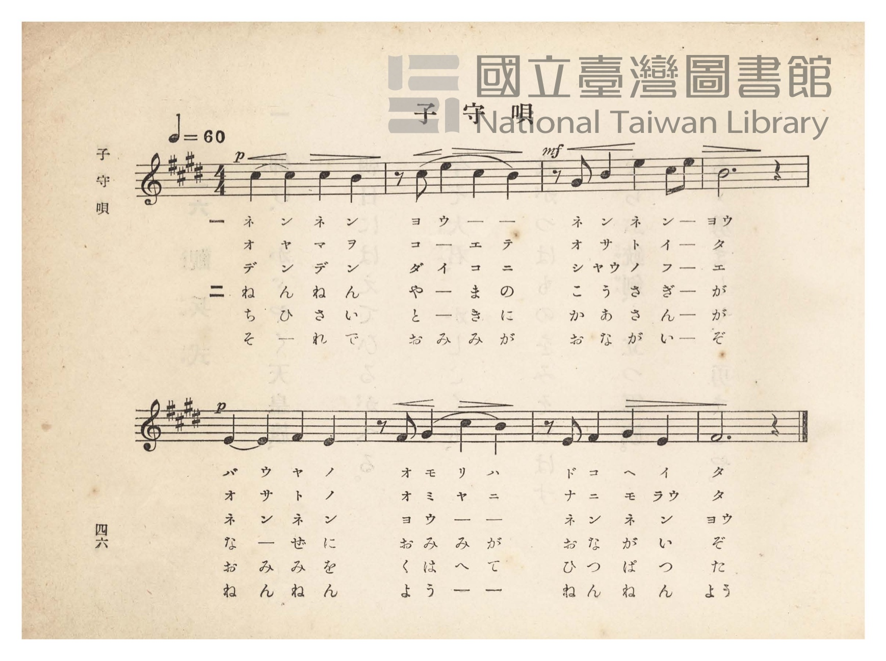
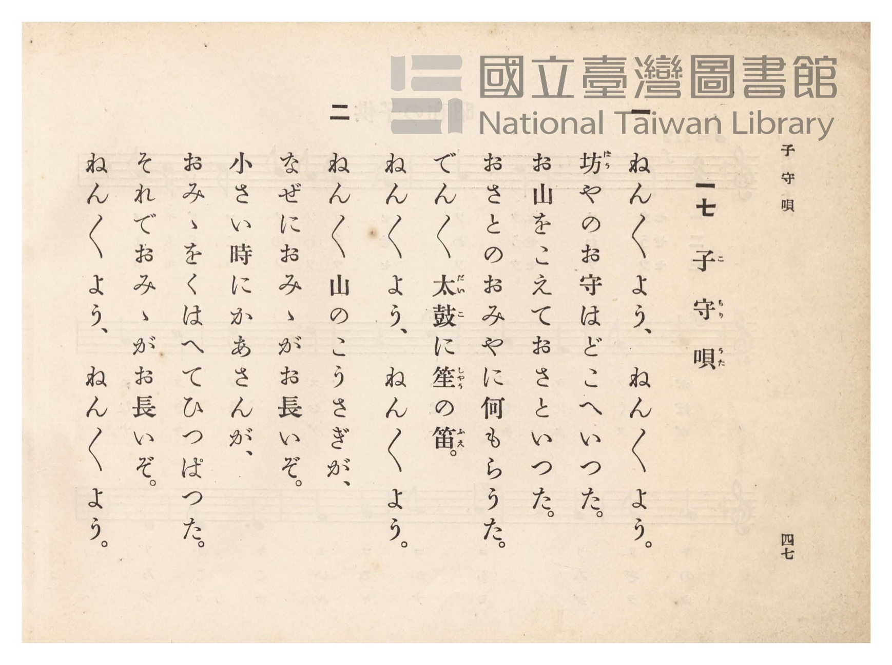

# 子守唄

> Re:Shōka 使用 AI 協助辨識與重建樂譜，可能會有錯誤。歡迎回報。

- **NEUTRINO 歌聲合成版**：<br><audio controls src="komoriuta_neutrino.mp3"></audio>
- **鋼琴伴奏版**：<br><audio controls src="komoriuta.mp3"></audio>


- 臺灣總督府《公學校唱歌》第四學年用（昭和十一年，索書號 0729 73）

## 說明

原書資訊與歌詞全文（對應 P051.jpg–P052.jpg，原書 pp. 46–47）：
調性與拍號：嬰ハ短調／ホ長調（4 個升記號，陽音階）4/4 拍，速度 ♩=60
譜面共有兩行五線譜（共 8 小節），下方排有 6 列唱詞（第一段 3 列、第二段 3 列，
每段反覆演唱三次旋律）。


## 歌詞

```text
一
ねんねんよう、ねんねんよう、
ばうやのお守（もり）はどこへいた。
お山をこえてお里いた。
お里のおみやに何もらうた。
でんでん太鼓（だいこ）に笙（しゃう）の笛（ふえ）。
ねんねんよう、ねんねんよう。

二
ねんねん山の小兎（こうさぎ）が、
なぜにお耳がお長いぞ。
小さい時にかあさんが、
お耳をくはへてひつぱつた。
それでお耳がお長いぞ。
ねんねんよう、ねんねんよう。
```

## ABC

```abc
X:1
T:子守唄
M:4/4
L:1/16
Q:1/4=60
K:E
V:V1 name="Piano" snm="Pia"
[V:V1]
!p! c4 c4 c4 B4 | z2 c2 e4 c4 B4 | !mf! z2 G2 B4 e4 c2 e2 | B12 z4 |
w: 1.~ネ ン ネ ン | ヨ ウ _ _ | ネ ン ネ ン _ | ヨウ
w: 2.~オ ヤ マ ヲ | コ _ _ _ | オ サ ト イ _ | タ
w: 3.~デ ン デ ン | ダ イ コ ニ | シャウ ノ フ _ _ | エ
w: 4.~ね ん ね ん | や _ ま の | こ う さ ぎ _ | が
w: 5.~ち ひ さ い | と _ き に | か あ さ ん _ | が
w: 6.~そ _ れ で | お み み が | お な が い _ | ぞ
!p! E4 E4 F4 E4 | z2 F2 G4 c4 B4 | z2 E2 F4 G4 E4 | F12 z4 |
w: 1.~バ ウ ヤ ノ | オ モ リ ハ | ド コ ヘ イ | タ
w: 2.~オ サ ト ノ | オ ミ ヤ ニ | ナ ニ モ ラウ | タ
w: 3.~ネ ン ネ ン | ヨ ウ _ _ | ネ ン ネ ン | ヨウ
w: 4.~な _ ぜ に | お み み が | お な が い | ぞ
w: 5.~お み み を | く は へ て | ひ っ ぱ っ | た
w: 6.~ね ん ね ん | よ う _ _ | ね ん ね ん | よう
```

## TMD 檔案連結

- [主旋律 TMD 檔案](komoriuta.tmd) [[在 TMD Studio 編輯](https://tmdlang.github.io/Tmd-TS/#tmd=s7IKdvYPcrWy4qpTUCpJTLdSSM7PyUlNLsnMz7PKzk9PzM7Ojy_OyM9OVIKrKMvPKc1NtUovSkxJjTdBiBfnlxYlp1oVJ2fk5-fEl6RWlCTl52ejy8cXJKanWgUYmBoiZAqK8stS8xLzgLoLijLzSlJTwNoRClLLMlNSQdLFyYl58WWpRZlpmakpSE5KLSoGuRhqRUlRYl5xclFmAcgbCFX5RSUZ-UBnF2RUWmVkFpfkF2UmJ-bEZyfmIfmuJCMV6Lm0xNzMnEp00ZREoGB8TmZaKrKhmemZeVYliZnlQKflp6VlJmcm5ihxaWkpPF074em6jqdTWhS0tLgUbRXMDLjsbRVcuWxM9E3sQAa8aN_1vHHx8x17n89d_HTXnMcNXU9b1zxdu-PZgoVPp2x8trbncUP38zVrns6eDRR8unPL8ykr3u_peDZj7dNJPU97G5_saAAKvt_T83zLomezd7yYOV_BwNzIUsHc-P2eTiUuLn0tBVtqAS4FBYWnffNB1mxuf7Gi60VHO9B9L1bOe9q64tm0dqCznm7ofdbeqQCKWb2sgvRHDZOBTCMQE-hCiFaFggI9BRMzoJSJOdCJ7_fMAhn7YtX-Zw3LQQZ29wL9ABR9umbD4-b-5_PXAqXe7-l_3Dz75dTtYHaHicLThu6nvUAnzACr7Xk5c-_L-ZtfzuoDGggMVwWgISDRhvlPdy1TeDRzpS0w1EGWrJ3zcu6ip60bn83pfNq68sXCnie7pjzfPgsoDnJ760YFC4WnG_qfr28AO6znyY7uZ9N2PuubBFSvYKbwtGM6MEaA3gUqBsYIMOSfrduqYAwSf9zQCBLZ1QMXAWoHWflsfT9Q6Gl_74tlbc_2TAHqf7Kj89mahc-mdz_d1w205nFDExdIIdA0EPW4ce3jpslQsqnjcWMb0GisghDVG0CcppbHjeseN3YBExrQaY-bmh43dYGMblz_uHHl40agzh2PG4Fq5oMsA2vrerpx4-OmSWA5oHnLgCIv23vQFYGFQAY_btwPtmT1k71TwcYDzW5DVroc7D4Q-XTJqpd7JoOc0bgAbB6QDVS9-vmamWDB6Y-bmoGawYLrnq-ZDRbcCnQFNCxICQNoyO0ChzSyApDvGtcBo_JpKzBJABUDxYHunfq4EZRCHjcC8xQ0_FY9bpwDdB3Qjy8aNoMkgL6euh3s8HlQ5wCNAWtteTazCay0-3EjkAEMCKCpCJPABoCCFKgaGO7AEAeG6qbHjUseNwIdAyQRoTX3cRPQouX4LCUhDICqKc_aUKCgpc_F5Z2fCyzQSksSrQIyE_PyHWoMaqpBtijYWGjZgRnYChUFSJYAZioFDWAGBWcjHXhJoIlFA9AukGE1CtUFtQpm8Qq6SIQpiKhRMADxDNEEq3PTaoEyxvEQAai0IVAGzIdBA5BisA0-hjUKj5t7gfzHzZvBJIJdoxAPZK1QeNy0DEkvRLQXq3qgalTFYFdBLDICSjetAiteAibngclNMCObwMY1rQCLtiGsAup53LQVLNoBVgHSDTJrP3Z7jEHOaEfyEIINcXoD1Ayojc3dcJu2P25eDHL_4-Y-sMxUuJch7sJimwlQrnEt2LTJIBKJDTGzBazjceM-MLkOJt44GYhBvgTmFjAJshFkVg92e0xBcgvBKkEhBtMFMh1iHsR9jxvB0dG4Gi7eDcRNCB1Ql-G0xwwkNxcqDsyLYJ3L4aZ1ATEo3GEkSB4hA45dsBjMZcBci2EP_myyq4fcbGIITvEgwgjOAmUTIA-YH9AzD1AarAwsBVULFsCVRyaAAwSUuGEJGBJl0CTavAgsBkng_TCZ5k54MpsB1k8g8SIyCXKSR7NpPpIb4Im3GRgBYB7MJSshjiWUU-iR9cGZBOQrSBKdAyYRSZQaiQqRSbqQTAKTTZPg5vUD8XqwzA4wCQkgkMwmIF4MFtsIJkFskGmgsMaVTfBl-w5o9kYJOqAqbOoh9RWGRbVcXLp2CtX22oZGtQpAFrzuAXGUuQA)]
- [鋼琴伴奏 TMD 檔案](komoriuta_piano.tmd) [[在 TMD Studio 編輯](https://tmdlang.github.io/Tmd-TS/#tmd=s7IKdvYPcrWy4tLSUni6dsLTdR1Pp7S839PxsnvP8wlbnuzZ8nRp__POjvd7OhW0tLgUbRXMDLjsbRVcuWxM9E3suOoUlF6073reuPj5jr3P5y5-umvO44aup61rnq7d8WzBwqdTNj5b2_O4ofv5mjVPZ88GCj7dueX5lBVA85_NWPt0Us_T3sYnOxqAgu_39DzfsujZ7B0vZs5XMDA3slQwNwbaqcTF5Z2fm1-UWVqSaBWQmZiXH-ThUGNQU82lAAQ2Flp2YEaNQnVBrYJZvIIuEmEKImoUDEA8QzTB6ty0WqCMcTxEACptCJQB82HQAKQYbIOPYY3C4-ZeIP9x82YwiWDXKMQDWSsUHjctQ9ILEe3Fqh6oGlUx2FUQi4yA0k2rwIqXgMl5YHITzMgmsHFNK8CibQirgHoeN20Fi3aAVYB0g8zaj90eY5Az2pE8hGBDnN4ANQNqY3M33Kbtj5sXg9z_uLkPLDMV7mWIu7DYZgKUa1wLNm0yiERiQ8xsAet43LgPTK6DiTdOBmKQLx83gmx53AiyEWRWD3Z7TEFyC8EqQSEG0wUyHWIexH2PG8HR0bgaLt4NxE0IHVCX4bTHDCQ3Fyr-uAmk6nHjcrhpXUAMCncYCZJHyIBjFywGc9njRlAso9qDlLINwYkURBjBWaCUDeQBkzB6egdKg5WBpaBqwQK4kvUEsB9A6RGW5iChDE1VzYvAYpA02Q-Tae6Ep4wZYP0E0hsiXSOnUjSb5iO5AZ7emoFhBubBXLIS4lhCiZseuRWcrkG-gqSqOWASkaqokQ4Q6boLySQw2TQJbl4_EK8Hy-wAk5AAAslsAuLFYLGNYBLEBpkGCmtcKRtfTu2A5kiUoAOqwqYeqBpVMcSiWoxi3Qe5WDeBF-tm8fEK0WbxubFILFyiwJQebYgqZAxiG4PYIJYB1ItwpVAKq1Zghok2ArLgamACQBpkENALunYK1fbahka1CkAW3D_RPkDlqAJG6ALG6AIm6AKm6AJmYAFlLgA)]

## 分析

```text
================================================================================
📊 TMD Song Profile: [ 子守唄 ]
================================================================================
⏱  Duration:       0:32 (32.0s), 8 measures total
🎼 Key & Tempo:    首調基準 E, != 60.0 BPM, <4/4>
   - 分析範圍：      由實際發聲的音符與和弦推測調性；播放脈絡另行呈現
🎤 人聲音域:    E4 (MIDI 64) – E5 (MIDI 76) [跨度: 12 個半音 / 1.0 個八度, 難度: easy]
   - 最低音:  E4 in [Komoriuta #1 @ m.5, 0:16]
   - 最高音: E5 in [Komoriuta #1 @ m.2, 0:05]
   - 適合: soprano, mezzo-soprano, contralto, tenor, baritone, bass
🏛  結構:      Komoriuta (32.0s)
⚡ 編曲密度:        Peak 1 軌道同時演奏
🗝  調性診斷：       E 調性不明確（純淨自然大調，未偵測到可信轉調）
   - 風格氣質:    純淨自然大調（陽光明朗、易唱易記，無明顯調外色彩）
   - 轉調歷程:    全曲維持單一推測調性（未偵測到可信轉調）
   - 核心骨幹音:  E, B, C#, F#, G#
   - 調性數值:    E 調性不明確 [相關度: 0.79, 穩定度: Ambiguous, 自然音純度: 100.0%]
   - 候選調性 (K-S): E 大調 (0.79), B 大調 (0.76), C# 小調 (0.64)
   - 五度圈歷程:   +4
   - 各段落調性細節:
     • [Komoriuta #1]: E 調性不明確 (r: 0.79, 自然音純度: 100.0%)

  [ 五度圈游移軌跡 ]
               C  
         F            G  
      Bb               D  
      Eb               A  
         Ab          [E ]*
            Db       B  
               F# 
     (* = active key center)

  [ 十二半音累積音高分佈 ]
     C  :                            0.0%
     C# : █████████████████████     21.4%
     D  :                            0.0%
     D# :                            0.0%
     E  : ████████████████████████  25.0%
     F  :                            0.0%
     F# : ███████████████████       19.6%
     G  :                            0.0%
     G# : █████████                  8.9%
     A  :                            0.0%
     A# :                            0.0%
     B  : ████████████████████████  25.0%
--------------------------------------------------------------------------------
Assignment 軌道音域：
  - Piano         : E4 – E5 (12 個半音 / 1.0 個八度, 27 個音符)
================================================================================
```


## 原書掃描頁






