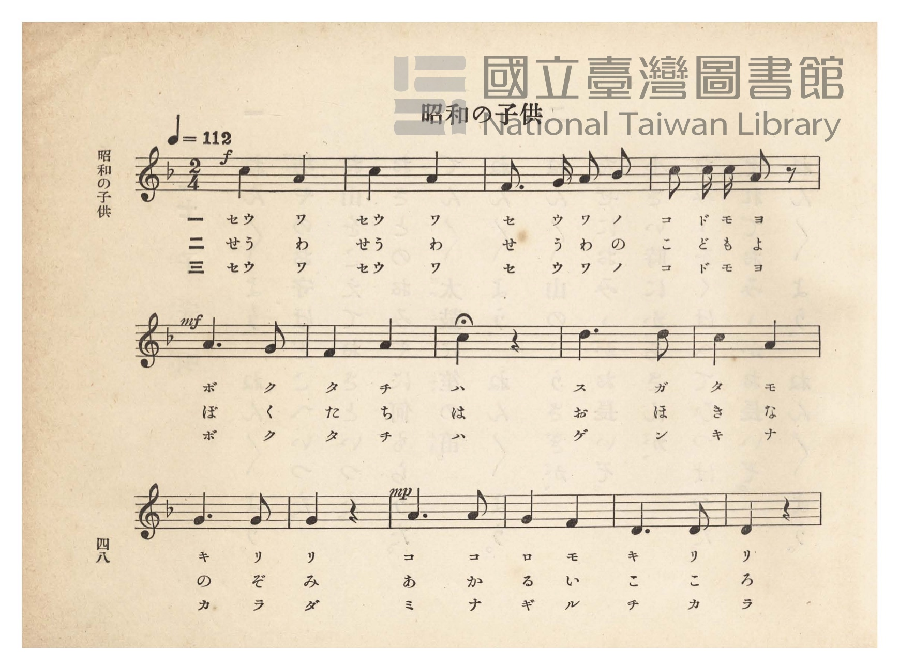
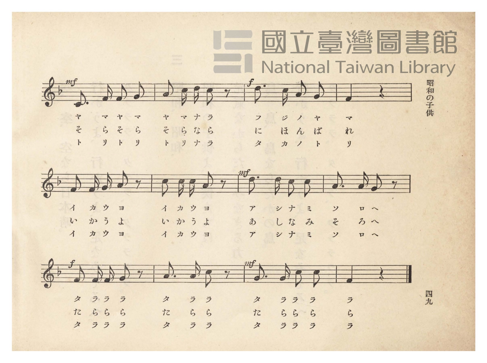
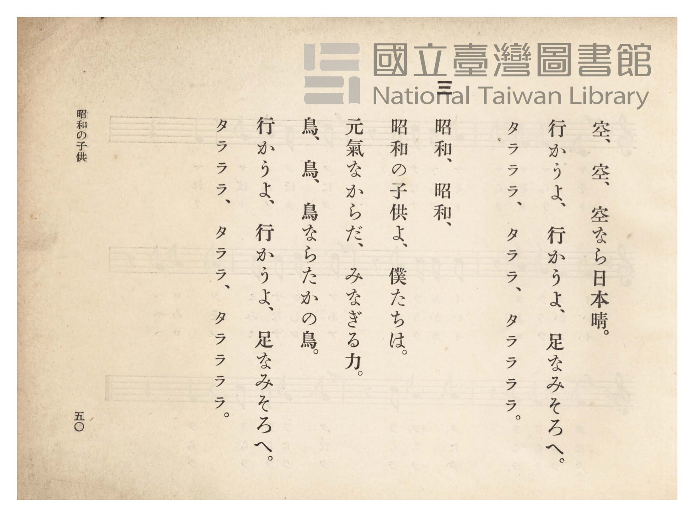
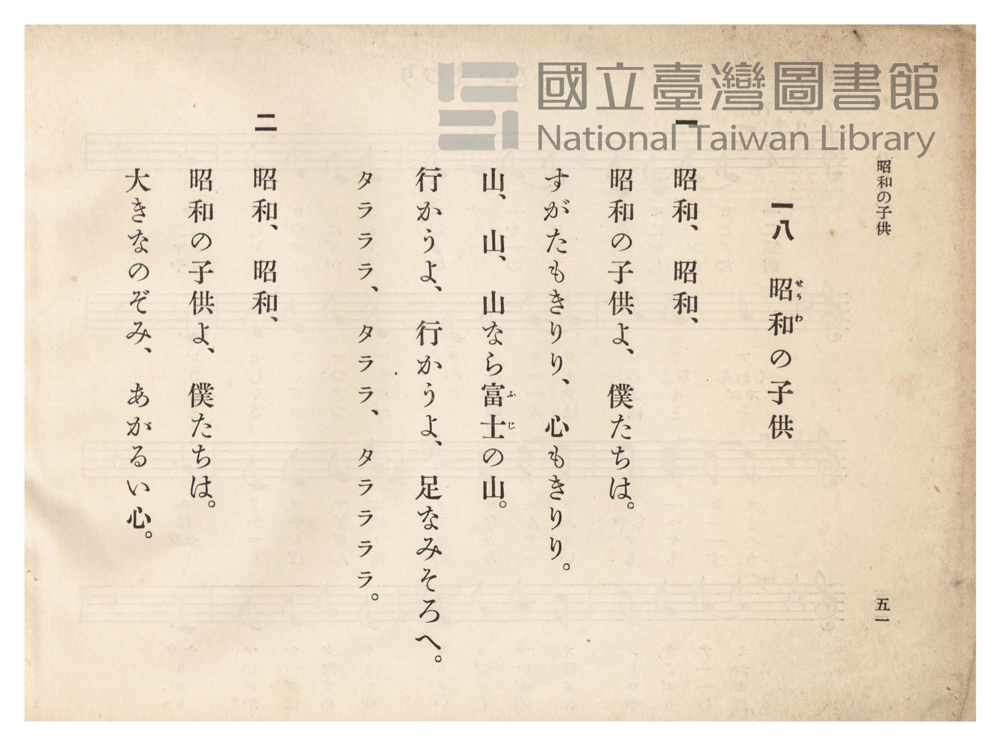

# 昭和の子供

> Re:Shōka 使用 AI 協助辨識與重建樂譜，可能會有錯誤。歡迎回報。

- **鋼琴伴奏版**：<br><audio controls src="showa_no_kodomo.mp3"></audio>
- **NEUTRINO 歌聲合成版**：<br><audio controls src="showa_no_kodomo_neutrino.mp3"></audio>

- 臺灣總督府《公學校唱歌》第四學年用（昭和十一年，索書號 0729 73）

## 說明

原書資訊與歌詞全文（對應 P053.jpg–P056.jpg，原書 pp. 48–51）：
調性與拍號：ヘ長調（F 大調）2/4 拍，速度 ♩=112


## 歌詞

```text
一
昭和、昭和、昭和の子供よ、
僕等は、
すがたもきりり、
心もきりり、
山、山、山なら富士の山。
いかうよ、いかうよ、足並（あしなみ）そろへ。
タラララ、タララ、タララララ。

二
昭和、昭和、昭和の子供よ、
僕等は、
大きな望（のぞみ）、
あかるい心、
空、空、空なら日本晴（にほんばれ）。
いかうよ、いかうよ、足並そろへ。
タラララ、タララ、タララララ。

三
昭和、昭和、昭和の子供よ、
僕等は、
元氣なからだ、
みなぎる力、
鳥、鳥、鳥ならたかの鳥。
いかうよ、いかうよ、足並そろへ。
タラララ、タララ、タララララ。
```

## ABC

```abc
X:1
T:昭和の子供
M:2/4
L:1/16
Q:1/4=112
K:F
V:V1 name="Piano" snm="Pia"
[V:V1]
!f! c4 A4 | c4 A4 | F3 G A2 B2 | c2 c c A2 z2 |
w: 1.~セウ ワ | セウ ワ | セ ウ ワ ノ | コ ド モ ヨ
w: 2.~せう わ | せう わ | せ う わ の | こ ど も よ
w: 3.~セウ ワ | セウ ワ | セ ウ ワ ノ | コ ド モ ヨ
!mf! A6 G2 | F4 A4 | c4 z4 | d6 d2 |
w: 1.~ボ ク | タ チ | ハ | ス ガ
w: 2.~ぼ く | た ち | は | お ほ
w: 3.~ボ ク | タ チ | ハ | ゲ ン
c4 A4 | G6 G2 | G4 z4 | !mp! A6 A2 |
w: 1.~タ モ | キ リ | リ | コ コ
w: 2.~き な | の ぞ | み | あ か
w: 3.~キ ナ | カ ラ | ダ | ミ ナ
G4 F4 | D6 D2 | D4 z4 | !mf! C3 F F2 G2 |
w: 1.~ロ モ | キ リ | リ | ヤ マ ヤ マ
w: 2.~る い | こ こ | ろ | そ ら そ ら
w: 3.~ギ ル | チ カ | ラ | ト リ ト リ
A2 c d c2 z2 | !f! d3 c A2 G2 | F4 z4 | F2 F G A2 z2 |
w: 1.~ヤ マ ナ ラ | フ ジ ノ ヤ | マ | イ カ ウ ヨ
w: 2.~そ ら な ら | に ほ ん ば | れ | い か う よ
w: 3.~ト リ ナ ラ | タ カ ノ ト | リ | イ カ ウ ヨ
c2 c c A2 z2 | !mf! d3 d c2 c2 | A3 A G2 z2 | !f! F2 F F G2 z2 |
w: 1.~イ カ ウ ヨ | ア シ ナ ミ | ソ ロ ヘ | タ ラ ラ ラ
w: 2.~い か う よ | あ し な み | そ ろ へ | た ら ら ら
w: 3.~イ カ ウ ヨ | ア シ ナ ミ | ソ ロ ヘ | タ ラ ラ ラ
A3 A c2 z2 | !mf! G3 G c2 c2 | F4 z4 |
w: 1.~タ ラ ラ | タ ラ ラ ラ | ラ
w: 2.~た ら ら | た ら ら ら | ら
w: 3.~タ ラ ラ | タ ラ ラ ラ | ラ
```

## TMD 檔案連結

- [主旋律 TMD 檔案](showa_no_kodomo.tmd) [[在 TMD Studio 編輯](https://tmdlang.github.io/Tmd-TS/#tmd=s7IKdvYPcrWy4qpTUCpJTLdSSM7PyUlNLsnMz7PKzk9PzM7Ojy_OyM9OVIKrKMvPKc1NtUovSkxJjTdBiBfnlxYlp1oVJ2fk5-fEl6RWlCTl52ejy8cXJKanWgUYmBojZAqK8stS8xLzgLoLijLzSlJTwNoRClLLMlNSQdLFyYl58WWpRZlpmakpSE5KLSoGuRhqRUlRYl5xclFmAcgbCFX5RSUZ-UBnF2RUWmVkFpfkF2UmJ-bEZyfmIfmuJCMV6LnkjMyclKJUJM0QcYjnkI3MTM_MsypJzCwHOiw_LS0zOTMRKK-lpfBsxtqnk3oeN657unbCk32zFbS0uBRtFQwNjbjsbRXcuGyM9E3sQOa8aN_1vHHx8x17n89d_HTXnMcNXU9b1zxdu-PZgoVPp2x8trbncUP38zVrns6eDRR8unPL8ykr3u_pgJj-tLfxyY4GoOD7PT3Ptyx6NnvHi5nzFQzMjSwVzI3f7-lU4uLS11KwpRbgUlBQeNo3H2TN5vYXK7pedLQD3fdi5bynrSueTWsHOuvpht5n7Z0KoOjVyypIf9QwGcg0AzGBLoRoVSgo0FMwsQBKmRoCnfh-zyyQsS9W7X_WsBxkYHcv0A9A0cfNM15O3Q4UBxrrpvB0yXIwsxMYbApANUDjXjbMf7prmcKjmSttQaEKMgUYGCAKGvQNjegMWGQ8buoACoK90zz1-drOx43rofzHjTMfNwIVzn_c1PS4sfdxUxcIQdXub8YmunEjkIUgG1c9bup8ur7n6eLVIPtA4k0Qk1seN3Y_bmyDWI7GfbFt85Mdy4BefdwItGE6yJRGkHcfN8593NT7uHEHzJSm_Y-bV0IR0BQ4F5kNFWmChMmuHgrDBBj2IE83rno2ZzbYheseN86DOg8WakBHdz9uAvqnBRRKENHnK3cBWQgSHDLPpi99NmfNs5nAJAs0CRhEux83TX7cuOFxUw_YPKLDigohs6OT0pBpbX62YTE4soC-B0osgAfIfrBoHzBMnnbNhoq-3LwUyEKQ4AABpTWQ59aBxenkfaAGyosDKFDQ0ufiCs7IL0_0y_fOT8nPzbcKyEzMy3eoMaipBtmkYGNopmUHZmErjRSApRsw475Y2KOgYaLwdEP_8_UNOvAiRBOLBqCFIMNqFKrTahVMFXTB0BhK12ARMQTTRmARE7gaUyAEiRiARMAm-hjWAAMSmCKXQbU-bl4PNwSfBEQMKAsRf9zcB5XZDOZ1AvEiIF4B5MUjbDMCqmicDYxYmKFN_QhD8UhAxICyEHFg2oHKTAbzVgLFm4C4A9U2Y3r5DX9M7-oBx7QpiTGdC4xqWIRCIhMRsdgiHxSpEBEzJF0gNpYEgoj85jlIqh83gTwM8up-eNA0IoKmGRYpIG_Dgmsniv41GPoXodoJTgJ7kPU0gkwFic6HiyxEmN8IixokOxu7UPSDIgwk2gsXWYVqJyghUOzPTcj6m0FJASS6Fi4CcxOh5LCjE5wczEhLDqDYh0FISoCJIOK9OrcANcmA2AiFsKQDTCAwf4EgmIMkBjcPqYCA-RLiU1DogkIJFsrIoQQKF0QoQ0OpGRFK8NRAvKlI6QaU7eE6GudBdDTC4hA5hTShqOyG2giiISItSGpBhQhCLYgHUtuL3R3gQmU1istXQl3egOmOZliahqgEpRGQfpg_HjfDTAKphaVASNiBZECiINNR3YE3fQGbzZgViwlxxY0pxA5DcFKBpDJQEjIFliKgEgRcbYCrIEgJA6lMUMslLKmneQnUr_OgbBAL4jcYDxQyEJ9CEuPj5qnQUNgBLX4hakEyIL240sdcqC5gEQ1mg1iQOIbxQGUDRBRqUyMkBkClCLBdBmZtgMZSD3abwKUJqKqBpFoIG5F-YTwMP0HLGlDMwvwEUos9zROoUqaQE8egODKENgogcYnRKICkA0j0QiIdhCHJAFSegCIbvfUAjkSQp8A1JrxWxCsDKQYeN22HZgpIRgHJ7IUG7FogngHTgRTFoIwLytCQ1gC8xscrAykMgL0MaNUAKTKQE0wvkL0D1TZwRqeH3_Bn59a1ZGVnYCxCohsU4bDIhcUiUmYGRTekgjBCim48uRmcikHpGoYx0jdBcUSJiVm2ISIaFGjgHAvFiOiElKmExeG5H0zjyMk09k8tF5eunQJKZ0EBKKDMBQA)]
- [鋼琴伴奏 TMD 檔案](showa_no_kodomo_piano.tmd) [[在 TMD Studio 編輯](https://tmdlang.github.io/Tmd-TS/#tmd=s7IKdvYPcrWy4tLSUng2Y-3TST2PG9c9XTvhyb7Z7_d0vOze83zClid7tjxd2v-8s-P9nk4FLS0uRVsFQ0MjLntbBTcuGyN9EzuuOgWlF-27njcufr5j7_O5i5_umvO4oetp65qna3c8W7Dw6ZSNz9b2PG7ofr5mzdPZs4GCT3dueT5lBdACiJVPexuf7GgACr7f0_N8y6Jns3e8mDlfwcDcyFLB3BhoqRIXV3BGfnmiX753fkp-br5VQGZiXn6Qh0ONQU01lwIQ2BiaadmBWTUK1Wm1CqYKumBoDKVrsIgYgmkjsIgJXI0pEIJEDEAiYBN9DGsUHjftfty0DKr1cfN6uCH4JCBiQFmI-OPmPqjMZjCvE4gXAfEKIC8eYZsRUEXj7MeNbTBDm_oRhuKRgIgBZSHiwGiEykwG81YCxZuAuAPVNmN6-Q0WObnA2IHFAST8EXGBLb5A8QARMUPSBWJjiVNEfDXPQVL9uAnkRpDr9sN904jwTTMsHEEuhflwJ4r-NRj6F6HaCY61Pch6GkGmgkTnw0UWIsxvhIUmkp2NXSj6QWEMEu2Fi6xCtRMUdxT7cxOy_mZQ7IFE18JFYG6CxyAowmAQEnkwEURUVecWoMYyiI1QCIttYJzCnAKCYA6SGNw8pGwIcxjEcaAAAXkMFjDIHgN5BREwUI81IzwGj0DiTUWKalDmgutonAfR0QgLduRIbUJR2Q21EURDRFqQ1IKyKkItiAdS24vdHeCsuxrF5SuhLm_AdEczLBlCVIKiFaQf5o_HzTCTQGphiQYSdiAZkCjIdFR3IGdqU4iwITh2IQkDFOumwLwKyqfg8hRcNkPyMaSURc39WCK8eQnUefOgbBAL4hwYD-QZiOMg6edx81Sow3dAyyWIWpAMSC-uKJ0L1QUsu8BsEAsSLTAeKAdCRKE2NUICDZRXHzdBytkN0IDtwW4TOM-CymBIQoOwEUkOxsPwEzRHgyID5ieQWuzJFBotoGA1hFZwkODHqOAgUQeJEUg8gTAk5kC5FhQ_6DUhONxB7gCX_vASHq8MJLM9btoOTXqQ5AiS2QsNi7VAPAOmAylWQNkDlG0gNRu89sIrA8lyjxunQ8tMSMZEjuNeIHsHqm3g7EQPvyE1UyAxBIojWHzAAh4py4BiCFJyGiHFEJ48A04roNQDwxipiKA4oijBzPSIuAH5E5wvoBgRA5DChrA4PI-BaRz5hcb-qcXauvRBbl1awBuXhvEK0YaxMAov3wSVbwD1Eooa03g8hkDi3wRiFJTCUAw10zQeahqcgSQGMcgMxDWLz41FYgHrZCDTCIcYjEbWiygN8HoE6FuYkzGksRsB0oFTP3KwgLyFEZhQQTQTsIUKiiOAca9rp4AS_dE-QFlMQSNsgsZgQWUuAA)]

## 分析

```text
================================================================================
📊 TMD Song Profile: [ 昭和の子供 ]
================================================================================
⏱  Duration:       0:28 (28.9s), 27 measures total
🎼 Key & Tempo:    首調基準 F, != 112.0 BPM, <2/4>
   - 分析範圍：      由實際發聲的音符與和弦推測調性；播放脈絡另行呈現
🎤 人聲音域:    C4 (MIDI 60) – D5 (MIDI 74) [跨度: 14 個半音 / 1.2 個八度, 難度: moderate]
   - 最低音:  C4 in [ShowaNoKodomo #1 @ m.16, 0:16]
   - 最高音: D5 in [ShowaNoKodomo #1 @ m.8, 0:07]
   - 適合: soprano, mezzo-soprano, contralto, tenor, baritone, bass
🏛  結構:      ShowaNoKodomo (28.9s)
⚡ 編曲密度:        Peak 1 軌道同時演奏
🗝  調性診斷：       A 調性不明確（純淨自然大調，未偵測到可信轉調）
   - 風格氣質:    純淨自然大調（陽光明朗、易唱易記，無明顯調外色彩）
   - 轉調歷程:    全曲維持單一推測調性（未偵測到可信轉調）
   - 核心骨幹音:  A, C, G, F, D
   - 調性數值:    A 調性不明確 [相關度: 0.74, 穩定度: Ambiguous, 自然音純度: 98.9%]
   - 候選調性 (K-S): A 小調 (0.74), F 大調 (0.73), C 大調 (0.70)
   - 五度圈歷程:   +3
   - 各段落調性細節:
     • [ShowaNoKodomo #1]: A 調性不明確 (r: 0.74, 自然音純度: 98.9%, 調外音: A#)

  [ 五度圈游移軌跡 ]
               C  
         F            G  
      Bb               D  
      Eb              [A ]*
         Ab           E  
            Db       B  
               F# 
     (* = active key center)

  [ 十二半音累積音高分佈 ]
     C  : ████████████████████      22.5%
     C# :                            0.0%
     D  : █████████████             15.4%
     D# :                            0.0%
     E  :                            0.0%
     F  : ██████████████            15.9%
     F# :                            0.0%
     G  : ███████████████           17.6%
     G# :                            0.0%
     A  : ████████████████████████  27.5%
     A# : █                          1.1%
     B  :                            0.0%
--------------------------------------------------------------------------------
Assignment 軌道音域：
  - Piano         : C4 – D5 (14 個半音 / 1.2 個八度, 71 個音符)
================================================================================
```


## 原書掃描頁










