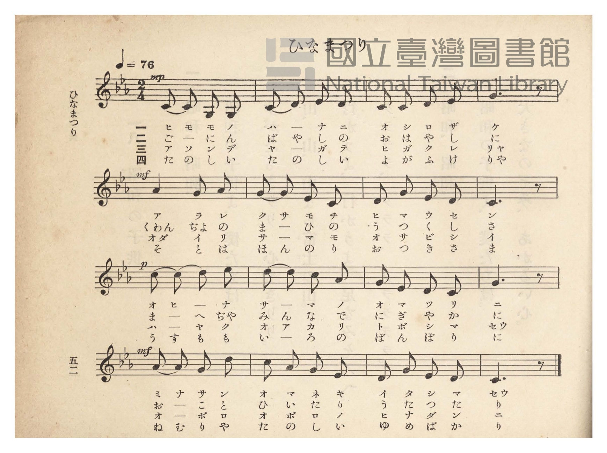
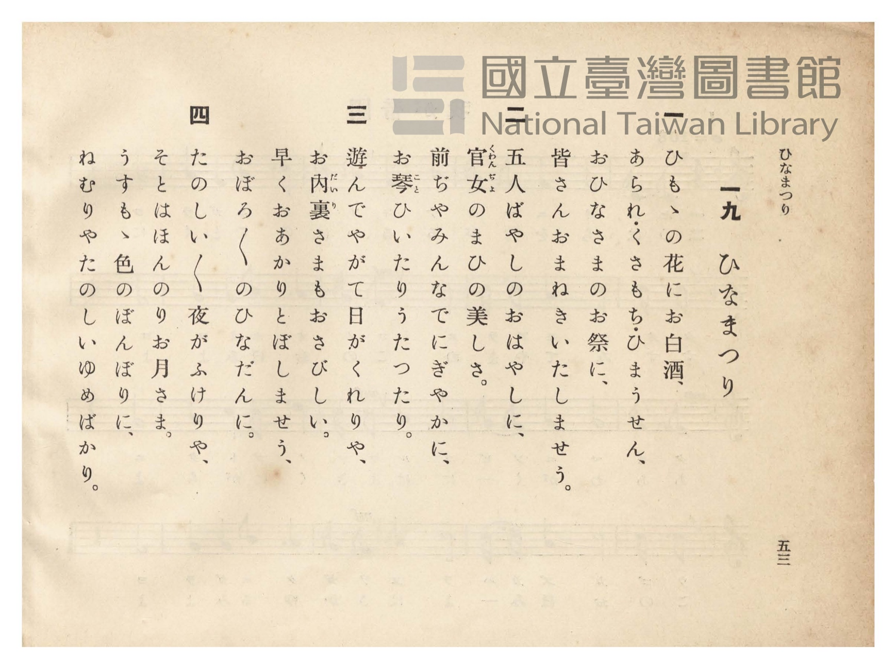

# ひなまつり

> Re:Shōka 使用 AI 協助辨識與重建樂譜，可能會有錯誤。歡迎回報。

<audio controls src="hinamatsuri.mp3"></audio>

- 臺灣總督府《公學校唱歌》第四學年用（昭和十一年，索書號 0729 73）

## 說明

原書資訊與歌詞全文（對應 P057.jpg–P058.jpg，原書 pp. 52–53）：
調性與拍號：ハ調都節音階（3 個降記號，C–D–Eb–G–Ab–C 陰音階）2/4 拍，速度 ♩=76


## 跨冊／重複收錄參照

> 同名異曲（各冊收錄之不同詞曲版本）

- **[同名異曲]** 《うたのほん》（唱歌課本）下卷（2006.006.0878）：[**〈ひな祭（女兒節／雛祭）〉**](../../../utanohon/ge_2006.006.0878/20_hinamatsuri/index.md)（`F` / `2/4` — [原始 TMD](../../../utanohon/ge_2006.006.0878/20_hinamatsuri/hinamatsuri.tmd)）
- 總表：[跨冊重複與同名歌曲總索引](../../../duplicate_songs.md)

## 歌詞

```text
一
ひもゝの花にお白酒、
あられ・くさもち・ひまうせん、
おひなさまのお祭に、
皆さんおまねきいたしませう。

二
五人ばやしのおはやしに、
官女（くわんぢよ）のまひの美しさ。
前ぢやみんなでにぎやかに、
お琴（こと）ひいたりうたつたり。

三
遊んでやがて日がくれりや、
お内裏（だいり）さまもおさびしい。
早くおあかりとぼしませう、
おぼろ／＼のひなだんに。

四
たのしい／＼夜がふけりや、
そとはほんのりお月さま。
うすもゝ色のぼんぼりに、
ねむりやたのしいゆめばかり。
```

## ABC

```abc
X:1
T:ひなまつり
M:2/4
L:1/16
Q:1/4=76
K:Eb
V:V1 name="Piano" snm="Pia"
[V:V1]
!mp! C2 C2 G,2 G,2 | C2 D2 E2 D2 | C2 C2 D2 E2 | G6 z2 |
w: 1.~ヒ モ モ ノ | ハ ー ナ ニ | オ シ ロ ザ | ケ
w: 2.~ご ー に ん | ば や し の | お は や し | に
w: 3.~ア ソ ン デ | ヤ ー ガ テ | ヒ ガ ク レ | リャ
w: 4.~た の し い | た の し い | よ が ふ け | りゃ
!mf! A4 G2 A2 | G2 G2 E2 C2 | D2 G2 E2 D2 | C6 z2 |
w: 1.~ア ラ レ | ク サ モ チ | ヒ マ ウ セ | ン
w: 2.~くわん ぢょ の | ま ー ひ の | う つ く し | さ
w: 3.~オダ イ リ | サ ー マ モ | オ サ ビ シ | イ
w: 4.~そ と は | ほ ん の り | お つ き さ | ま
!p! c2 c2 d2 e2 | d2 d2 c2 A2 | G2 E2 D2 C2 | G6 z2 |
w: 1.~オ ヒ ー ナ | サ ー マ ノ | オ マ ツ リ | ニ
w: 2.~ま ー へ ぢゃ | み ん な で | に ぎ や か | に
w: 3.~ハ ー ヤ ク | オ ア カ リ | ト ボ シ マ | セウ
w: 4.~う す ー も | も い ろ の | ぼ ん ぼ り | に
!mf! A2 A2 G2 d2 | c2 A2 G2 E2 | D2 G2 E2 D2 | C6 z2 |
w: 1.~ミ ナ サ ン | オ マ ネ キ | イ タ シ マ | セウ
w: 2.~お ー こ と | ひ い た り | う た っ た | り
w: 3.~オ ー ボ ロ | オ ボ ロ ノ | ヒ ナ ダ ン | ニ
w: 4.~ね む り や | た の し い | ゆ め ば か | り
```

## TMD 檔案連結

- [主旋律 TMD 檔案](hinamatsuri.tmd) [[在 TMD Studio 編輯](https://tmdlang.github.io/Tmd-TS/#tmd=s7IKdvYPcrWy4qpTUCpJTLdSSM7PyUlNLsnMz7PKzk9PzM7Ojy_OyM9OVIKrKMvPKc1NtUovSkxJjTdBiBfnlxYlp1oVJ2fk5-fEl6RWlCTl52ejy8cXJKanWgUYmJojZAqK8stS8xLzgLoLijLzSlJTwNoRClLLMlNSQdLFyYl58WWpRZlpmakpSE5KLSoGuRhqRUlRYl5xclFmAcgbCFX5RSUZ-UBnF2RUWmVkFpfkF2UmJ-bEZyfmIfmuJCMV6Lm01OKSzLLEHHTx5IzMnJSiVKChWloKjxs3PW5c9bhx3-PGJY-buhS0tLgUbRXMzbjsbRVck7hsjPRN7ED6X7Tvet64-PmOvc_nLn66a87jhq6nrWuert3xbMHCp1M2Plvb87ih-_maNU9nzwYKPt255fmUFe_3dDybsfbppJ6nvY1PdjQABd_v6Xm-ZdGz2TtezJyvYGBuZKlgbvx-T6cSF5e-loIttQCXgoLC0775IGs2t79Y0fWiox3ovhcr5z1tXfFsWjvQWU839D5r71QARaBeVkH6o4bJQKYFiAl0IUSrQkGBnoKpEVDKFOTE93tmgYx9sWr_s4blIAO7e4F-AIo-bu4HCr5s3vt8fcPL-ZtfzuoDmm-s8LSh--XM3hcrZoBV9TgDzXEBYtckIOEOxI4ghrPCy5kbYJo6gSGtADQWqPplw_ynu5YpPJq50hYYESB7gcEHokCR1dT0uGnu48Z1L7o2Pm5c_bix6_nMvS9bJz1uaISoAEp3Pm7qedy8-3Fj_-PGqSANjQvBXGBMA6O57XHj7MdNk-EaumBJYCpYeh3IyKVrQWZDVDyfBdQBNGYyWClQBVCu93Fjy-PG-Y8bp4NFZoNMbWiCOHVXD4Sa8mTXrseNGx43AVUClYHMfdy4HsaFmf503YynSzcDwwzk2iYgAlqz6HFTBzBAwHqApgNdt-75vj6wtqkga0DaOoFOAKoDGrYfrAfo_uXg8OgDC3YjbAD5ZwIw6QFtAKoDpkqgwUAjwe5vAjoJ6DugR5ZAuTBf7OgEUS-BbgaZvhxsaM_jxmXPpi8FM4Au7QGpB4rDrXna1vpicT_YpgUgC5q6wJaBwxUUC0DLgOzNYI8AtYE98mz6SnA8AeWAKrrBLlrxuHEPatAiomrP4yZgEgFaAlQBDB5IzC0AOxLoYYjjgZkQoh7oL6AakG0QLU-XzAE7fuvjxolojgcmKaC16x837gabtQ7skK5nc4B-Absf4lpwaM2EpMEXnaCIAbsIqAFIAjUgwnzt46YGqBVIznjc1Pa4qRGUKiBehZhKeZaHAgUtfS4uj8y8xNzEkuLSokyrgMzEvHyHGoOaapA9CjaGZlp2YBa28kYBWH4BM9qLhT0KGiYKTzf0A7O0DryQ0MSiAWgdyLAahercgloFs3gFXQhhDCdqIALmIMIQxoAKosrUKBgDSRg0AImADfcxrFF43DwJyH_cvAiJ7APrARY_YN4eMNkFJrshMk2rQLym7WCxtWD2NqjMRiSbwA6C2GQElGucgjCvcTVY12SIrsYNYF4LWGY6mFwHlQHb27geTR4kAzIBi03GIFeA_dG0F2zfZjDZDvXTEoQbmtaA2W1QGXA4QMSawPY1g9ggmVWPmxdjt8wE5JD5cAfDHA9yKF6Zpg4wrwdMbgWTE6EywHTdjGEZ_oS1q4e8hJVWq2ACtQaUQEBsSFIBYVDCASejGkhCgokhJzMcSQoc_CD4uHklckBCgrUJ7F9oUmtEDvzmeWD5ZWByN1QGFH24EhS0WIfZBiq1QfGMSD37wMZCUtwmFBlQrAOLZjAJTufwdDUVu4XgdAVMCQ0w25ogSQmUFUBSEF9BMgvYH2AfIjILRB7kVkjGAcmATMCVqubCfbUCTILCDiQOCheIn6EpC9iyQs4qEC_1gkmQV2DBQEqC2tFJVoICFVRA00HYHIgN48DWg5ggDBJGJDF4UoKmMTwlFCQAoUkEURphD3Ro2QXVAxEDlxuwiAKXYbgSFHJ62QEmgUkKlB1BkvuRQh5sfONyqAy4MGsEWQ0rpKAFJb5CCqV4BccaOH8gUgykEAObDXc8uNxongOWgRS_IC-C9AArV1DGwZWcIOl9JsLKpiaoRhANKZiA9T-YDcsjEHUQD0PYsKSG6S28CQrYaqCohAJhUAIBJSNg0YMkAqneSC2gmsEFM6ROg6YhUDGDnm7AodG0FioDiSJIIiA26MGJClJ1QhIVJDBBORokAymSICkG7CR4AEOiC1J_gOoeCBtcP2C3CVI8IWyCpBFw5YyQQYghKnlItoK4EVS2wYMCV0YBJyewGU1g9WAXQdI9_joP7KcmUIkPrfBhuQSLn2q5uHTtFJDaWwpArjIXAA)]
- [鋼琴伴奏 TMD 檔案](hinamatsuri_piano.tmd) [[在 TMD Studio 編輯](https://tmdlang.github.io/Tmd-TS/#tmd=s7IKdvYPcrWy4tLSUnjcuOlx46rHjfseNy553NT1fk_Hy-49zydsebJny9Ol_c87O97v6VTQ0uJStFUwN-Oyt1VwTeKyMdI3seOqU1B60b7reePi5zv2Pp-7-OmuOY8bup62rnm6dsezBQufTtn4bG3P44bu52vWPJ09Gyj4dOeW51NWAC14NmPt00k9T3sbn-xoAAq-39PzfMuiZ7N3vJg5X8HA3MhSwdwYaKkSF5dHZl5ibmJJcWlRplVAZmJefpCHQ41BTTWXAhDYGJpp2YFZNQrVuQW1CmbxCroQwhhO1EAEzEGEIYwBFUSVqVEwBpIwaAASARvuY1ij8Lh5EpD_uHkREtkH1vO4uR_M2wMmu8BkN0SmaRWI17QdLLYWzN4GldmIZBPYQRCbjIByjVMQ5jWuBuuaDNHVuAHMawHLTAeT66AyYHsb16PJg2RAJmCxyRjkCrA_mvaC7dsMJtuhflqCcEPTGjC7DSoDDgeIWBPYvmYQGySz6nHzYuyWmYAcMh_uYJjjQQ7FK9PUAeb1gMmtYHIiVKbrcVMzhmXwtJBWq2AClQHFKYgNiV0QBsU1OOZrIHEPE0NOGThSATjEQPBx80pkv0NCognsRGjqaEQOr-Z5YPllYHI3VAYU4rjSQP_jJiACxTvYtsZFj5tAUYOI8H1gYyGJZBOKDCiigDkZTIKTJjwpTMVuITgpACOvAWZbEyT2QakXJAXxFSR9g_0B9iEifUPkQW6FpHWQDMgEXAlhLtxXK8AkKOxA4qBwgfgZmhiaQKkakbohXuoFkyCvwIIBexoAFQdAARA2B2LDOLAOEBOEQcKIVAGPfWiywFMOQPwMjVVEnsceTtASAqoHIgbOnbCwBZcUuNIAchTvAJPAVABK9CDJ_UiBBTa-cTlUBlxkNIKshhUF0OIIX1GAUoiBAxqcpBGRDCkqwGbDHQ_Onc1zwDKQQg7kRZCe3ZC0jisFQJLoTISVTU1QjSAakv0fN0FiGpasIeogHoawYakD01vo5QAIg-IUFPPADI4kAin3SS0GmsElFqSwh0Y7KDOjRzXYA01roTKQUIXEG7GhBU4HkDoFkg4g_gflG5AMJONDIhnsJHiYQEIYUrCCCmUIG1xwYrcJUgggbIJEK7jWQsggxBC1HyQnQNwIKkHgQYErbYNTANiMJrB6sIsgSRV_ZQD2UxOoXIXWhLCEjcVPtViaDj7ITQcLeMvBLD5eIdosPjcW2F4AsoxBLKioaXysgimMgawSLGgIEkPoAbEMoJ6sUTABCptAjQTSyJoRrBqE6VitAbEQRmKzHq4Nal-NgiFECiwBtYSAG5GshopAzSDWecDA1rVTQArvaB-gbnQhI0whY0whoO1AIWUuAA)]

## 分析

```text
================================================================================
📊 TMD Song Profile: [ ひなまつり ]
================================================================================
⏱  Duration:       0:25 (25.3s), 16 measures total
🎼 Key & Tempo:    首調基準 E,, != 76.0 BPM, <2/4>
   - 分析範圍：      由實際發聲的音符與和弦推測調性；播放脈絡另行呈現
🎤 人聲音域:    G3 (MIDI 55) – D#5 (MIDI 75) [跨度: 20 個半音 / 1.7 個八度, 難度: challenging]
   - 最低音:  G3 in [Hinamatsuri #1 @ m.1, 0:00]
   - 最高音: D#5 in [Hinamatsuri #1 @ m.9, 0:13]
   - 適合: mezzo-soprano, contralto, baritone, bass
🏛  結構:      Hinamatsuri (25.3s)
⚡ 編曲密度:        Peak 1 軌道同時演奏
🗝  調性診斷：       C 小調（純淨自然小調，未偵測到可信轉調）
   - 風格氣質:    純淨自然小調（陰鬱抒情、旋律集中，無明顯調外色彩）
   - 轉調歷程:    全曲維持單一推測調性（未偵測到可信轉調）
   - 核心骨幹音:  C, G, D, D#, G#
   - 調性數值:    C 小調 [相關度: 0.83, 穩定度: High, 自然音純度: 100.0%]
   - 候選調性 (K-S): C 小調 (0.83), G 大調 (0.60), C 大調 (0.60)
   - 五度圈歷程:   +0
   - 各段落調性細節:
     • [Hinamatsuri #1]: C 小調 (r: 0.83, 自然音純度: 100.0%)

  [ 五度圈游移軌跡 ]
              [C ]*
         F            G  
      Bb               D  
      Eb               A  
         Ab           E  
            Db       B  
               F# 
     (* = active key center)

  [ 十二半音累積音高分佈 ]
     C  : ████████████████████████  28.3%
     C# :                            0.0%
     D  : █████████████████         20.0%
     D# : ███████████               13.3%
     E  :                            0.0%
     F  :                            0.0%
     F# :                            0.0%
     G  : ███████████████████████   26.7%
     G# : ██████████                11.7%
     A  :                            0.0%
     A# :                            0.0%
     B  :                            0.0%
--------------------------------------------------------------------------------
Assignment 軌道音域：
  - Piano         : G3 – D#5 (20 個半音 / 1.7 個八度, 51 個音符)
================================================================================
```


## 原書掃描頁






