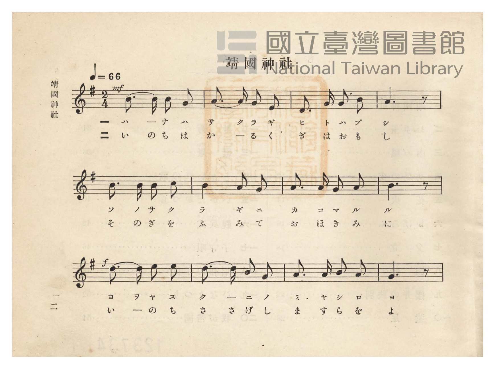
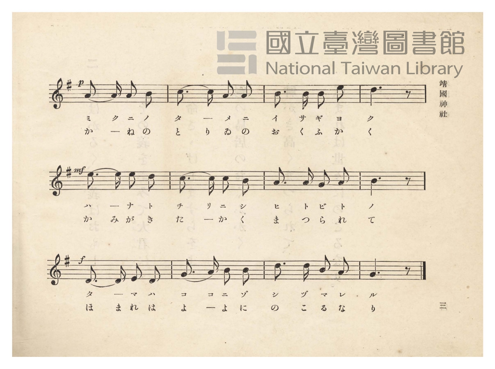
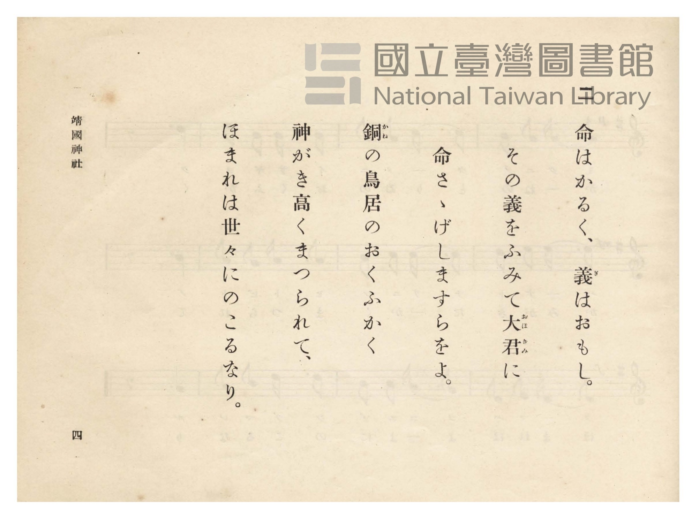
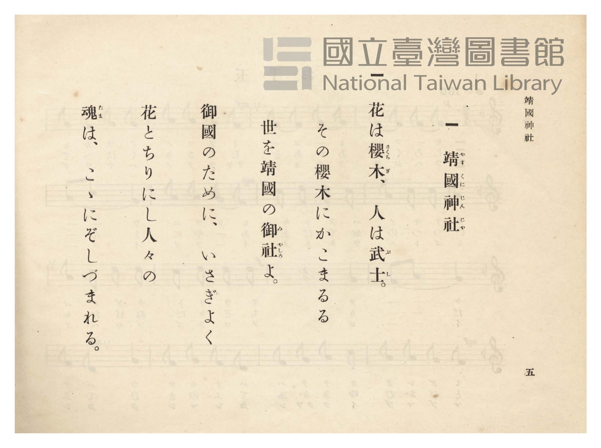

# 靖國神社

> Re:Shōka 使用 AI 協助辨識與重建樂譜，可能會有錯誤。歡迎回報。

- **NEUTRINO 歌聲合成版**：<br><audio controls src="yasukuni_jinja_neutrino.mp3"></audio>
- **鋼琴伴奏版**：<br><audio controls src="yasukuni_jinja.mp3"></audio>


- 詞：文部省（尋常小學唱歌）
- 曲：文部省（尋常小學唱歌）
- 臺灣總督府《公學校唱歌》第四學年用（昭和十一年，索書號 0729 73）

## 說明

原書資訊與歌詞全文（對應 P007.jpg–P010.jpg，原書 pp. 2–5）：
調性與拍號：ト長調（G 大調，四七抜き長音階）2/4 拍，速度 ♩=66


## 跨冊／重複收錄參照

> 同名異曲（各冊收錄之不同詞曲版本）

- **[同名異曲]** 《共益商社唱歌教科書》卷四・教師用（明治33年／1900）：[**〈靖國神社〉**](../../../kyoeki_shoka/kan_4_854865/9_yasukuni_jinja/index.md)（`C` / `6/8` — [原始 TMD](../../../kyoeki_shoka/kan_4_854865/9_yasukuni_jinja/yasukuni_jinja.tmd)）
- 總表：[跨冊重複與同名歌曲總索引](../../../duplicate_songs.md)

## 歌詞

```text
一
花は櫻木人は武士（ぶし）、
その櫻木にかこまるる
代代（よよ）靖國（やすくに）のみやしろよ。
御國（みくに）の爲（ため）にいさぎよく
花と散りにし人人（ひとびと）の
たまはここにぞしづまれる。

二
命（いのち）は輕（かる）く義（ぎ）は重（おも）し、
その義をふみて大君（おほきみ）に
命ささげしますらをよ。
銅（かね）の鳥居（とりゐ）の奧深（おくふか）く、
神垣（かみがき）高くまつられて、
ほまれは代代に殘（のこ）るなり。
```

## ABC

```abc
X:1
T:靖國神社
C:曲：文部省（尋常小學唱歌）
M:2/4
L:1/16
Q:1/4=66
K:G
V:V1 name="Piano" snm="Pia"
[V:V1]
!mf! B3 B B2 G2 | A3 A G2 E2 | D3 G G2 B2 | A6 z2 |
w: 1.~ハ _ ナ ハ | サ ク ラ ギ | ヒ ト ハ ブ | シ
w: 2.~い の ち は | か _ る く | ぎ は お も | し
B3 B B2 c2 | B4 A2 G2 | A3 A G2 A2 | B6 z2 |
w: 1.~ソ ノ サ ク | ラ ギ ニ | カ コ マ ル | ル
w: 2.~そ の ぎ を | ふ み て | お ほ き み | に
!f! d3 d e2 e2 | d3 d B2 G2 | A3 A B2 A2 | G6 z2 |
w: 1.~ヨ ヨ ヤ ス | ク _ ニ ノ | ミ ヤ シ ロ | ヨ
w: 2.~い _ の ち | さ さ げ し | ま す ら を | よ
!p! A3 A A2 B2 | c3 c A2 A2 | B3 B B2 e2 | d6 z2 |
w: 1.~ミ ク ニ ノ | タ _ メ ニ | イ サ ギ ヨ | ク
w: 2.~か _ ね の | と り ゐ の | お く ふ か | く
!mf! e3 e e2 d2 | c3 c c2 B2 | A3 A G2 A2 | B6 z2 |
w: 1.~ハ _ ナ ト | チ リ ニ シ | ヒ ト ビ ト | ノ
w: 2.~か み が き | た _ か く | ま つ ら れ | て
!f! D3 D E2 D2 | G3 A B2 B2 | d3 d B2 A2 | G6 z2 |
w: 1.~タ _ マ ハ | コ コ ニ ゾ | シ ヅ マ レ | ル
w: 2.~ほ ま れ は | よ _ よ に | の こ る な | り
```

## TMD 檔案連結

- [主旋律 TMD 檔案](yasukuni_jinja.tmd) [[在 TMD Studio 編輯](https://tmdlang.github.io/Tmd-TS/#tmd=s7IKdvYPcrWy4qpTUCpJTLdSSM7PyUlNLsnMz7PKzk9PzM7Ojy_OyM9OVIKrKMvPKc1NtUovSkxJjTdBiBfnlxYlp1oVJ2fk5-fEl6RWlCTl52ejy8cXJKanWgUYGJgjZAqK8stS8xLzgLoLijLzSlJTwNoRClLLMlNSQdLFyYl58WWpRZlpmakpSE5KLSoGuRhqRUlRYl5xclFmAcgbCFX5RSUZ-UBnF2RUWmVkFpfkF2UmJ-bEZyfmIfmuJCMV6Lnk1KLU3Py8zMQcdJnczJzMksSiSiUuLS2Fl3OnPZ3T_XzpvOdL9iloaXEp2iqYmXHZ2yq4c9kY6ZvYgfS-WDnv_Z5Zz6a1v2xe8XxO4_s9HU83dD_dsePphv6na3c8nbLx2dqe93s6wfY8m72JaLUv2nc9b1z8fMfe53MXP90153FD19PWNUBVzxYshCh83ND9fM2ap7Nng7Tu3PJ8ygqgec9mrH06qedpb-OTHQ1Awfd7ep5vWfRs9o4XM-crGJgbWSqYG4Mt4NLXUrClFuBSUFB42jcfZM3m9hcrul50tAPdBwyYp60rgJ4Fe7P3WXunAihZ6GUVpD9qmBxgYGgAYgJdCNGqUFCgp2AElDEFOhAYSiBDX6za_6xhOci47l6gD4Cij5s7Xk7dDhQHGuqu8HTJcjCzBxgKT3Y0P-ua87ixFyj_cv7ml7P6gOYAI0kBqBeo4mXD_Ke7lik8mrnSFhiFIMOBIQS2o2vj48b1z1bvfjZnxZNdu0DstcueLl4NtOBx47bHjdOBxjxuaAQpfdw493HjOojSx42rHzd2P26c_Lhx3-OmbiACm7l7MRCBtDaBEFArJAmBRVoeN8583NgP1AkysnHd48b9YMHpj5t6QeobmsABuW8hVANQGkn18w5g2gEKzn_cBEw4QBGg_UDNUx839oE0N_bDPbPi2dTFj5u6wCqmA70ERGCdm4BSjxs3A0mIiRAvzQd5oHE92CdABNQzD-SkxqVgj_WA_AZ0GNhzu3rADpy4F2wc0HKgFxaCzVr_Ys9UsCAoIMAi_c_3rQSLgKIBqOBlOzAWgNyux01NYJHpKIEKVP24adLjxq1gXy8DRuzTCbOhGhp3A2MVKA7xNdQJYJ8DEVAP0LFAH8x83NQJMgIekC-7WqFOalwL8fDLzUufboQIrgAFUNMEiPjTpcufbd8Isw0Y5EBXQH0BdSSwCHg6DxyvIOOALuwBOgkUu6tngDUA7V8Cth8ovgzuMaC7wUHYuB6SLoCuf7ZuBtgUYMhNBtkADN3GVSC3QNxMeV6EAgUtfS6uyMTi0uzSvEyvzLysRKuAzMS8fIcag5pqkE0KNoZmWnZgFraiQAFYtAAzyIuFPQoaJgrA8un5-gYdeP7VxKIBaCHIsBqF6ty0WgVjBV0gNAbThkBco2AEFjEC88ziwUKmIAokDxIDqYSpgkADkAjYUB_DGoXHzf1Q8cfNXWASxAeKN22FiDatB4qtBLPWQWSaJ0HVd0BVP26eBtWzHckesGMg9hgB5RpbILoa1wHxQjBrPURXYzfMBU0gFjDmoeJ9UB1AFzSC3dbUBJWZjmEP_iDf1UNOkCOHtgnYZogIKLyxhT-IjVCDJayb9kJDrg8avqDQhYQpKIQhYQAK5cfNoJAA6VgNFd0MFJsHlgGJgHRAZLCH9VyksAaFIjAHQ0MOEqsguf1gchlUHBS-IP5uIO6Fy4NkMO0hkLw7yUrewNRtCrbDVMEMSIIwMClDRTDTO0gEEt4gcVxpewU0vFcA8RJwOOyEhiso3CFy4DQHjBFIqM6Hii6BpubHzWuhMhCz8KVtSIiDSFD6BolPhYpOBWJQDEBSLkhmH1RmJtCeTrDLoDHU1EFaeAPraMzwtiAc3gW18LAE0ZByApTKQWkdJIKcmiF5ADlOsIc3NPTAZQZKuDaBUhMkZMF5H56-QbEC0rEVnvJB4YwcQ9jCG15iNIJiBxLqIHFofDd1AfEEFBlY-u6H5gGIGSAZWPlHbPreNYWs8AYV36AABAUjiAYFIyLAQTRyUU1kgYJReIMSD0i8ESq6ChYR4MSMXnhPRtEDKW7xBTioUABW0mBWLzT4IFEOC1BE4Q1L4KCMBEngIH0gGVCRQ0oCb11LVoCDChRITQikwFUjmAsrMCBFCCTMkYsZgoUKUlKGFMiwCnMzRBRcVEPCHBQGiGrxcXMrXM8aaJjjK8R3Q0NwHzTs4BUmvIiAsCBFNEgHKLGD-JPhVekqqA5I8ke2p5aLS9dOAaUtowAUUOYCAA)]
- [鋼琴伴奏 TMD 檔案](yasukuni_jinja_piano.tmd) [[在 TMD Studio 編輯](https://tmdlang.github.io/Tmd-TS/#tmd=s7IKdvYPcrWy4tLSUng5d9rTOd3Pl857vmTf-z0dL7v3PJ-w5cmeLU-X9j_v7Hi_p1NBS4tL0VbBzIzL3lbBncvGSN_EjqtOQenFynnv98x6Nq39ZfOK53MagXqfbuh-umPH0w39T9fueDpl47O1PUDtSiC1z2ZvIlrti_ZdzxsXP9-x9_ncxU93zXnc0PW0dQ1Q1bMFCyEKHzd0P1-z5uns2SCtO7c8n7ICaN6zGWufTup52tv4ZEcDUPD9np7nWxY9m73jxcz5CgbmRpYK5sZgC7giE4tLs0vzMr0y87ISrQIyE_PygzwcagxqqrkUgMDG0EzLDsyqUajOTatVMFbQBUJjMG0IxDUKRmARIzDPLB4sZAqiQPIgMZBKmCoINACJgA31MaxReNzcDxV_3NwFJkF8oHjTVoho03qg2Eowax1EpnkSVH0HVPXj5mlQPduR7AE7BmKPEVCusQWiq3EdEC8Es9ZDdDV2w1zQBGI9boS6oLEPqgPogkaw25qaoDLTMeyBhhJyAJmAFUNEQEGELchAbIQaLMHTtBfq2T5okIACBBIMoECBOBsUMI-bQY4H6VgNFd0MFJsHlgGJgHRAZLAHz1yk4AF5_HETKJhBMpCIAMntB5PLoOKgIAHxdwNxL1weJINpDywRAdOQKVjYVMEMSIIwMMFARTBTFUgEEkQgcVwpaAU0iFYA8RKw03dCgwIUVBA5cMwCAxESEPOhokugaeZx81qoDMQsfCkIEkggEpSKQOJToaJTgRgUaJD0AZLZB5WZCbSnE-wyaKA2deAMooJauPdBNCQDgdISKEWBRJDTDCSlIQcj9iCCehicmVCCogkUZ5DAAGcKeCoCBSRIx1Z4-gIFDXKgYgsieFZqBAUoJKBA4tAoauoC4gkoMrBU1A9NaRAzQDKwggEziEBFEcjPIJ-DaJDPEWEEopGLHSJzGkZBBIoikHgjVHQVLOzASQa9IJqMogdSdOALI1BuedzYA2b1Qn0MiSVYGCAKIlgyAiVXSDIC6QPJgPIi9jAC5TRIQQykwCUzmAvLSZC8BQkm5PxHMLchJRhI4QIrrzdDRMHFDiSYQM5GlMqPm1vhetZAgwlfgbQb6ul9UO_Cy2t43oGwIMUNSAcoSYH4k-El-SqoDkgiQ7anFmvl54Nc-VnA6z7DeIVow1gYBarhgCzT-FhguAIZZvG5IEGcikAMA6jXUJSZIGkDq8bUB2Yga8IwyATNIOz24zEHmzqooZg6kT2Mw4NQvXB3oPNJ9B9cHw4-TlOAMaxrp4ASydE-QGlMQSOwoDIXAA)]

## 分析

```text
================================================================================
📊 TMD Song Profile: [ 靖國神社 ]
================================================================================
⏱  Duration:       0:43 (43.6s), 24 measures total
🎼 Key & Tempo:    首調基準 G, != 66.0 BPM, <2/4>
   - 分析範圍：      由實際發聲的音符與和弦推測調性；播放脈絡另行呈現
🎤 人聲音域:    D4 (MIDI 62) – E5 (MIDI 76) [跨度: 14 個半音 / 1.2 個八度, 難度: moderate]
   - 最低音:  D4 in [YasukuniJinja #1 @ m.3, 0:03]
   - 最高音: E5 in [YasukuniJinja #1 @ m.9, 0:15]
   - 適合: soprano, mezzo-soprano, contralto, tenor, baritone, bass
🏛  結構:      YasukuniJinja (43.6s)
⚡ 編曲密度:        Peak 1 軌道同時演奏
🗝  調性診斷：       G 大調（純淨自然大調，未偵測到可信轉調）
   - 風格氣質:    純淨自然大調（陽光明朗、易唱易記，無明顯調外色彩）
   - 轉調歷程:    全曲維持單一推測調性（未偵測到可信轉調）
   - 核心骨幹音:  B, A, G, D, E
   - 調性數值:    G 大調 [相關度: 0.71, 穩定度: Moderate, 自然音純度: 100.0%]
   - 候選調性 (K-S): G 大調 (0.71), B 小調 (0.64), D 大調 (0.63)
   - 五度圈歷程:   +1
   - 各段落調性細節:
     • [YasukuniJinja #1]: G 大調 (r: 0.71, 自然音純度: 100.0%)

  [ 五度圈游移軌跡 ]
               C  
         F           [G ]*
      Bb               D  
      Eb               A  
         Ab           E  
            Db       B  
               F# 
     (* = active key center)

  [ 十二半音累積音高分佈 ]
     C  : ██████                     6.7%
     C# :                            0.0%
     D  : ██████████████            16.1%
     D# :                            0.0%
     E  : ████████                   8.9%
     F  :                            0.0%
     F# :                            0.0%
     G  : ██████████████            16.7%
     G# :                            0.0%
     A  : █████████████████████     23.9%
     A# :                            0.0%
     B  : ████████████████████████  27.8%
--------------------------------------------------------------------------------
Assignment 軌道音域：
  - Piano         : D4 – E5 (14 個半音 / 1.2 個八度, 77 個音符)
================================================================================
```


## 原書掃描頁










