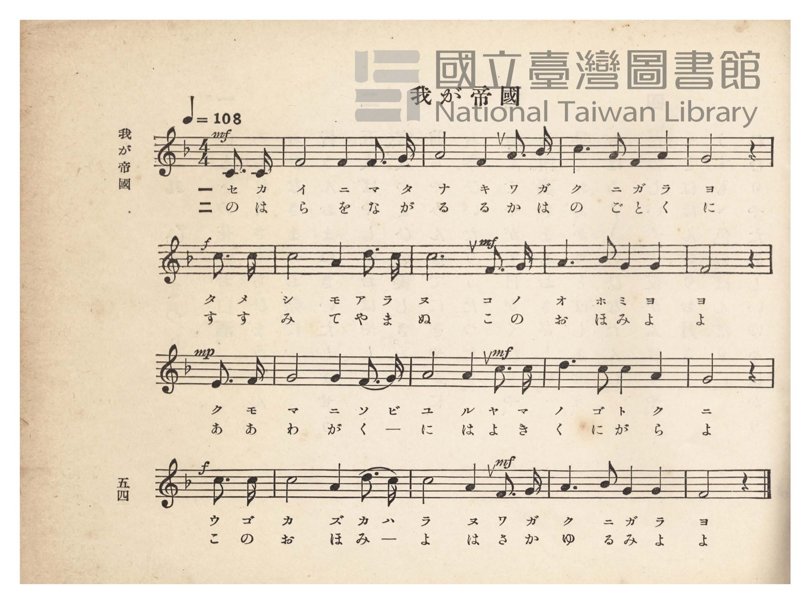
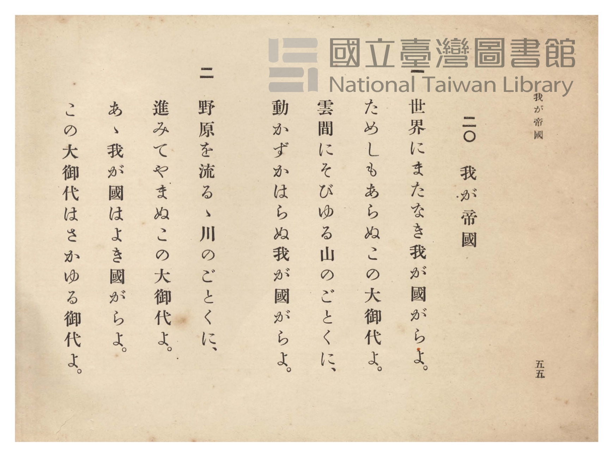

# 我が帝國

> Re:Shōka 使用 AI 協助辨識與重建樂譜，可能會有錯誤。歡迎回報。

- **鋼琴伴奏版**：<br><audio controls src="waga_teikoku.mp3"></audio>
- **NEUTRINO 歌聲合成版**：<br><audio controls src="waga_teikoku_neutrino.mp3"></audio>

- 詞：文部省讀本
- 曲：田村虎藏
- 臺灣總督府《公學校唱歌》第四學年用（昭和十一年，索書號 0729 73）

## 說明

原書資訊與歌詞全文（對應 P059.jpg–P060.jpg，原書 pp. 54–55）：
調性與拍號：ヘ長調（F 大調）4/4 拍（弱起一拍），速度 ♩=108


## 歌詞

```text
一
世界にまたなき我が國がらよ。
ためしもあらぬこの大御代よ。
雲間にそびゆる山のごとくに、
動かずかはらぬ我が國がらよ。

二
野原を流るゝ川のごとくに、
進みてやまぬこの大御代よ。
あゝ我が國はよき國がらよ。
この大御代はさかゆる御代よ。
```

## ABC

```abc
X:1
T:我が帝國
C:曲：田村虎藏
M:4/4
L:1/16
Q:1/4=108
K:F
V:V1 name="Piano" snm="Pia"
[V:V1]
!mf! z12 C3 C | F8 F4 F3 G | A8 F4 A3 c | c6 A2 F4 A4 |
w: 1.~セ カ | イ ニ マ タ | ナ キ ワ ガ | ク ニ ガ ラ
w: 2.~の は | ら を な が | る る か は | の ご と く
!f! G8 z4 c3 c | c8 A4 d3 c | !mf! c12 F3 G | A6 B2 G4 G4 |
w: 1.~ヨ タ メ | シ モ ア ラ | ヌ コ ノ | オ ホ ミ ヨ
w: 2.~に す す | み て や ま | ぬ こ の | お ほ み よ
!mp! F8 z4 E3 F | G8 G4 F3 G | !mf! A8 A4 c3 c | d6 c2 c4 A4 |
w: 1.~ヨ ク モ | マ ニ ソ ビ | ユ ル ヤ マ | ノ ゴ ト ク
w: 2.~よ あ あ | わ が く ー | に は よ き | く に が ら
!f! G8 z4 c3 c | c8 A4 d3 c | !mf! c8 A4 F3 G | A6 B2 G4 G4 |
w: 1.~ニ ウ ゴ | カ ズ カ ハ | ラ ヌ ワ ガ | ク ニ ガ ラ
w: 2.~よ こ の | お ほ み ー | よ は さ か | ゆ る み よ
F8 z8 |
w: 1.~ヨ
w: 2.~よ
```

## TMD 檔案連結

- [主旋律 TMD 檔案](waga_teikoku.tmd) [[在 TMD Studio 編輯](https://tmdlang.github.io/Tmd-TS/#tmd=s7IKdvYPcrWy4qpTUCpJTLdSSM7PyUlNLsnMz7PKzk9PzM7Ojy_OyM9OVIKrKMvPKc1NtUovSkxJjTdBiBfnlxYlp1oVJ2fk5-fEl6RWlCTl52ejy8cXJKanWgUYmFoiZAqK8stS8xLzgLoLijLzSlJTwNoRClLLMlNSQdLFyYl58WWpRZlpmakpSE5KLSoGuRhqRUlRYl5xclFmAcgbCFX5RSUZ-UBnF2RUWmVkFpfkF2UmJ-bEZyfmIfmuJCMV6Lnk1KLU3Py8zMQcZO2Z6Zl5VkDhpFJgkGBKpGZmZSL5W0tL4VnHxMeNPU93zH06p1tBS4tL0VbB0MCCy95WwY3LxkTfxA5kxouV897vmfVsWvvL5hXP5zS-WNfwbM4asOnPZm8CyjyfsuHZ3IkvZva9mN4PFn7Rvut54-LnO_Y-n7v46a45jxu6nrauebp2x7MFC59O2fhsbc_jhu7na9Y8nT0bKPh055bnU1a839PxbMbap5N6nvY2PtnRABR8v6fn-ZZFz2bveDFzvoKBuZGlgrnx-z2dSlxc-loKttQCXAoKCk_75oOs2dz-YkXXi452oPuAPn7augLoY6Cznm7ofdbeqQBKEHpZBemPGiYHGJgZgJhAF0K0KhQU6CmYmgClTE2BTgQGCcjYF6v2P2tYDjKwuxfoB6Do4-YZL6duB4oDjXVTeLpkOZjZCQxnBaAakF17Nr7Yuh3ofzAXaFDPy4b5T3ctU3g0c6UtKGJA5gKlIdS051N7Hjeufty473Hj_MeNqx439kLjc043kHzc1Pm4qeNxQxNINUhFU-PjxumPm5oeNzaB5BrXPG6c_LhxHdAdT_ctfLJ7MUL1y9mbXk4DygHNnvu4cfPjprbHTd1PN24Eqn7cOOVx44rHjf0g2YZGcPh1T33cCLRxFphcDzEbu0vADt_VA7ajvQ8Yeo-bJj3b2gg0_XHT3KfbgZZhs-Blw6bHjfsfNy573NQC9i1ul4P9NhfJcqBzOoABgzVIUM0AKm0EewTiWzSDKU9qUKCgpc_FFZ6YnhiSmpmdn11qFZCZmJfvUKNrWFMNskjBxtBMyw7MwpbQFYAZB5gCXizsUdCAJBcFQ1DqUdBWMFF4uqH_-foGHXhi1cSiH2g9yOwaBQMFXaywOjetVsE0HswGUjVA81EVwPgQ2giowhiHCoi4KVCFKZIsSBRVhS5QhRGaGTDnVYNcAzMH7HQfwxoFiPMw4eOm3VB6NdDMx01L0OWbu-GseVCV-0Eqm7swTFoLV7keKrIGbCaEh2weSAbGXwn30ePmFWhmwlwNshOieiHMT0Z4_NS4DkqvB9vfieHSSXCVq6B0D1glzK8IlXDfN0JYUDOhNsDkpoBJmOuBeRHhp8bVuPzUOBNO14AzOu70u6sHnH5JTLDIaQgEYWnHDEyipzJkCE7S2JOrCVgMwobRmEkenhhzC2oVzCFeNkRKjo-btqPpeNy8CMZqgrBASQOUKHpwOPJx02aouj5w5EGiEmbabDA5H86HRQ7-ZAZNuEC3IJIZsChFt7lxGVxHC1RkHziyYckaw62Nk6H0OrA65MzzuBGUBRG2AMtQhFvhbAy3NjbBaULJZ0cnOckHvYCB8XEXYzA-pEQEM0GpDJLeIBAkCkt15JZlsJIIKQgRpVTTXqjIZHBUwyIKoRKWHx83Q8o6kGkglX3Iqpq2gGVggY8ow0Aq0UsJRPKB2AbSjZR8mmClAdx0YGkDY0HkHjfvwVpWgEobmNkQtwCrZrBKZDMh-pBMhZd4-BMQUpLEn4CADU_6lD8oCYga5Q8MIpc8GIHctAvOgsg9bu4HRzSsaoKrhJdF1K_i0FwKLncwqlhwSQFhwSpEcMLBiGSkhNM4FUp3g1W2IasCV2-kljwIl9ZycenaKSC1zRSAXGUuAA)]
- [鋼琴伴奏 TMD 檔案](waga_teikoku_piano.tmd) [[在 TMD Studio 編輯](https://tmdlang.github.io/Tmd-TS/#tmd=s7IKdvYPcrWy4tLSUnjWMfFxY8_THXOfzul-v6fjZfee5xO2PNmz5enS_uedHe_3dCpoaXEp2ioYGlhw2dsquHHZmOib2HHVKSi9WDnv_Z5Zz6a1v2xe8XxO44t1Dc_mrFECyTybvQko83zKhmdzJ76Y2fdiej9Y-EX7rueNi5_v2Pt87uKnu-Y8buh62rrm6dodzxYsfDpl47O1PY8bup-vWfN09myg4NOdW55PWQF00bMZa59O6nna2_hkRwNQ8P2enudbFj2bvePFzPkKBuZGlgrmxkBXKnFxhSemJ4akZmbnZ5daBWQm5uUHeTjU6BrWVHMpAIGNoZmWHZhVo2CgoIsVVuem1SqYxoPZQKpGwRBNAYwPoY2AKoxxqICImwJVmCLJgkRRVegCVRihmQFzXjXINTBzwE73MaxRgDgPEz5u2g2lVwPNfNy0BF2-uRvOmgdVuR-ksrkLw6S1cJXroSJrwGZCeMjmgWRg_JVwHz1uXoFmJszVIDshqhfC_GSEx0-N66D0erD9nRgunQRXuQpK94BVwvyKUAn3fSOEBTUTagNMbgqYhLn-cWM_wk-Nq3H5qXEmnK7hgqYx5GgHQVh0m4FJ9ISBDMGpEHsKMwGLQdgwGjOVwtNPbkGtgjnElYZIKehx03Y0HY-bF8FYTRAWKDZB8diDw5GPmzZD1fWBwxsS-jDTZoPJ-XA-LDzxpwxoWgO6BZEyHjdC0guS6Y3L4DpaoCL7wPEDS4kYbm2cDKXXgdUhp_fHjaBcg7DlcVMHwq1wNoZbG5vgNDzG0bMxjI-7sIDxIeUOmAlKGJAkAoEgUVhCIbfEgOV3JF8jyoKmvVCRyeDYgYUtQiUs1T9uhpQoINNAKvuQVTVtAcvAwgtRUoBUoudFRIxDbAPpRorxJlieg5sOzNMwFkTucfMerDkSlKdhZkPc8rixF6wS2UyIPiRT4eUK_jhHSkXk53KUOKdGLodB5PyNES5Nu-AsiNzj5n5w3MDKbLhKeI6nftmP5lJw7saoe8D5EcKC1RTguMaIF6S4bpwKpbvBKtuQVYHLfVLzN8KltVjaFT4o7QoTtGaFASiu4hWiDWNhFGG-aTyQZRofC2YADYAaiKTMBIcxZvEIzcgKEIagmI3dehOIBbRyDihcwCGpa6eAFJjRPkA5dCEjsJAyFwA)]

## 分析

```text
================================================================================
📊 TMD Song Profile: [ 我が帝國 ]
================================================================================
⏱  Duration:       0:35 (35.6s), 16 measures total
🎼 Key & Tempo:    首調基準 F, != 108.0 BPM, <4/4>
   - 分析範圍：      由實際發聲的音符與和弦推測調性；播放脈絡另行呈現
🎤 人聲音域:    C4 (MIDI 60) – D5 (MIDI 74) [跨度: 14 個半音 / 1.2 個八度, 難度: moderate]
   - 最低音:  C4 in [WagaTeikoku #1 @ m.1, 0:01]
   - 最高音: D5 in [WagaTeikoku #1 @ m.6, 0:12]
   - 適合: soprano, mezzo-soprano, contralto, tenor, baritone, bass
🏛  結構:      WagaTeikoku (35.6s)
⚡ 編曲密度:        Peak 1 軌道同時演奏
🗝  調性診斷：       C 調性不明確（純淨自然大調，未偵測到可信轉調）
   - 風格氣質:    純淨自然大調（陽光明朗、易唱易記，無明顯調外色彩）
   - 轉調歷程:    全曲維持單一推測調性（未偵測到可信轉調）
   - 核心骨幹音:  C, A, F, G, D
   - 調性數值:    C 調性不明確 [相關度: 0.81, 穩定度: Ambiguous, 自然音純度: 98.3%]
   - 候選調性 (K-S): C 大調 (0.81), F 大調 (0.80), A 小調 (0.72)
   - 五度圈歷程:   +0
   - 各段落調性細節:
     • [WagaTeikoku #1]: C 大調 (r: 0.82, 自然音純度: 98.3%, 調外音: A#)

  [ 五度圈游移軌跡 ]
              [C ]*
         F            G  
      Bb               D  
      Eb               A  
         Ab           E  
            Db       B  
               F# 
     (* = active key center)

  [ 十二半音累積音高分佈 ]
     C  : ████████████████████████  27.9%
     C# :                            0.0%
     D  : ████                       5.0%
     D# :                            0.0%
     E  : █                          1.2%
     F  : ██████████████████        20.4%
     F# :                            0.0%
     G  : █████████████████         20.0%
     G# :                            0.0%
     A  : ████████████████████      23.7%
     A# : █                          1.7%
     B  :                            0.0%
--------------------------------------------------------------------------------
Assignment 軌道音域：
  - Piano         : C4 – D5 (14 個半音 / 1.2 個八度, 59 個音符)
================================================================================
```


## 原書掃描頁






