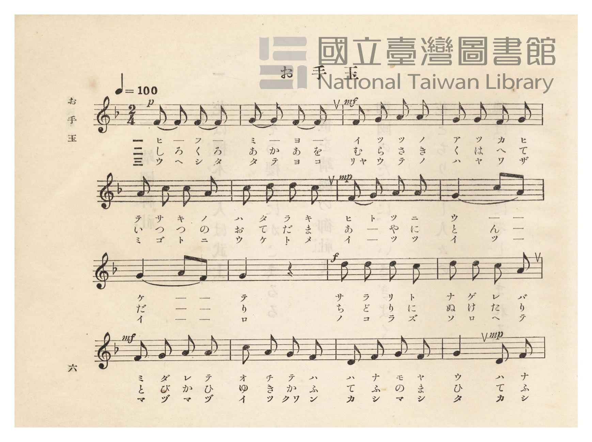
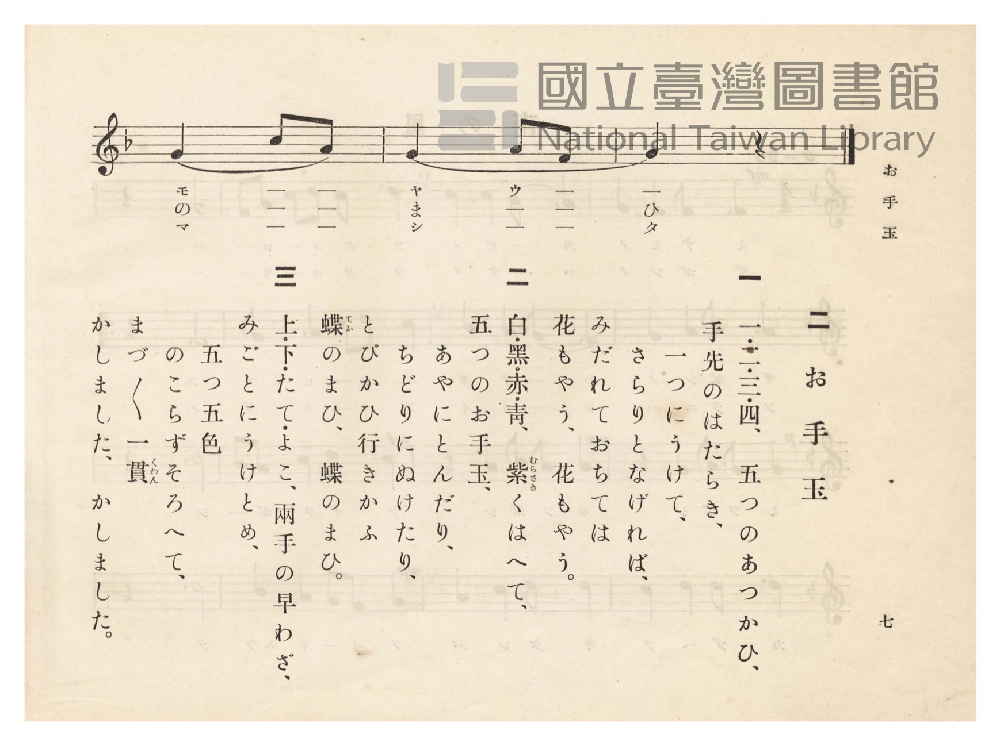

# お手玉

> Re:Shōka 使用 AI 協助辨識與重建樂譜，可能會有錯誤。歡迎回報。

<audio controls src="otedama.mp3"></audio>

- 臺灣總督府《公學校唱歌》第四學年用（昭和十一年，索書號 0729 73）

## 說明

原書資訊與歌詞全文（對應 P011.jpg–P012.jpg，原書 pp. 6–7）：
調性與拍號：ヘ長調（F 大調）2/4 拍，速度 ♩=100


## 歌詞

```text
一
ひい・ふう・みい・よ、五つのあつかひ、
手先の働き、一つにうけて、
さらりと投げれば、亂（みだ）れて落ちて、
花も樣樣（さまざま）、うたひつつ。

二
白・黑・赤・青・紫くはへて、
五つのお手玉、あやにとんだり、
千鳥（ちどり）にぬけたり、とびかひきかは、
手ふしのままに、おもしろや。

三
上下（うへした）・縱橫（たてよこ）、兩手（りゃうて）の早わざ、
みごとに受けとめ、いつついつつと、
のこらずそろへて、まづまづ一貫（いっくわん）、
かちししるしの、うつくしや。
```

## ABC

```abc
X:1
T:お手玉
M:2/4
L:1/16
Q:1/4=100
K:F
V:V1 name="Piano" snm="Pia"
[V:V1]
!p! F2 F2 F2 F2 | G2 G2 F2 F2 | !mf! F2 G2 A2 A2 | G2 G2 F2 G2 |
w: 1.~ヒ _ フ _ | ミ _ ヨ _ | イ ツ ツ ノ | ア ツ カ ヒ
w: 2.~し ろ く ろ | あ か あ を | む ら さ き | く は へ て
w: 3.~ウ ヘ シ タ | タ テ ヨ コ | リャ ウ テ ノ | ハ ヤ ワ ザ
A2 c2 c2 A2 | c2 d2 d2 c2 | !mp! F2 G2 A2 A2 | G4 c2 A2 |
w: 1.~テ サ キ ノ | ハ タ ラ キ | ヒ ト ツ ニ | ウ _ _
w: 2.~い つ つ の | お て だ ま | あ _ や に | と ん _
w: 3.~ミ ゴ ト ニ | ウ ケ ト メ | イ _ ツ ツ | イ ツ _
G4 A2 F2 | G4 z4 | !f! d2 d2 d2 c2 | d2 d2 c2 A2 |
w: 1.~ケ _ _ | テ | サ ラ リ ト | ナ ゲ レ バ
w: 2.~だ _ _ | り | ち ど り に | ぬ け た り
w: 3.~ツ _ _ | ト | ノ コ ラ ズ | ソ ロ ヘ テ
!mf! F2 G2 A2 A2 | c2 A2 G2 F2 | D2 F2 G2 F2 | !mp! G4 D2 F2 |
w: 1.~ミ ダ レ テ | オ チ テ ハ | ハ ナ モ ヤ | ウ ハ ナ
w: 2.~と び か ひ | ゆ き か は | て ふ し の | ま て ふ
w: 3.~マ ヅ マ ヅ | イ ッ クヮ ン | カ チ シ シ | タ カ チ
G4 c2 A2 | G4 A2 F2 | G4 z4 |
w: 1.~モ _ _ | ヤ ウ _ | _
w: 2.~の _ _ | ま _ _ | ひ
w: 3.~マ _ _ | シ _ _ | タ
```

## TMD 檔案連結

- [主旋律 TMD 檔案](otedama.tmd) [[在 TMD Studio 編輯](https://tmdlang.github.io/Tmd-TS/#tmd=s7IKdvYPcrWy4qpTUCpJTLdSSM7PyUlNLsnMz7PKzk9PzM7Ojy_OyM9OVIKrKMvPKc1NtUovSkxJjTdBiBfnlxYlp1oVJ2fk5-fEl6RWlCTl52ejy8cXJKanWgUYGBoiZAqK8stS8xLzgLoLijLzSlJTwNoRClLLMlNSQdLFyYl58WWpRZlpmakpSE5KLSoGuRhqRUlRYl5xclFmAcgbCFX5RSUZ-UBnF2RUWmVkFpfkF2UmJ-bEZyfmIfmuJCMV6LmCnMRKdLGUxMycyviczLRUJS4tLYXHjV3POruf93UqaGlxKdoqGBoYcNnbKrhx2Rjpm9iB9L5o3_W8cfHzHXufz138dNecxw1dT1vXPF2749mChU-nbHy2tudxQ_fzNWuezp4NFHy6c8vzKSve7-l4NmPt00k9T3sbn-xoAAq-39PzfMuiZ7N3vJg5X8HA3MhSwdz4_Z5OJS4ufS0FW2oBLgUFhad980HWbG5_saLrRUc70H0vVs572rri2bR2oLOebuh91t6pAIo4vayC9EcNk4FMIxAT6EKIVoWCAj0FM6CMOdCB7_fMAhn6YtX-Zw3LQcZ19wJ9ABR93Dzj5dTtQHGgoW4KT5csBzM7gYGmAFQDNOxlw_ynu5YpPJq50hYUpiBTgEEBoh43bnrc2PK4effjxq2PG9vAjP1QkaaOxw2NT3ZNedy45HHjuseNTWBGN0hLQyNIMzCynrZ2AOWeNvc-buwFqd7RAFa0GmRW48THjcugSh83Tn3c1Pm4qetx44pnXVMfN0563NTzuHED2IYmoLvB1i4AuhosvuzFhL2PGxci9L_o2vi4qenZisVABFYNNGLf48ZpQBKkp6ERbOF8sHeA9i953NAE8eauHhD1fOZeoI9e7p4IJF9sXQJiz50EJJ9vAbq0_3Hj-seNOxCWIfkZmiDBFjQ9bmoBe23F46bJQMeCfAPR8LS3-eXmpWB3Ad28EigBchRI6RpwKMyHKAXpbNwMDUJgeIEY6xFhCY6C6WBrgV4DotVgPV1Aj4PEm3pB9sP8taMTQnU92dENthjofaAXgNqBKaIT5LUdG5-tXA2WAgbLMlBsNk6GhNXT1pVA60BSQGc1NYP1LgO7eN2z6UDXAwNkGjzegNECDA2gw1c_7QeaDvQN0PuNYJcBQwMc1gjGCrg2oCcmg2K8cdbjxrkgt8MCGOyzpRASmFxebIK4EWjEYlBUAC1vgjoTYhAwWIBhCrQZGAJANjh8oNENtBDoVKA4OFiAqinPtVCgoKXPxeUPLDUTcxOtAjIT8_IdagxqqkF2KNhYaNmBGdhKCwVg6QPy1cIeBQ0Thacb-p-vb9CBZ3FNLBqANoEMq1GoLqhVMITCGgUjIISwqnPTQBJGCsZACJMwUqgBa_MxrFF43DxJQRdITgWSIN58MG8FhNe0BMhugeI-sMgiCK9pNVgn1BwjoEzjdKBoL5DuB9MgkSZQDEDoJqBaINkAxJ2g_AzEEDVA1Y3rgXgHEC-DmWcMUrsMaMMMIL0diPeDde8HirSBXfe4aTPYtaseNy-GKgVJgJ3YDDSyGeRwoLFN24BG4g_vXT3khLexgikQgoLUVMEMCE3BYQ2OBERY60KUIIU10JFNW4F4LbJjwf5aCRaFxMfj5g5omHeD_b0MaBIIIoc2ULYR6EkwXgcOyS5wCAKLFiDeBw1_YFw2gVSuBvNBsQrMIAiTQOEMjPHHTVugdsLse9y0ESqyEJoOQKkCkhKQ-SCTCCTnTnKCFxR2xtCkrKtgAE6N1cCUDApqSGBDaJTQBboZGk7gkNZViIemYmCIg8K3eRXYTyBZYFg1bQLSa4B4Akq4LkCY0dSFMKNxIRCD4ggUypDQBOptnAjEoPDrQglRULjA3NGBMAMY46B0C4nrXWAb9gJ5oLQATOdAFxMIS2DDhKyiAbUIAAUaqBAABmE8WBgWyuDkCxZDTrFA3zUDcy04pIAuBLoZFIqN0AzXD89wwHBpBpUNS-ApFiaOHLrAnNsIDAFwqbAJrBJoCrAkgIisB4crKA0DYwxUnkBT9j6QaVBx5HCeB8StcBpWXjUD6fWPm9cBmeBCAlxUAR0MLki2QwsSUEaAiBMsH6aAA90YOdDB7SyCCRhSPmBJykjBuwgpqYAzFTjoasBi4GSDFHjrEGrBQQJjb0JVCw0aRDLejsQG-RyitpaLS9dOAVpNKQCZylwA)]
- [鋼琴伴奏 TMD 檔案](otedama_piano.tmd) [[在 TMD Studio 編輯](https://tmdlang.github.io/Tmd-TS/#tmd=s7IKdvYPcrWy4tLSUnjc2PWss_t5X-f7PR0vu_c8n7DlyZ4tT5f2P-_seL-nU0FLi0vRVsHQwIDL3lbBjcvGSN_EjqtOQelF-67njYuf79j7fO7ip7vmPG7oetq65unaHc8WLHw6ZeOztT2PG7qfr1nzdPZsoODTnVueT1kBtODZjLVPJ_U87W18sqMBKPh-T8_zLYuezd7xYuZ8BQNzI0sFc2OgpUpcXP4lqSmJuYlWAZmJeflBHg41BjXVXApAYGOhZQdm1ChUF9QqGEJhjYIREEJY1blpIAkjBWMghEkYKdSAtfkY1ig8bp6koAskpwJJEG8-mLcCwmtaAmS3QHEfWGQRhNe0GqwTao4RUKZxOlC0F0j3g2mQSBMQd0PoJqBaINkAxJ1AkalADFEDVN24Hoh3APEymHnGILXLgDbMANLbgXg_WPd-oEgb2HWPmzaDXbvqcfNiqFKQBNiJzUAjm0EOBxrbtA1oJDSIjBVMgRAUCqYKZkBoCg4ecLghgkcXogQpeIDmNm0F4rXI5oOdshIsCgnCx80d0GDqBjt1GdAkEEQOIKBsI9BdYLwO7PkusKcfNy4A4n3QIAMGfxNI5WowHxQRj5smI0wCBQ0wkh43bYHaCbPvcdNGqMhCaNSBIhISech8kEnQEAF51xiaYHQVDMBxXg1ML6DQgYQPhEYJEKA1UK-BA0dXIR6aVoCBBAqS5lVgZ4Bkgd5r2gSk1wDxBJSgWIAwo6kLYUbjQiAGBSsoYCABANTbOBGIQV7uQgkEkFdg7uhAmAGMJFDqgETPLrANe4E8UPQBUxPQxXDvo-UNkD9BuQPo63iwMCxgwIkELIacLoAOagYmZ7DngIYCrQF5vBGaEvvhKRHolWZQplkCTxcwceQAASbpRqCjwdllE1gl0BRgFoGIrAcHBSilAAMZlNGg6WcfyDSoOHLQzAPiVjgNy8jNQHr94-Z1QCY494DzMNDB4By2HZrDQMkNIo6STCAZB0uCQQqRRUgRAk5tYN_WgMXAkYPk33UItWBfwNibUNVCfYNILNuR2CDHQtTWohWSPtgLScN4hWjDWBgFjPF4IMs0HkkEpwo4A-IwTJVQhgmQMsFrEkwEag6mG-AikAwJNREujcbH7xx0XWCzUW0xAzHM4nOJchIOR4IiQNdOARoH0T5AJchcI1SuMZirzAUA)]

## 分析

```text
================================================================================
📊 TMD Song Profile: [ お手玉 ]
================================================================================
⏱  Duration:       0:22 (22.8s), 19 measures total
🎼 Key & Tempo:    首調基準 F, != 100.0 BPM, <2/4>
   - 分析範圍：      由實際發聲的音符與和弦推測調性；播放脈絡另行呈現
🎤 人聲音域:    D4 (MIDI 62) – D5 (MIDI 74) [跨度: 12 個半音 / 1.0 個八度, 難度: easy]
   - 最低音:  D4 in [Otedama #1 @ m.15, 0:16]
   - 最高音: D5 in [Otedama #1 @ m.6, 0:06]
   - 適合: soprano, mezzo-soprano, contralto, tenor, baritone, bass
🏛  結構:      Otedama (22.8s)
⚡ 編曲密度:        Peak 1 軌道同時演奏
🗝  調性診斷：       C 調性不明確（純淨自然大調，未偵測到可信轉調）
   - 風格氣質:    純淨自然大調（陽光明朗、易唱易記，無明顯調外色彩）
   - 轉調歷程:    全曲維持單一推測調性（未偵測到可信轉調）
   - 核心骨幹音:  G, F, A, C, D
   - 調性數值:    C 調性不明確 [相關度: 0.66, 穩定度: Ambiguous, 自然音純度: 100.0%]
   - 候選調性 (K-S): C 大調 (0.66), F 大調 (0.63), G 大調 (0.59)
   - 五度圈歷程:   +0
   - 各段落調性細節:
     • [Otedama #1]: C 調性不明確 (r: 0.66, 自然音純度: 100.0%)

  [ 五度圈游移軌跡 ]
              [C ]*
         F            G  
      Bb               D  
      Eb               A  
         Ab           E  
            Db       B  
               F# 
     (* = active key center)

  [ 十二半音累積音高分佈 ]
     C  : █████████                 12.5%
     C# :                            0.0%
     D  : █████████                 12.5%
     D# :                            0.0%
     E  :                            0.0%
     F  : ████████████████          22.2%
     F# :                            0.0%
     G  : ████████████████████████  33.3%
     G# :                            0.0%
     A  : ██████████████            19.4%
     A# :                            0.0%
     B  :                            0.0%
--------------------------------------------------------------------------------
Assignment 軌道音域：
  - Piano         : D4 – D5 (12 個半音 / 1.0 個八度, 65 個音符)
================================================================================
```


## 原書掃描頁






