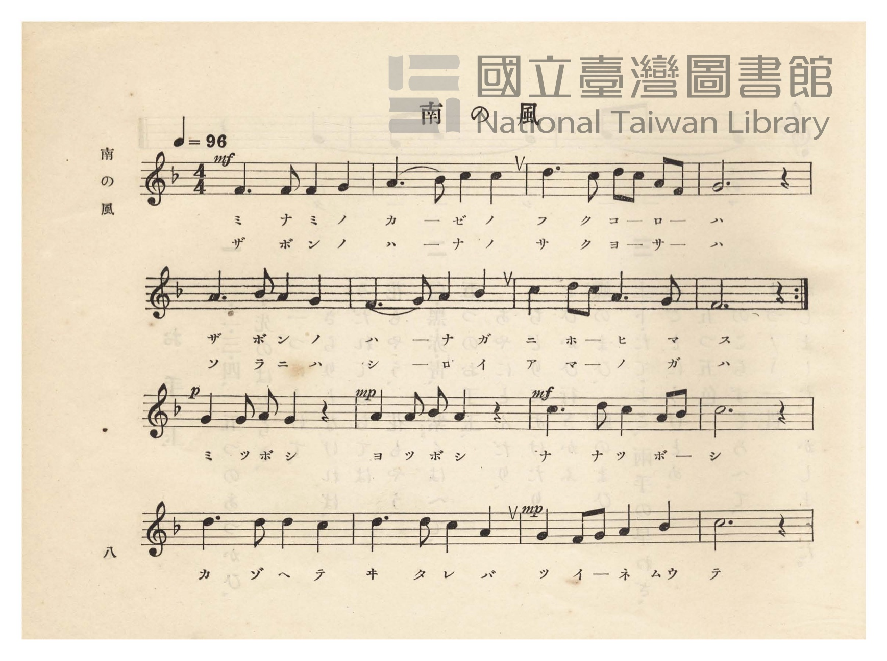
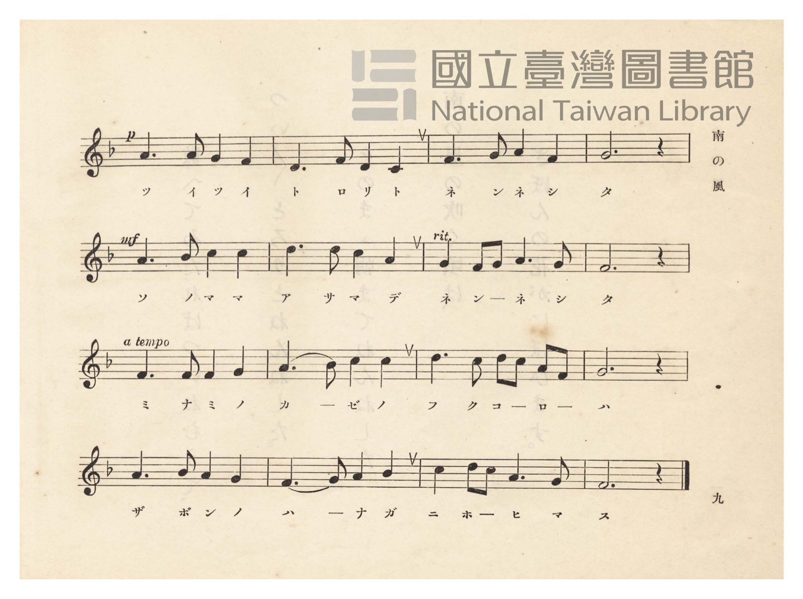
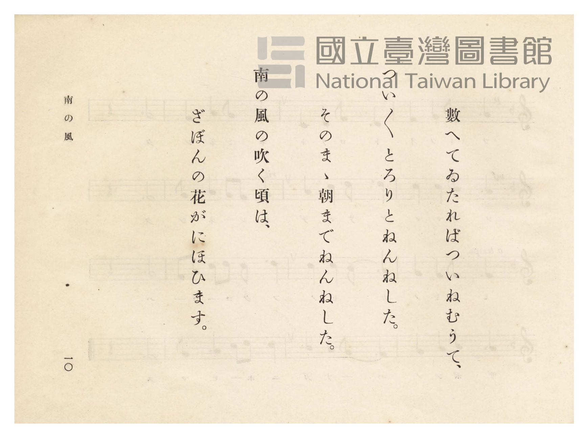
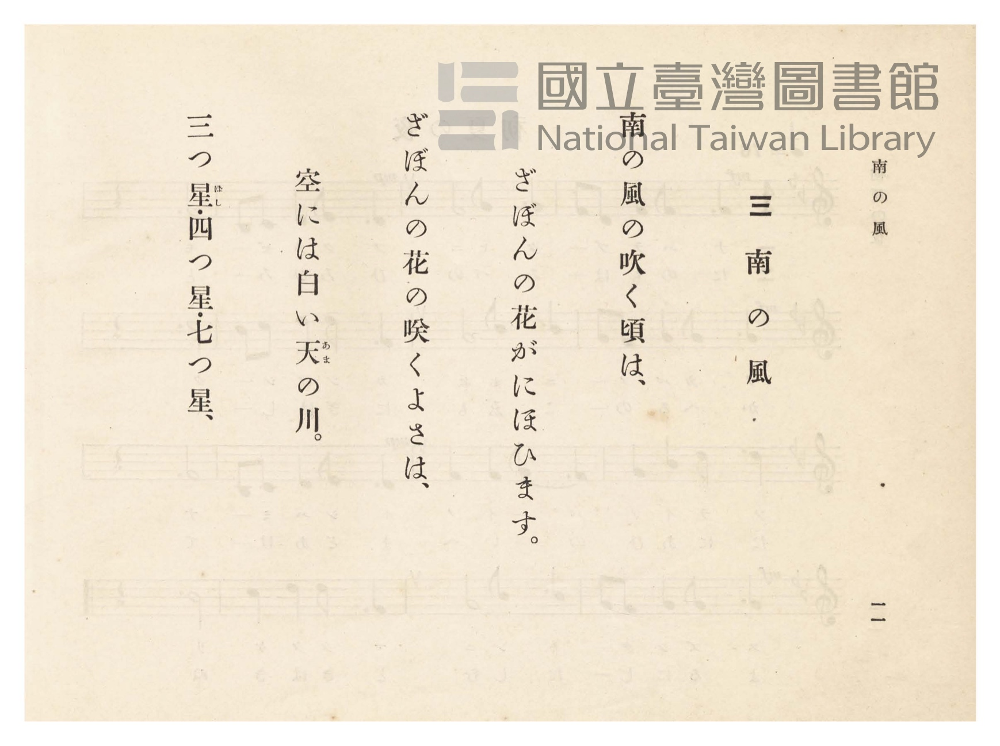

# 南の風

> Re:Shōka 使用 AI 協助辨識與重建樂譜，可能會有錯誤。歡迎回報。

- **鋼琴伴奏版**：<br><audio controls src="minami_no_kaze.mp3"></audio>
- **NEUTRINO 歌聲合成版**：<br><audio controls src="minami_no_kaze_neutrino.mp3"></audio>

- 臺灣總督府《公學校唱歌》第四學年用（昭和十一年，索書號 0729 73）

## 說明

原書資訊與歌詞全文（對應 P013.jpg–P016.jpg，原書 pp. 8–11）：
調性與拍號：ヘ長調（F 大調）4/4 拍，速度 ♩=96
譜面結構說明：第 1–8 小節（P013.jpg 第 1–2 行）末尾設有反覆記號（:||），
反覆段唱第一、二段（「南の風の…」「ざぼんの花の…」），其後接第 9–32 小節通作段
（「三つ星・四つ星…」至結尾「ざぼんの花がにほひます。」），全曲演出共 40 小節。


## 歌詞

```text
南の風の吹（ふ）く頃（ころ）は、
ざぼんの花がにほひます。

ざぼんの花の咲（さ）く夜（よ）さは、
空には白い天（あま）の川（がは）。

三つ星・四つ星・七つ星、
數（かぞ）へて來（き）たればついねむて、

ついついとろりとねんねした。
そのまま朝（あさ）までねんねした。

南の風の吹く頃は、
ざぼんの花がにほひます。
```

## ABC

```abc
X:1
T:南の風
M:4/4
L:1/16
Q:1/4=96
K:F
V:V1 name="Piano" snm="Pia"
[V:V1]
!mf! F6 F2 F4 G4 | A6 B2 c4 c4 | d6 c2 d2 c2 A2 F2 | G12 z4 |
w: ミ ナ ミ ノ | カ _ ゼ ノ | フ ク コ _ ロ _ | ハ
A6 B2 A4 G4 | F6 G2 A4 B4 | c4 d2 c2 A6 G2 | F12 z4 |
w: ザ ボ ン ノ | ハ _ ナ ガ | ニ ホ _ ヒ マ | ス
!mf! F6 F2 F4 G4 | A6 B2 c4 c4 | d6 c2 d2 c2 A2 F2 | G12 z4 |
w: ザ ボ ン ノ | ハ _ ナ ノ | サ ク ヨ _ サ _ | ハ
A6 B2 A4 G4 | F6 G2 A4 B4 | c4 d2 c2 A6 G2 | F12 z4 |
w: ソ ラ ニ ハ | シ _ ロ イ | ア マ _ ノ ガ | ハ
!p! G4 G2 A2 G4 z4 | !mp! A4 A2 B2 A4 z4 | !mf! c6 d2 c4 A2 B2 | c12 z4 |
w: ミ ツ ボ シ | ヨ ツ ボ シ | ナ ナ ツ ボ _ | シ
d6 d2 d4 c4 | d6 d2 c4 A4 | !mp! G4 F2 G2 A4 B4 | c12 z4 |
w: カ ゾ ヘ テ | キ タ レ バ | ツ イ _ ネ ム | テ
!p! A6 A2 G4 F4 | D6 F2 D4 C4 | F6 G2 A4 F4 | G12 z4 |
w: ツ イ ツ イ | ト ロ リ ト | ネ ン ネ シ | タ
!mf! A6 B2 c4 c4 | d6 d2 c4 A4 | G4 F2 G2 A6 G2 | F12 z4 |
w: ソ ノ マ マ | ア サ マ デ | ネ ン _ ネ シ | タ
!mf! F6 F2 F4 G4 | A6 B2 c4 c4 | d6 c2 d2 c2 A2 F2 | G12 z4 |
w: ミ ナ ミ ノ | カ _ ゼ ノ | フ ク コ _ ロ _ | ハ
A6 B2 A4 G4 | F6 G2 A4 B4 | c4 d2 c2 A6 G2 | F12 z4 |
w: ザ ボ ン ノ | ハ _ ナ ガ | ニ ホ _ ヒ マ | ス
```

## TMD 檔案連結

- [主旋律 TMD 檔案](minami_no_kaze.tmd) [[在 TMD Studio 編輯](https://tmdlang.github.io/Tmd-TS/#tmd=s7IKdvYPcrWy4qpTUCpJTLdSSM7PyUlNLsnMz7PKzk9PzM7Ojy_OyM9OVIKrKMvPKc1NtUovSkxJjTdBiBfnlxYlp1oVJ2fk5-fEl6RWlCTl52ejy8cXJKanWgUYGBojZAqK8stS8xLzgLoLijLzSlJTwNoRClLLMlNSQdLFyYl58WWpRZlpmakpSE5KLSoGuRhqRUlRYl5xclFmAcgbCFX5RSUZ-UBnF2RUWmVkFpfkF2UmJ-bEZyfmIfmuJCMV6Lm8xJLSolR00ZLEzPJEJAMhouWpiUBGEbI9memZeVDV8flpaZnJmYk5SlxaWgpPe6c_blz3ctEKBS0tLkVbBUszLntbBTcuGxN9EzuQAS_adz1vXPx8x97ncxc_3TXncUPX09Y1T9fueLZg4dMpG5-t7Xnc0P18zZqns2cDBZ_u3PJ8yor3ezqezVj7dFLP097GJzsagILv9_Q837Lo2ewdL2bOVzAwN7JUMDd-v6dTiYtLX0vBllqAS0FB4WnffJA1m9tfrOh60dEOdN-LlfOetq54Nq0d6KynG3qftXcqgCJbL6sg_VHDZCDTDMQEuhCiVaGgQE_BAihjaAh04fs9s0Cmvli1_1nDcpB53b1ALwBFHzfPeDl1O1AcaKqbwtMly8HMTmCoKQDVAE172TD_6a5lCo9mrrQFhinIjLVzXs5d9HzrhGfLu1-sWvVsRh_QGGDIKRgCLbNQeLqh__n6BqBpMMcpwOSMFF4s7AGa_WzO6qcb9r1YsfbZnM6n_b0vlrW9WDED7JoOq5oasGN7wEEAlnu2biswfoBmAGPgcUPjk109QBGg0scNwGiBxjmQfNSw7HFDL1DwceO0x417HjdNBgq-6NoIl4KY-7R129N9Pc_6loIcZQl0lLER1MUvG2Y92TsHaDbIaoj5T3Z0Pm5c8mzG_MfNu4HpAsKGmPaifTMwBIDewGYjUGT148bdjxs3PW7c97hx5uOGJiQHrHg2e9OzPVOetu962rpRwcQAaj9QERfY10ieejphJ8gljUD_Al3S_3JBM5g7-XETyLTHjeuBAQLSQ4wLwIZjBs7TSZvAZk6FWPF0yRwQt6kDzJ2KsOL5yl1gM9c_n7n3cWPL0yUrwdqagOaDla57un0uWARo9XqQCNRGrGEIZD_Z0QxlQ8x_NnUHWHv348Z5YAN3PG5c9mRfG1gQ4tv5j5uAhm8AagM64HHj2sdNDUA1IP0Qr0GEIeQKYBA9buoCMUAKgf5d-7gRGLBA65ogqucC3QwOnH3P5kBcDvQLJBSAgsuxaMMSO5BIITEigOooLyOgQEFLn4vLNzMvMTfTL987sQpYAWQm5uU71BjUVIMsUrCx0LIDM7AVUKCsCcxWwGwJjBEI-2Vjr4KGCTRN6sBLGE0smoFWgwyuUajOTatVMFTQBUJDMG0ExDUKxmAREwVTIAnCNQpmYBFTIG0KlDUEioBUwqABSA3YSB_DGoXHzfPBoo-bu6Dsx819YFMeN62G6njctAdZvHkqVHQ9EG8Gy6yFyvQj2RMPtgd_oOzqoTRQYL4H0ZDwgISQEVjEBCwCChVIWEBkYGqwhkfTNmh4zAFiiO9g_ob5DhRWIP-vgYp3g8Vmg8lJUBXzwCG4k8TwQE4ku3pwhIcCsPiGltoDkF6IDx94OtoKEQWll-YVYBZIhNL0QnH4UD_p7IV6fyU8UYA8CJLZDg8aUFZ53LQEKr4ILDYPHlyQZEVO0OzoBAYN6WVKQS3Y7yA_g2iwj4ApBygM8rIxNHhgwsAEBQoRSJhApCFhhK9wedzcAkku4FAA-wWWELDKgBIPrEBqAbPmoIUikWECrAjJCRNIdjAD08gZBOZneAiBAswQI7ngShyQ0vRx0z6gh2aAvdUG9RYoSYBk9gPFQGXK4-YJ0KAAex-cWB4394LJBUD-MrAcSDdJeWcKZmCYEJVAIIkfkkBAyR8YICALQRwwwxQSc8i5B6IMX7UD8hrEc8jeBMl0QGSAOeVx8yowCyQCkgEFAYi_GRYc4BQBCsL9pAXG09a1ZAUGKAPgKj-RkwdyyiC-2OiDFwUgElY8QMpLmEw7UlDAyl9osAADg4ygALYQyQ6KYdUYedq6mpyAGGoNkFouLl07BeS2bLSPYawCUEyZCwA)]
- [鋼琴伴奏 TMD 檔案](minami_no_kaze_piano.tmd) [[在 TMD Studio 編輯](https://tmdlang.github.io/Tmd-TS/#tmd=s7IKdvYPcrWy4tLSUnjaO_1x47qXi1a839PxsnvP8wlbnuzZ8nRp__POjvd7OhW0tLgUbRUszbjsbRXcuGxM9E3suOoUlF6073reuPj5jr3P5y5-umvO44aup61rnq7d8WzBwqdTNj5b2_O4ofv5mjVPZ88GCj7dueX5FJD5z2asfTqp52lv45MdDUDB93t6nm9Z9Gz2jhcz5ysYmBtZKpgbA-1U4uLyzcxLzM30y_dOrEq1CshMzMsP8nCoMaip5lIAAhsLLTswo0ahOjetVsFQQRcIDcG0ERDXKBiDRUwUTIEkCNcomIFFTIG0KVDWECgCUgmDBiA1YCN9DGsUHjfPB4s-bu6Csh8394FNedy0GqrjcdMeZPHmqVDR9UC8GSyzFirTj2RPPNgeqNthjgTREGdDPGIEFjEBi4AcD3EyRAamBquzm7ZBnT0HiCGOgDkP5giQl0DOXAMV7waLzQaTk6Aq5oE9uhOXs2kT5MS7HR4VWyGioCBvXgFmgUToHOR7oU5bCQ9MkOUgme1wZ4NSwuOmJVDxRWCxeXCvQKIDr7OrC2rBzgU5E0SDHQGMCKAwyJXGUB_BhIHxA_IExBsQaYi38CX3x80tkNAHOxxsPSxcscqA4gKWRVrArDloHsfwBiRBmIFp5CQCcybcUyA_GmJECq4ogGTJx037gG6YAXZJG9QloIAHyewHioFS_OPmCVDXg10MjpLHzb1gcgGQvwwsB9KNMxogqQISDaB0AfQDSA2IA2aYQsIHOVlBlOErbkCugbgH2WUgmQ6IDDAJPW5eBWaBREAyIFeD-JthPgCHO8jX-3G6H5QycOVT5EhADn_is0AfPFmDSFhSh-RLmEw7kuth-RzqE6D7Cbt-tKinS1Ffi60K9kGugk3gVbBhvEK0YSyMgvBN45EETIAMEyS-aTxUBYhhAPUVQh9cGsVooAFwPlYVqAYNKgehm4_sIhgXairEEBwOgrobROH2B7Lz8HgMOYDQzUGXJxA--MN1SMUXMN3r2ikgJ_1oH6AsUEyZCwA)]

## 分析

```text
================================================================================
📊 TMD Song Profile: [ 南の風 ]
================================================================================
⏱  Duration:       1:40 (100.0s), 40 measures total
🎼 Key & Tempo:    首調基準 F, != 96.0 BPM, <4/4>
   - 分析範圍：      由實際發聲的音符與和弦推測調性；播放脈絡另行呈現
🎤 人聲音域:    C4 (MIDI 60) – D5 (MIDI 74) [跨度: 14 個半音 / 1.2 個八度, 難度: moderate]
   - 最低音:  C4 in [MinamiNoKaze[L1] #1 @ m.26, 1:04]
   - 最高音: D5 in [MinamiNoKaze[L1] #1 @ m.3, 0:05]
   - 適合: soprano, mezzo-soprano, contralto, tenor, baritone, bass
🏛  結構:      MinamiNoKaze[L1] (100.0s)
⚡ 編曲密度:        Peak 1 軌道同時演奏
🗝  調性診斷：       F 大調（純淨自然大調，未偵測到可信轉調）
   - 風格氣質:    純淨自然大調（陽光明朗、易唱易記，無明顯調外色彩）
   - 轉調歷程:    全曲維持單一推測調性（未偵測到可信轉調）
   - 核心骨幹音:  A, F, G, C, D
   - 調性數值:    F 大調 [相關度: 0.85, 穩定度: High, 自然音純度: 100.0%]
   - 候選調性 (K-S): F 大調 (0.85), C 大調 (0.69), D 小調 (0.63)
   - 五度圈歷程:   -1
   - 各段落調性細節:
     • [MinamiNoKaze[L1] #1]: F 大調 (r: 0.85, 自然音純度: 100.0%)

  [ 五度圈游移軌跡 ]
               C  
        [F ]*          G  
      Bb               D  
      Eb               A  
         Ab           E  
            Db       B  
               F# 
     (* = active key center)

  [ 十二半音累積音高分佈 ]
     C  : ████████████████████      18.9%
     C# :                            0.0%
     D  : █████████████             11.8%
     D# :                            0.0%
     E  :                            0.0%
     F  : ███████████████████████   21.6%
     F# :                            0.0%
     G  : ████████████████████      19.3%
     G# :                            0.0%
     A  : ████████████████████████  22.6%
     A# : ██████                     5.7%
     B  :                            0.0%
--------------------------------------------------------------------------------
Assignment 軌道音域：
  - Piano         : C4 – D5 (14 個半音 / 1.2 個八度, 142 個音符)
================================================================================
```


## 原書掃描頁










