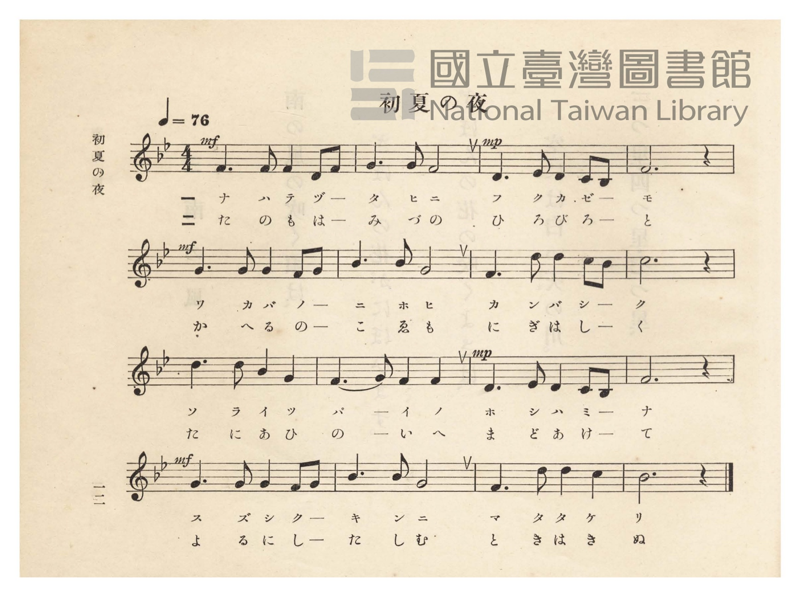
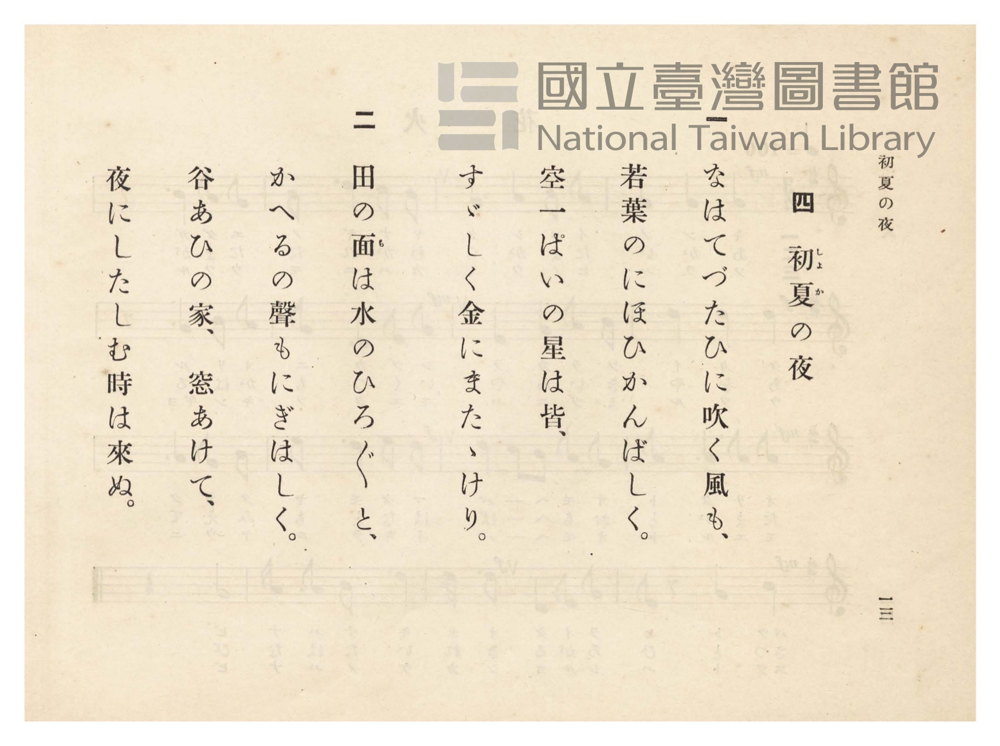

# 初夏の夜

> Re:Shōka 使用 AI 協助辨識與重建樂譜，可能會有錯誤。歡迎[回報](https://github.com/TMDLang/reshoka/issues)。

- **鋼琴伴奏版**：<br><audio controls src="shoka_no_yoru.mp3"></audio>
- **NEUTRINO 歌聲合成版**：<br><audio controls src="shoka_no_yoru_neutrino.mp3"></audio>

- 曲：山本壽
- 臺灣總督府《公學校唱歌》第四學年用（昭和十一年，索書號 0729 73）

## 說明

原書資訊與歌詞全文（對應 P017.jpg–P018.jpg，原書 pp. 12–13）：
調性與拍號：ロ變長調（Bb 大調）4/4 拍，速度 ♩=76


## 歌詞

```text
一
なはてづたひに吹く風も、
若葉（わかば）のにほひかんばしく、
空一ぱいの星はみな、
涼（すず）しく銀（ぎん）にまたたけり。

二
田の面（も）は水のひろびろと、
蛙（かへる）の聲（こゑ）もにぎはしく、
谷あひの家（いへ）窓（まど）あけて、
夜（よる）に親（した）しむ時は來ぬ。
```

## ABC

<div class="abc-score" data-abc-src="shoka_no_yoru.abc" aria-label="五線譜載入中"></div>

[下載 ABC 原始檔](shoka_no_yoru.abc)

## TMD 檔案連結

- [主旋律 TMD 檔案](shoka_no_yoru.tmd) [[在 TMD Studio 編輯](https://tmdlang.github.io/Tmd-TS/#tmd=s7IKdvYPcrWy4qpTUCpJTLdSSM7PyUlNLsnMz7PKzk9PzM7Ojy_OyM9OVIKrKMvPKc1NtUovSkxJjTdBiBfnlxYlp1oVJ2fk5-fEl6RWlCTl52ejy8cXJKanWgUYGJojZAqK8stS8xLzgLoLijLzSlJTwNoRClLLMlNSQdLFyYl58WWpRZlpmakpSE5KLSoGuRhqRUlRYl5xclFmAcgbCFX5RSUZ-UBnF2RUWmVkFpfkF2UmJ-bEZyfmIfmuJCMV6Lm8xJLSolR00eLUxOL8vPji0tzc1CJkczPTM_OsShIzgSEFCq3yxPjcxMy8nMQ8oBu1tBSedsx9uqT_ceO6p0vmKGhpcSnaKpibcdnbKjglcdmY6JvYgYx6NnvT-z2znm7c-GzOmqeL94KNf9G-63nj4uc79j6fu_jprjmPG7qetq55unbHswULn07Z-Gxtz-OG7udr1jydPRso-HTnludTVrzf0_Fsxtqnk3qe9jY-2dEAFHy_p-f5lkXPZu94MXO-goG5kaWCufH7PZ1KXFz6Wgq21AJcCgoKT_vmg6zZ3P5iRdeLjnag-16snPe0dcWzae1AZz3d0PusvVMBFPV6WQXpjxomA5kWICbQhRCtCgUFegqGRkApQ5ATgeEBMvbFqv3PGpaDDOzuBfoBKPq4ee2LdV0vp24HSgFNdkpSeLpkOZjdCQxOBaA6oJEvG-Y_3bVM4dHMlbbA0AYZBAwPEPW4cdXjxvWPG5c9blz6uHH-48ZNjxtXP52w83Fj_8tFKx43NT1uaATb2730xUSgIzoeNwEjr_tx4wag-cBYBKp-3LgbrK37cdNkoPjjxulAzVBtz1fuAlr0uHHj48YWoOpnM4A2AG3bD7IWouLZtj0gUxtnPm6cBTYSpPtlVwNYsA9oJFgQaMk-sPOAaOLjpq7HDU0QX-zqAVszBWjtupdzF4Ed2ATWsv7Zhi1gB2563NT7uHEzmFwB887smWALgB7Z8bipG-KXF43AVAcUnPy4aSJIBOh5kMV9YCcjeerFhu2PG4FyQD-ve7puG1gP0Hc7gHqerwK6F8gFOnYl2FCgsomg0IXoBKZ5sAuBCGLn6hfLVoE1AI0HRibY-00Nz2YCta1_sq_tceMakE-BOilPlFCgoKXPxRUMKsX88iPzi0qtAjIT8_IdagxqqkH2KNhYaNmBGdgyhAIwgwHj88XCHgUNE4WnG_qfr2_QgadiTSwagLaBDKtRqM5Nq1UwjVfQBUIgBWYZg-kaBTOIMJCCKtAFayioBakA8UziISyjeAVDkAa4MhA0ACkH2-JjWKPwuLkLLPq4uR-I28CsVrCBj5v2Q2UmAXE33KLHzVMh4k3rgXg1mLUHKrMIyR6QnVB7jIByjfMhuhrXAdU3gVnrIboaofY0LgXLwu1p3AS1pxfI3gxlQWRWYNiDPw529ZAdB4jABrOAQQmkaxQMwaKGMGmQs6ChbAyEwKAHytUASdzhDvI9yE-rgewJ4HDug4YiJKwfN88Ghz08PMBhDRLfDNPRtB0qAzELe7hDTWvcAVQHYkPCGCQzGeqCidAYgYU71J7GPmgcAXMZVKafxHDf0UlOuIPCDxSOoDAGhy88bGFJHkyQn-ab9kJDciWQvQTMaoGG_USoDpg4LE5mQ0W3g3MKSAaUnhH5B3-aB8ZxIyTNg9I0SAaWzoFFITR2IOL7oKJAl0F1gFwEkllGWtgDK3b6p3mQEEQV9nDfCQ3FXdC0C0m5IBlIeEDSNnJZMw-qYz-0PHrctBEqswp3uDd1QHV1Q1MzIgXDYmQ6ULYBYQ-0RHncCCprIGm-FyqzBsOeWi4uXTsFpEpBAchV5gIA)]
- [鋼琴伴奏 TMD 檔案](shoka_no_yoru_piano.tmd) [[在 TMD Studio 編輯](https://tmdlang.github.io/Tmd-TS/#tmd=s7IKdvYPcrWy4qpTUCpJTLdSSM7PyUlNLsnMz7PKzk9PzM7Ojy_OyM9OVIKrKMvPKc1NtTJBiBTnlxYlp-JSD5GNL0hMT7UKMDA01wUSFgjpgqL8stS8xDygASWJmeWJefHpQIGivPyi-PTUvNSixByE2tSyzJRUkMqCoszcxKLK-JT8ZKBb8kqQXJdaVAxyfEFmYl5-fGJRUWJeeiqqkvyikoz89KLEgoxKq4zM4pL8oszkxJz47MQ8JFeXZAB1WaWmlCYnggJDiUtLS-Fpx9ynS_ofN657umTO-z0dL7v3PJ-w5cmeLU-X9j_v7Hi_p1NBS4tL0VbB3IzL3lbBKYnLxkTfxA5k5LPZm97vmfV048Znc9Y8XbwXbM2L9l3PGxc_37H3-dzFT3fNedzQ9bR1zdO1O54tWPh0ysZna3seN3Q_X7Pm6ezZQMGnO7c8n7ICaOmzGWufTup52tv4ZEcDUPD9np7nWxY9m73jxcz5CgbmRpYK5sZAhyhxcQWDYsEvPzK_qNQqABQYQR4ONQY11VwKQGBjoWUHZtQoVOem1SqYxivoAiGQArOMwXSNghlEGEhBFeiCNRTUglSAeCbxEJZRvIIhSANcGQgagJSDbfExrFF43NwFFn3c3A_EbSBW0y6wgY-b9kNlJgFxN9yix81TIeJN64F4NZi1ByqzCMkekJ1Qe4yAco3zIboa1wHVN4FZ6yG6GqH2NM4Cy8LtadwEtacXyN4MZUFkVmDYgxxsiPABs4C-B9I1CoZgUUOYNMgkaMAYAyEwtIByNUASd1CBHAxyxmogewI4aPqgHocEz-Pm2eDggnsBHDwg8c0wHU3boTIQs7AHFdS0xh1AdSA2JFhAMpOhMh3QQIQFFdSexj5osD5unA6V6ccVVCAvg7wOChZwkMCDA5awwAT5KatpL9TzK4HsJWBWCzS4JkJ1wMRhwTgbKrodnB5BMqBUg0il-FMWMFoaISkLlHJAMrDU9LgRZDMoQCHi-6CiQJdBdYBcBJJZhiu4KEtZICGIKuxBtRPq8V3QFAJJHyAZiBcgKQg5E86D6tgPzaiPmzZCZVbhDqqmDqiubmiaQaQTWCBOB8o2IOyBZrXHjaBMCElZvVCZNRj21GIp33yQyzcTePlmGB-vEG0YH4tg1AATF5BpgiqGTZ1pPIgNJGMhTAOoF5FMgDOQTMAmRpSpxJpAG7eimwBhotkGMhYY-rp2CkgREO1jGKuALmQEFlLmAgA)]

## 分析

```text
================================================================================
📊 TMD Song Profile: [ 初夏の夜 ]
================================================================================
⏱  Duration:       0:50 (50.5s), 16 measures total
🎼 Key & Tempo:    首調基準 B,, != 76.0 BPM, <4/4>
   - 分析範圍：      由實際發聲的音符與和弦推測調性；播放脈絡另行呈現
🎤 人聲音域:    A#3 (MIDI 58) – D5 (MIDI 74) [跨度: 16 個半音 / 1.3 個八度, 難度: moderate]
   - 最低音:  A#3 in [ShokaNoYoru #1 @ m.3, 0:09]
   - 最高音: D5 in [ShokaNoYoru #1 @ m.7, 0:20]
   - 適合: soprano, mezzo-soprano, contralto, tenor, baritone, bass
🏛  結構:      ShokaNoYoru (50.5s)
⚡ 編曲密度:        Peak 1 軌道同時演奏
🗝  調性診斷：       A# 調性不明確（純淨自然大調，未偵測到可信轉調）
   - 風格氣質:    純淨自然大調（陽光明朗、易唱易記，無明顯調外色彩）
   - 轉調歷程:    全曲維持單一推測調性（未偵測到可信轉調）
   - 核心骨幹音:  F, G, D, A#, C
   - 調性數值:    A# 調性不明確 [相關度: 0.74, 穩定度: Ambiguous, 自然音純度: 100.0%]
   - 候選調性 (K-S): A# 大調 (0.74), F 大調 (0.72), G 小調 (0.64)
   - 五度圈歷程:   -2
   - 各段落調性細節:
     • [ShokaNoYoru #1]: A# 調性不明確 (r: 0.74, 自然音純度: 100.0%)

  [ 五度圈游移軌跡 ]
               C  
         F            G  
     [Bb]*              D  
      Eb               A  
         Ab           E  
            Db       B  
               F# 
     (* = active key center)

  [ 十二半音累積音高分佈 ]
     C  : ███████                    9.2%
     C# :                            0.0%
     D  : █████████████             17.5%
     D# : █                          1.7%
     E  :                            0.0%
     F  : ████████████████████████  31.7%
     F# :                            0.0%
     G  : ██████████████████        24.2%
     G# :                            0.0%
     A  :                            0.0%
     A# : ████████████              15.8%
     B  :                            0.0%
--------------------------------------------------------------------------------
Assignment 軌道音域：
  - Piano         : A#3 – D5 (16 個半音 / 1.3 個八度, 55 個音符)
================================================================================
```


## 原書掃描頁






