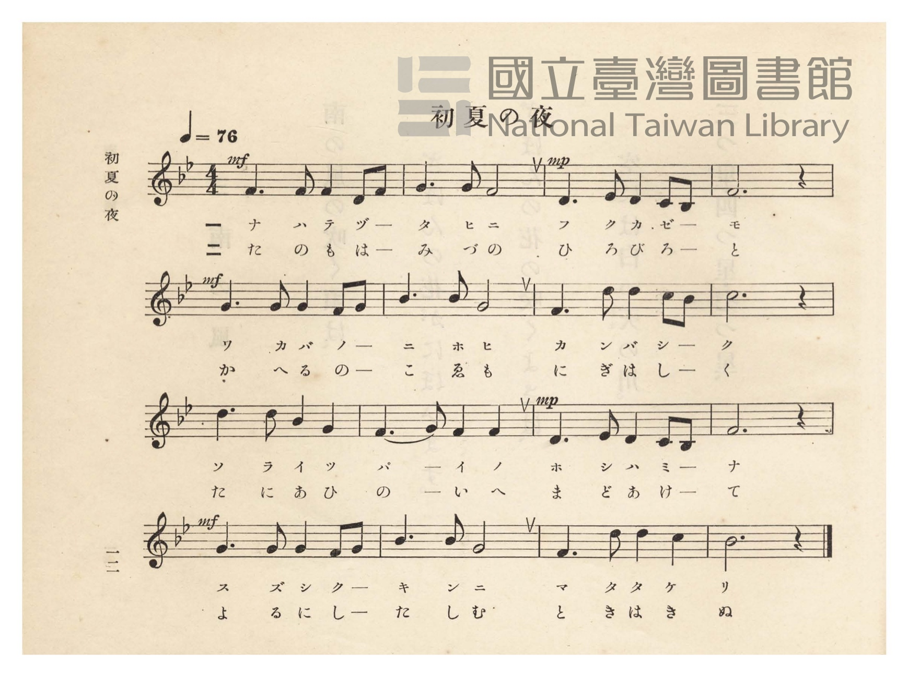
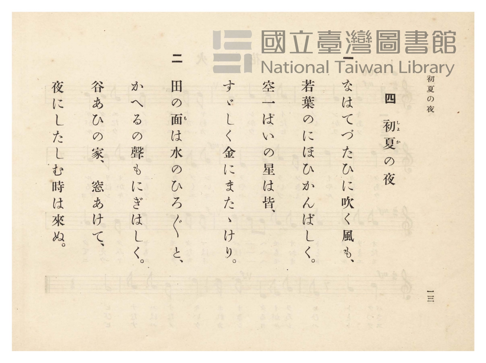

# 初夏の夜

> Re:Shōka 使用 AI 協助辨識與重建樂譜，可能會有錯誤。歡迎回報。

<audio controls src="shoka_no_yoru.mp3"></audio>

- 曲：山本壽
- 臺灣總督府《公學校唱歌》第四學年用（昭和十一年，索書號 0729 73）

## 說明

原書資訊與歌詞全文（對應 P017.jpg–P018.jpg，原書 pp. 12–13）：
調性與拍號：ロ變長調（Bb 大調）4/4 拍，速度 ♩=76


## 歌詞

```text
一
なはてづたひに吹く風も、
若葉（わかば）のにほひかんばしく、
空一ぱいの星はみな、
涼（すず）しく銀（ぎん）にまたたけり。

二
田の面（も）は水のひろびろと、
蛙（かへる）の聲（こゑ）もにぎはしく、
谷あひの家（いへ）窓（まど）あけて、
夜（よる）に親（した）しむ時は來ぬ。
```

## ABC

```abc
X:1
T:初夏の夜
C:曲：山本壽
M:4/4
L:1/16
Q:1/4=76
K:Bb
V:V1 name="Piano" snm="Pia"
[V:V1]
!mf! F6 F2 F4 D2 F2 | G6 G2 F8 | !mp! D6 E2 D4 C2 B,2 | F12 z4 |
w: 1.~ナ ハ テ ヅ _ | タ ヒ ニ | フ ク カ ゼ _ | モ
w: 2.~た の も は _ | み づ の | ひ ろ び ろ _ | と
!mf! G6 G2 G4 F2 G2 | B6 B2 G8 | F6 d2 d4 c2 B2 | c12 z4 |
w: 1.~ワ カ バ ノ _ | ニ ホ ヒ | カ ン バ シ _ | ク
w: 2.~か へ る の _ | こ ゑ も | に ぎ は し _ | く
d6 d2 B4 G4 | F6 G2 F4 F4 | !mp! D6 E2 D4 C2 B,2 | F12 z4 |
w: 1.~ソ ラ イ ツ | パ _ イ ノ | ホ シ ハ ミ _ | ナ
w: 2.~た に あ ひ | の _ い へ | ま ど あ け _ | て
!mf! G6 G2 G4 F2 G2 | B6 B2 G8 | F6 d2 d4 c4 | B12 z4 |
w: 1.~ス ズ シ ク _ | ギ ン ニ | マ タ タ ケ | リ
w: 2.~よ る に し _ | た し む | と き は き | ぬ
```

## TMD 檔案連結

- [主旋律 TMD 檔案](shoka_no_yoru.tmd) [[在 TMD Studio 編輯](https://tmdlang.github.io/Tmd-TS/#tmd=s7IKdvYPcrWy4qpTUCpJTLdSSM7PyUlNLsnMz7PKzk9PzM7Ojy_OyM9OVIKrKMvPKc1NtUovSkxJjTdBiBfnlxYlp1oVJ2fk5-fEl6RWlCTl52ejy8cXJKanWgUYGJojZAqK8stS8xLzgLoLijLzSlJTwNoRClLLMlNSQdLFyYl58WWpRZlpmakpSE5KLSoGuRhqRUlRYl5xclFmAcgbCFX5RSUZ-UBnF2RUWmVkFpfkF2UmJ-bEZyfmIfmuJCMV6Lm8xJLSolR00eLUxOL8vPji0tzc1CIlLi0thacdc58u6X_cuO7pkjkKWlpcirYK5mZc9rYKTklcNib6JnYgE57N3vR-z6ynGzc-m7Pm6eK9YFNftO963rj4-Y69z-cufrprzuOGrqeta56u3fFswcKnUzY-W9vzuKH7-Zo1T2fPBgo-3bnl-ZQV7_d0PJux9umknqe9jU92NAAF3-_peb5l0bPZO17MnK9gYG5kqWBu_H5PpxIXl76Wgi21AJeCgsLTvvkgaza3v1jR9aKjHei-FyvnPW1d8WxaO9BZTzf0PmvvVABFql5WQfqjhslApgWICXQhRKtCQYGegqERUMoQ5ERgeICMfbFq_7OG5SADu3uBfgCKPm5e-2Jd18up24FSQJOdkhSeLlkOZncCg1MBqA5o5MuG-U93LVN4NHOlLTC0QQYBwwNEPW5c9bhx_ePGZY8blz5unP-4cdPjxtVPJ-x83Nj_ctGKx01NjxsawfZ2L30xEeiIjsdNwMjrfty4AWg-MBaBqh837gZr637cNBko_rhxOlAzVNvzlbuAFj1u3Pi4sQWo-tkMoA1A2_aDrIWoeLZtD8jUxpmPG2eBjQTpftnVABbsAxoJFgRasg_sPCCa-Lip63FDE8QXu3rA1kwBWrvu5dxFYAc2gbWsf7ZhC9iBmx439T5u3AwmV8C8M3sm2AKgR3Y8buqG-OVFIzDVAQUnP26aCBIBeh5kcR_YyUieerFh--NGoBzQz-uertsG1gP03Q6gnuergO4FcoGOXQk2FKhsIih0ITqBaR7sQiCC2Ln6xbJVYA1A44GRCfZ-U8OzmUBt65_sa3vcuAbkU6BOyhMlFCho6XNxBYPKJ7_8yPyiUquAzMS8fIcag5pqkD0KNhZadmAGtgyhAMxgwPh8sbBHQcNE4emG_ufrG3TgqVgTiwagbSDDahSqc9NqFUzjFXSBEEiBWcZgukbBDCIMpKAKdMEaCmpBKkA8k3gIyyhewRCkAa4MBA1AysG2-BjWKDxu7gKLPm7uB-I2MKsVbODjpv1QmUlA3A236HHzVIh403ogXg1m7YHKLEKyB2Qn1B4joFzjfIiuxnVA9U1g1nqIrkaoPY1LwbJwexo3Qe3pBbI3Q1kQmRUY9uCPg109ZMcBIrDBLGBQAukaBUOwqCFMGuQsaCgbAyEw6IFyNUASd7iDfA_y02ogewI4nPugoQgJ68fNs8FhDw8PcFiDxDfDdDRth8pAzMIe7lDTGncA1YHYkDAGyUyGumAiNEZg4Q61p7EPGkfAXAaV6Scx3Hd0khPuoPADhSMojMHhCw9bWJIHE-Sn-aa90JBcCWQvAbNaoGE_EaoDJg6Lk9lQ0e3gnAKSAaVnRP7Bn-aBcdwISfOgNA2SgaVzYFEIjR2I-D6oKNBlUB0gF4FklpEW9sCKnf5pHiQEUYU93HdCQ3EXNO1CUi5IBhIekLSNXNbMg-rYDy2PHjdthMqswh3uTR1QXd3Q1IxIwbAYmQ6UbUDYAy1RHjeCyhpImu-FyqzBsKeWi0vXTgGpUlAAcpW5AA)]
- [鋼琴伴奏 TMD 檔案](shoka_no_yoru_piano.tmd) [[在 TMD Studio 編輯](https://tmdlang.github.io/Tmd-TS/#tmd=s7IKdvYPcrWy4tLSUnjaMffpkv7HjeueLpnzfk_Hy-49zydsebJny9Ol_c87O97v6VTQ0uJStFUwN-Oyt1VwSuKyMdE3seOqU1B6NnvT-z2znm7c-GzOmqeL9yqBxF6073reuPj5jr3P5y5-umvO44aup61rnq7d8WzBwqdTNj5b2_O4ofv5mjVPZ88GCj7dueX5lBVAS5_NWPt0Us_T3sYnOxqAgu_39DzfsujZ7B0vZs5XMDA3slQwNwY6RImLKzgjPzvRLz8yv6jUKiAzMS8_yMOhxqCmmksBCGwstOzAjBqF6ty0WgXTeAVdIARSYJYxmK5RMIMIAymoAl2whoJakAoQzyQewjKKVzAEaYArA0EDkHKwLT6GNQqPm7vAoo-b-4G4DcxqBRv4uGk_VGYSEHfDLXrcPBUi3rQeiFeDWXugMouQ7AHZCbXHCCjXOB-iq3EdUH0TmLUeoqsRak_jUrAs3J7GTVB7eoHszVAWRGYFhj3IwYYIHzAL6HsgXaNgCBY1hEmDTIIGjDEQAkMLKFcDJHEHFcjBIGesBrIngIOmD-pxSPA8bp4NDi64F8DBAxLfDNPRtB0qAzELe1BBTWvcAVQHYkOCBSQzGeqCidBAhAUV1J7GPmiwPm6cDpXpxxVUIC-DvA4KFnCQwIMDlrDABPkpq2kv1PMrgewlYFYLNLgmQnXAxGHBOBsquh2cHkEyoFSDSKX4UxYwWhohKQuUckAysNT0uBFkMyhAIeL7oKJAl0F1gFwEklmGK7goS1kgIYgq7EG1E-rxXdAUAkkfIBmIFyApCDkTzoPq2A_NqI-bNkJlVuEOqqYOqK5uaJpBpBNYIE4HyjYg7IFmtceNoEwISVm9UJk1GPbUYinffJDLNxN4-WYYH68QbRgfi2DUABMXkGmCKoZNnWk8iA0kYyFMA6gXkUyAM5BMwCZGlKnEmkAbt6KbAGGi2QYyFhj6unYKSBEQ7WMYq4AuZAQWUuYCAA)]

## 分析

```text
================================================================================
📊 TMD Song Profile: [ 初夏の夜 ]
================================================================================
⏱  Duration:       0:50 (50.5s), 16 measures total
🎼 Key & Tempo:    首調基準 B,, != 76.0 BPM, <4/4>
   - 分析範圍：      由實際發聲的音符與和弦推測調性；播放脈絡另行呈現
🎤 人聲音域:    A#3 (MIDI 58) – D5 (MIDI 74) [跨度: 16 個半音 / 1.3 個八度, 難度: moderate]
   - 最低音:  A#3 in [ShokaNoYoru #1 @ m.3, 0:09]
   - 最高音: D5 in [ShokaNoYoru #1 @ m.7, 0:20]
   - 適合: soprano, mezzo-soprano, contralto, tenor, baritone, bass
🏛  結構:      ShokaNoYoru (50.5s)
⚡ 編曲密度:        Peak 1 軌道同時演奏
🗝  調性診斷：       A# 調性不明確（純淨自然大調，未偵測到可信轉調）
   - 風格氣質:    純淨自然大調（陽光明朗、易唱易記，無明顯調外色彩）
   - 轉調歷程:    全曲維持單一推測調性（未偵測到可信轉調）
   - 核心骨幹音:  F, G, D, A#, C
   - 調性數值:    A# 調性不明確 [相關度: 0.74, 穩定度: Ambiguous, 自然音純度: 100.0%]
   - 候選調性 (K-S): A# 大調 (0.74), F 大調 (0.72), G 小調 (0.64)
   - 五度圈歷程:   -2
   - 各段落調性細節:
     • [ShokaNoYoru #1]: A# 調性不明確 (r: 0.74, 自然音純度: 100.0%)

  [ 五度圈游移軌跡 ]
               C  
         F            G  
     [Bb]*              D  
      Eb               A  
         Ab           E  
            Db       B  
               F# 
     (* = active key center)

  [ 十二半音累積音高分佈 ]
     C  : ███████                    9.2%
     C# :                            0.0%
     D  : █████████████             17.5%
     D# : █                          1.7%
     E  :                            0.0%
     F  : ████████████████████████  31.7%
     F# :                            0.0%
     G  : ██████████████████        24.2%
     G# :                            0.0%
     A  :                            0.0%
     A# : ████████████              15.8%
     B  :                            0.0%
--------------------------------------------------------------------------------
Assignment 軌道音域：
  - Piano         : A#3 – D5 (16 個半音 / 1.3 個八度, 55 個音符)
================================================================================
```


## 原書掃描頁






