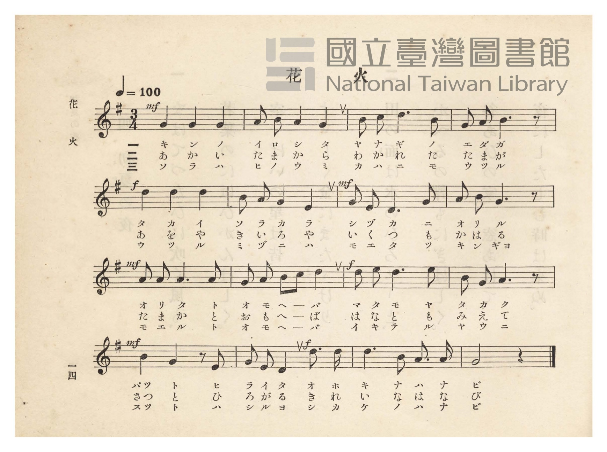
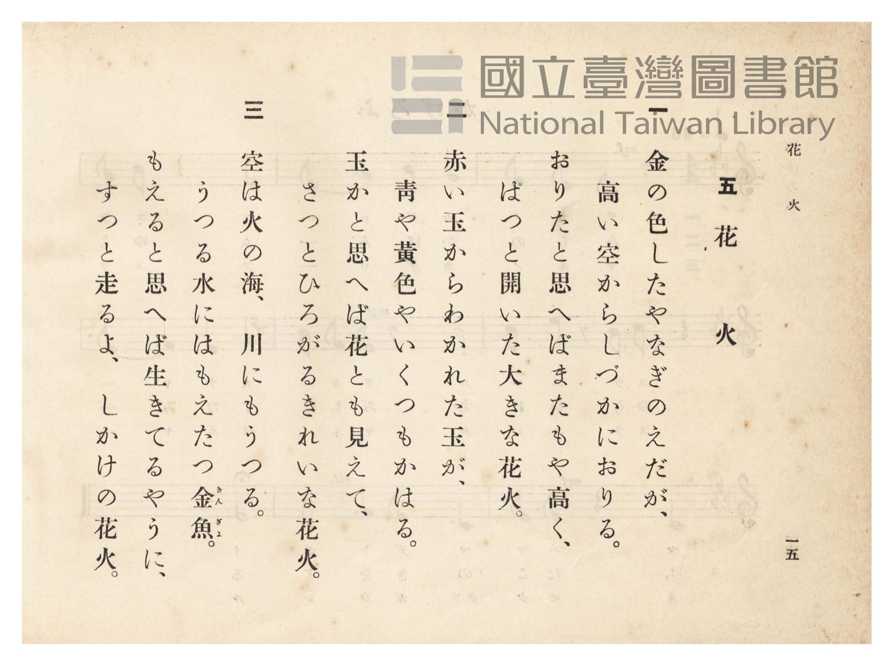

# 花火

> Re:Shōka 使用 AI 協助辨識與重建樂譜，可能會有錯誤。歡迎回報。

- **鋼琴伴奏版**：<br><audio controls src="hanabi.mp3"></audio>
- **NEUTRINO 歌聲合成版**：<br><audio controls src="hanabi_neutrino.mp3"></audio>

- 臺灣總督府《公學校唱歌》第四學年用（昭和十一年，索書號 0729 73）

## 說明

原書資訊與歌詞全文（對應 P019.jpg–P020.jpg，原書 pp. 14–15）：
調性與拍號：ト長調（G 大調）3/4 拍，速度 ♩=100


## 歌詞

```text
一
金（きん）の色（いろ）した柳（やなぎ）の枝（えだ）が、
高い空から靜（しづ）かに下（お）りる。
下りたと思へばまたもや高く、
ぱつと開（ひら）いた大（おほ）きな花火。

二
赤い玉からわかれた玉が、
青や黃色やいくつも變（かは）る。
玉かと思へば花とも見えて、
さつとひろがるきれいな花火。

三
空は火の海、川にもうつる。
うつる水にはもえたつ金魚（きんぎょ）。
もえると思へば生きてるやうに、
すつとはしるよおほきな花火。
```

## ABC

```abc
X:1
T:花火
M:3/4
L:1/16
Q:1/4=100
K:G
V:V1 name="Piano" snm="Pia"
[V:V1]
!mf! G4 G4 G4 | A2 B2 A4 G4 | B2 c2 d6 B2 | G2 A2 B6 z2 |
w: 1.~キ ン ノ | イ ロ シ タ | ヤ ナ ギ ノ | エ ダ ガ
w: 2.~あ か い | た ま か ら | わ か れ た | た ま が
w: 3.~ソ ラ ハ | ヒ ノ ウ ミ | カ ハ ニ モ | ウ ツ ル
!f! d4 d4 d4 | B2 A2 G4 E4 | !mf! G2 E2 D6 G2 | A2 B2 G6 z2 |
w: 1.~タ カ イ | ソ ラ カ ラ | シ ヅ カ ニ | オ リ ル
w: 2.~あ を や | き い ろ や | い く つ も | か は る
w: 3.~ウ ツ ル | ミ ヅ ニ ハ | モ エ タ ツ | キ ン ギョ
!mf! A2 A2 A6 A2 | G2 A2 B2 c2 d4 | !f! d2 e2 d6 e2 | B2 G2 A6 z2 |
w: 1.~オ リ タ ト | オ モ ヘ _ バ | マ タ モ ヤ | タ カ ク
w: 2.~た ま か と | お も へ _ ば | は な と も | み え て
w: 3.~モ エ ル ト | オ モ ヘ _ バ | イ キ テ ル | ヤ ウ ニ
!mf! B4 G4 z2 E2 | !f! G2 E2 D4 d3 d | d6 B2 A3 A | G8 z4 |
w: 1.~パッ ト ヒ | ラ イ タ オ ホ | キ ナ ハ ナ | ビ
w: 2.~さっ と ひ | ろ が る き れ | い な は な | び
w: 3.~スッ ト ハ | シ ル ヨ オ ホ | キ ナ ハ ナ | ビ
```

## TMD 檔案連結

- [主旋律 TMD 檔案](hanabi.tmd) [[在 TMD Studio 編輯](https://tmdlang.github.io/Tmd-TS/#tmd=s7IKdvYPcrWy4qpTUCpJTLdSSM7PyUlNLsnMz7PKzk9PzM7Ojy_OyM9OVIKrKMvPKc1NtUovSkxJjTdBiBfnlxYlp1oVJ2fk5-fEl6RWlCTl52ejy8cXJKanWgUYGFoiZAqK8stS8xLzgLoLijLzSlJTwNoRClLLMlNSQdLFyYl58WWpRZlpmakpSE5KLSoGuRhqRUlRYl5xclFmAcgbCFX5RSUZ-UBnF2RUWmVkFpfkF2UmJ-bEZyfmIfmuJCMV6LmCnMRKdLHi1MTi_Lz44tLc3NQiZFMz0zPzrHLz85JKgSGlxKWlpfCia-PzxtUKWlpcirYKhgYGXPa2Cu5cNsb6JnYgfS_adz1vXPx8x97ncxc_3TXncUPX09Y1T9fueLZg4dMpG5-t7Xnc0P18zZqns2cDBZ_u3PJ8yor3ezqezVj7dFLP097GJzsagILv9_Q837Lo2ewdL2bOVzAwN7JUMDd-v6dTiYtLX0vBllqAS0FB4WnffJA1m9tfrOh60dEOdN-LlfOetq54Nq0d6KynG3qftXcqgGJUL6sg_VHD5AADIwMQE-hCiFaFggI9BUMToJShKdCJ7_fMAhn7YtX-Zw3LQQZ29wL9ABR93Nzxcup2oDjQWHeFp0uWg5mdwGBTAKoBGveyYf7TXcsUHs1caQsKVZApwMAAUS_bJwI1PW7sfdw0GajlceO6F52bwCItj5uAWoEi0x83zn82fzNIsKnlceOqx419EJXP5s0FqwSiBWARYPg3gg1dPQOo__nKXY8bux83db6cOwesDmjQUrC67seNq5_s6AYLdoFEmroeN3U_bmiCOAyopwto5-PGFc8a5j5u3PG4ccPjxn0gkaYmoBPApvdDrXrcuPFx4xKg0pfTIOZtAloItgTo1PnAoIBY8rhxN1iwF-h-SCID2Qa2blcPOFC3Ag1ped4Hdl0T0EX9YEYP0BCwINxrcyeBnLC7GRhM4OAAIqDSJUCnvVgH9AvQMqDv1oM9BfMR1FQk7wCdAOSC9CwDigP1LIN7ZyrEO2CPAF3bAzIGFDtAl4ACH83xOzrBFoBCej1IHBgpW7cDzXq6HWjTalB4NbaBXQdzC5z_bMMWkIrG9WBFQCcAw3sJMDW8XDsLniCAMf24CZhWO2GaIUpBLkL45fkUoE6gS5eBxEEhArQA6ECod2bCvLMeFP8gFdDoQI8LoGrKcx0UKGjpc3F5AIunpEyrgMzEvHyHGoOaapAVCjYWWnZgBrbMrgAsPID54sXCHgUNE4WnG_qfr2_QgedQTSwagBaBDKtRqM5Nq1UwVNCF4xoFIwVjIIbxjBVMFEyBLF0gqwYoBpIF8QwUasBG-BjWAMN3LVDkcfNmMNkH1ve4aQmQvRZIbweJNu2HiDaDRLuA_HVgU0CqQWpXAFkNQHoNWDQeZrYRUK6xCaSusRtMtkBMaZwPxPtgok2dUBv7wSLANAcxG6gKWS1EFG62MUjHXrAbVoLJfqgLJ4Fd9bhpGVh0PtTs1WAVj5tBNoLEF4FFlwFZLUC8Gm42_kja1UNWJAHjCBQHMAyKFSNw_JjFg7nQWATyTEECoLiDxCNIDXpcgWIC5B8QuQTqu73gUICKgsMDJLodyG6FioLEu8Giq4AsEEb4GS2umiaBSVhc9YLjDVgqoIgCRRpB8QVyAUi8CSwKjL3G9UAeJJRR4woSHyD9ELtBcQWMW5ALwbGCiMFFkBQF9ilEDySNglIoMOU9bl5OZHTt6CQ7TxmBIcgaI3i-geQkWHyaQfOVGTg-QSow4woa1nCfdMBjAOjH5hlgsQlQX88DqwPJQNQuAasFioDSbtN6LLGFnItA-WUFOA5AubMJSO8Ai22AxhcwVhqB9gLVIMcX0PTGDiAGxQ1afMFiAZpO8LodVFaA46cNqnY1rKwA5zBEasAbXcD2E-nRZWNoBi1ZoREHKd4gxR8kQuDZDJ7joLlMF54zQfmyBsqCQJAxyPGPkIEZCoJIcd088XFzM1QYFFgQFsgiUJEEiWJwQQXOtLAkAWKtguqZDU3mCGtARS0sY0B4IFMmozkG5hnkpAGszhfDDIHGOdQxjZsgjoHkZ3CpCsuvID5IFCTSA83lSI4Bph8QCUmJIB5IBajOwOMYcM7fiTtkoFkeUsmAk9rjZphzqRkytVxcunYKkLpZAchS5gIA)]
- [鋼琴伴奏 TMD 檔案](hanabi_piano.tmd) [[在 TMD Studio 編輯](https://tmdlang.github.io/Tmd-TS/#tmd=s7IKdvYPcrWy4tLSUnjRtfF54-r3ezpedu95PmHLkz1bni7tf97Z8X5Pp4KWFpeirYKhgQGXva2CO5eNsb6JHVedgtKL9l3PGxc_37H3-dzFT3fNedzQ9bR1zdO1O54tWPh0ysZna3seN3Q_X7Pm6ezZQMGnO7c8n7ICaMGzGWufTup52tv4ZEcDUPD9np7nWxY9m73jxcz5CgbmRpYK5sZAS5W4uDwS8xKTMq0CMhPz8oM8HGoMaqq5FIDAxkLLDsyoUajOTatVMFTQheMaBSMFYyCG8YwVTBRMgSxdIKsGKAaSBfEMFGrARvgY1ig8bloLFHncvBlM9oH1PW5aAmSvBdLbQaJN-yGizSDRLiB_HdgUkGqQ2hVAVgOQXgMWjYeZbQSUa2wCqWvsBpMtEFMa5wPxPphoUyfUxn6wyOOmHojZQFXIaiGicLONQTr2gt2wEkz2Q104Ceyqx03LwKLzoWavBqt43AyyESS-CCy6DMhqAeLVcLNh4QoMVlCwwTAoII3AQWoWD-ZCAx7IMwUJgIIbEvQgNejBCwo8kBNA5BKog_aCHQ4VBXsBJLodyG6FioLEu8Giq4AsEEY4Ey14myaBSVjw9oKD-nFTL4ooUKQRFMQgF4DEm8CiwABvXA_kQQIGNXghQQjSD7EbFLzA6AC5EByQiEBfBEkEYJ9C9ECSFShRARPL4-blGCEMCkAjMATJGMFTJyS9wqLADJp6zcBRAFKBGbzQ4IFb3gEPNKCzmmeAxSZAHToPrA4kA1G7BKwWKAJKIU3rsQQwcloFpcoV4GAD5YEmIL0DLLYBGsTAgGwE2gtUgxzEQNMbO4AYFJxoQQwLOGjU4nU7KEeCg7QNqnY1LEeC0zEiAiGFhKEZaikByfeQcgEShvDEDE_X0LSsC0__oNRfA2VBIMgY5ChDyMAMBUGk6Gme-Li5GSoM8h-EBbIIlFchsQLOweCsAYtFEGsVVM9saGJCWAMqg2DJD8IDmTIZzTEwzyDH5tTHjYthhkCjCeqYxk0Qx0ByDbi4geUKEB8kChLpgeYlJMcAoxxEQhIPiAdSASpM8TgGnL924g4ZaMaClL7g1PG4GeZcaoZMLWo144NczZjAE5BhvEK0YSwYA1NDPJBnGg_joshBObD8iV022iw-F7dBCL0IeRABUYDGNcFwFIbVZkAZ7GaBnILCA-kFBoiunQIkTKJ9gIJIPCMUnjGYp8wFAA)]

## 分析

```text
================================================================================
📊 TMD Song Profile: [ 花火 ]
================================================================================
⏱  Duration:       0:28 (28.8s), 16 measures total
🎼 Key & Tempo:    首調基準 G, != 100.0 BPM, <3/4>
   - 分析範圍：      由實際發聲的音符與和弦推測調性；播放脈絡另行呈現
🎤 人聲音域:    D4 (MIDI 62) – E5 (MIDI 76) [跨度: 14 個半音 / 1.2 個八度, 難度: moderate]
   - 最低音:  D4 in [Hanabi #1 @ m.7, 0:11]
   - 最高音: E5 in [Hanabi #1 @ m.11, 0:18]
   - 適合: soprano, mezzo-soprano, contralto, tenor, baritone, bass
🏛  結構:      Hanabi (28.8s)
⚡ 編曲密度:        Peak 1 軌道同時演奏
🗝  調性診斷：       G 大調（純淨自然大調，未偵測到可信轉調）
   - 風格氣質:    純淨自然大調（陽光明朗、易唱易記，無明顯調外色彩）
   - 轉調歷程:    全曲維持單一推測調性（未偵測到可信轉調）
   - 核心骨幹音:  D, G, A, B, E
   - 調性數值:    G 大調 [相關度: 0.88, 穩定度: Moderate, 自然音純度: 100.0%]
   - 候選調性 (K-S): G 大調 (0.88), D 大調 (0.80), B 小調 (0.54)
   - 五度圈歷程:   +1
   - 各段落調性細節:
     • [Hanabi #1]: G 大調 (r: 0.88, 自然音純度: 100.0%)

  [ 五度圈游移軌跡 ]
               C  
         F           [G ]*
      Bb               D  
      Eb               A  
         Ab           E  
            Db       B  
               F# 
     (* = active key center)

  [ 十二半音累積音高分佈 ]
     C  : ██                         2.2%
     C# :                            0.0%
     D  : ████████████████████████  27.8%
     D# :                            0.0%
     E  : ███████                    7.8%
     F  :                            0.0%
     F# :                            0.0%
     G  : ████████████████████████  27.8%
     G# :                            0.0%
     A  : █████████████████         20.0%
     A# :                            0.0%
     B  : ████████████              14.4%
--------------------------------------------------------------------------------
Assignment 軌道音域：
  - Piano         : D4 – E5 (14 個半音 / 1.2 個八度, 57 個音符)
================================================================================
```


## 原書掃描頁






